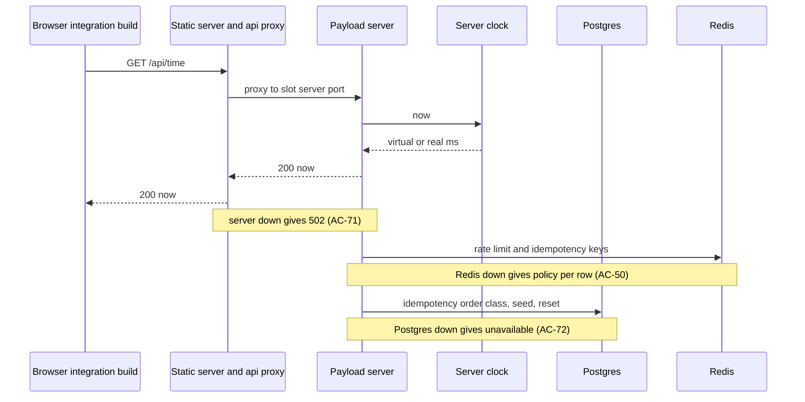

# Spec: Каркас сервера
Spec ID: SPEC-02
Status: approved
Supersedes: none

## Problem and user

Після SPEC-01 у `web/` є робочий простір і словник шва, але немає сервера: `server/` відсутній, `pnpm-workspace.yaml` його не містить, запис `verify` для `server` — заглушка `TODO-until-created` (`.claude/sdd-engineering.json:23-28`), а сайт бере `/api/time` лише з функції Cloudflare (`functions/api/time.ts:1-9`). Кожна наступна хвиля бекенду (SPEC-03 … SPEC-23) потребує того самого: Payload 3 + Postgres, Redis, Centrifugo, Mailpit, модель помилок, перевірку входу, тестові дверцята, годинник, сид, ліміти, ідемпотентність. Якщо кожна будуватиме це сама, хвилі конфліктуватимуть у тих самих файлах, а дві одночасні хвилі на одній машині (16 ГБ, `docs/backend/sdd-routing.md` §7) затиратимуть одна одній базу, ключі й листи. Користувачі цієї специфікації — оркестратор і агенти наступних хвиль; власник лише запускає Docker Desktop і не має побачити жодної зміни на сайті й у демо.

## Goals / Non-goals

**Goals**
- `server/` на Payload 3.91.0 (усі `@payloadcms/*` — точно 3.91.0) і Next 16.4.1 / React 19.3.0 сайту; Postgres у схемі `public`, лише міграції (режим push вимкнено).
- Стенд Docker однією командою: Postgres 5433, Redis, Centrifugo, Mailpit; порожні теки `fakes/ai/`, `fakes/youtube/`, `fakes/paypro/`.
- Ізоляція робочих дерев (слот, порти, база, Redis, префікс каналів, адреси листів) і замок інтеграції на машину.
- Класи середовищ `test` / `rehearsal` / `production` і перевірка ізоляції ресурсів.
- Модель помилок `ApiResult` на сервері, перевірка входу за схемами `@time2fest/contracts`, same-origin для змінювальних запитів, лише коди замість текстів.
- Тестові дверцята (годинник, сид, скидання; заготовки решти), тестовий годинник у `server/src/clock`, `GET /api/time`.
- Механізми: сид, ліміти частоти, ідемпотентність `clientId`, інтерфейси «Тривога» й «дані суб’єкта»; реєстри «один рядок на домен».
- Наскрізний доказ: збірка `test` + `http` бере `/api/time` з тестового годинника сервера.
- Справжні команди `verify` для `server` і `contracts`, кроки CI, виправлені скіли стенду в `.claude/skills`.

**Non-goals**
- Будь-яка логіка доменів (каталог, вхід, чат, оплати…) і їхні колекції — хвилі-власники.
- Фейки AI, YouTube, PayPro (SPEC-09, SPEC-12, SPEC-17); емулятор R2 (minio) — хвиля, що першою пише в R2 (DR-Q12).
- Поля, доступ і вхід колекції `admins`, адмін-зріз годинника репетиції (SPEC-04, SPEC-07); Better Auth і схема `auth` (SPEC-10).
- Узгодження машини часу клієнта з годинником сервера й дрейф клієнта на швидкості понад 1 (FR-CLK-15) — SPEC-07 / SPEC-03; `lib/time/**`, `packages/rules/**`, `lib/engine/**`, `lib/toast/season.ts`, `lib/rating/**` ця хвиля не змінює.
- Планувальник моментів і його підписники (лише порожній реєстр) — SPEC-07; канали й публікація Centrifugo (лише префікс) — SPEC-06.
- Справжній добовий відбиток IP — SPEC-05 (тут заглушка); доставка тривог у Telegram — SPEC-13b.
- `board-tools/http-seeds.mjs`, `compare-live.mjs`, конфіг Playwright для `http` — SPEC-04.
- e2e, сценарії машини часу й звірка з дошками в CI — лишаються локальними воротами перед злиттям (відповідь власника 3(а) у SPEC-01).
- Оновлення Node і Payload понад 3.91.0 (3.92+ вимагає Node ^22.23.4, на машині 22.12.0) — позиція беклогу.
- Пуш гілки й запуск CI на GitHub у цій хвилі.

## User stories

- **US-1** Як агент наступної хвилі, я хочу підняти весь бекенд однією командою без інтернету, щоб одразу писати свій домен. → AC-1 … AC-6
- **US-2** Як оркестратор, я хочу, щоб дві хвилі на одній машині ганяли інтеграційні тести одночасно без взаємного впливу, а ламкі тести йшли по одному. → AC-7 … AC-17, AC-33
- **US-3** Як власник, я хочу, щоб тестові дверцята й віртуальний час ніколи не потрапили в робоче й репетиційне середовища, а тестове не могло писати в робочі ресурси. → AC-18 … AC-21, AC-29 … AC-32, AC-41, AC-61
- **US-4** Як агент доменної хвилі, я хочу готові модель помилок, перевірку входу, same-origin, ліміти, ідемпотентність, «Тривогу» й «дані суб’єкта», щоб лише додати свій рядок у реєстр. → AC-22 … AC-28, AC-48 … AC-57, AC-72
- **US-5** Як агент хвилі часу, я хочу тестовий годинник сервера і доказ, що збірка `test` + `http` бере час із нього. → AC-34 … AC-40, AC-42 … AC-44, AC-71
- **US-6** Як конвеєр `sdd-engineering`, я хочу справжні `verify`, сид, міграції, реєстри, CI й актуальні скіли. → AC-45 … AC-47, AC-58 … AC-60, AC-62 … AC-66, AC-70
- **US-7** Як власник, я хочу, щоб сайт і демо лишилися точно такими, як зараз. → AC-67 … AC-69

## Acceptance criteria (EARS)

### Стенд і одна команда

**AC-1 [server]** WHEN `pnpm stack` runs in a worktree while Docker is running, the system shall start Postgres, Redis, Centrifugo and Mailpit, wait until all four are healthy, create the worktree databases, apply migrations, run the seed and then run the server in the foreground on the worktree's server port.
Verify: integration — після команди `GET /api/time` на порту сервера дерева відповідає 200, `migrate:status` не має неприйнятих міграцій.

**AC-2 [server]** WHEN `pnpm stack` runs after `pnpm install` and image pull, with the machine's outbound network disabled, the system shall complete AC-1 and pass `pnpm stack:smoke`.
Verify: manual — вимкнена мережа на машині, вивід команди у звіті; автоматично відрізати мережу хоста тест не може.

**AC-3 [server]** WHEN `pnpm stack:down` and then `pnpm stack:up` run, the system shall stop and start only the infrastructure containers and keep the volumes, so rows written before remain.
Verify: integration — рядок, записаний до `stack:down`, читається після `stack:up`.

**AC-4 [server]** The repository shall contain the folders `fakes/ai/`, `fakes/youtube/`, `fakes/paypro/`, each tracked by one placeholder file, with no fake service declared in `docker-compose.yml`.
Verify: unit (static) — `git ls-files fakes/` дає рівно три файли-заготовки; у compose немає сервісу `fake*`.

**AC-5 [server]** IF Docker is not reachable when `pnpm stack` or `pnpm stack:up` starts, THEN the system shall exit with a non-zero code and a message naming Docker before any database step.
Verify: integration — запуск із недосяжним `DOCKER_HOST` → код ≠ 0, у виводі «Docker», бази не створено.

**AC-6 [server]** IF a port of the worktree's slot is already in use when the server or the static server starts, THEN the system shall exit with a non-zero code and a message naming that port.
Verify: integration — зайнятий порт сервера слота → код ≠ 0, номер порту у виводі.

### Ізоляція робочих дерев

**AC-7 [server]** The slot function shall return 0 for the main checkout, `2·NN` for a branch `spec-NN-*` or `spec-NNa-*`, and `2·NN+1` for `spec-NNb-*`, where `NN` is 01–23.
Verify: unit — таблиця гілок `master`, `spec-02-x`, `spec-13a-x`, `spec-13b-x`, `spec-23-x` → 0, 4, 26, 27, 46.

**AC-8 [server]** The ports function shall return `4000 + 10·slot + offset` with offset 0 for the server, 1 for the web build and 2–5 for fakes, giving distinct ports below 4600 for every slot 0–47.
Verify: unit — усі 48 × 6 портів різні, максимум 4475.

**AC-9 [server]** IF the branch name matches no `spec-NN[a|b]-*` pattern and is not the main checkout, and `T2F_SLOT` is not set, THEN the system shall refuse to start with a message naming the branch and `T2F_SLOT`.
Verify: unit — гілка `feature-x` без `T2F_SLOT` → відмова з обома назвами; з `T2F_SLOT=5` → слот 5.

**AC-10 [server]** The isolation function shall derive from the worktree slug: databases `t2f_<slug>` and `t2f_<slug>_test`, Redis database number equal to the slot with key prefix `t2f:<slug>:`, Centrifugo channel prefix `<slug>_`, and test e-mail addresses whose local part contains `<slug>`.
Verify: unit — для `spec-02-server-skeleton` повертає очікувані шість значень; slug — лише `[a-z0-9_]`, ≤40 символів.

**AC-11 [server]** The stack shall start Redis with 64 logical databases.
Verify: integration — `CONFIG GET databases` → 64.

**AC-12 [server]** WHILE two worktrees run their server integration suites at the same time, the system shall keep each worktree's database rows, Redis keys and Mailpit messages invisible to the other.
Verify: integration — два дерева одночасно, обидва набори зелені; лічильники рядків і ключів кожного дерева не містять чужого slug.

### Замок інтеграції

**AC-13 [server]** WHEN an ordinary integration run starts, the system shall take the machine's integration lock in shared mode, waiting while an exclusive holder exists.
Verify: integration — при утримуваному ексклюзивному замку спільний запит чекає й отримує замок після звільнення.

**AC-14 [server]** WHEN an exclusive integration run starts, the system shall wait until no shared or exclusive holder remains before taking the lock.
Verify: integration — ексклюзивний запит чекає, доки звільниться спільний.

**AC-15 [server]** IF waiting for the lock exceeds 30 minutes, THEN the system shall exit with a non-zero code and a message naming the current holder, its mode and its start time.
Verify: integration — з тайм-аутом, зменшеним змінною тесту, вивід містить власника, режим і час.

**AC-16 [server]** IF a holder's lease is older than 60 minutes, THEN the next requester shall take the lock over and append a journal entry naming the stale holder.
Verify: integration — штучно застарілий запис замка перехоплюється, у журналі рядок `takeover` з ім’ям попереднього власника.

**AC-17 [server]** The lock shall live in `.claude/sdd/locks/` of the main checkout, resolved through `git rev-parse --git-common-dir`, unless `T2F_LOCK_DIR` names another folder, with one journal line (time, owner, mode, event) appended there for every take, release and takeover.
Verify: unit — з робочого дерева шлях вказує на основний checkout; з `T2F_LOCK_DIR` — на нього; `git check-ignore` підтверджує, що тека ігнорується.

### Класи середовищ

**AC-18 [server]** The system shall read the environment class from `T2F_ENV` (`test`, `rehearsal`, `production`) and treat an unset or unknown value as `production`.
Verify: unit — `''`, `prod`, `Test`, відсутня → `production`.

**AC-19 [server]** IF environment variables fail the server's environment schema at start, THEN the server shall exit with a non-zero code before listening and name the failing variables without their values.
Verify: unit — неправильне значення секрету → назва змінної у виводі, значення — ні.

**AC-20 [server]** IF the class is `test` or `rehearsal` and any isolated-resource variable (database, Redis, Centrifugo, R2, PayPro, AI, mail) equals or contains an identifier from the schema's production denylist, or PayPro is not in sandbox mode, THEN the server shall refuse to start and name the variable.
Verify: integration — тестовий клас з адресою бази зі списку робочих → відмова з назвою змінної.

**AC-21 [server]** WHERE the class is `rehearsal`, the system shall behave like `production` for test doors and like real time for the clock until SPEC-07 adds the admin control.
Verify: integration — `T2F_ENV=rehearsal T2F_TEST_DOORS=1`: `/api/_test/clock` → 404, `/api/time` ≈ `Date.now()` (±2 000 мс).

### Модель помилок, вхід, походження

**AC-22 [server]** WHEN a route rejects a request as an expected failure, the server shall respond with the body `{ ok: false, error: { code, reason?, retryAfterMs?, attemptsLeft?, message? } }` whose `code` is an `ApiErrorCode` from `@time2fest/contracts`.
Verify: integration — набір відповідей-відмов проходить схему `ApiResult` з пакета контрактів.

**AC-23 [server]** The server shall send the HTTP status mapped from the error code: `validation` 400, `unauthorized` 401, `forbidden` 403, `not_found` 404, `conflict` 409, `rate_limited` 429, `unavailable` 503, `unknown` 500.
Verify: integration — по одному маршруту-зразку на код.

**AC-24 [server]** IF a request's body or query fails the route's schema from `@time2fest/contracts`, THEN the server shall respond `validation` with reason `invalid-input` without running the route handler.
Verify: integration — тіло поза схемою → 400 `invalid-input`, обробник-шпигун не викликано.

**AC-25 [contracts]** The contracts package shall gain the reasons `invalid-input`, `in-progress` and `lock-required` by addition only, each with its row in the seam vocabulary.
Verify: unit — `node scripts/contract-surface.mjs --check` проходить; три причини експортовано.

**AC-26 [server]** IF a route handler throws an unexpected error, THEN the server shall respond `unknown` with no stack trace or exception text in the body and write the error to the server log.
Verify: integration — обробник, що кидає, → 500 `unknown`, тіло без тексту винятку, у журналі є запис.

**AC-27 [server]** The server shall return no interface text: error bodies carry only codes, reasons, numeric fields and an optional `message` holding a field path or a log id.
Verify: integration — контрактні відповіді всіх маршрутів-зразків не містять ключів, крім дозволених; `message` відповідає шаблону шляху поля чи id журналу.

**AC-28 [server]** IF a mutating request (`POST`, `PUT`, `PATCH`, `DELETE`) arrives with an `Origin` that is absent or not in the class's allowed origins, and its route carries no same-origin exemption flag in the route registry, THEN the server shall respond `forbidden` without running the handler.
Verify: integration — чужий і відсутній `Origin` → 403; маршрут із прапором винятку → обробник викликано.

### Тестові дверцята

**AC-29 [server]** WHERE `T2F_ENV=test` and `T2F_TEST_DOORS=1` both hold, and only then, the system shall import the doors module and register the test doors under `/api/_test/`.
Verify: unit — у класах `rehearsal`/`production` і в `test` без прапора модуль дверцят не завантажено (перелік завантажених модулів).

**AC-30 [server]** IF the class is `production`, THEN every `/api/_test/*` path shall answer 404 identical to an unknown path.
Verify: e2e — робоча конфігурація: усі дверцята → 404, тіло й заголовки як у неіснуючого шляху.

**AC-31 [server]** IF a request carries any header, query parameter or cookie naming test doors or the test class while the class is not `test` with `T2F_TEST_DOORS=1`, THEN the server shall still answer 404 for `/api/_test/*`.
Verify: e2e — робоча конфігурація з `X-T2F-Test-Doors: 1`, `?doors=1`, cookie `t2f_env=test` → 404.

**AC-32 [server]** WHEN a stub door (last mail code, signed PayPro webhook, video status, moderation verdict) is called in the test class before its owner wave fills it, the server shall respond 501 with `{ ok: false, error: { code: 'unavailable' } }`.
Verify: integration — чотири заготовки → 501 з цим тілом.

**AC-33 [server]** IF a door flagged as dependency-breaking in the door registry is called while the caller's worktree does not hold the exclusive integration lock, THEN the server shall respond `forbidden` with reason `lock-required` and change nothing.
Verify: integration — тестова дверцята з прапором без замка → 403 `lock-required`; із замком → виконано.

### Тестовий годинник і `/api/time`

**AC-34 [server]** The server shall read the current time only through the clock module in `server/src/clock`.
Verify: unit (static) — правило лінтера забороняє `Date.now()` і `new Date()` без аргументів у `server/src/**` поза `clock/`.

**AC-35 [server]** WHEN `POST /api/_test/clock` sets `at`, the clock shall return `at` at that instant and advance from it at the current speed.
Verify: integration — після `at = 2026-12-31T23:59:00Z`, швидкість 1, `GET /api/time` дає `at` ±500 мс.

**AC-36 [server]** WHILE the clock speed is `s` (integer 0–600) and the clock is not frozen, the clock shall advance `s` milliseconds per real millisecond.
Verify: integration — швидкість 60, 1 000 мс реального часу → +60 000 мс ±1 000 мс.

**AC-37 [server]** WHILE the clock is frozen, the clock shall return the same instant on every read.
Verify: integration — три читання з інтервалом 500 мс рівні.

**AC-38 [server]** IF `POST /api/_test/clock` carries a speed outside 0–600, a non-integer speed, or an `at` that is negative or non-integer, THEN the server shall respond `validation`/`invalid-input` and keep the clock state.
Verify: integration — 601, −1, 1.5, `at: -5` → 400, `GET /api/_test/clock` без змін.

**AC-39 [server]** WHEN `POST /api/_test/reset` is called or the server restarts, the clock shall return to real time at speed 1, not frozen.
Verify: integration — після скидання й після перезапуску `/api/time` ≈ `Date.now()` ±2 000 мс.

**AC-40 [server]** WHEN `GET /api/time` is called, the server shall respond 200 with the bare body `{ "now": <non-negative integer ms> }` from the clock and the headers of `functions/api/time.ts` (`Cache-Control: no-store, max-age=0`, `Content-Type: application/json; charset=utf-8`, `X-Robots-Tag: noindex`), without an `ApiResult` envelope.
Verify: integration — тіло рівно з одним ключем `now`, ціле ≥ 0; три заголовки побайтно.

**AC-41 [server]** WHERE the class is `production`, the clock shall return real time and expose no operation that changes it.
Verify: unit — у класі `production` годинник не має викликаного сетера; спроба через внутрішній інтерфейс — помилка типу.

**AC-42 [web, server]** WHEN the integration build (`NEXT_PUBLIC_ENV=test`, `NEXT_PUBLIC_API_MODE=http`) is served through the local static server and the server clock is frozen at instant X, the site's time source shall report a time within 2 000 ms of X.
Verify: e2e — Playwright виставляє X через дверцята, читає час сайту через наявні тестові хуки тестової збірки.

**AC-43 [server]** WHEN the local static server runs for the integration build, it shall serve `out-int` on the slot's web port and proxy every `/api/*` request to the slot's server port, using Node built-in modules only.
Verify: integration — `GET /` → `index.html`, `GET /api/time` → тіло сервера; у залежностях скрипта лише `node:*`.

**AC-44 [web]** WHERE `NEXT_PUBLIC_ENV=test` and the API mode is `http`, and only then, the site's Next configuration shall add an `/api/*` rewrite to the server that applies under `next dev`, every other configuration staying unchanged.
Verify: unit — конфіг, обчислений для чотирьох комбінацій, має переадресацію лише в одній; для `export` — без змін відносно `master`.

### Сид і скидання

**AC-45 [server]** The seed shall read only from the allowed sources (`data/*.json` except `data/streams.candidates.json`, `scripts/seed/*.seed.json`, `lib/demo/seed.ts`) and fictional fixtures inside `server/`.
Verify: unit (static) — перевірка в CI: жодного посилання на `research_data` у `server/`, `packages/`, `tests/`, `scripts/seed/`; джерела сиду — лише з переліку.

**AC-46 [server]** WHEN the seed runs twice on the same database, the system shall leave every registered collection with the same row count as after the first run.
Verify: integration — з тестовим рядком реєстру сиду лічильники після двох запусків рівні.

**AC-47 [server]** WHEN `POST /api/_test/reset` is called, the system shall empty the rows of registered collections in the worktree database, delete Redis keys with the worktree prefix, reset the clock and run the seed, leaving other worktrees' data untouched.
Verify: integration — після скидання дані дерева = після сиду; ключі іншого префікса на місці.

### Ліміти частоти

**AC-48 [server]** The rate-limit registry shall require every row to declare its limit, window, key kinds (`subject`, `device`, `ipDay`) and its policy when Redis is unavailable (`fail-closed` or `memory`), with no default policy.
Verify: unit — рядок без політики не проходить typecheck.

**AC-49 [server]** WHEN a key exceeds its row's limit within the window, the server shall respond `rate_limited` with `retryAfterMs` greater than 0.
Verify: integration — N+1-й запит → 429, `retryAfterMs > 0`.

**AC-50 [server]** IF Redis is unavailable, THEN each limit row shall act on its declared policy: `fail-closed` → respond `unavailable`; `memory` → enforce the same limit in the server process.
Verify: integration — під ексклюзивним замком Redis зупинено: два тестові рядки поводяться за політикою.

**AC-51 [server]** The `ipDay` key shall come from a fingerprint stub that reads no client address from any request header until SPEC-05 replaces it.
Verify: unit — підроблені `X-Forwarded-For` і `X-Real-IP` не змінюють ключ.

### Ідемпотентність

**AC-52 [server]** WHEN a request repeats the same `clientId` for the same subject and method within the method's retention, the server shall return the first stored result without running the handler again.
Verify: integration — повтор → той самий результат, лічильник виконань = 1.

**AC-53 [server]** WHEN the same `clientId` arrives for a different subject or a different method, the server shall treat it as a new request.
Verify: integration — інший суб’єкт і інший метод → обидва виконано.

**AC-54 [server]** IF a request with the same subject, method and `clientId` arrives while the first is still running, THEN the server shall respond `conflict` with reason `in-progress`.
Verify: integration — два одночасні запити: один результат, другий 409 `in-progress`.

**AC-55 [server]** The idempotency registry shall require each method to declare its retention class: `chat` kept in Redis for at least 24 hours, or `order` kept in Postgres for the order's lifetime.
Verify: unit + integration — рядок без класу не проходить typecheck; TTL ключа `chat` ≥ 86 400 с; ключ `order` переживає перезапуск Redis.

### «Тривога» й «дані суб’єкта»

**AC-56 [server]** WHEN a capability raises an alarm of level `page` or `log`, the alarm interface shall write one structured log line with level, source and code and return without throwing, even if the write fails.
Verify: unit — обидва рівні дають рядок; збій запису не кидає виняток.

**AC-57 [server]** WHEN the subject-data registry is asked to export, erase or anonymise a subject, it shall call every registered handler and return either all results keyed by capability or a failure naming the capabilities that failed.
Verify: integration — два тестові обробники, один падає → відмова з його назвою; без обробників → порожній результат.

### Колекції, міграції, Payload

**AC-58 [server]** The Payload configuration shall declare one auth collection `admins` with only e-mail and password, so that the database has no `users` table.
Verify: integration — після міграцій на порожній базі таблиці `admins` є, `users` немає.

**AC-59 [server]** The server shall change the database schema only through migrations generated by Payload, with push mode off and nothing created outside schema `public`.
Verify: integration — `migrate` на порожній базі, потім `migrate:down` і знову `migrate` — без помилок; схема `auth` не створена.

**AC-60 [server]** The server shall answer 404 for Payload GraphQL, its playground and every `/api/<collection>` path, Payload's built-in REST living only under a non-public prefix.
Verify: integration — `/api/graphql` і `/api/graphql-playground` → 404; `/api/admins` → 404; вбудований REST відповідає під своїм префіксом.

**AC-61 [server]** WHILE the class is `test`, the server shall listen on the loopback address only.
Verify: integration — з’єднання на зовнішню адресу машини відхилено.

### Реєстри, `verify`, CI, скіли

**AC-62 [server]** The server shall keep one registry per shared thing (collections, routes, middleware, doors, seed, rate limits, moment subscribers, subject data, environment-schema blocks), each a sorted list with one row per domain guarded by a static check that fails on an unsorted or duplicate row.
Verify: unit — перевірка падає на штучно переставленому й продубльованому рядку.

**AC-63 [server, contracts]** The file `.claude/sdd-engineering.json` shall hold working `server` `files` and `full` commands (typecheck, unit, serial integration on the worktree `_test` database, `migrate:status`, types check) and a "Test doors" contract check naming `T2F_ENV=test` and `T2F_TEST_DOORS=1`.
Verify: integration — обидві команди `server` і `full` для `contracts` завершуються з кодом 0 у дереві хвилі.

**AC-64 [server, web]** The contract runner shall run every domain suite on `sim` and run on `http` only the domains served by the server, reporting each other domain as skipped with the mark `no server`.
Verify: integration — звіт прогону: усі домени `sim` зелені, на `http` — пропуски з позначкою.

**AC-65 [server, web]** The CI workflow shall run server unit tests, server integration tests against Postgres and Redis service containers, the `sim` contract suites, the secret check and the `research_data` path check.
Verify: manual — нічого не пушиться в цій хвилі; ті самі кроки виконано локально з виводом у звіті; файл workflow містить усі п’ять кроків (static).

**AC-66 [server]** The skills `local-stack`, `seed-and-fixtures`, `migration-safety`, `layout-fidelity` and `contract-conformance` in `.claude/skills` shall describe the stand of this spec (SPEC-02 as owner, slot and ports, Redis, lock, no minio) with no "SPEC-01 creates" text.
Verify: unit (static) — пошук «SPEC-01 creates» у п’яти скілах порожній; формула портів збігається з AC-8.

### Сайт без змін

**AC-67 [web]** The wave shall change no site file outside the server exclusions (`tsconfig.json`, ESLint config, `.graphifyignore`), `pnpm-workspace.yaml`, root `package.json` scripts, `next.config.ts` (AC-44) and test configuration, and none under `lib/time/**`, `packages/rules/**`, `lib/engine/**`, `lib/toast/season.ts`, `lib/rating/**`.
Verify: unit (static) — `git diff master --name-only` поза `server/`, `fakes/`, `docs/`, `.claude/`, `tests/`, `packages/contracts/` ⊆ дозволеного переліку; зміна `tsconfig.json` — лише рядок виключення.

**AC-68 [web]** The site's typecheck, ESLint and unit tests shall exclude `server/`, which `pnpm-workspace.yaml` lists as its own workspace project.
Verify: integration — `full` для `web` зелений; `pnpm -r ls --depth -1` містить пакет сервера.

**AC-69 [web]** The system shall keep simulation code in the demo build (`sim`) only and out of the production (`http`) build.
Verify: integration — `vercel.json` без змін відносно `master`; `pnpm build:demo` проходить; наявний запобіжник бандла `http` зелений.

**AC-70 [server]** The wave report shall contain the docs patch for the Time2Fest root (`docs/backend/architecture.md` Payload layering rules, `docs/backend/README.md` §6 and §9, `docs/backend/sdd-routing.md` table if the server layout differs) without editing those files.
Verify: manual — розділ латки у звіті хвилі; `git status` кореня Time2Fest без змін від хвилі.

### Відмови залежностей

**AC-71 [server]** IF the server port does not answer, THEN the static server shall respond 502 to `/api/*` with an empty body.
Verify: integration — сервер зупинено → `/api/time` через статичний сервер дає 502.

**AC-72 [server]** IF Postgres is unavailable, THEN a route that needs it shall respond `unavailable`, while `GET /api/time` keeps answering from the clock.
Verify: integration — під ексклюзивним замком Postgres зупинено: маршрут-зразок → 503 `unavailable`, `/api/time` → 200.

## Edge cases

- **EC-1** Гілка не відповідає шаблону `spec-NN[a|b]-*`. → AC-9
- **EC-2** Власник замка впав і не звільнив його. → AC-16
- **EC-3** Ексклюзивний прогін чекає на довгий спільний. → AC-14, AC-15
- **EC-4** Redis лежить під час перевірки ліміту. → AC-50
- **EC-5** Два однакові запити з одним `clientId` одночасно. → AC-54
- **EC-6** Тестове середовище налаштовано на робочу базу чи кошик. → AC-20
- **EC-7** Друкарська помилка в `T2F_ENV`. → AC-18
- **EC-8** Заголовок чи параметр намагається ввімкнути дверцята. → AC-31
- **EC-9** Швидкість 601, −1, 1.5. → AC-38
- **EC-10** Сервер перезапущено посеред тесту з віртуальним часом. → AC-39
- **EC-11** Клієнт дрейфує від годинника сервера на швидкості понад 1. → Non-goal (FR-CLK-15, SPEC-07 / SPEC-03)
- **EC-12** Payload сам додає колекцію `users`, коли немає жодної колекції з входом (`packages/payload/src/config/sanitize.ts:72-92`, v3.91.0). → AC-58
- **EC-13** `rewrites` не діють у статичному експорті (`next.config.ts:22`). → AC-43, AC-44
- **EC-14** На машині немає інтернету. → AC-2
- **EC-15** Docker Desktop не запущено. → AC-5
- **EC-16** Порт слота зайнятий іншим процесом. → AC-6
- **EC-17** Підроблений `X-Forwarded-For`. → AC-51
- **EC-18** Обробник «даних суб’єкта» падає. → AC-57
- **EC-19** В основному checkout лежить незакомічена правка `tsconfig.json`. → AC-67 (зміна мінімальна, той файл не комітиться)
- **EC-20** Викликано заготовку дверцят до хвилі-власника. → AC-32
- **EC-21** Обробник кидає непередбачений виняток. → AC-26
- **EC-22** Власник хоче рухати годинник репетиції. → Non-goal (SPEC-04 / SPEC-07)
- **EC-23** Payload 3.92+ потребує новішого Node. → Non-goal (беклог)
- **EC-24** Пізніша хвиля додає рядок реєстру не за порядком. → AC-62
- **EC-25** Сервер недоступний для статичного сервера інтеграційної збірки. → AC-71
- **EC-26** Ім’я гілки дає slug довший за межу імені бази Postgres. → AC-10

## Non-functional requirements

**NFR-1 [server]** The stack shall cap container memory at 1 GB for Postgres and 256 MB each for Redis, Centrifugo and Mailpit.
Verify: unit (static) — ліміти в `docker-compose.yml`.

**NFR-2 [server, contracts]** The new dependencies shall be limited to `payload` and all `@payloadcms/*` pinned to exactly 3.91.0, the server's database and Redis clients, and at most one runtime validation library in `@time2fest/contracts`, each of them and the Redis service justified in the plan (constitution IX, A-2).
Verify: unit (static) — точні версії в `package.json`; розділ обґрунтувань у плані (рецензія).

**NFR-3 [server]** Secret values shall exist only in the environment — never in a committed file (`.env.example` holds names only), log line, response body or test.
Verify: unit (static) — перевірка секретів у CI; рецензія безпеки.

**NFR-4 [server]** The logger and the alarm interface shall replace the value of every variable marked secret in the environment schema with a fixed mask.
Verify: unit — запис із значенням секрету дає маску.

**NFR-5 [server]** Every server test command shall run with at most 2 workers, integration tests with exactly 1.
Verify: unit (static) — команди в `sdd-engineering.json` і скриптах сервера.

**NFR-6 [server]** `pnpm stack` with images already pulled shall reach a listening server within 120 s on the owner's machine.
Verify: integration — заміряний час у звіті.

**NFR-7 [server]** Every cookie the server sets shall carry `SameSite=Lax` and `HttpOnly`.
Verify: integration — cookie входу `admins` має обидва атрибути.

**NFR-8 [server]** `GET /api/time` shall answer within 50 ms at the 95th percentile for 1 000 sequential local requests.
Verify: integration — замір у тесті.

## Module interactions

Межі: збірка сайту → статичний сервер → сервер; сервер → Postgres, Redis; сценарій стенду → Docker; тест → замок інтеграції. Centrifugo й Mailpit у цій хвилі лише піднімаються (публікація — SPEC-06, листи — SPEC-10).



Кожна стрілка, що може впасти, має критерій: статичний сервер → сервер (AC-71), сервер → Redis (AC-50), сервер → Postgres (AC-72), сценарій стенду → Docker (AC-5), тест → замок (AC-15, AC-16).

Контракти — **proposed** (дверцята — лише клас `test`, AC-29):

```text
GET  /api/time                     (існує на краю; тепер і на сервері)
  200 → { now: integer ms ≥ 0 }      без ApiResult; заголовки AC-40
GET  /api/_test/clock               → 200 { ok: true, value: { now, speed, frozen } }
POST /api/_test/clock               body { at?: integer ≥ 0, speed?: integer 0–600, frozen?: boolean }
  200 → { ok: true, value: { now, speed, frozen } }
  400 validation/invalid-input
POST /api/_test/reset               → 200 { ok: true, value: {} }
POST /api/_test/fixtures            body { name: string } (рядок реєстру сиду) → 200 | 400 | 404
POST /api/_test/last-code           заготовка → 501 { ok: false, error: { code: 'unavailable' } }
POST /api/_test/paypro-webhook      заготовка → 501 (як вище)
POST /api/_test/video-status        заготовка → 501 (як вище)
POST /api/_test/moderation          заготовка → 501 (як вище)
Будь-яка дверцята з прапором dependency-breaking без ексклюзивного замка → 403 forbidden/lock-required
Відмови всіх маршрутів: { ok: false, error: { code, reason?, retryAfterMs?, attemptsLeft?, message? } }, статуси AC-23
Нові причини (contracts, лише додаванням): invalid-input, in-progress, lock-required
```

## Inputs and provenance

| Вхід | Джерело | Хто виробляє | Свіжість | Довіра |
|---|---|---|---|---|
| Тіла й параметри запитів | браузер, тести | будь-хто, хто дістався порту | на запит | недовірений |
| Заголовок `Origin` | браузер | клієнт | на запит | недовірений |
| `X-Forwarded-For`, `X-Real-IP` | клієнт чи проксі | будь-хто | на запит | недовірений, ігнорується |
| Змінні середовища | `.env.local`, CI | оператор | на старт | довірений після перевірки схемою |
| Дані сиду | `data/*.json`, `scripts/seed/*.seed.json`, `lib/demo/seed.ts` | репозиторій | на збірку | довірений, перевіряється схемою |
| Записи замка й журналу | тека замків | інші дерева на машині | на запит замка | напівдовірений |
| Пакети npm, образи Docker | реєстри | треті сторони | на встановлення | недовірений |
| Ім’я гілки | git | оркестратор | на старт | довірений після нормалізації |

## Untrusted inputs

- **Тіла й параметри** — перевірка схемою на межі: AC-24; без текстів у відповіді: AC-27; обмеження розміру тіла — у схемах доменів.
- **`Origin`** — AC-28.
- **Адресні заголовки** — не читаються: AC-51.
- **Заголовки, параметри, cookie щодо дверцят** — не вмикають їх: AC-31.
- **Змінні середовища** — схема й ізоляція: AC-19, AC-20; маскування секретів: NFR-4.
- **Записи замка** — застарілий запис перехоплюється з журналом: AC-16.
- **Пакети й образи** — точні версії: NFR-2; лише lockfile `--frozen-lockfile` (SPEC-01).
- **Ім’я гілки** — нормалізація slug до `[a-z0-9_]`, ≤40 символів: AC-10.
- **Тенантність** — None: у хвилі немає особистих записів; дані дерев розділено AC-12.

## Design review

| # | Знахідка чи пропозиція (перший прохід) | Доказ | Рішення | Куди |
|---|---|---|---|---|
| 1 | Payload сам створює `users` без колекції з входом | `sanitize.ts:72-92`, v3.91.0 | [А] мінімальна `admins` у SPEC-02 | AC-58; Non-goal |
| 2 | `rewrites` не діють у статичному експорті | `next.config.ts:22` | [А] статичний сервер з проксі + переадресація лише в `next dev` | AC-43, AC-44, AC-71 |
| 3 | `/api/time` — голе `{now}` | `TimeSource.ts:74`, `functions/api/time.ts:1-9` | [А] прийнято | AC-40 |
| 4 | Дрейф клієнта понад швидкість 1 | `TimeSource.ts:90-100` | [А] Non-goal | Non-goal, EC-11 |
| 5 | `NODE_ENV=test` не годиться як ворота | `sdd-engineering.json` contractChecks | [А] `T2F_ENV`, хибне → `production` | AC-18, AC-29, AC-63 |
| 6 | Немає причини для відмови схеми | `result.ts:25` | [А] `invalid-input` | AC-24, AC-25 |
| 7 | 16 баз Redis замало; простори імен Centrifugo статичні | — | [А] 64 бази, префікс ключів, префікс каналів | AC-10, AC-11 |
| 8 | «Без інтернету» | FR-PLAT-05 | [А] після встановлення й завантаження образів | AC-2 |
| 9 | Різна політика лімітів без Redis | `spec.md:885` | [А] кожен рядок декларує, типової немає | AC-48, AC-50 |
| 10 | Винятки same-origin | NFR-07 | [А] лише прапор у реєстрі | AC-28 |
| 11 | Сайт підхопить `server/` | `research-code.md:33` | [А] виключення, `server` у робочому просторі | AC-67, AC-68 |
| 12 | Скіли стенду застаріли | `research-code.md:5-12` | [А] виправити в хвилі | AC-66 |
| O1 | Дверцята на репетиції | FR-PLAT-06, FR-CLK-15, конституція XIII | [А] (а): 404 як у робочому; годинник — реальний до SPEC-07 | AC-21 |
| Q6 | Схема слотів і портів | — | [А] прийнято; `T2F_SLOT` для інших гілок | AC-7 … AC-10 |
| Q7 | Замок інтеграції | §4.3 п. 5 | [А] прийнято; тека в основному checkout | AC-13 … AC-17, AC-33 |
| Q8 | Сервер на хості, `pnpm stack` | — | [А] прийнято | AC-1, AC-3 |
| Q9 | Сховище ідемпотентності | FR-PLAT-15 | [А] прийнято; `in-progress` | AC-52 … AC-55 |
| Q10 | Стан годинника й межі | FR-CLK-14 | [А] прийнято | AC-35 … AC-39, AC-41 |
| Q11 | FR-PLAT-10 у CI | відповідь 3(а) | [А] CI без e2e; доведено локально | AC-65; Non-goal |
| Q12 | minio | local-stack | [А] не тут | Non-goal |
| Q13 | Вбудовані REST і GraphQL Payload | — | [А] GraphQL вимкнено, REST під непублічним префіксом | AC-60 |
| 13 | Відповідність кодів статусам HTTP | — | рішення spec-creator у межах [А]; оркестратор має підтвердити | AC-23 |
| 14 | Заготовки дверцят → 501 `unavailable` | — | рішення spec-creator у межах [А]; оркестратор має підтвердити | AC-32 |
| 15 | Список робочих ідентифікаторів у схемі середовища | FR-PLAT-11 | рішення spec-creator у межах [А]; значення заповнює SPEC-13a | AC-20; Open question 1 |
| 16 | Причина `lock-required` у контрактах | §4.3 п. 5 | рішення spec-creator у межах [А] (Q7) | AC-33 |

Перевірка конституції: IX — Payload 3 + Postgres у `server/`, локально в Docker, обґрунтування Redis і нових залежностей у плані (NFR-2); XI — схеми з `@time2fest/contracts`, відмови як `ApiResult` (AC-22 … AC-25); XII — сайт без видимих змін (AC-67 … AC-69); XIII — дверцята лише в `test`, 404 у робочому (AC-29 … AC-31); X — латка документів кореня у звіті (AC-70).

## Traceability

| AC / NFR | From (US / EC / design review) | Packages | Verify |
|---|---|---|---|
| AC-1 | US-1, DR-Q8 | server | integration |
| AC-2 | US-1, EC-14, DR-8 | server | manual |
| AC-3 | US-1, DR-Q8 | server | integration |
| AC-4 | US-1, DR-Q12 | server | unit |
| AC-5 | US-1, EC-15 | server | integration |
| AC-6 | US-1, EC-16 | server | integration |
| AC-7 | US-2, DR-Q6 | server | unit |
| AC-8 | US-2, DR-Q6 | server | unit |
| AC-9 | US-2, EC-1, DR-Q6 | server | unit |
| AC-10 | US-2, EC-26, DR-7 | server | unit |
| AC-11 | US-2, DR-7 | server | integration |
| AC-12 | US-2 | server | integration |
| AC-13 | US-2, DR-Q7 | server | integration |
| AC-14 | US-2, EC-3, DR-Q7 | server | integration |
| AC-15 | US-2, EC-3, DR-Q7 | server | integration |
| AC-16 | US-2, EC-2, DR-Q7 | server | integration |
| AC-17 | US-2, DR-Q7 | server | unit |
| AC-18 | US-3, EC-7, DR-5 | server | unit |
| AC-19 | US-3 | server | unit |
| AC-20 | US-3, EC-6, DR-15 | server | integration |
| AC-21 | US-3, DR-O1 | server | integration |
| AC-22 | US-4 | server | integration |
| AC-23 | US-4, DR-13 | server | integration |
| AC-24 | US-4, DR-6 | server | integration |
| AC-25 | US-4, DR-6, DR-Q9 | contracts | unit |
| AC-26 | US-4, EC-21 | server | integration |
| AC-27 | US-4 | server | integration |
| AC-28 | US-4, DR-10 | server | integration |
| AC-29 | US-3, DR-5 | server | unit |
| AC-30 | US-3 | server | e2e |
| AC-31 | US-3, EC-8 | server | e2e |
| AC-32 | US-3, EC-20, DR-14 | server | integration |
| AC-33 | US-2, DR-16 | server | integration |
| AC-34 | US-5 | server | unit |
| AC-35 | US-5, DR-Q10 | server | integration |
| AC-36 | US-5, DR-Q10 | server | integration |
| AC-37 | US-5, DR-Q10 | server | integration |
| AC-38 | US-5, EC-9, DR-Q10 | server | integration |
| AC-39 | US-5, EC-10, DR-Q10 | server | integration |
| AC-40 | US-5, DR-3 | server | integration |
| AC-41 | US-3, DR-Q10 | server | unit |
| AC-42 | US-5, DR-2 | web, server | e2e |
| AC-43 | US-5, EC-13, DR-2 | server | integration |
| AC-44 | US-5, EC-13, DR-2 | web | unit |
| AC-45 | US-6 | server | unit |
| AC-46 | US-6 | server | integration |
| AC-47 | US-6 | server | integration |
| AC-48 | US-4, DR-9 | server | unit |
| AC-49 | US-4 | server | integration |
| AC-50 | US-4, EC-4, DR-9 | server | integration |
| AC-51 | US-4, EC-17 | server | unit |
| AC-52 | US-4, DR-Q9 | server | integration |
| AC-53 | US-4, DR-Q9 | server | integration |
| AC-54 | US-4, EC-5, DR-Q9 | server | integration |
| AC-55 | US-4, DR-Q9 | server | unit, integration |
| AC-56 | US-4 | server | unit |
| AC-57 | US-4, EC-18 | server | integration |
| AC-58 | US-6, EC-12, DR-1 | server | integration |
| AC-59 | US-6 | server | integration |
| AC-60 | US-6, DR-Q13 | server | integration |
| AC-61 | US-3, DR-1 | server | integration |
| AC-62 | US-6, EC-24 | server | unit |
| AC-63 | US-6, DR-5 | server, contracts | integration |
| AC-64 | US-6 | server, web | integration |
| AC-65 | US-6, DR-Q11 | server, web | manual |
| AC-66 | US-6, DR-12 | server | unit |
| AC-67 | US-7, EC-19, DR-11 | web | unit |
| AC-68 | US-7, DR-11 | web | integration |
| AC-69 | US-7 | web | integration |
| AC-70 | US-6 | server | manual |
| AC-71 | US-5, EC-25, DR-2 | server | integration |
| AC-72 | US-4 | server | integration |
| NFR-1 | US-2 | server | unit |
| NFR-2 | US-6 | server, contracts | unit |
| NFR-3 | US-3 | server | unit |
| NFR-4 | US-3, US-4 | server | unit |
| NFR-5 | US-2 | server | unit |
| NFR-6 | US-1 | server | integration |
| NFR-7 | US-4 | server | integration |
| NFR-8 | US-5 | server | integration |

(DR-N — рядок N таблиці Design review; DR-O1, DR-Qn — рядки рішень за питаннями першого проходу.)

## Open questions

Маркерів немає. Усі відповіді першого проходу — [А] рішення оркестратора 2026-11-16 (O1, Q1–Q13, знахідки 3, 4, 8–12; перелік — Design review). Відкладені питання, що не блокують жодного критерію:

1. Значення списку робочих ідентифікаторів (адреси бази, Redis, Centrifugo, кошика R2) для AC-20 — заповнює SPEC-13a, коли з’являться робочі ресурси; до того список може бути порожнім, перевірка PayPro sandbox діє одразу. → DR-15
2. Оркестратор підтверджує рішення spec-creator у межах [А]: відповідність кодів статусам HTTP (AC-23), відповідь 501 заготовок дверцят (AC-32), причина `lock-required` (AC-33). → DR-13, DR-14, DR-16
3. Оновлення Node і Payload понад 3.91.0 — позиція беклогу. → EC-23
