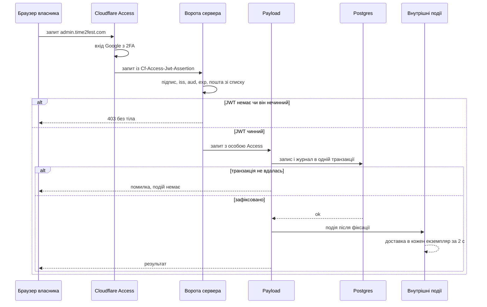
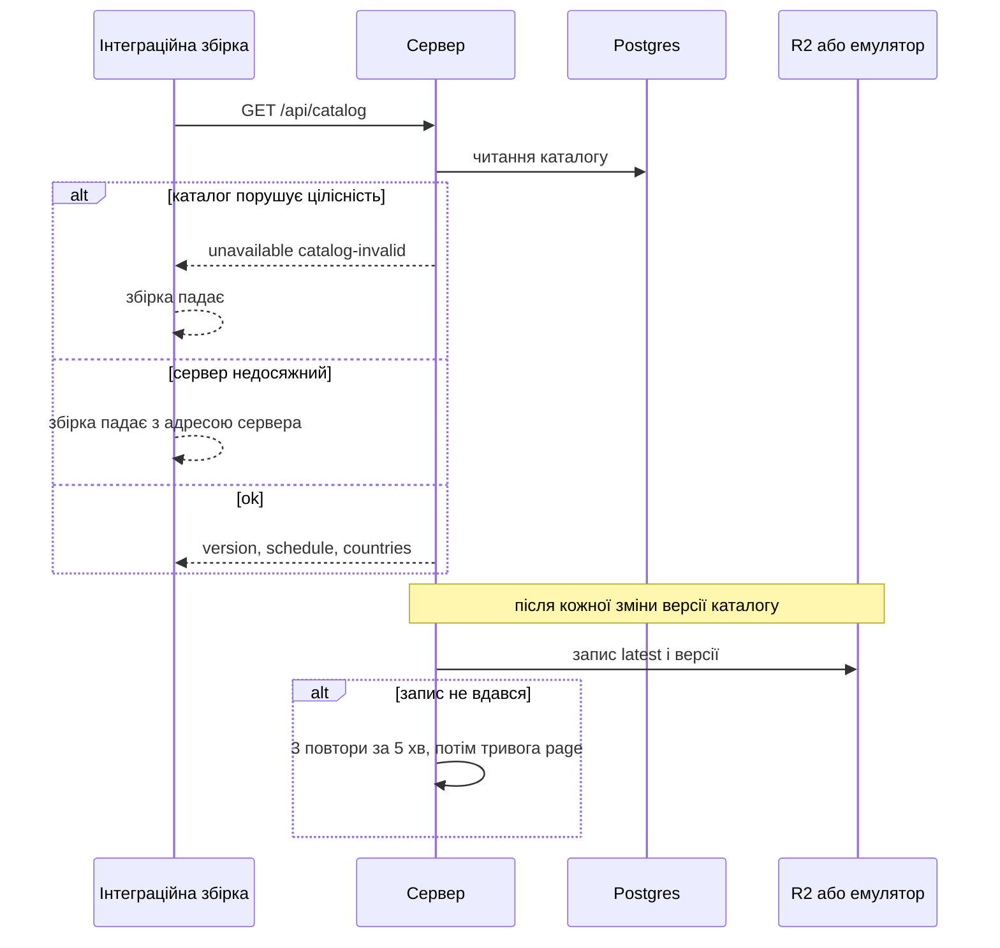
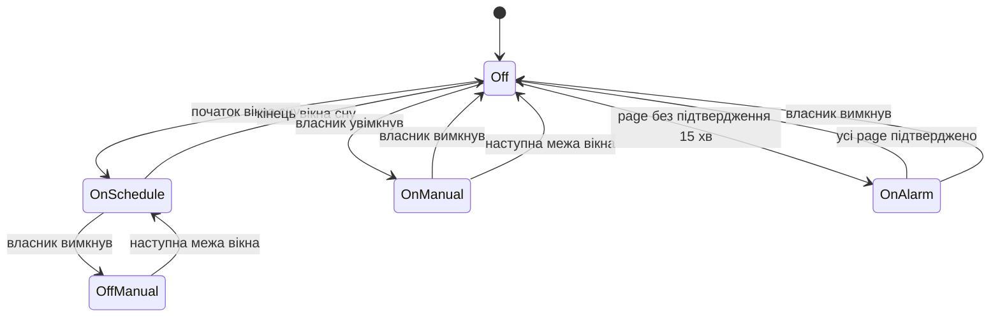

# Spec: Адмінка й каталог моментів
Spec ID: SPEC-04
Status: approved
Supersedes: none

## Problem and user

Власник має керувати сезоном з одного місця й безпечно — у тому числі в новорічну ніч, коли помилку в моменті події помічають о 23:40 (`specs/002-backend/spec.md:223`). Сьогодні адмінки немає: на сервері SPEC-02 є лише колекція `admins` з поштою й паролем (`docs/specs/SPEC-02-server-skeleton.md:242`), а каталог сезону (38 поясів, 298 подій, 246 країн, 298 міст, 738 традицій) лежить у `data/schedule.json` і `data/countries.json` і запікається в збірку при завантаженні модуля (`lib/data/load.ts`, контракт `lib/api/contracts/catalog.ts:12-19`). Поправити момент, сховати подію чи змінити головне святкування без нової збірки неможливо; журналу дій і відкату немає; агенти вмісту й трансляцій не мають вузьких ролей і ключів; якщо власник заснув, система не переходить у суворіший режим сама.

Без перевірки підтвердження Cloudflare Access на сервері адмінку можна відкрити прямим запитом на походження з одним паролем Payload (`specs/002-backend/review-blind-spots.md:34-39`, К-4).

Користувачі: **власник** (єдина людина з входом в адмінку), **агенти** `content-agent` і `stream-agent` (працюють ключем, поверхні запису — у SPEC-21a/b), **хвилі-споживачі** (SPEC-07 перераховує моменти, SPEC-08 несе поправки й перезбирає сайт, SPEC-12 бере події не опівночі, SPEC-13b доставляє тривоги, решта ставить свої зрізи на перший екран), **оркестратор** (сайт має виглядати точно як зараз після перемикання `catalog` на `http`).

### Рішення власника на питання першого проходу

Власник відповів на `spec04-q1` … `spec04-q7` 2026-11-17 (панель розробки; слова власника передав оркестратор) — усі за рекомендацією. Таблиця фіксує рішення й пункти, які його кодують. Пошти власника (основна й резервна) живуть лише в конфігурації та змінних середовища — не в коді, тестах чи комітах.

| Питання | Рішення власника (2026-11-17) | Пункти, що кодують рішення |
|---|---|---|
| Q1 Вхід: Access + пароль Payload чи лише Access | (а) Access з 2FA, далі пароль Payload; сесія Payload — 24 год | AC-12; EC-3 |
| Q2 Обліковий запис Access | (а) Google-акаунт власника з 2FA як спосіб входу в Access; у списку сервера — основна й одна резервна пошта власника | AC-3; EC-4; рядок «Від власника» в Module interactions |
| Q3 Межа зсуву моменту поправкою | (а) ±60 хв від базового моменту події | AC-55; EC-12 |
| Q4 Вихід із режиму, увімкненого тривогою | (б) лише коли власник підтвердив усі тривоги `page` або вимкнув режим вручну; сам не вимикається | AC-35; EC-16 |
| Q5 Розклад сну й ручний вимикач | (а) разові інтервали дата-час за київським часом; ручна дія діє до наступної межі вікна | AC-31, AC-33; EC-15 |
| Q6 Головне святкування й сховані події | (б) нова головна знімає позначку зі старої тієї ж пари «країна-пояс»; сховати головну можна лише разом із вибором нової, **якщо в парі є інша видима подія**; якщо нема — з попередженням | AC-56, AC-57, AC-58; EC-13 |
| Q7 Видалення записів каталогу | (а) видаляти не можна: подію ховають поправкою, пояси, країни й міста змінює лише імпорт | AC-47; EC-19 |

## Goals / Non-goals

**Goals**
- Адмінка `admin.time2fest.com`: сервер сам перевіряє підтвердження Cloudflare Access у кожному запиті, крім `/api/*`, і без нього відмовляє навіть із паролем Payload (FR-ADM-01, NFR-08).
- Ролі `owner`, `content-agent`, `stream-agent`; ключі агентів із видачею й миттєвим відкликанням; вимикач `agentPublish` (FR-ADM-02, FR-ADM-05).
- Журнал «хто, що, коли, до, після» для кожного запису й відкат одним кроком; виконавець «система» для автоматичних дій (FR-ADM-03).
- Каркас першого екрана з реєстром зрізів; у цій хвилі — тестовий зріз, зріз поправок подій (CAP-CAT) і зріз режиму без нагляду (FR-ADM-04, FR-ADM-06).
- Режим без нагляду: розклад сну, ручний вимикач, автоувімкнення за непідтвердженою 15 хв тривогою `page`, подія «Режим без нагляду» (FR-ADM-07). Мінімальне сховище тривог `page` з `acknowledgedAt` і дія «Підтвердити» — за наявним портом «Тривога» [А, рішення оркестратора].
- Механізм внутрішніх подій і реєстр підписників (рядок на домен), що доходить до кожного запущеного екземпляра сервера; «стан — істина, подія — підказка» [А, рішення оркестратора].
- Каталог сезону в Payload: сезон, пояси, події (у т. ч. модель подій не опівночі), країни (рід і число), міста, традиції; поля вмісту — uk, en, es, fr (FR-CAT-01, -03, -04, -11, FR-I18N-02).
- Північ поясів — лише з генератора за tzdb; звіт розбіжностей із новою tzdb (FR-CAT-02, FR-CAT-10).
- Поправки подій (момент, `isMainCelebration`, `restrained` з приміткою, `hidden`) з підтвердженням, журналом, відкатом і подією «Поправку події змінено» (FR-CAT-12).
- `GET /api/catalog` для збирання; інтеграційна збірка бере каталог із сервера, і зібраний `Catalog` глибоко дорівнює нинішньому з `data/`; подія «Каталог змінено» з версією [А, П1 прийнято].
- Копія каталогу в R2; локально — S3-сумісний емулятор у стенді (образ обирає план) [А, рішення оркестратора].
- Команди `import catalog` (усі класи середовищ, ідемпотентна, сухий прогін, журнал) з реєстром імпорту (рядок на домен) і `export catalog` (адмінка → `data/`) для демо.
- Інструменти дошок для `http`: `http-seeds`, `compare-live`, маски, конфіг Playwright для `http`. **Місце коду** [А, рішення оркестратора — корінь документації Time2Fest не в git і цією хвилею не змінюється]: код інструментів живе в репозиторії `web/` у теці `scripts/boards/`; маніфести дошок у `D:/Work/Pets/Time2Fest/docs/bmad/planning-artifacts/ux-designs/ux-Time2Fest-2026-10-21/board-tools/manifests/` інструменти лише читають; маски — у файлі-накладці в тій самій теці репозиторію.
- Інтерфейс адмінки — рідний Payload українською, без токенів сайту [А, П2 прийнято].

**Non-goals**
- Слоти вмісту країн, агент вмісту, очищення SVG (FR-CAT-05–07) — SPEC-21a/b.
- Перезбирання сайту зі зміни каталогу й заморожування (FR-CAT-08, FR-CAT-09) — SPEC-08; тут лише подія «Каталог змінено».
- Знімок `site`, доставка `eventPatches` до вкладок, червона кнопка — SPEC-08.
- Перерахунок моментів після поправки, планувальник, зріз годинника репетиції — SPEC-07.
- Доставка тривог у Telegram, повний зріз «Тривоги й журнал тривог», моніторинг — SPEC-13b.
- Реакції на режим без нагляду в чаті й оплатах (FR-CHAT-27, FR-OPS-08) — SPEC-15/16 і SPEC-17.
- Зміни в реальному Cloudflare (застосунки Access, сервісні токени, WAF) — лише власник і скрипти SPEC-05; ця хвиля нічого там не змінює.
- Закриття походження від прямих запитів (FR-EDGE-09) — SPEC-05; тут — лише перевірка після його злиття.
- Видалення записів каталогу в адмінці (Q7) — свідомо немає.
- Сторонні плагіни журналу Payload — не вимога; механізм обирає план.
- Очищення журналу після 3 років і обробник «дані суб’єкта» для журналу — SPEC-20 / SPEC-11.
- Будь-яка зміна вмісту `data/*.json`, компонентів, стилів, токенів чи текстів сайту.
- Повноцінні події не опівночі зі слотом ефіру й штампом — пізніше (FR-CAT-03).

## User stories

- **US-1** Як власник, я хочу входити в адмінку лише через Cloudflare Access зі своїм обліковим записом, щоб ніхто не відкрив її паролем чи прямим запитом. → AC-1 … AC-13
- **US-2** Як власник, я хочу видавати агентам вузькі ключі, миттєво їх відкликати й вимикати агентам публікацію. → AC-14 … AC-19
- **US-3** Як власник, я хочу бачити кожну дію (свою, агента, системи) з попереднім значенням і відкочувати її одним кроком. → AC-20 … AC-25
- **US-4** Як власник, я хочу один перший екран, куди кожна можливість ставить свої кнопки й віджети. → AC-26 … AC-30
- **US-5** Як власник, я хочу, щоб на час мого сну чи коли я не відповідаю на тривогу система сама переходила в режим без нагляду. → AC-31 … AC-39
- **US-6** Як агент хвилі-споживача (07, 08, 12, 15, 17), я хочу отримувати внутрішні події й читати поточний стан, щоб реагувати в кожному екземплярі сервера. → AC-40, AC-41, AC-42, AC-62, AC-66, AC-67
- **US-7** Як власник, я хочу вести каталог сезону в адмінці кількома мовами, без ручного введення півночі поясів. → AC-43 … AC-52
- **US-8** Як власник, я хочу о 23:40 виправити момент події, сховати подію чи змінити головне святкування з підтвердженням і відкатом. → AC-53 … AC-62
- **US-9** Як оркестратор, я хочу, щоб сайт збирався з каталогу сервера й виглядав точно як зараз. → AC-63 … AC-71, AC-84 … AC-87
- **US-10** Як власник, я хочу мати копію каталогу в R2 на випадок відмови сервера. → AC-72, AC-73, AC-74
- **US-11** Як власник і агент SPEC-22b, я хочу наповнити будь-яке середовище з `data/` без дублів і повернути правки адмінки в демо. → AC-75 … AC-83, AC-88

## Acceptance criteria (EARS)

Позначення: «ворота» — перевірка Access перед Payload; «хост адмінки» — адреса з конфігурації класу середовища (`admin.time2fest.com` у робочому); «пара» — країна в поясі (у `data/schedule.json` їх 296); «базовий момент» — момент події з каталогу без поправки.

### Access і вхід

**AC-1 [server]** IF запит до будь-якого шляху сервера, крім `/api/*`, не несе заголовка `Cf-Access-Jwt-Assertion` із чинним JWT, THEN the system shall відповісти 403 з порожнім тілом і не передавати запит у Payload, навіть коли запит несе чинну cookie сесії Payload чи API-ключ.
Verify: integration — після входу паролем із тестовим JWT той самий cookie без JWT на `/admin` і `/cms-api/admins/me` → 403, тіло порожнє; з JWT → 200; запит з API-ключем агента без JWT → 403.

**AC-2 [server]** IF JWT має невірний підпис, невідомий `kid`, алгоритм не RS256, чужий `iss`, чужий `aud` чи минулий `exp`, THEN the system shall відповісти 403 так само, як за відсутнього JWT.
Verify: integration — шість тестових JWT від тестового підписувача, по одному порушенню в кожному → 403.

**AC-3 [server]** WHERE JWT належить людині (непорожні `sub` і `email`), the system shall пропускати запит лише тоді, коли `email` є в списку пошт власника з конфігурації (основна й одна резервна, Q2).
Verify: integration — JWT із поштою поза списком → 403; з основною і з резервною → проходить.

**AC-4 [server]** WHERE JWT належить сервісному токену (порожній `sub`, є `common_name`), the system shall пропускати лише запити до `/cms-api/*` і лише з `common_name` зі списку сервісних токенів агентів.
Verify: integration — сервісний JWT до `/admin` → 403; до `/cms-api` з `common_name` поза списком → 403; з дозволеним → запит доходить до перевірки ключа (AC-16).

**AC-5 [server]** IF запит доходить до операції Payload (вхід, `me`, будь-яка операція з колекцією, дія зрізу) без особи Access, яку встановили ворота для цього запиту, THEN the system shall відмовити в операції.
Verify: integration — виклик обробника Payload в обхід воріт (тестовий виклик маршруту напряму) з чинним cookie → відмова.

**AC-6 [server]** IF `Host` запиту до `/admin/*` чи `/cms-api/*` не є хостом адмінки, THEN the system shall відповісти 404, однаковим із невідомим шляхом.
Verify: integration — `Host: time2fest.com` на `/admin` і `/cms-api/admins` → 404 з тим самим тілом і заголовками, що невідомий шлях; із хостом адмінки та JWT → 200.

**AC-7 [server]** IF клас середовища `rehearsal` чи `production`, а налаштування Access відсутні (домен команди, `aud`, список пошт) чи вказують на тестового видавця чи тестовий JWKS, THEN the system shall відмовитися стартувати з кодом ≠ 0 і повідомленням, що називає змінну.
Verify: integration — старт у класі `production` з адресою тестового JWKS → код ≠ 0, назва змінної у виводі; без `aud` → те саме.

**AC-8 [server]** WHILE клас середовища `test` і `T2F_TEST_DOORS=1`, the system shall видавати через дверцята `POST /api/_test/access-token` JWT людини чи сервісного токена, підписаний тестовим ключем, якому сервер довіряє лише в класі `test`.
Verify: integration — у тесті дверцята дають JWT, що проходить AC-1…AC-4; у робочій конфігурації `/api/_test/access-token` → 404, як невідомий шлях.

**AC-9 [server]** WHEN надходить JWT з `kid`, якого немає в кешованому наборі ключів, а від попереднього перечитування JWKS минуло щонайменше 30 с, the system shall перечитати JWKS і прийняти токен, підписаний новим ключем, без перезапуску.
Verify: integration — локальний JWKS з ключем A; додати ключ B; токен із B приймається на першому запиті після 30 с.

**AC-10 [server]** IF JWKS недосяжний, а `kid` токена відсутній у кеші, THEN the system shall відповісти 403 і підняти тривогу рівня `log` з кодом `access-jwks-unreachable`.
Verify: integration — зупинений локальний JWKS, токен із новим `kid` → 403, рядок тривоги в журналі сервера.

**AC-11 [server]** IF запит до адмінки йде на походження повз край Cloudflare, THEN the system shall відмовити в ньому.
Verify: e2e — виконується після злиття SPEC-05 (rebase цієї гілки) за `D:/Work/Pets/Time2Fest/docs/backend/cloudflare-notes.md`: прямий запит на адресу походження з `Host` адмінки → відмова (закриття походження SPEC-05 разом з AC-1). До злиття SPEC-05 — позначка «не виконано, чекає SPEC-05» у звіті.

**AC-12 [server]** WHEN власник, що пройшов ворота, вводить правильний пароль Payload, the system shall створити сесію Payload строком 24 год (Q1).
Verify: integration — у токені сесії `exp − iat` = 24 год ±1 хв; строк cookie сесії — 24 год ±1 хв.

**AC-13 [server]** The system shall не мати екрана першої реєстрації Payload в жодному класі середовища; першого власника створює лише команда сервера, яка відмовляє, якщо власник уже є.
Verify: integration — на порожній `admins` `/admin/create-first-user` і REST першої реєстрації → відмова; команда створює власника; повторний запуск → код ≠ 0.

### Ролі й ключі агентів

**AC-14 [server]** The system shall знати рівно три ролі — `owner`, `content-agent`, `stream-agent` — і не допускати другого запису з роллю `owner` через адмінку чи `/cms-api`.
Verify: integration — спроба створити чи змінити запис на `owner` від власника й від агента → відмова; запис з іншою назвою ролі → відмова.

**AC-15 [server]** WHEN власник видає агенту ключ, the system shall показати значення ключа один раз і далі ніде не віддавати його значення — ні в читаннях записів, ні в журналі, ні в журналах сервера.
Verify: integration — після видачі читання запису агента власником і агентом не містить значення; запис журналу видачі не містить значення; пошук значення в журналі сервера — 0 збігів.

**AC-16 [server]** WHEN власник відкликає ключ агента, the system shall відмовляти в першому ж наступному запиті з цим ключем.
Verify: integration — запит із ключем → 200; відкликати; наступний запит → відмова (без затримки й кешу).

**AC-17 [server]** IF запис із роллю агента намагається увійти паролем, THEN the system shall відмовити у вході.
Verify: integration — вхід поштою й паролем запису `content-agent` → відмова.

**AC-18 [server]** The system shall дозволяти ролям агентів у колекціях цієї хвилі лише читання колекцій каталогу (сезон, пояси, події, країни, міста, традиції) і відмовляти їм у будь-якому записі каталогу, поправок, журналу, ключів, режиму без нагляду й тривог.
Verify: integration — матриця «роль агента × колекція × створення / зміна / видалення» → відмова; читання каталогу → 200; читання журналу й ключів → відмова.

**AC-19 [server]** WHILE вимикач `agentPublish` вимкнено, the system shall зберігати спробу агента опублікувати запис як пропозицію зі статусом `proposal`, починаючи з першого запиту після перемикання.
Verify: integration — тестова колекція (лише клас `test`): вимикач увімкнено → публікація агента опублікована; вимкнути між двома запитами → друга спроба має статус `proposal`.

### Журнал і відкат

**AC-20 [server]** WHEN відбувається запис через адмінку, `/cms-api` (власник чи ключ агента), команду цієї хвилі чи дію системи, the system shall у тій самій транзакції додати рівно один запис журналу з полями: виконавець (вид `owner` / `agent` / `system`, ідентифікатор, назва; для системи — назва підсистеми), дія, ціль (колекція та ідентифікатор), час за годинником сервера, значення «до» й «після».
Verify: integration — для зміни каталогу, поправки, видачі й відкликання ключа, зміни режиму без нагляду, підтвердження тривоги й запуску імпорту — рівно один запис із заповненими полями; змодельований збій запису журналу → запис даних теж відкочено.

**AC-21 [server]** The system shall відмовляти будь-якій ролі в зміні чи видаленні записів журналу.
Verify: integration — зміна й видалення запису журналу від власника через `/cms-api` і адмінку → відмова.

**AC-22 [server]** WHEN власник відкочує запис журналу, the system shall за один крок повернути ціль до значення «до», додати запис відкату з посиланням на вихідний і дозволити відкотити сам відкат.
Verify: integration — зміна → відкат → значення = «до»; відкат відкату → значення = «після»; у журналі три записи з посиланнями.

**AC-23 [server]** IF поточне значення цілі відрізняється від значення «після» в записі, який відкочують, THEN the system shall відмовити з причиною `changed-since` і нічого не змінювати.
Verify: integration — зміна A, потім зміна B того ж поля; відкат A → `changed-since`, значення лишається B.

**AC-24 [server]** IF для виду дії запису журналу не зареєстровано обробника відкату, THEN the system shall не показувати дію «Відкотити» для цього запису й відмовляти у відкаті через API з причиною `not-revertible`.
Verify: integration — запис тестового виду без обробника → відмова `not-revertible`; e2e — у журналі адмінки для нього немає кнопки.

**AC-25 [server]** IF відкат запитує роль, відмінна від `owner`, THEN the system shall відмовити.
Verify: integration — запит відкату з ключем агента → відмова.

### Каркас першого екрана

**AC-26 [server]** WHEN власник відкриває перший екран адмінки, the system shall показати зрізи з реєстру слотів у порядку реєстру, останні 20 записів журналу з дією «Відкотити» і зріз режиму без нагляду.
Verify: e2e — стенд `test`, вхід із тестовим JWT: видно тестовий зріз, зріз поправок подій, зріз режиму без нагляду й 20 записів журналу.

**AC-27 [server]** IF зріз не відмалювався чи його запит даних завершився помилкою, THEN the system shall показати решту зрізів і повідомлення про помилку на місці цього зрізу.
Verify: e2e — тестовий зріз у стані «падає» (лише клас `test`) → два інші зрізи й журнал видно, на місці тестового — повідомлення.

**AC-28 [server]** The system shall реєструвати тестовий зріз лише в класі середовища `test`.
Verify: integration — у конфігурації `production` реєстр слотів не містить тестового зрізу.

**AC-29 [server]** WHEN власник виконує дію зрізу, the system shall провести її через інтерфейс власника даних і записати в журнал за AC-20 з обробником відкату.
Verify: integration — дія тестового зрізу дає один запис журналу, який відкочується (AC-22).

**AC-30 [server]** The system shall показувати інтерфейс адмінки рідним інтерфейсом Payload мовою `uk`, з українськими назвами колекцій, полів і зрізів цієї хвилі.
Verify: e2e — мова інтерфейсу Payload `uk`; назви колекцій каталогу, журналу й трьох зрізів — українською.

### Режим без нагляду і тривоги

**AC-31 [server]** WHEN власник зберігає вікно сну, the system shall прийняти разовий інтервал «дата-час — дата-час», введений за часом `Europe/Kyiv`, і зберегти його в UTC, відмовляючи, якщо кінець не пізніше за початок чи інтервал перетинає інше вікно (Q5).
Verify: unit — перетворення київського часу в UTC (зокрема 31.12–01.01); integration — вікно з кінцем ≤ початку → відмова; вікно, що перетинає інше → відмова.

**AC-32 [server]** WHILE час сервера всередині вікна сну і ручного перемикання не діє, the system shall тримати режим без нагляду ввімкненим, із запізненням переходу не більше 30 с від межі вікна.
Verify: integration — тестовий годинник: межа −1 с → вимкнено; межа +30 с → увімкнено; кінець вікна +30 с → вимкнено.

**AC-33 [server]** WHEN власник перемикає режим вручну, the system shall тримати ручний стан до найближчої межі будь-якого вікна сну, після чого знову діє розклад (Q5).
Verify: integration — тестовий годинник: ручне вимкнення всередині вікна діє до його кінця; ручне ввімкнення поза вікном діє до початку наступного вікна.

**AC-34 [server]** IF тривога рівня `page` лишається непідтвердженою 15 хв, THEN the system shall увімкнути режим без нагляду з виконавцем «система» і причиною `alarm`.
Verify: integration — тестовий годинник: тривога о T; T+14:59 → вимкнено; T+15:00 (+≤30 с) → увімкнено, запис журналу з виконавцем «система».

**AC-35 [server]** WHILE режим увімкнено з причиною `alarm`, the system shall вимикати його лише тоді, коли власник підтвердив усі тривоги `page` чи вимкнув режим вручну (Q4).
Verify: integration — минає 2 год без нових тривог → режим увімкнено; підтвердження останньої тривоги → вимкнено ≤30 с; окремо — ручне вимкнення → вимкнено.

**AC-36 [server]** WHEN режим без нагляду змінюється з будь-якої причини, the system shall опублікувати рівно одну внутрішню подію «Режим без нагляду» на кожен перехід.
Verify: integration — тестовий підписувач (лише клас `test`) отримує по одній події на кожен перехід AC-32…AC-35 з полями з контракту; запис журналу на кожен перехід.

**AC-37 [server]** WHEN можливість піднімає тривогу рівня `page` через порт «Тривога», the system shall зберегти її (джерело, код, час, `acknowledgedAt` = порожньо) на додачу до рядка журналу сервера, не кидаючи винятку, якщо збереження не вдалося.
Verify: integration — `raise` рівня `page` → рядок у сховищі тривог і рядок у журналі сервера; змодельований збій сховища → виклик повертається без винятку (AC-56 SPEC-02 тримається).

**AC-38 [server]** WHEN власник натискає «Підтвердити» біля тривоги в зрізі режиму без нагляду, the system shall записати `acknowledgedAt` за часом сервера і додати запис журналу.
Verify: integration — підтвердження → `acknowledgedAt` заповнено, один запис журналу; e2e — кнопка в зрізі.

**AC-39 [server]** WHILE клас середовища `test` і `T2F_TEST_DOORS=1`, the system shall піднімати тривогу рівня `page` через дверцята `POST /api/_test/alarm`.
Verify: integration — дверцята створюють тривогу, яку бачить AC-34; у робочій конфігурації шлях → 404.

### Внутрішні події

**AC-40 [server]** WHEN хвиля публікує внутрішню подію («Поправку події змінено», «Режим без нагляду», «Каталог змінено»), the system shall доставити її кожному підписнику з реєстру підписників у кожному запущеному екземплярі сервера протягом 2 с після фіксації транзакції.
Verify: integration — два екземпляри сервера (у ексклюзивному замку інтеграції), тестовий підписувач у кожному; зміна в першому → обидва отримують подію ≤2 с.

**AC-41 [server]** IF транзакцію, що мала спричинити подію, відкочено, THEN the system shall не публікувати подію.
Verify: integration — змодельований збій після запису до фіксації → тестовий підписувач подій не отримав.

**AC-42 [server]** The system shall давати кожній події версію, що зростає, і порт читання поточного стану з тією самою версією, щоб підписник, який пропустив події, звірився читанням.
Verify: integration — три поправки до старту підписника; підписник читає стан і отримує версію третьої поправки й усі три значення.

### Колекції каталогу

**AC-43 [server]** The system shall зберігати поля вмісту каталогу (назва країни, назва міста, орієнтир міста, назва й текст традиції, текст `howTo`, примітка `restrained`) мовами `uk`, `en`, `es`, `fr`, де `uk` обов’язкова, а решта необов’язкові.
Verify: unit (model) — схема кожного з полів має чотири мови; запис лише з `uk` проходить; без `uk` → відмова.

**AC-44 [server]** The system shall зберігати для країни рід і число зі значеннями `m`, `f`, `n`, `pl` чи порожньо, як у `Gender` (`lib/data/types.ts:14`).
Verify: unit (model) — допустимі п’ять значень; інше значення → відмова.

**AC-45 [server]** IF будь-яка роль змінює момент півночі поясу через адмінку чи `/cms-api`, THEN the system shall відмовити; момент поясу записує лише імпорт із результату генератора.
Verify: integration — зміна `midnightUtc` поясу від власника → відмова; e2e — поле в адмінці лише для читання.

**AC-46 [server]** IF будь-яка роль змінює `iso` чи `slug` країни після створення, THEN the system shall відмовити.
Verify: integration — зміна `slug` від власника → відмова, значення незмінне.

**AC-47 [server]** IF будь-яка роль видаляє запис сезону, поясу, події, країни, міста чи традиції, THEN the system shall відмовити (Q7).
Verify: integration — видалення кожного виду від власника → відмова; e2e — в адмінці немає дії «Видалити» для цих колекцій.

**AC-48 [server]** The system shall зберігати для події вид слоту (`midnight`, `fireworks-20`, `dawn`, `jan-1`) і для виду, відмінного від `midnight`, власний момент `startsAt` у UTC, відмовляючи в записі без `startsAt`.
Verify: unit (model) — схема виду й `startsAt`; integration — подія `dawn` без `startsAt` → відмова; зі `startsAt` → збережено.

**AC-49 [server]** IF збереження ламає цілісність каталогу (подія посилається на відсутній пояс, місто чи країну; пояс міста не дорівнює поясу події; у парі не рівно одна головна видима подія, крім пари, де всі події сховано), THEN the system shall відмовити з назвою порушеного правила.
Verify: integration — по одній спробі на кожне правило → відмова з його назвою.

### Північ поясів і tzdb

**AC-50 [web]** WHEN генератор півночі поясів запускається на закріпленій версії tzdb, the system shall записати момент півночі кожного поясу як UTC і версію tzdb у метадані сезону, без жодного ручного введення моменту поясу.
Verify: unit — запуск на версії, записаній у `data/schedule.json`, дає 38 поясів із моментами й версією, що збігаються з файлом.

**AC-51 [web]** WHEN звіт розбіжностей запускається з версією tzdb і джерелом каталогу (`data/` чи `GET /api/catalog` середовища), the system shall записати датований звіт із кожним поясом, у якого відрізняється зміщення чи момент півночі, завершитися кодом 0 без розбіжностей і 1 з ними та нічого не змінювати в каталозі.
Verify: unit — фікстура зі зміщеним на 30 хв поясом → один рядок, код 1; без змін → порожній звіт, код 0; рядків у базі до й після однаково.

**AC-52 [web]** The system shall мати два звіти розбіжностей tzdb за сезон — у перший тиждень грудня й до 30.12 — і запис про стеження за оголошеннями tzdb до свята.
Verify: manual — два датовані звіти в репозиторії й рядок у `docs/backlog.md` про підписку на оголошення tzdb; автоматично перевірити дату запуску неможливо.

### Поправки подій

**AC-53 [server]** WHEN власник зберігає поправку в зрізі поправок подій, the system shall спершу показати підтвердження зі значеннями «було → стане» (для моменту — ще й місцевий час поясу події) і зберігати лише після підтвердження.
Verify: e2e — зміна моменту відкриває підтвердження з обома значеннями й місцевим часом; «Скасувати» → нічого не змінено; «Підтвердити» → збережено.

**AC-54 [server]** WHEN поправку збережено чи відкочено, the system shall записати її в журнал і опублікувати подію «Поправку події змінено» з полями контракту для кожної зміненої події.
Verify: integration — збереження → один запис журналу й одна подія; відкат → ще одна подія з відновленими значеннями.

**AC-55 [server]** IF виправлений момент події відрізняється від базового моменту більше ніж на 60 хв, THEN the system shall відмовити з причиною `correction-out-of-range` (Q3).
Verify: integration — +60 хв і −60 хв → збережено; +61 хв → відмова.

**AC-56 [server]** WHEN власник позначає подію головною, the system shall у тій самій поправці зняти позначку з попередньої головної події тієї ж пари (Q6).
Verify: integration — пара з двома подіями: позначити другу → перша не головна; один запис журналу; дві події «Поправку події змінено» з однією версією.

**AC-57 [server]** IF власник ховає головну подію пари, у якій є інша видима подія, не вибравши нову головну в тій самій поправці, THEN the system shall відмовити з причиною `main-required` (Q6).
Verify: integration — сховати головну без вибору → відмова; з вибором нової → збережено.

**AC-58 [server]** WHERE у парі немає іншої видимої події, the system shall дозволяти сховати головну подію після підтвердження з попередженням, що пара лишиться без головної (Q6).
Verify: e2e — пара з однією подією: у підтвердженні попередження, після підтвердження подію сховано.

**AC-59 [server]** IF стриманий режим увімкнено без примітки `uk` чи примітка довша за 200 символів, THEN the system shall відмовити; примітку збережено як простий текст.
Verify: integration — без примітки → відмова; 201 символ → відмова; примітка з `<b>` зберігається й віддається як текст без змін.

**AC-60 [server]** WHILE час сервера в межах 31.12 08:00 – 01.01 14:00 UTC, the system shall приймати поправки подій так само, як поза цим вікном.
Verify: integration — тестовий годинник 31.12 23:40 UTC → поправку моменту збережено, подію опубліковано.

**AC-61 [server]** IF збереження поправки несе версію, старішу за поточну версію поправок цієї події, THEN the system shall відмовити з причиною `changed-since`.
Verify: integration — дві вкладки читають версію 1; перша зберігає; друга з версією 1 → `changed-since`.

**AC-62 [server]** The system shall тримати поправки окремо від базових значень каталогу: `GET /api/catalog` і версія каталогу від поправки не змінюються, а поточні поправки читаються портом у формі `SiteEventPatch` (`packages/contracts/src/site.ts:34-40`) з версією.
Verify: integration — після поправки тіло й версія `GET /api/catalog` ті самі; порт повертає `{ moment, isMainCelebration, restrained, hidden }` зміненої події.

### Каталог для збирання

**AC-63 [server, contracts]** WHEN надходить `GET /api/catalog`, the system shall відповісти 200 тілом `ApiResult` з `version`, `schedule` і `countries`, що проходить спільну схему каталогу з `@time2fest/contracts`.
Verify: integration — тіло проходить схему; `schedule` проходить `data/schedule.schema.json`.

**AC-64 [server, web]** WHEN `import catalog --apply` виконано на порожній базі, the system shall віддавати каталог, з якого збирання сайту дає `Catalog`, глибоко рівний `Catalog` із `data/schedule.json` і `data/countries.json`, включно з вмістом усіх `ReadonlyMap` і `catalogVersion`.
Verify: integration — обидва `Catalog` зібрані тією самою функцією сайту; порівняння за всіма полями й записами Map; версії рівні.

**AC-65 [server]** IF каталог у базі порушує правила цілісності AC-49, THEN the system shall відповісти на `GET /api/catalog` кодом `unavailable` з причиною `catalog-invalid`.
Verify: integration — фікстура вставляє подію з неіснуючим поясом в обхід перевірок → `unavailable` / `catalog-invalid`.

**AC-66 [server]** The system shall не включати події виду, відмінного від `midnight`, у `events` відповіді `GET /api/catalog` і віддавати їх зі `startsAt` через порт читання для SPEC-12.
Verify: integration — подія `fireworks-20` у базі: у `GET /api/catalog` її немає, порт повертає її зі `startsAt`.

**AC-67 [server]** WHEN змінюється будь-який запис каталогу (крім імпорту без змін), the system shall встановити `generatedAt` сезону на час сервера, змінивши версію каталогу, і опублікувати подію «Каталог змінено» з новою версією.
Verify: integration — зміна назви міста → нова версія в `GET /api/catalog` і одна подія; повторний імпорт без змін → версія та сама, подій нема.

**AC-68 [web]** WHEN виконується інтеграційна збірка (`build:int`), the system shall брати каталог із `GET /api/catalog` сервера дерева і завершуватися з кодом ≠ 0 з адресою сервера в повідомленні, якщо відповідь не `ok`, без відкату на `data/`.
Verify: integration — сервер зупинено → збірка падає з адресою; сервер живий → збірка використала каталог сервера (змінена в базі назва міста є в зібраній сторінці).

**AC-69 [web]** The system shall збирати демо-версію (режим без `http`) з `data/` без змін і не змінювати вміст `data/*.json` цією хвилею.
Verify: integration — звичайна збірка проходить без сервера; `git diff --stat master -- data/` порожній.

**AC-70 [web]** WHERE `NEXT_PUBLIC_API_MODE=http`, the system shall обслуговувати домен `catalog` з каталогу сервера, а `version()` повертати його версію.
Verify: unit — у режимі `http` домен `catalog` позначено перенесеним, `version()` = версія з відповіді сервера.

**AC-71 [web]** WHEN дошки всіх сторінок знято з інтеграційної збірки з каталогом сервера, the system shall дати різницю з еталонними знімками не більше 0,1 % на кожну дошку, а пояснені різниці 0,1–0,5 % — з розбором причин і без зсуву макета.
Verify: e2e — `layout-fidelity` на всіх маніфестах, `--workers=2`; звіт `compare-live` додано до звіту хвилі.

### Копія в R2

**AC-72 [server]** WHEN версія каталогу змінюється (включно з імпортом зі змінами), the system shall протягом 60 с записати в кошик R2 свого середовища тіло, рівне відповіді `GET /api/catalog`, під ключем останньої версії й під ключем цієї версії.
Verify: integration — локальний S3-сумісний емулятор: після зміни обидва об’єкти є, тіло глибоко рівне відповіді `GET /api/catalog`.

**AC-73 [server]** IF запис у R2 не вдався, THEN the system shall повторити його щонайменше 3 рази протягом 5 хв, лишити зміну каталогу зафіксованою і після останньої невдачі підняти тривогу рівня `page`.
Verify: integration — емулятор зупинено (ексклюзивний замок): зміна каталогу в базі є, після повторів — тривога `page` у сховищі тривог.

**AC-74 [server]** WHEN `pnpm stack` запускає стенд дерева, the system shall запустити S3-сумісний емулятор R2 з окремим кошиком чи префіксом дерева, виведеним із назви хвилі.
Verify: integration — два дерева пишуть копію каталогу; кожне бачить лише свій об’єкт.

### Імпорт і експорт

**AC-75 [server]** WHEN `import catalog` запускається без `--apply`, the system shall вивести звіт «додати / змінити / без змін / змінено в адмінці — пропущено» з переліком записів і нічого не записувати в базу, журнал і R2.
Verify: integration — кількість рядків у базі, журналі й об’єктів R2 до й після сухого прогону однакова; звіт містить чотири групи.

**AC-76 [server]** WHEN `import catalog --apply` виконується двічі поспіль на чистій базі, the system shall після другого запуску мати той самий стан, а другий звіт — нуль доданих і нуль змінених.
Verify: integration — знімок таблиць каталогу після першого й другого запуску рівний; другий звіт 0 / 0.

**AC-77 [server]** IF запис змінено в адмінці після його останнього імпорту, THEN the system shall пропустити його під час імпорту й показати в групі «змінено в адмінці — пропущено».
Verify: integration — імпорт, зміна назви міста в адмінці, повторний імпорт → назва з адмінки лишилась, місто у звіті як пропущене.

**AC-78 [server]** WHEN `import catalog --apply` завершується, the system shall записати в журнал підсумок запуску з виконавцем «система: import» і по одному запису на кожен доданий чи змінений запис.
Verify: integration — імпорт зі зміною двох записів → один підсумок і два записи.

**AC-79 [server]** The system shall запускати `import catalog` як команду сервера в усіх класах середовищ, незалежно від тестових дверцят.
Verify: integration — запуск у класі `rehearsal` на локальній базі без `T2F_TEST_DOORS` проходить сухим прогоном.

**AC-80 [server]** IF `import` отримує назву домену, якої немає в реєстрі імпорту, THEN the system shall завершитися з кодом ≠ 0 і переліком відомих доменів.
Verify: unit — реєстр імпорту має рядок `catalog`; `import nope` → код ≠ 0, у виводі `catalog`.

**AC-81 [server]** IF файл джерела не проходить схему (`data/schedule.schema.json` чи схему країн), THEN the system shall завершити імпорт із кодом ≠ 0, назвою файлу й шляхом до поля і нічого не записати.
Verify: integration — копія `schedule.json` з порожнім `zoneId` у тимчасовій теці → код ≠ 0, у виводі файл і шлях; база без змін.

**AC-82 [server, web]** WHEN `export catalog` пише файли з каталогу середовища, the system shall записати `schedule.json` і `countries.json` у форматі `data/` без поправок і без подій не опівночі, байт у байт рівні `data/`, якщо після імпорту не було правок.
Verify: integration — імпорт `data/`, експорт у тимчасову теку → файли байт у байт рівні; після поправки й події `dawn` — файли ті самі.

**AC-83 [server, web]** IF `export catalog` запущено без `--write` чи цільові файли мають незакомітжені зміни, THEN the system shall не записувати файли і вивести перелік змінених файлів чи причину відмови.
Verify: integration — без `--write` → файли не змінено, перелік виведено; з `--write` над зміненим робочим деревом → відмова з причиною.

### Інструменти дошок для `http`

**AC-84 [web]** WHEN `http-seeds` готує стан дошки, the system shall перетворити назву насіння з маніфесту на виклики тестових дверцят сервера дерева і завершитися з кодом ≠ 0 з переліком назв, для яких немає відповідності.
Verify: unit — усі назви насіння з маніфестів мають відповідність; невідома назва → код ≠ 0 з назвою.

**AC-85 [web]** WHEN `compare-live` отримує `--ref`, `--new`, `--ids` і `--tol 24`, the system shall записати для кожного id зображення різниці `<id>.fid.png` і JSON-звіт із відсотком різниці й класом «пройдено» (≤0,1 %), «розбір» (0,1–0,5 %) чи «дефект» (>0,5 %).
Verify: unit — синтетичні пари зображень із різницею 0,05 %, 0,3 %, 0,8 % дають три класи й три файли.

**AC-86 [web]** The system shall брати маски дошок із файлу-накладки в репозиторії, зафарбовувати їх в обох зображеннях і лише читати маніфести з кореня документації Time2Fest.
Verify: unit — маска з накладки прибирає різницю в замаскованій області; unit (static) — код інструментів не відкриває маніфести на запис.

**AC-87 [web]** WHEN запускається конфіг Playwright для `http`, the system shall знімати дошки з інтеграційної збірки, що працює проти сервера дерева, не більше ніж двома процесами одночасно.
Verify: integration — прогін однієї дошки через конфіг `http` проходить; у конфігурації `workers` ≤ 2.

### Сид стенду

**AC-88 [server]** WHEN `pnpm stack` чи дверцята скидання наповнюють базу дерева, the system shall заповнити каталог із `data/` рядком реєстру сиду `catalog`, з тим самим станом каталогу, що дає `import catalog --apply` на порожній базі.
Verify: integration — після `pnpm stack` і після скидання знімок таблиць каталогу рівний знімку після імпорту на порожній базі; сид не читає `research_data/` і `streams.candidates.json`.

## Edge cases

- **EC-1** Cookie Payload украдено, запит іде повз Access. → AC-1, AC-5
- **EC-2** Хтось підставляє `Host: admin.time2fest.com` у прямий запит на походження. → AC-1, AC-11
- **EC-3** Сесія Payload закінчилась уночі, а Access ще чинний — власник вводить пароль удруге за добу. → AC-12 (Q1)
- **EC-4** Власник втратив доступ до основної пошти чи Google-акаунта. → AC-3 (резервна пошта, Q2)
- **EC-5** Cloudflare змінив ключі підпису (кожні 6 тижнів, старий діє ще 7 днів). → AC-9
- **EC-6** JWKS Cloudflare недосяжний під час входу. → AC-10
- **EC-7** Агент шле правильний API-ключ без сервісного токена Access або токен без ключа. → AC-1, AC-4, AC-16
- **EC-8** Зміна `PAYLOAD_SECRET` робить недійсними всі ключі агентів; скидання пароля ключ не відкликає. → Open question 7
- **EC-9** Хтось відкриває `/admin/create-first-user` на свіжій базі. → AC-13
- **EC-10** Відкат дії, після якої той самий запис уже змінили. → AC-23
- **EC-11** Дві вкладки адмінки одночасно правлять одну поправку. → AC-61
- **EC-12** Поправка моменту на кілька годин (друкарська помилка в годині). → AC-55 (Q3)
- **EC-13** Ховають головну подію пари з однією подією і з двома. → AC-57, AC-58 (Q6)
- **EC-14** Поправка моменту вже після старого моменту чи в межах заморожування. → AC-60; перерахунок і штамп за старим моментом — Non-goal (SPEC-07, SPEC-14)
- **EC-15** Власник вручну вимкнув режим посеред вікна сну. → AC-33 (Q5)
- **EC-16** Режим увімкнувся через тривогу, потім 2 год тиші. → AC-35 (Q4)
- **EC-17** Тривога `page`, збереження якої не вдалося (база недоступна). → AC-37
- **EC-18** Два екземпляри сервера; поправку зроблено на одному, планувальник працює на іншому. → AC-40, AC-42
- **EC-19** Власник хоче видалити країну чи подію. → AC-47 (Q7); сховати — AC-56…AC-58
- **EC-20** Імпорт після правки в адмінці; повторний імпорт без змін. → AC-76, AC-77
- **EC-21** Пошкоджений `schedule.json` у робочому середовищі. → AC-81
- **EC-22** Сервер недосяжний під час інтеграційної збірки. → AC-68
- **EC-23** Емулятор R2 чи R2 недоступний у момент зміни каталогу. → AC-73
- **EC-24** Нова tzdb змінює зміщення поясу за кілька тижнів до свята (Фіджі 2022, Самоа 2021). → AC-51, AC-52
- **EC-25** Експорт тестових правок адмінки перезаписує демо до SPEC-22b. → AC-83
- **EC-26** Зріз іншої хвилі падає на першому екрані. → AC-27
- **EC-27** Дія зрізу без обробника відкату. → AC-24
- **EC-28** Агент намагається змінити каталог чи журнал. → AC-18, AC-21
- **EC-29** Подія не опівночі потрапляє в слот ефіру через `events` каталогу. → AC-66

## Non-functional requirements

**NFR-1 [server]** The system shall додавати перевіркою Access не більше 20 мс до часу відповіді на 95-му процентилі за прогрітого кешу JWKS.
Verify: integration — 200 запитів до `/cms-api/admins/me` з тестовим JWT і без воріт (тестова конфігурація), різниця p95 ≤ 20 мс.

**NFR-2 [server]** The system shall відповідати на `GET /api/catalog` за 1 с на 95-му процентилі з тілом не більше 2 МБ для повного каталогу `data/`.
Verify: integration — 20 запитів на локальному стенді після імпорту; p95 і розмір тіла у звіті.

**NFR-3 [server]** IF один клієнт робить понад 30 запитів `GET /api/catalog` за хвилину, THEN the system shall відповідати кодом `rate_limited` з `retryAfterMs`.
Verify: integration — 31-й запит за хвилину → `rate_limited`.

**NFR-4 [server]** The system shall виконувати `import catalog --apply` повного `data/` на порожній базі за 120 с, а сухий прогін — за 60 с на локальному стенді.
Verify: integration — час обох запусків у звіті.

**NFR-5 [server]** The system shall не виводити ключі агентів, JWT Access, ключі R2 і `PAYLOAD_SECRET` у журнали сервера, журнал дій, вивід команд і відповіді.
Verify: integration — пошук тестових значень у журналах і виводі після прогону набору → 0 збігів; security review.

**NFR-6 [server]** The system shall зберігати записи журналу дій щонайменше 3 роки, без автоматичного видалення в цій хвилі (відповідь власника №6).
Verify: unit (static) — у коді хвилі немає операції видалення журналу; очищення — SPEC-20.

**NFR-7 [server]** The system shall обмежувати пам’ять контейнера емулятора R2 у стенді 256 МБ.
Verify: integration — ліміт контейнера в стенді ≤ 256 МБ; `docker stats` під час AC-72 — у межах ліміту.

**NFR-8 [server]** WHEN ворота відмовляють у запиті, the system shall писати один рядок журналу сервера з кодом причини, без JWT і пошти, не частіше одного рядка на секунду для однієї причини.
Verify: integration — 50 відмов за 5 с з однією причиною → ≤ 5 рядків, без токена й пошти.

**NFR-9 [server, web, contracts]** The system shall пройти рецензію безпеки агентом `security-reviewer` (хвиля змінює поверхню запису агентів, Access і ключі).
Verify: security review — без невиправлених знахідок HIGH.

**NFR-10 [server]** The system shall відкривати перший екран адмінки за 3 с на 95-му процентилі на локальному стенді.
Verify: e2e — 10 завантажень першого екрана після входу, p95 у звіті.

## Module interactions

### Вхід в адмінку й дія власника

Відмови на стрілках: немає JWT чи він нечинний → AC-1, AC-2; JWKS недосяжний → AC-10; збій транзакції → AC-20, AC-41; доставка подій між екземплярами → AC-40, AC-42.

### Збирання з каталогу й копія в R2

Відмови: `catalog-invalid` → AC-65; сервер недосяжний → AC-68; R2 недоступний → AC-73.

### Стани режиму без нагляду

`OffManual` — ручне вимкнення всередині вікна (AC-33). Кожен перехід — одна подія «Режим без нагляду» і запис журналу (AC-36).

### Контракти (усі **proposed**)

**`GET /api/catalog`** — сайт → сервер, синхронно, лише під час збирання (`docs/backend/frontend-seam.md:228`).
- Запит: без тіла й параметрів; без сесії.
- Відповідь 200: `ApiResult<{ version: string; schedule: Schedule; countries: Countries }>` (`packages/contracts/src/result.ts:33`).
  - `version` (обов’язкове) — `catalogVersionOf(meta)` (`packages/contracts/src/site.ts:70-73`).
  - `schedule` (обов’язкове) — форма `data/schedule.json`, перевіряється наявною `data/schedule.schema.json`.
  - `countries` (обов’язкове) — форма `data/countries.json`.
  - Мовні поля — у формі `data/` (`{ uk }` там, де зараз `{ uk }`; рядок там, де зараз рядок).
- Помилки: `unavailable` / `catalog-invalid` (AC-65); `rate_limited` (NFR-3). Причина `catalog-invalid` — у новому файлі домену `catalog` пакета контрактів (лише додаванням).

**Внутрішня подія «Поправку події змінено»** — сервер → підписники (SPEC-07, SPEC-08), асинхронно.
- `eventId: string` (обов’язкове); `before: SiteEventPatch | null`, `after: SiteEventPatch | null` (обов’язкові); `version: number` (обов’язкове); `at: string` ISO UTC (обов’язкове); `actor: { kind: 'owner' | 'system'; label: string }` (обов’язкове).

**Внутрішня подія «Каталог змінено»** — сервер → підписники (SPEC-08 перезбирання, копія R2), асинхронно.
- `version: string` (обов’язкове); `at: string` (обов’язкове).

**Внутрішня подія «Режим без нагляду»** — сервер → підписники (SPEC-15/16, SPEC-17), асинхронно.
- `on: boolean`; `cause: 'schedule' | 'manual' | 'alarm'`; `at: string`; `version: number` — усі обов’язкові.

**Порти читання (внутрішні, для хвиль-споживачів).** Поточні поправки `Record<eventId, SiteEventPatch>` з версією; моменти поясів і подій з урахуванням поправок; події не опівночі зі `startsAt`; поточний стан режиму без нагляду з версією; непідтверджені тривоги `page`.

**Тестові дверцята** (лише клас `test` і `T2F_TEST_DOORS=1`, правила `docs/backend/architecture.md:27-30`):
- `POST /api/_test/access-token` — `{ kind: 'person' | 'service'; email?: string; commonName?: string; aud?: string; iss?: string; expiresInSec?: number; kid?: string }` → `{ token: string }`. Необов’язкові поля дозволяють зібрати нечинні токени для AC-2.
- `POST /api/_test/alarm` — `{ source: string; code: string }` → `{ id: string }`.
- Тестовий годинник — наявні дверцята SPEC-02.

**Команди сервера:** `import <домен> [--apply]` (реєстр імпорту, рядок `catalog`); `export catalog --from <адреса середовища> [--write]`; команда створення першого власника.

**Копія в R2:** об’єкти «остання версія» і «версія `<version>`» у кошику середовища; тіло = відповідь `GET /api/catalog`.

### Від власника

- Застосунок Cloudflare Access для `admin.time2fest.com`, вхід через Google-акаунт із 2FA, основна й резервна пошта в політиці — **пт 20.11** (до того локально — тестовий підписувач).
- Сервісні токени Access для агентів — до старту SPEC-21a (5.12).

### Передача іншим хвилям

- **SPEC-05:** чи доходить `Cf-Access-Jwt-Assertion` до походження через обраний канал і чи йде хост адмінки через Worker — у `cloudflare-notes.md`; AC-11 виконується після rebase на злитий SPEC-05. Сервер пише в R2 через S3 API (змінні R2 — блок `catalog` у схемі змінних сервера); рядок `wrangler.toml` для копії каталогу потрібен, лише якщо Worker читає копію (запас SPEC-08).
- **SPEC-07:** підписник на «Поправку події змінено» в реєстрі підписників; порт моментів із поправками; зріз годинника репетиції — рядок у реєстрі слотів.
- **SPEC-08:** `eventPatches` і `catalogVersion` — з порту поправок і `GET /api/catalog`; затримане перезбирання — підписник на «Каталог змінено»; `import products` — рядок у реєстрі імпорту; слот ефіру, коли пара без головної (AC-58), вирішує SPEC-08/12.
- **SPEC-12:** події не опівночі — з порту (AC-66); `import chains` — рядок у реєстрі імпорту.
- **SPEC-13a:** окремий застосунок Access (свій `aud`) і хост адмінки репетиційного середовища; повтор AC-11 на справжньому сервері; примітка до `secrets.md`: зміна `PAYLOAD_SECRET` анулює всі ключі агентів.
- **SPEC-13b:** SPEC-04 володіє лише сховищем тривог `page` з `acknowledgedAt` і дією «Підтвердити» в зрізі режиму без нагляду, за портом «Тривога»; 13b додає доставку в Telegram і повний зріз «Тривоги й журнал тривог» поверх того самого сховища, не дублюючи його.
- **SPEC-20:** очищення журналу дій після 3 років; обробник «дані суб’єкта» для записів журналу з ідентифікаторами людей (з’являться з банами SPEC-11).
- **SPEC-21a/b:** ролі, ключі й правило `agentPublish` (AC-19) вже є; агент шле і заголовки сервісного токена Access, і API-ключ; `import channels` — рядок у реєстрі імпорту.
- **SPEC-22b:** `import catalog` спершу сухим прогоном на репетиції, потім `--apply` у робочому; після цього джерело правди — адмінка робочого середовища; `export catalog --write` оновлює демо на прохання власника.
- **Усі хвилі зі зрізами:** рядок у реєстрі слотів, дія — через порт журналу з обробником відкату свого виду; видалення — лише м’яке, бо Payload видаляє версії разом із документом.

## Inputs and provenance

| Вхід | Джерело | Хто створює | Свіжість | Довіра |
|---|---|---|---|---|
| `Cf-Access-Jwt-Assertion` | заголовок запиту | Cloudflare Access (у тесті — тестовий підписувач) | на кожен запит | ні — до перевірки підпису |
| JWKS Access | `https://time2fest.cloudflareaccess.com/cdn-cgi/access/certs` | Cloudflare | кеш ≤10 хв, ключі змінюються кожні 6 тижнів | так після TLS; набір ключів — лише для перевірки |
| `Host` | заголовок запиту | клієнт | на кожен запит | ні |
| Cookie сесії Payload, API-ключ агента | заголовки запиту | Payload / власник | на кожен запит | ні — до перевірки |
| Записи агентів через `/cms-api` | агенти (LLM) | агенти | довільна | ні |
| Поля форм адмінки | власник | власник | довільна | частково — перевіряються схемами |
| `data/schedule.json`, `data/countries.json` | репозиторій | генератор (`scripts/build_schedule.py`) і правки в git | на запуск імпорту | частково — перевіряються схемою |
| tzdb (`tzdata` закріпленої версії) | пакет Python | IANA | на запуск генератора чи звіту | частково — звіряється звітом |
| Відповідь `GET /api/catalog` у збірці | сервер дерева | SPEC-04 | на збірку | частково — перевіряється схемою |
| Маніфести дошок | корінь документації Time2Fest (не git) | власник і агенти дизайну | на запуск | так, лише читання |
| Відповіді S3 / R2 | емулятор чи R2 | Cloudflare / емулятор | на запис | частково |
| Тіла тестових дверцят | тести | тести | на виклик | ні — лише клас `test` |
| Рішення П1, П2, тривоги, події, емулятор, місце інструментів дошок | оркестратор | [А] | 2026-11-17 | так |

## Untrusted inputs

| Вхід | Обробка | Вимога |
|---|---|---|
| `Cf-Access-Jwt-Assertion` | перевірка підпису, `iss`, `aud`, `exp`, алгоритму; людина — лише пошта зі списку; сервіс — лише `common_name` зі списку | AC-1, AC-2, AC-3, AC-4, AC-9, AC-10 |
| `Host` | хост адмінки лише з конфігурації; Access перевіряється незалежно від `Host` | AC-1, AC-6 |
| Cookie Payload, API-ключ | не відкривають нічого без воріт; ключ відкликається з наступного запиту | AC-1, AC-5, AC-16, AC-17 |
| Записи агентів | обмежені роллю; у цій хвилі — лише читання каталогу; публікація — за `agentPublish` | AC-18, AC-19 |
| Поля форм адмінки | перевірка схемами й правилами цілісності; примітка — простий текст ≤200 символів; поле моменту поясу недоступне | AC-43 … AC-49, AC-55, AC-59 |
| `data/*.json` на імпорті | перевірка схемою до запису; нічого не пишеться, якщо схема не пройдена | AC-81 |
| tzdb | розбіжності лише звітуються, нічого не застосовується | AC-51 |
| Відповідь `GET /api/catalog` у збірці | перевірка схемою; збірка падає замість відкату | AC-63, AC-68 |
| Маніфести дошок | лише читання; маски — з накладки репозиторію | AC-86 |
| Тіла тестових дверцят | лише клас `test`, правила дверцят SPEC-02 | AC-8, AC-39 |

Тенантів у продукті немає; межа доступу — роль (власник проти агентів), її тримають AC-18, AC-21, AC-25.

## Design review

Дизайну адмінки немає: `designs` з `.claude/sdd-engineering.json` містить лише сайт і маніфести дошок. Сайт — еталон, видимих змін немає (AC-69, AC-71).

| # | Знахідка першого проходу | Доказ | Рішення | Куди |
|---|---|---|---|---|
| 1 | Тривоги лише пишуться в лог — нема з чого рахувати «15 хв без підтвердження» | `SPEC-02-server-skeleton.md:234` | accepted [А, оркестратор]: мінімальне сховище й «Підтвердити» тут, решта — SPEC-13b | AC-37, AC-38, AC-39; Module interactions |
| 2 | Немає механізму внутрішніх подій; подія мусить дійти до кожного екземпляра | `server/src/registries/moments.ts` (порожній), звіт дослідника коду | accepted [А, оркестратор] | AC-40, AC-41, AC-42 |
| 3 | Каталог синхронний і запечений; `http`-адаптер можливий лише як крок збірки | `lib/api/contracts/catalog.ts:14-19`, `lib/api/services.ts:38` | accepted [А] | AC-68, AC-70 |
| 4 | Версія каталогу мусить змінюватися після правок | `packages/contracts/src/site.ts:70-73` | accepted [А] | AC-67 |
| 5 | Поправки окремо від базових значень | `docs/backend/content-freshness.md:325` | accepted [А] | AC-62 |
| 6 | Події не опівночі відсутні в даних і в `Event` | `lib/data/types.ts:60-70` | accepted [А] | AC-48, AC-66 |
| 7 | Мовні поля сьогодні лише `uk`, частина — рядки | `lib/data/types.ts:19-31` | accepted [А] | AC-43, контракт `GET /api/catalog` |
| 8 | Рівно одна головна подія на пару | 296 з 296 пар, звіт дослідника коду | accepted (Q6 — робоча відповідь) | AC-49, AC-56, AC-57, AC-58 |
| 9 | Своя стратегія Payload не може заборонити вхід паролем | S6, S7 у звіті дослідника | accepted [А]: ворота перед Payload + друга перевірка | AC-1, AC-5 |
| 10 | Екран першої реєстрації Payload | Payload 3.91 | accepted [А] | AC-13 |
| 11 | JWKS недосяжний; зміна ключів | S1, S2 | accepted [А] | AC-9, AC-10 |
| 12 | `Host` підробляється | `review-blind-spots.md:38` | accepted [А] | AC-1, AC-6, AC-11 |
| 13 | Відкат після подальшої зміни; Payload видаляє версії разом із документом | S14 | accepted [А] | AC-23, AC-47; Module interactions |
| 14 | Дві вкладки правлять одну поправку | — | accepted [А] | AC-61 |
| 15 | Поправка після старого моменту | `spec.md:552` (FR-CLK-20) | accepted | AC-55, AC-60 |
| 16 | Північ поясу лише генератором | `scripts/build_schedule.py:5-19` | accepted [А] | AC-45, AC-50 |
| 17 | Звіт tzdb нічого не застосовує | `review-blind-spots.md:132` | accepted [А] | AC-51, AC-52 |
| 18 | Експорт може зіпсувати демо до SPEC-22b | `waves.md:119` | accepted [А] | AC-82, AC-83 |
| 19 | Агентських поверхонь запису ще немає | `waves.md:841` | accepted [А]: тестова колекція | AC-19 |
| 20 | Зміна `PAYLOAD_SECRET` анулює ключі | S16 | deferred | Open question 7; передача SPEC-13a |
| 21 | Режим без нагляду без планувальника SPEC-07 | `server/src/registries/moments.ts` | accepted [А] | AC-32 … AC-35 |
| 22 | Кількість дошок і прапорець `--shots` не встановлено | звіт дослідника коду | deferred | Open question 5 |
| 23 | Емулятор R2 | `SPEC-02` план, рядок 1027 | accepted [А, оркестратор]: будь-який S3-сумісний, образ — у плані | AC-74, NFR-7 |
| Q1–Q7 | Питання власнику | розділ «Рішення власника на питання першого проходу» | рішення власника 2026-11-17 (панель, `spec04-q1` … `spec04-q7`) | AC-3, AC-12, AC-31, AC-33, AC-35, AC-47, AC-55 … AC-58 |
| П1 | Подія «Каталог змінено» | — | accepted [А, оркестратор] | AC-67 |
| П2 | Рідний інтерфейс Payload українською | — | accepted [А, оркестратор] | AC-30 |
| Ор-1 | Інструменти дошок у репозиторії, маніфести лише читаються | корінь документації не в git | accepted [А, оркестратор] | AC-84 … AC-87 |

## Traceability

| AC / NFR | From (US / EC / design review) | Packages | Verify |
|---|---|---|---|
| AC-1 | US-1, EC-1, EC-2, EC-7; FR-ADM-01, NFR-08; DR 9, 12 | server | integration |
| AC-2 | US-1; FR-ADM-01 | server | integration |
| AC-3 | US-1, EC-4; FR-ADM-01; Q2 | server | integration |
| AC-4 | US-1, EC-7; FR-ADM-02, NFR-08 | server | integration |
| AC-5 | US-1, EC-1; FR-ADM-01; DR 9 | server | integration |
| AC-6 | US-1; FR-ADM-01 («не через проксі сайту»); DR 12 | server | integration |
| AC-7 | US-1; FR-ADM-01; картка «тестовий підписувач лише в тестовому класі» | server | integration |
| AC-8 | US-1; картка «тестовий підписувач підтвердження Access» | server | integration |
| AC-9 | US-1, EC-5; DR 11 | server | integration |
| AC-10 | US-1, EC-6; DR 11 | server | integration |
| AC-11 | US-1, EC-2; FR-ADM-01, NFR-08; картка «прямий запит повз край → відмова» (Д8) | server | e2e |
| AC-12 | US-1, EC-3; Q1; картка «відмова навіть з паролем Payload» | server | integration |
| AC-13 | US-1, EC-9; DR 10 | server | integration |
| AC-14 | US-2; FR-ADM-02; картка «ролі owner/content-agent/stream-agent» | server | integration |
| AC-15 | US-2; FR-ADM-02, NFR-08 | server | integration |
| AC-16 | US-2, EC-7; FR-ADM-02; картка «ключі агентів з миттєвим відкликанням» | server | integration |
| AC-17 | US-2; FR-ADM-02 | server | integration |
| AC-18 | US-2, EC-28; FR-ADM-02, NFR-08 | server | integration |
| AC-19 | US-2; FR-ADM-05; DR 19 | server | integration |
| AC-20 | US-3; FR-ADM-03; картка «кожна дія — у журналі» | server | integration |
| AC-21 | US-3, EC-28; FR-ADM-03 | server | integration |
| AC-22 | US-3; FR-ADM-03; картка «відкат одним кроком» | server | integration |
| AC-23 | US-3, EC-10; DR 13 | server | integration |
| AC-24 | US-3, EC-27; FR-ADM-06 | server | integration |
| AC-25 | US-3; FR-ADM-03, NFR-08 | server | integration |
| AC-26 | US-4; FR-ADM-04 | server | e2e |
| AC-27 | US-4, EC-26; FR-ADM-04 | server | e2e |
| AC-28 | US-4; FR-ADM-04; картка «тестовий зріз підключається до каркаса» | server | integration |
| AC-29 | US-4; FR-ADM-06; картка «тестовий зріз підключається до каркаса» | server | integration |
| AC-30 | US-4; П2 | server | e2e |
| AC-31 | US-5, EC-15; FR-ADM-07; Q5 | server | unit, integration |
| AC-32 | US-5; FR-ADM-07; картка «режим без нагляду за розкладом (тестовий годинник)» | server | integration |
| AC-33 | US-5, EC-15; FR-ADM-07; Q5 | server | integration |
| AC-34 | US-5; FR-ADM-07; картка «за непідтвердженою тривогою» | server | integration |
| AC-35 | US-5, EC-16; FR-ADM-07; Q4 | server | integration |
| AC-36 | US-5, US-6; FR-ADM-07, FR-ADM-03 | server | integration |
| AC-37 | US-5, EC-17; FR-ADM-07; DR 1 | server | integration |
| AC-38 | US-5; FR-ADM-07; DR 1 | server | integration, e2e |
| AC-39 | US-5; FR-ADM-07; картка «дверцята режиму без нагляду через тестовий годинник» | server | integration |
| AC-40 | US-6, EC-18; FR-CAT-12, FR-ADM-07; DR 2 | server | integration |
| AC-41 | US-6; DR 2 | server | integration |
| AC-42 | US-6, EC-18; DR 2 | server | integration |
| AC-43 | US-7; FR-CAT-11, FR-I18N-02; DR 7 | server | unit |
| AC-44 | US-7; FR-CAT-04 | server | unit |
| AC-45 | US-7; FR-CAT-02; DR 16 | server | integration, e2e |
| AC-46 | US-7; FR-CAT-01 | server | integration |
| AC-47 | US-7, EC-19; Q7 | server | integration, e2e |
| AC-48 | US-7; FR-CAT-03; DR 6 | server | unit, integration |
| AC-49 | US-7; FR-CAT-01; DR 8 | server | integration |
| AC-50 | US-7; FR-CAT-02; картка «скрипт генерує північ поясів з tzdb» | web | unit |
| AC-51 | US-7, EC-24; FR-CAT-10; картка «звіт розбіжностей» | web | unit |
| AC-52 | US-7, EC-24; FR-CAT-10; DR 17 | web | manual |
| AC-53 | US-8; FR-CAT-12; картка «поправка зберігається з підтвердженням» | server | e2e |
| AC-54 | US-8; FR-CAT-12; картка «публікує внутрішню подію “Поправку події змінено”» | server | integration |
| AC-55 | US-8, EC-12; FR-CAT-12; Q3 | server | integration |
| AC-56 | US-8; FR-CAT-12; Q6; DR 8 | server | integration |
| AC-57 | US-8, EC-13; FR-CAT-12; Q6 | server | integration |
| AC-58 | US-8, EC-13; FR-CAT-12; Q6 | server | e2e |
| AC-59 | US-8; FR-CAT-12 | server | integration |
| AC-60 | US-8, EC-14; FR-CAT-12 | server | integration |
| AC-61 | US-8, EC-11; DR 14 | server | integration |
| AC-62 | US-6, US-8; FR-CAT-12; DR 5 | server | integration |
| AC-63 | US-9; FR-CAT-01 | server, contracts | integration |
| AC-64 | US-9; FR-CAT-01; картка «зібраний Catalog глибоко дорівнює нинішньому» | server, web | integration |
| AC-65 | US-9; FR-CAT-01 | server | integration |
| AC-66 | US-6, US-9, EC-29; FR-CAT-03; DR 6 | server | integration |
| AC-67 | US-6, US-9; П1; DR 4 | server | integration |
| AC-68 | US-9, EC-22; FR-CAT-01; картка «сайт збирається з GET /api/catalog»; DR 3 | web | integration |
| AC-69 | US-9; картка «демо із замороженого web/data» (Д4) | web | integration |
| AC-70 | US-9; картка «перемикання catalog»; DR 3 | web | unit |
| AC-71 | US-9; картка «дошки всіх сторінок — без різниці» | web | e2e |
| AC-72 | US-10; FR-CAT-01; картка «копія каталогу в R2» | server | integration |
| AC-73 | US-10, EC-23; FR-CAT-01 | server | integration |
| AC-74 | US-10; картка «локально — емуляція»; DR 23 | server | integration |
| AC-75 | US-11; картка «сухий прогін нічого не пише» (К6) | server | integration |
| AC-76 | US-11, EC-20; картка «import catalog двічі → однаковий стан» | server | integration |
| AC-77 | US-11, EC-20; картка «не перетирає правки адмінки» | server | integration |
| AC-78 | US-11; FR-ADM-03; картка «пише кожен запуск у журнал» | server | integration |
| AC-79 | US-11; картка «не дверцята; працює в усіх класах» | server | integration |
| AC-80 | US-11; картка «реєстр імпорту з рядком на домен» | server | unit |
| AC-81 | US-11, EC-21 | server | integration |
| AC-82 | US-11; картка «export catalog оновлює демо» (Д4); DR 18 | server, web | integration |
| AC-83 | US-11, EC-25; DR 18 | server, web | integration |
| AC-84 | US-9; картка «http-seeds.mjs»; Ор-1 | web | unit |
| AC-85 | US-9; картка «compare-live.mjs»; Ор-1 | web | unit |
| AC-86 | US-9; картка «маски»; Ор-1 | web | unit |
| AC-87 | US-9; картка «конфіг Playwright для http»; Ор-1 | web | integration |
| AC-88 | US-9, US-11; картка «сид каталогу з web/data»; FR-CAT-01 | server | integration |
| NFR-1 | US-1; NFR-08 | server | integration |
| NFR-2 | US-9; FR-CAT-01 | server | integration |
| NFR-3 | US-9; FR-CAT-01 (публічний маршрут) | server | integration |
| NFR-4 | US-11; К6 | server | integration |
| NFR-5 | US-2; NFR-08; конституція VI «Секрети» | server | integration, security review |
| NFR-6 | US-3; FR-ADM-03; відповідь власника №6 | server | unit |
| NFR-7 | US-10; DR 23; 16 ГБ | server | integration |
| NFR-8 | US-1; NFR-08 | server | integration |
| NFR-9 | US-1, US-2; NFR-08; contractCheck «Agent write surface» | server, web, contracts | security review |
| NFR-10 | US-4; FR-ADM-04 | server | e2e |

Покриття вимог: FR-ADM-01 → AC-1…AC-13; FR-ADM-02 → AC-4, AC-14…AC-18; FR-ADM-03 → AC-20…AC-25, AC-36, AC-78; FR-ADM-04 → AC-26…AC-28, NFR-10; FR-ADM-05 → AC-19; FR-ADM-06 → AC-24, AC-29; FR-ADM-07 → AC-31…AC-39; FR-CAT-01 → AC-46, AC-49, AC-63…AC-65, AC-68, AC-72, AC-73, AC-88; FR-CAT-02 → AC-45, AC-50; FR-CAT-03 → AC-48, AC-66; FR-CAT-04 → AC-44; FR-CAT-10 → AC-51, AC-52; FR-CAT-11 → AC-43; FR-CAT-12 → AC-53…AC-62; FR-I18N-02 → AC-43; NFR-08 → AC-1, AC-4, AC-15, AC-18, NFR-1, NFR-5, NFR-8, NFR-9.

## Open questions

Маркерів немає; усі питання нижче не блокують план.

- OQ-1 → AC-11 — Чи доходить `Cf-Access-Jwt-Assertion` до походження через канал, який обере SPEC-05 (тунель чи Authenticated Origin Pulls), і чи йде хост адмінки через Worker? Ворота спираються на заголовок у будь-якому разі; відповідь — у `D:/Work/Pets/Time2Fest/docs/backend/cloudflare-notes.md` після злиття SPEC-05.
- OQ-2 → AC-1, AC-6, AC-12 — Чи робить клієнт адмінки Payload запити відносними адресами чи через `serverURL`, коли адмінку відкрито на `admin.localhost`? Перший пункт перевірки в плані (спайк) до реалізації воріт.
- OQ-3 → AC-5 — Чи бачить перевірка доступу Payload (`access.admin` чи хук входу) заголовки запиту? Перший пункт перевірки в плані; від відповіді залежить, де саме друга перевірка, а не її наявність.
- OQ-4 → закрито 2026-11-17: власник відповів на Q1–Q7 за рекомендацією (таблиця «Рішення власника на питання першого проходу»).
- OQ-5 → AC-71, AC-84 — Скільки дошок у маніфестах `batch-01` … `batch-08` і чи підтримує `snapshot.mjs` прапорець `--shots`, якого чекає скіл `layout-fidelity`? Встановлює план.
- OQ-6 → AC-6, AC-7 — Назва хоста адмінки й застосунок Access репетиційного середовища — вирішує SPEC-13a.
- OQ-7 → EC-8 — Порядок зміни `PAYLOAD_SECRET` без втрати ключів агентів (видати ключі заново) — записати в `docs/backend/secrets.md` у SPEC-13a.
