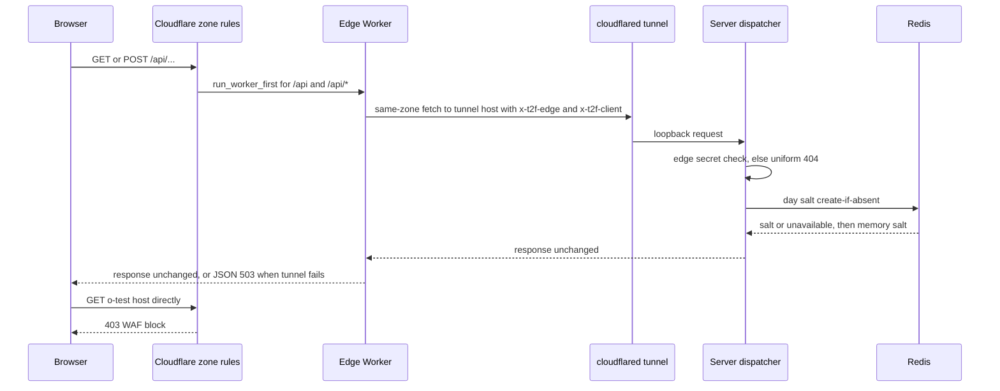

# Spec: Край Cloudflare
Spec ID: SPEC-05
Status: approved
Supersedes: none

## Problem and user

Сьогодні сайт — статичний експорт Next (`next.config.ts:36-37`, `output:'export'`, `trailingSlash:true`), час віддає Pages Function `functions/api/time.ts:1-10`, а сервер SPEC-02 не знає ні адреси, ні країни клієнта: ключ `ipDay` — заглушка `ipday:stub:<дата>` (`server/src/platform/rateLimit.ts:37-43`, AC-51 SPEC-02). Без краю: сервер походження відкритий для прямих запитів (К-4, `specs/002-backend/spec.md:225`), `X-Forwarded-For` підробляється й обходить ліміти, особисті відповіді можуть потрапити в кеш Cloudflare разом із `Set-Cookie` (research-cloudflare §5), а вебхук PayPro у режимі «під атакою» отримає виклик замість проходу (§4). До того ж власник з 1 грудня ставить передстартовий статичний сайт на Cloudflare (`docs/decision.md:24-29`).

Користувачі: відвідувач (сайт працює статикою, IP не зберігається), власник (походження закрите, стан Cloudflare лише зі скрипта), агенти хвиль 04, 06, 08, 10, 13a, 17, 22a (беруть готовий канал, довірений заголовок і правила).

## Goals / Non-goals

**Goals**
- Сайт — Worker зі статикою; на походження йдуть лише `/api/*` через тунель `cloudflared` у тій самій зоні з секретом краю (FR-EDGE-01, FR-EDGE-09).
- Сервер відмовляє будь-якому `/api/*` без дійсного секрету однаковою відповіддю; адресу й країну бере лише з `x-t2f-client` (FR-EDGE-07).
- Добовий відбиток IP замість заглушки SPEC-02 (FR-EDGE-10); декларативний рядок у реєстрі «дані суб’єкта».
- Час з краю в `rehearsal`/`prelaunch`/`production` (FR-EDGE-04); проксі не кешує й не чіпає cookie, тіло й заголовки (FR-EDGE-03, FR-EDGE-08, FR-EDGE-11).
- `infra/cloudflare/`: бажаний стан у git + скрипт `plan`/`apply` зі сторожем основного домену.
- Середовище wrangler `prelaunch` з командою розгортання статики.
- Перевірка наживо на `test.time2fest.com` (спайк 1 `content-freshness.md:341`) сценарним e2e.
- **Поза репозиторієм (пише ведучий хвилі):** `docs/backend/cloudflare-notes.md` — єдине дослідження Cloudflare для 04, 06, 08, 13a, П-RT; записи журналу в `docs/services/cloudflare.md`.

**Non-goals**
- FR-EDGE-02, 05, 06, 12 — кеш публічного знімка, очищення, червона кнопка, `HIT` на знімках — SPEC-08.
- Адмінка (`/admin`, `/cms-api/*`): Worker сайту її не проксує; її канал — тунель + JWT Access — SPEC-04 (FR-ADM-01). Access і правила кешу в `infra/cloudflare/` додають SPEC-04 і SPEC-08.
- Centrifugo і його піддомен — SPEC-06 / П-RT. WebSocket через `/api/*` не підтримується.
- Справжній сервер, закриття походження на ньому, репетиція — SPEC-13a. Обробник вебхука PayPro — SPEC-17. Справжня cookie сесії — SPEC-10 (тут лише транспорт через дверцята).
- Режим збірки «до запуску», SEO-файли (`sitemap`, `robots`, `canonical`), будь-яке розгортання на `time2fest.com` — хвиля передстартового сайту. Глобальний `X-Robots-Tag: noindex` у `public/_headers:1-7` вирішує вона.
- Розгортання `rehearsal`, `prelaunch`, `production` у цій хвилі — лише `test`.
- Workers VPC (бета) і Authenticated Origin Pulls — відхилено (D1). Кошики R2 — SPEC-08. Bot Fight Mode — вимкнений на всю зону, не правило шляху (D9).
- FR-ID-17 (блок нових гостей за відбитком) — хвиля входу; тут лише ключ лімітів.

## User stories

- **US-1** Як відвідувач, я хочу отримувати сайт статикою з краю, щоб сторінки й час працювали, навіть коли сервер недоступний (FR-EDGE-01, FR-EDGE-04). → AC-1 … AC-4, AC-10, AC-11, AC-48
- **US-2** Як власник, я хочу, щоб походження приймало лише мій край, щоб Cloudflare не можна було обійти (FR-EDGE-09). → AC-14 … AC-19, AC-37, AC-49
- **US-3** Як сервер (ліміти, прапор), я хочу одну адресу й країну, яку клієнт не підробить (FR-EDGE-07). → AC-8, AC-20 … AC-23, AC-28, AC-47, AC-50
- **US-4** Як відвідувач, я хочу, щоб моя IP не зберігалася, а ліміти рахувалися за добовим відбитком (FR-EDGE-10, FR-PRIV-03). → AC-24 … AC-31
- **US-5** Як агенти SPEC-10 і SPEC-17, ми хочемо проксі, що передає cookie, тіло й заголовки без змін і нічого особистого не кешує (FR-EDGE-03, FR-EDGE-08, FR-EDGE-11). → AC-5 … AC-7, AC-9, AC-32 … AC-36, AC-46, AC-51
- **US-6** Як власник, я хочу змінювати стан Cloudflare лише скриптом з репозиторію, який не зачепить основний домен без мого «так». → AC-37 … AC-44
- **US-7** Як власник, я хочу окреме середовище для передстартового статичного сайту (`docs/decision.md:29`). → AC-12, AC-13
- **US-8** Як оркестратор, я хочу, щоб нові пакети перевірялися в CI так само, як інші. → AC-45

## Acceptance criteria (EARS)

Пакети: `edge` — `workers/edge/` (новий пакет робочого простору), `infra` — `infra/cloudflare/`, `server`, `web`. «Єдиний 404» — відповідь `notFoundResponse` (`server/src/endpoints/pipeline.ts:60-62`): 404, тіло `{"ok":false,"error":{"code":"not_found"}}`, JSON. «Перевірка наживо» (`e2e (live)`) — сценарний набір на `test.time2fest.com` через `cloudflared` у Docker з ноутбука; пропускається без своїх змінних середовища (зразок `server/test/e2e/*.e2e.ts`, `T2F_E2E_BASE`). Позначка **[13a]** — повторюється на справжньому сервері в SPEC-13a.

### Статика й маршрути краю

**AC-1 [edge]** The edge Worker config shall для кожного з середовищ `test`, `rehearsal`, `prelaunch`, `production` задавати статику з теки експорту сайту, `run_worker_first` лише для `/api` і `/api/*`, `html_handling: force-trailing-slash`, і вимкнені `workers.dev` та адреси попереднього перегляду.
Verify: unit — тест розбирає конфіг wrangler і перевіряє ці поля в усіх чотирьох середовищах.

**AC-2 [edge]** WHEN шлях запиту не `/api` і не починається з `/api/` (зокрема `/admin`, `/admin/*`, `/cms-api/*`), the Worker shall віддати його зі статики (невідомий шлях — статус 404), не звертаючись до походження.
Verify: integration — Worker у локальному `workerd` із заглушкою походження: `/`, сторінка країни → 200, `/admin/`, `/cms-api/x` → 404, лічильник викликів заглушки = 0; e2e (live) — сервер зупинено, `/` і сторінка країни → 200.

**AC-3 [edge]** IF шлях рівно `/api` або запит під `/api/` має `Upgrade: websocket`, THEN the Worker shall відповісти єдиним 404 з `Cache-Control: private, no-store`, не звертаючись до походження.
Verify: integration — обидва випадки → тіло й статус єдиного 404, викликів заглушки 0.

**AC-4 [web, edge]** The repository shall не містити Pages Function: `functions/` видалено, поведінка `functions/api/time.ts` живе лише в пакеті `edge`, а `tsc`, `eslint` і `vitest` кореня проходять без перевірки `workers/**` і `infra/**` бібліотеками DOM.
Verify: unit (static) — `Glob functions/**` порожній; повний `verify` пакета `web` зелений.

### Проксі `/api/*`

**AC-5 [edge]** WHERE середовище `test`, `rehearsal` або `production`, WHEN запит під `/api/` (крім AC-10), the Worker shall передати на ім’я тунелю метод, шлях, рядок запиту, заголовки (зокрема `Cookie`) і тіло потоком без змін, змінивши лише `x-t2f-edge` і `x-t2f-client`.
Verify: integration — для GET, HEAD, OPTIONS, PUT, DELETE, POST JSON і POST `application/x-www-form-urlencoded` заглушка отримує ті самі метод, шлях, запит, заголовки, а SHA-256 тіла збігається з надісланим.

**AC-6 [edge]** The Worker shall повертати клієнту статус, заголовки (кожен рядок `Set-Cookie` окремо) і тіло відповіді походження без змін, крім випадків AC-9, зокрема JSON-відповіді 5xx самого сервера.
Verify: integration — заглушка з двома `Set-Cookie`, власним заголовком і JSON 503 → клієнт отримує їх байт у байт.

**AC-7 [edge]** The Worker shall не класти відповіді в кеш, не задавати параметрів кешу запиту до походження й не додавати чи змінювати `Cache-Control` і `Set-Cookie`.
Verify: unit (static) — у пакеті немає Cache API і опцій кешу `cf`; integration — заголовки відповіді дорівнюють заголовкам заглушки.

**AC-8 [edge]** WHEN запит доходить до Worker, the Worker shall видалити вхідні `x-t2f-client` і `x-t2f-edge` і поставити `x-t2f-edge` зі секрету середовища та `x-t2f-client: <CF-Connecting-IP>;<request.cf.country>` (порожня країна, якщо її немає).
Verify: integration — підроблені вхідні значення не доходять до заглушки; вона бачить значення із симульованих даних `cf`.

**AC-9 [edge]** IF запит до походження кидає виняток або походження відповідає 502, 503, 504 чи 520–530 без типу `application/json`, THEN the Worker shall відповісти 503 з тілом `{"ok":false,"error":{"code":"unavailable","retryAfterMs":5000}}`, `Retry-After: 5`, `Cache-Control: private, no-store`, і ніколи сторінкою HTML Cloudflare.
Verify: integration — заглушка: HTML 530, HTML 502, обрив з’єднання → JSON 503; e2e (live) — `cloudflared` зупинено → JSON 503.

### Час

**AC-10 [edge]** WHERE середовище `rehearsal`, `prelaunch` або `production`, WHEN GET рівно `/api/time`, the Worker shall сам відповісти 200 з тілом `{"now":<ціле мс UTC>}` і заголовками `Cache-Control: no-store, max-age=0`, `Content-Type: application/json; charset=utf-8`, `X-Robots-Tag: noindex`, не звертаючись до походження.
Verify: integration — походження недосяжне → 200, `now` у межах ±1000 мс годинника тесту, викликів заглушки 0. **[13a]** наживо на репетиції.

**AC-11 [edge]** WHERE середовище `test`, the Worker shall передавати `/api/time` на походження як будь-який шлях `/api/*`, щоб тестовий годинник сервера лишався єдиним джерелом часу (FR-CLK-01).
Verify: integration — тіло відповіді дорівнює тілу заглушки.

### Передстартове середовище

**AC-12 [edge]** WHERE середовище `prelaunch`, WHEN запит під `/api/` інший, ніж GET `/api/time`, the Worker shall відповісти єдиним 404 без звернення до походження (конфіг `prelaunch` не має адреси походження й секрету краю).
Verify: unit — конфіг `prelaunch` без змінної походження; integration — `/api/x`, POST `/api/time` → єдиний 404.

**AC-13 [edge]** The edge package shall мати команду розгортання для кожного з чотирьох середовищ (у `prelaunch` — своя тека статики) і описаний у README пакета слот скрипта `build:prelaunch` без реалізації; у цій хвилі розгортається лише `test`.
Verify: unit — `wrangler deploy --dry-run --env <env>` проходить для всіх чотирьох; README називає слот.

### Перевірка походження на сервері

**AC-14 [server]** The env registry shall мати `T2F_EDGE_SECRET` (секрет, ≥ 32 символи, `requiredIn: rehearsal, production`) і рядок у `server/.env.example` без значення.
Verify: unit — `loadEnv` у класі `rehearsal` без змінної падає й друкує лише назву.

**AC-15 [server]** WHILE клас середовища `rehearsal` або `production`, IF запит `/api/*` не має `x-t2f-edge`, рівного `T2F_EDGE_SECRET`, THEN the dispatcher shall відповісти єдиним 404 до пошуку маршруту, проміжних ланок і обробника.
Verify: integration — `/api/time` і невідомий шлях без секрету й з хибним → однакові статус, заголовки й тіло; обробник не викликано. **[13a]**

**AC-16 [server]** WHERE клас `test` і `T2F_EDGE_SECRET` задано, the dispatcher shall застосовувати перевірку AC-15.
Verify: integration — той самий набір, що в AC-15, у класі `test`.

**AC-17 [server]** WHERE клас `test` і `T2F_EDGE_SECRET` не задано, the dispatcher shall обслуговувати запити без перевірки краю й без довіреної адреси.
Verify: integration — наявні набори SPEC-02 проходять без змін.

**AC-18 [server]** The edge check shall порівнювати секрет за сталий час, незалежно від довжини й спільного префікса отриманого значення.
Verify: unit — хибні значення іншої й тієї самої довжини → відмова; рецензія безпеки підтверджує порівняння сталого часу.

**AC-19 [server]** The server shall не писати секрет краю, значення `x-t2f-edge` і `x-t2f-client`, сиру адресу й сіль у журнали, відповіді, Postgres і сховище.
Verify: unit — перехоплений журнал успіху, відмови й необробленої помилки не містить жодного з цих рядків; `Grep` колекцій не знаходить полів адреси чи солі.

### Довірений клієнт

**AC-20 [server]** WHEN секрет краю дійсний, the server shall брати адресу й країну лише з `x-t2f-client`, ігноруючи `X-Forwarded-For`, `X-Real-IP`, `CF-Connecting-IP`, `True-Client-IP` і `Forwarded`.
Verify: integration — зміна будь-якого з п’яти заголовків не змінює країну й відбиток.

**AC-21 [server]** IF частина країни відсутня, дорівнює `XX` чи `T1` або не є двома великими латинськими літерами, THEN the server shall вважати країну `unknown`.
Verify: unit — таблиця значень.

**AC-22 [server]** IF перевірка краю неактивна, заголовка немає або частина адреси не є дійсною IPv4 чи IPv6, THEN the server shall вважати, що довіреної адреси немає, і рахувати `ipDay` у спільному кошику «без адреси».
Verify: unit — `1.2.3`, `abc`, порожньо → ключ кошика «без адреси».

**AC-23 [server]** The request context shall давати обробникам і проміжним ланкам країну й відбиток і не давати сирої адреси.
Verify: unit (static) — тип контексту запиту не має поля адреси; `tsc` проходить.

### Добовий відбиток IP

**AC-24 [server]** The fingerprint shall бути HMAC-SHA-256 адреси (IPv6 — зведеної до префікса /64) із сіллю поточної доби UTC і не містити жодної частини адреси.
Verify: unit — та сама адреса в ту саму добу → той самий відбиток; дві IPv6 одного /64 → однаковий, різних /64 → різний; переписаний тест AC-51 SPEC-02 (`server/test/unit/mechanisms.test.ts:31-65`) зелений.

**AC-25 [server]** WHEN солі поточної доби UTC немає в швидкому сховищі, the server shall створити випадкову 32-байтову сіль операцією «створити, якщо немає» з терміном життя ≤ 24 год від створення.
Verify: integration — два диспетчери на одному Redis дають однаковий відбиток; TTL ключа ≤ 86 400 000 мс.

**AC-26 [server]** WHEN годинник сервера переходить північ UTC, the server shall обчислювати відбиток із солі нової доби.
Verify: unit — тестовий годинник 23:59:59.999 і 00:00:00.000 → різні відбитки однієї адреси.

**AC-27 [server]** IF швидке сховище недоступне, THEN the server shall брати сіль доби з пам’яті процесу, ніде її не зберігаючи й відкидаючи зі зміною доби.
Verify: unit — сховище кидає `DependencyUnavailable` → відбиток обчислено й стабільний у межах доби процесу.

**AC-28 [server]** The rate-limit middleware shall передавати відбиток як значення `ipDay`.
Verify: integration — рядок ліміту `ipDay` з лімітом 2: три запити з тим самим `x-t2f-client` і різним `X-Forwarded-For` → третій `rate_limited`; з різними адресами → без відмови.

**AC-29 [server]** IF рядок ліміту з ключем `ipDay` має `windowMs` > 86 400 000, THEN the rate-limit registry check shall зупинити запуск сервера.
Verify: unit — такий рядок → помилка перевірки реєстру.

**AC-30 [server]** The fingerprint shall використовуватися лише як ключ лімітів частоти і не потрапляти в колекції, повідомлення, профіль, замовлення й журнали.
Verify: unit (static) — `Grep` викликів функції відбитка лише з модулів лімітів і контексту краю; рецензія безпеки.

**AC-31 [server]** The subject-data registry shall підтримувати декларативний рядок без обробника зі строком зберігання (виконавець пропускає його в `export`, `erase`, `anonymise` і називає в результаті) і містити рядок «добовий відбиток IP: без обробника, строк ≤ 24 год».
Verify: unit — виконавець із декларативним рядком не падає й повертає його в переліку декларативних.

### Кеш і cookie на сервері

**AC-32 [server]** The dispatcher shall віддавати кожну відповідь маршруту, не оголошеного публічним, і кожну власну відповідь (404, 429, 500, 503) з `Cache-Control`, що містить `no-store`, ставлячи `private, no-store`, коли обробник не поставив заголовка або поставив без `no-store`.
Verify: integration — тестові маршрути без заголовка, з `max-age=60` і з `no-store, max-age=0`; помилки диспетчера.

**AC-33 [server]** WHERE маршрут оголошено публічним, IF його відповідь має `Set-Cookie`, THEN the dispatcher shall прибрати `Set-Cookie` і записати попередження з ключем маршруту.
Verify: integration — тестовий публічний маршрут із cookie → відповіді без `Set-Cookie`; у реєстрі маршрутів хвилі публічних рядків 0.

**AC-34 [server]** WHERE клас `test` і дверцята ввімкнено, the server shall відповідати на `GET` і `POST /api/_test/edge-echo` за контрактом «Дверцята відлуння» (Module interactions).
Verify: integration — поля відповіді, SHA-256 тіла, перелік заголовків; у відповіді немає адреси, відбитка й значень `x-t2f-*`.

**AC-35 [server]** WHEN запит до дверцят відлуння не має cookie `t2f_edge_probe`, the door shall поставити `t2f_edge_probe=<випадкове>; Path=/; Secure; HttpOnly; SameSite=Lax` без `Domain`.
Verify: integration — рядок `Set-Cookie` точно з цими атрибутами; з cookie — `probeCookie` дорівнює її значенню.

**AC-36 [server]** WHERE клас не `test` або дверцята вимкнено, the server shall відповідати на `/api/_test/edge-echo` єдиним 404.
Verify: integration — перевірка «Test doors» з `contractChecks`.

### Інфраструктура Cloudflare

**AC-37 [infra]** The infra desired state shall описувати для кожного середовища: тунель і його ingress (останнє правило — `http_status:404`), проксійований CNAME імені тунелю, правило WAF, що блокує публічні запити до імені тунелю, правило пропуску (рівень безпеки, BIC, ліміти частоти, керовані правила) й правила конфігурації для одного реєстру шляхів-винятків (`/api/webhooks/paypro`; у `test` ще `/api/_test/edge-echo`), перемикач «під атакою» лише для `test.time2fest.com` (типово вимкнений), а також перевірку, що Bot Fight Mode і Pseudo IPv4 вимкнені.
Verify: unit — перевірка бажаного стану `test` знаходить кожен елемент.

**AC-38 [infra]** WHEN скрипт запущено без `apply`, the script shall друкувати відмінності бажаного й поточного стану, не роблячи жодного запиту на зміну.
Verify: unit — фейковий API записує 0 запитів, крім GET.

**AC-39 [infra]** WHEN `apply` запущено вдруге без зміни бажаного стану, the script shall не робити жодного запиту на зміну й повідомляти «без змін».
Verify: integration — фейковий API; e2e (live) — другий `apply` на тестовому середовищі друкує «без змін».

**AC-40 [infra]** IF зміна зачіпає `time2fest.com`, `www.time2fest.com`, `admin.time2fest.com`, налаштування всієї зони або видаляє ресурс чи правило (зокрема правило фази, якого немає в бажаному списку), THEN the script shall завершитися з ненульовим кодом без жодного запиту на зміну, якщо не передано явного прапорця.
Verify: unit — кожен із п’яти випадків без прапорця → код ≠ 0 і 0 запитів на зміну.

**AC-41 [infra]** WHILE інший `apply` тримає замок `cloudflare` механізму `server/scripts/lock.mjs`, the script shall не робити запитів на зміну.
Verify: integration — два процеси одночасно: другий починає зміни лише після звільнення замка.

**AC-42 [infra]** The script shall не виводити `CLOUDFLARE_API_TOKEN_INFRA`, токен тунелю й секрет краю та передавати токен тунелю локальному `cloudflared` лише через місце поза git.
Verify: unit — вивід із фейковими значеннями цих трьох не містить їх; `git check-ignore` для місця токена — так.

**AC-43 [infra]** WHEN `apply` завершився зі змінами, the script shall надрукувати один готовий рядок журналу `- <YYYY-MM-DD> — infra/cloudflare apply (<env>): <перелік змін>` для `docs/services/cloudflare.md`.
Verify: unit — формат рядка на фейковому API.

**AC-44 [infra]** IF токена немає або API відмовляє (наприклад, 403), THEN the script shall зупинитися на першій відмові з ненульовим кодом, назвати потрібний дозвіл і перелічити вже застосовані зміни.
Verify: unit — фейковий API з 403 на правилах.

### CI

**AC-45 [edge, infra]** The verify config shall мати записи `edge` і `infra` (`files`, `full`) у `.claude/sdd-engineering.json` і ті самі кроки в `.github/workflows/verify.yml`.
Verify: unit (static) — команди кроків CI збігаються з конфігом.

### Перевірка наживо на `test.time2fest.com`

**AC-46 [edge, server]** WHEN клієнт двічі звертається до дверцят відлуння через край, the edge shall доставити `Set-Cookie` першої відповіді без змін атрибутів, а cookie — на походження в другому запиті.
Verify: e2e (live) — атрибути `Secure; HttpOnly; SameSite=Lax`, без `Domain`; другий `probeCookie` дорівнює першому значенню.

**AC-47 [edge, server]** The edge shall доставляти країну клієнта на походження.
Verify: e2e (live) — `client.country` дверцят дорівнює `loc` з `/cdn-cgi/trace` того самого імені, `addressPresent: true`.

**AC-48 [edge]** The edge shall ніколи не віддавати проксійовану відповідь `/api/*` з `CF-Cache-Status: HIT`.
Verify: e2e (live) — 20 поспіль запитів до дверцят і до `/api/time` — жодного `HIT`.

**AC-49 [infra, server]** IF запит іде на ім’я тунелю повз Worker або на порт походження не з loopback, THEN the edge and origin shall відмовити: Cloudflare блокує ім’я тунелю для `/api/time`, `/api/webhooks/paypro`, `/connection/websocket`, а порт походження з іншого інтерфейсу не приймає з’єднання.
Verify: e2e (live) — три запити на `o-test.time2fest.com` → 403 Cloudflare, журнал сервера без цих запитів; з’єднання з іншої машини мережі на порт сервера відхилено. **[13a]** на справжньому сервері; адмінка — SPEC-04.

**AC-50 [edge, server]** IF клієнт надсилає власні `x-t2f-client`, `x-t2f-edge` і `X-Forwarded-For`, THEN the edge shall доставити на походження лише свої значення.
Verify: e2e (live) — з `x-t2f-client: 203.0.113.9;US` і випадковим `x-t2f-edge` дверцята показують `edgeVerified: true` і `country` = `loc` трасування.

**AC-51 [edge, infra, server]** WHILE перемикач «під атакою» для `test.time2fest.com` увімкнено, the edge shall пропускати POST на шлях-виняток без виклику й без зміни тіла й заголовків.
Verify: e2e (live) — POST `application/x-www-form-urlencoded` з `x-t2f-probe-signature` = HMAC сирого тіла → 200, `bodySha256` дорівнює хешу клієнта, підпис дійшов без змін; GET `/` того ж імені → виклик (не 200); після тесту перемикач вимкнено, `plan` без відмінностей.

## Edge cases

- **EC-1** IPv6 клієнта (зокрема змінні адреси в одному /64). → AC-24
- **EC-2** Країни немає, `XX` (невідома) чи `T1` (Tor). → AC-21
- **EC-3** Клієнт підробляє `x-t2f-client` чи `x-t2f-edge`. → AC-8, AC-50
- **EC-4** Тіло більше за ліміт маршруту (16 КіБ типово): Worker передає потік, сервер відмовляє своєю відповіддю, Worker її не змінює. → AC-6, NFR-4
- **EC-5** Тунель чи сервер лежить (530 / 1033 / обрив). → AC-9
- **EC-6** HEAD чи OPTIONS під `/api/`: проксі передає, диспетчер відповідає єдиним 404; у `prelaunch` — єдиний 404 краю. → AC-5, AC-12
- **EC-7** `/api` без косої риски. → AC-3
- **EC-8** `/api/time/` з косою рискою: край відповідає лише на точний `/api/time`, решта йде звичайним шляхом без перенаправлення. → AC-1, AC-5, AC-10
- **EC-9** WebSocket-апгрейд на `/api/*`. → AC-3
- **EC-10** Сіль змінюється опівночі UTC посеред вікна ліміту. → AC-26
- **EC-11** Швидке сховище недоступне. → AC-27
- **EC-12** Два вузли одночасно створюють сіль доби. → AC-25
- **EC-13** Сервер сам відповідає JSON 503 (Redis лежить). → AC-6
- **EC-14** `x-t2f-client` зіпсований за дійсного секрету. → AC-22
- **EC-15** Запит через `*.workers.dev` повз правила зони. → AC-1
- **EC-16** Ротація `T2F_EDGE_SECRET` без простою. → Open question 1
- **EC-17** Тіло невідомої статичної сторінки (сторінка 404 сайту чи порожнє). → Open question 2
- **EC-18** «Під атакою» на всю зону в ніч запуску. → Open question 3
- **EC-19** Відповідь з `Set-Cookie` і явним TTL краю (Cloudflare прибирає cookie й кешує). → AC-7, AC-32

## Non-functional requirements

**NFR-1 [edge]** The Worker shall витрачати ≤ 2 мс CPU на проксійований запит на 95-му перцентилі.
Verify: manual — метрика CPU Worker у панелі Cloudflare після 200 запитів наживо (автоматично її не прочитати без токена аналітики).

**NFR-2 [edge]** The Worker bundle shall бути ≤ 64 КіБ і не мати залежностей часу виконання, крім платформи.
Verify: unit — розмір із `wrangler deploy --dry-run`; `dependencies` пакета порожні.

**NFR-3 [edge, infra, server]** The repository shall не містити значень секретів: секрети краю — лише `wrangler secret`, токени — лише змінні середовища, `scripts/check-secrets.mjs` зелений на `workers/` і `infra/`.
Verify: unit — `node scripts/check-secrets.mjs` → код 0; конфіг wrangler без секретних `vars`.

**NFR-4 [edge]** The Worker shall передавати тіло запиту потоком, не читаючи його.
Verify: integration — тіло 1 МіБ доходить до заглушки з тим самим SHA-256; рецензія — тіло не читається в Worker.

**NFR-5 [server]** The edge check and fingerprint shall додавати ≤ 1 мс на запит на 95-му перцентилі в процесі (сіль у пам’яті процесу після першого читання доби).
Verify: unit — 1 000 запитів через диспетчер із заглушкою сховища.

## Module interactions

Кожна стрілка, що може впасти: Worker → тунель (AC-9), сервер → Redis (AC-27), прямий запит на тунель (AC-49), край → статика без походження (AC-2, AC-10).

**Контракт: довірені заголовки краю (proposed).** Worker → походження, кожен запит `/api/*`. `x-t2f-edge` (обов’язковий, рядок = `T2F_EDGE_SECRET` середовища); `x-t2f-client` (обов’язковий, `<ip>;<country>`, `ip` — `CF-Connecting-IP` IPv4 чи IPv6, `country` — `request.cf.country` чи порожньо). Помилки: секрет невірний чи відсутній → єдиний 404 (AC-15); заголовок зіпсований → «без адреси» (AC-22).

**Контракт: збій походження на краю (proposed).** 503, `Retry-After: 5`, `Cache-Control: private, no-store`, тіло `ApiResult` з `ApiError` (`packages/contracts/src/result.ts:4-31`): `code: 'unavailable'` (503 у `server/src/endpoints/pipeline.ts:23`), `retryAfterMs: 5000`. Нових кодів і причин немає.

**Контракт: час краю (наявний).** `GET /api/time` → `{now:number}` і три заголовки — як `server/src/endpoints/time.ts:7-11`, що повторює `functions/api/time.ts:5-9`.

**Контракт: дверцята відлуння (proposed, лише `test` + дверцята).** `GET|POST /api/_test/edge-echo`; тіло POST будь-якого типу ≤ 16 КіБ (більше — наявна відмова диспетчера). Відповідь 200 у конверті дверцят `{ok:true, value}`: `method` string, `path` string, `query` string (без `?`), `bodyBytes` number, `bodySha256` string (hex), `headers` object — лише `content-type`, `content-length`, `user-agent`, `cookie`, `x-t2f-probe-signature`, `edgeVerified` boolean, `client: {country: string ('unknown' | ISO-2), addressPresent: boolean}`, `probeCookie` string | null. Заборонено у відповіді: адреса, відбиток, сіль, значення `x-t2f-*`.

**Передачі іншим хвилям**
- **SPEC-02:** перевірка краю — до пошуку маршруту; `30-rate-limit` отримує `ipDay` (`server/src/registries/middleware.ts:145-149`); реєстр env — `T2F_EDGE_SECRET`; реєстр «дані суб’єкта» — декларативний рядок.
- **SPEC-04:** адмінка — окреме ім’я тунелю за Access; JWT `Cf-Access-Jwt-Assertion` (research-cloudflare §8); правила Access додає в `infra/cloudflare/`.
- **SPEC-06 / П-RT:** realtime — своє публічне ім’я тунелю, `security_level: off`, пінг 25–50 с (research-cloudflare §7).
- **SPEC-08:** публічні маршрути (оголошення `public`, без `Set-Cookie`), правила кешу, `HIT` знімка, очищення.
- **SPEC-10:** справжня cookie сесії з атрибутами FR-EDGE-08 на публічному домені.
- **SPEC-13a:** розгортання `rehearsal`, закриття походження на справжньому сервері (AC-15, AC-49 позначено [13a]), відсутність солі в резервних копіях Redis, перевірка AC-10 наживо.
- **SPEC-17:** маршрут `POST /api/webhooks/paypro` без схеми тіла (сирі байти), `sameOriginExempt`; підпис PayPro — за значеннями полів, не за сирим тілом (research-cloudflare §4), але байтова тотожність лишається (NFR-09).
- **SPEC-22a (FR-OPS-05):** інструкція на ніч — Bot Fight Mode вимкнений на всю зону (пропустити за шляхом на Free неможливо); шлях вебхука у винятках.
- **Хвиля передстартового сайту:** режим збірки «до запуску» в слоті `build:prelaunch`; глобальний `noindex` у `public/_headers`.

## Inputs and provenance

| Input | Source | Producer | Freshness | Trusted |
|---|---|---|---|---|
| `CF-Connecting-IP`, `request.cf.country` | Cloudflare у Worker | Cloudflare | на запит | так, у Worker (research-cloudflare §3) |
| `x-t2f-edge`, `x-t2f-client` на походженні | Worker | наш край | на запит | лише з дійсним секретом |
| `X-Forwarded-For`, `X-Real-IP`, `CF-Connecting-IP`, `True-Client-IP`, `Forwarded` на походженні | клієнт чи проксі | будь-хто | на запит | ні, ігнорується |
| Вхідні `x-t2f-*` від клієнта | клієнт | будь-хто | на запит | ні, видаляються |
| Метод, шлях, запит, тіло, `Cookie` | клієнт (зокрема PayPro) | будь-хто | на запит | ні |
| Відповідь походження | сервер | наш сервер | на запит | так (передається без змін) |
| Сіль доби | Redis чи пам’ять процесу | сервер | ≤ 24 год | так |
| Поточний стан Cloudflare | API Cloudflare | Cloudflare | на запуск скрипта | так, через токен `CLOUDFLARE_API_TOKEN_INFRA` (від власника, окремо) |
| Факти Cloudflare | research-cloudflare (Opus, 2026-11-17, developers.cloudflare.com) | дослідник | 2026-11 | так; позначені NC — перевіряє AC-46 … AC-51 |
| Факти коду | research-code (Sonnet, 2026-11-17) | дослідник | 2026-11-17 | так, звірено вибірково |

## Untrusted inputs

- Клієнтські заголовки адреси (`X-Forwarded-For` та ін.) — ігноруються: AC-20, AC-28.
- Вхідні `x-t2f-client`, `x-t2f-edge` — видаляються краєм: AC-8, AC-50; без секрету — відмова: AC-15, AC-16.
- Значення `x-t2f-client` — перевіряється на межі (IP, ISO-2): AC-21, AC-22.
- Тіло й заголовки запиту — не виконуються, не змінюються, обмежені за розміром сервером: AC-5, AC-6, NFR-4, EC-4.
- Сира IP — не зберігається й не журналюється: AC-19, AC-23, AC-30.
- Шляхи `/admin`, `/cms-api/*` на імені сайту — не проксуються: AC-2.
- Арендність: не застосовна — хвиля не читає записів за id; ключі лімітів відокремлені відбитком: AC-28.

## Design review

Інтерфейсу немає: хвиля не змінює `web/` видимо (дизайн-джерела `designs` не стосуються). Знахідки першого проходу (ведучий хвилі, research-code і research-cloudflare):

1. `functions/api/time.ts` і `server/src/endpoints/time.ts` — близнюки; Pages Function зникає → accepted → AC-4, AC-10.
2. Диспетчер відповідає 404 невідомому шляху до проміжних ланок (`pipeline.ts:209-210`) → відмова без секрету не повинна розрізняти маршрути → accepted → AC-15.
3. `cache-control: no-store` уже в `JSON_HEADERS` (`pipeline.ts:28-31`), але `private` і публічні маршрути не оголошені → accepted → AC-32, AC-33.
4. Тип рядка `SubjectDataHandler` вимагає обробників (`server/src/platform/subjectData.ts:9-14`) → accepted → AC-31.
5. Тест-заглушка AC-51 SPEC-02 (`mechanisms.test.ts:31-65`) переписується → accepted → AC-24.
6. Підпис PayPro — за значеннями полів, не сирим тілом (research-cloudflare §4) → байтова тотожність лишається → accepted → AC-5, AC-51.
7. Bot Fight Mode не пропускається за шляхом → declined як правило → Non-goal; обмеження → AC-37, SPEC-22a.
8. Токен розгортання не має дозволів на правила й DNS (research-cloudflare §9) → окремий `CLOUDFLARE_API_TOKEN_INFRA` → accepted → AC-42, AC-44.
9. `public/_headers` — глобальний `noindex` → declined у цій хвилі → Non-goal (хвиля передстартового сайту).
10. Корінь перевіряє `**/*.ts` з DOM (`tsconfig.json:135-143`) → accepted → AC-4, AC-45.
11. Чи `/api` збігається з `/api/*` (NC) → accepted → AC-1, AC-3.
12. Ротація секрету, сторінка 404 статики, «під атакою» на всю зону → deferred → Open questions 1–3.

### Decisions

- **D1 [А]** Канал край → походження: ім’я тунелю `cloudflared` у тій самій зоні (`o-test.time2fest.com`; Worker на `test.time2fest.com`), походження слухає лише loopback; захист у глибину — правило WAF зони, що блокує ім’я тунелю, і секрет `x-t2f-edge`. Адмінку Worker сайту не проксує (SPEC-04). Workers VPC і Authenticated Origin Pulls — відхилені альтернативи. → AC-1, AC-2, AC-5, AC-37, AC-49
- **D2 [А]** У `rehearsal`/`production` `T2F_EDGE_SECRET` обов’язковий; без дійсного секрету — однакова відповідь для наявних і невідомих шляхів; порівняння сталого часу; у `test` — лише коли змінну задано; секрет і заголовок не журналюються. → AC-14 … AC-19
- **D3 [А]** Один довірений заголовок `x-t2f-client: <ip>;<country>`; вхідні копії видаляє Worker; інші адресні заголовки ігноруються завжди; `XX`/`T1`/порожньо → `unknown`; сира IP не зберігається. → AC-8, AC-20 … AC-23
- **D4 [А]** Добовий відбиток: HMAC-SHA-256 із 32-байтовою сіллю доби UTC у Redis (TTL ≤ 24 год, спільна, «створити, якщо немає»), запасна сіль у пам’яті, IPv6 → /64, без адреси — спільний кошик; лише ключ лімітів; декларативний рядок у реєстрі суб’єкта. → AC-24 … AC-31
- **D5 [А]** Worker зі статикою, `run_worker_first` лише для `/api/*`, `force-trailing-slash`; пакет `workers/edge/`; `functions/api/time.ts` видалено; середовища `test`, `rehearsal`, `prelaunch`, `production`, розгортається лише `test`. → AC-1, AC-4, AC-13
- **D6 [А]** Час: у `rehearsal`/`prelaunch`/`production` відповідає Worker; у `test` — проксі на сервер. → AC-10, AC-11
- **D7 [А]** Проксі без змін, без кешу й cookie; збій походження → JSON `unavailable` з `Retry-After`; сервер — `private, no-store` типово, публічні маршрути без `Set-Cookie`. → AC-5 … AC-9, AC-32, AC-33
- **D8 [А]** Атрибути cookie доводяться дверцятами відлуння; справжня cookie сесії — SPEC-10. → AC-34 … AC-36, AC-46
- **D9 [А]** Вебхук: байтова тотожність для всього `/api/*`; правила пропуску для реєстру шляхів-винятків; Bot Fight Mode вимкнений на зону; «під атакою» перевіряється лише на тестовому імені. → AC-37, AC-51
- **D10 [А]** Стан Cloudflare поза git — лише `infra/cloudflare/` (`plan` типово, `apply`, ідемпотентно, фази цілком, сторож доменів і видалень, замок `cloudflare`, токен `CLOUDFLARE_API_TOKEN_INFRA`, рядок журналу); Worker — `wrangler` з `CLOUDFLARE_API_TOKEN`. → AC-37 … AC-44
- **D11 [А]** Середовище `prelaunch` (своя статика, час краю, без проксі); слот `build:prelaunch` описано, не реалізовано. → AC-12, AC-13
- **D12 [А]** Перевірка наживо на `test.time2fest.com` через `cloudflared` у Docker, набір пропускається без змінних; `HIT` знімків — SPEC-08; позначки [13a]. → AC-46 … AC-51
- **D13 [А]** Записи `verify` і кроки CI для нових пакетів; `check-secrets` зелений. → AC-45, NFR-3
- **D14** Документи поза репозиторієм (`docs/backend/cloudflare-notes.md`, журнал `docs/services/cloudflare.md`) пише ведучий хвилі. → Goals

## Traceability

| AC / NFR | From (US / EC / design review) | Packages | Verify |
|---|---|---|---|
| AC-1 | US-1, EC-8, EC-15, D1, D5 | edge | unit |
| AC-2 | US-1, D1 | edge | integration, e2e |
| AC-3 | US-1, EC-7, EC-9, DR-11 | edge | integration |
| AC-4 | US-1, DR-1, DR-10, D5 | web, edge | unit |
| AC-5 | US-5, EC-6, EC-8, DR-6, D7 | edge | integration |
| AC-6 | US-5, EC-4, EC-13, D7 | edge | integration |
| AC-7 | US-5, EC-19, D7 | edge | unit, integration |
| AC-8 | US-3, EC-3, D3 | edge | integration |
| AC-9 | US-5, EC-5, D7 | edge | integration, e2e |
| AC-10 | US-1, EC-8, D6 | edge | integration |
| AC-11 | US-1, D6 | edge | integration |
| AC-12 | US-7, EC-6, D11 | edge | unit, integration |
| AC-13 | US-7, D5, D11 | edge | unit |
| AC-14 | US-2, D2 | server | unit |
| AC-15 | US-2, DR-2, D2 | server | integration |
| AC-16 | US-2, D2 | server | integration |
| AC-17 | US-2, D2 | server | integration |
| AC-18 | US-2, D2 | server | unit |
| AC-19 | US-2, US-4, D2, D4 | server | unit |
| AC-20 | US-3, D3 | server | integration |
| AC-21 | US-3, EC-2, D3 | server | unit |
| AC-22 | US-3, EC-14, D3, D4 | server | unit |
| AC-23 | US-3, D3 | server | unit |
| AC-24 | US-4, EC-1, DR-5, D4 | server | unit |
| AC-25 | US-4, EC-12, D4 | server | integration |
| AC-26 | US-4, EC-10, D4 | server | unit |
| AC-27 | US-4, EC-11, D4 | server | unit |
| AC-28 | US-3, US-4, D4 | server | integration |
| AC-29 | US-4, D4 | server | unit |
| AC-30 | US-4, D4 | server | unit |
| AC-31 | US-4, DR-4, D4 | server | unit |
| AC-32 | US-5, EC-19, DR-3, D7 | server | integration |
| AC-33 | US-5, DR-3, D7 | server | integration |
| AC-34 | US-5, D8 | server | integration |
| AC-35 | US-5, D8 | server | integration |
| AC-36 | US-5, D8 | server | integration |
| AC-37 | US-2, US-6, DR-7, D1, D9, D10 | infra | unit |
| AC-38 | US-6, D10 | infra | unit |
| AC-39 | US-6, D10 | infra | integration, e2e |
| AC-40 | US-6, D10 | infra | unit |
| AC-41 | US-6, D10 | infra | integration |
| AC-42 | US-6, DR-8, D10 | infra | unit |
| AC-43 | US-6, D10 | infra | unit |
| AC-44 | US-6, DR-8, D10 | infra | unit |
| AC-45 | US-8, DR-10, D13 | edge, infra | unit |
| AC-46 | US-5, D8, D12 | edge, server | e2e |
| AC-47 | US-3, D12 | edge, server | e2e |
| AC-48 | US-1, D12 | edge | e2e |
| AC-49 | US-2, D1, D12 | infra, server | e2e |
| AC-50 | US-3, EC-3, D12 | edge, server | e2e |
| AC-51 | US-5, DR-6, D9, D12 | edge, infra, server | e2e |
| NFR-1 | US-1, D5 | edge | manual |
| NFR-2 | US-1, D5 | edge | unit |
| NFR-3 | US-8, D13 | edge, infra, server | unit |
| NFR-4 | US-5, EC-4, D7 | edge | integration |
| NFR-5 | US-3, US-4, D4 | server | unit |

DR-n — пункт n розділу Design review.

**FR → AC:** FR-EDGE-01 → AC-1 … AC-4, AC-48 · FR-EDGE-03 → AC-7, AC-32, AC-33, AC-48 · FR-EDGE-04 → AC-10, AC-11 · FR-EDGE-07 → AC-8, AC-20 … AC-23, AC-28, AC-47, AC-50 · FR-EDGE-08 → AC-5, AC-6, AC-34, AC-35, AC-46 (сесія — SPEC-10) · FR-EDGE-09 → AC-14 … AC-18, AC-37, AC-49 · FR-EDGE-10 → AC-19, AC-24 … AC-31 · FR-EDGE-11 → AC-5, AC-6, AC-37, AC-51, NFR-4.

**«Готово, коли» (`waves.md:133`) → AC:**

| Пункт картки | AC |
|---|---|
| Спайк 1 на тестовому піддомені через `cloudflared`: cookie | AC-35, AC-46 |
| … `CF-Cache-Status` за класами адрес (тут — `/api/*` ніколи не `HIT`; знімки — SPEC-08) | AC-7, AC-48 |
| … країна доходить | AC-8, AC-47 |
| Прямий запит на походження до `/api/*`, вебхука й realtime → відмова | AC-15, AC-49 [13a] |
| Підроблений `X-Forwarded-For` не впливає на ліміти | AC-20, AC-28, AC-50 |
| Добовий відбиток, сіль ≤ 24 год, рядок реєстру | AC-24 … AC-27, AC-31 |
| Сервер зупинено → `/api/time` відповідає | AC-10 (integration; наживо — [13a]) |
| «Під атакою» → підписаний вебхук проходить, підпис за сирим тілом | AC-5, AC-51 |
| Стан Cloudflare поза git — лише `infra/cloudflare/` | AC-37 … AC-44 |
| Повторено на репетиції | AC-10, AC-15, AC-49 → SPEC-13a |

## Open questions

Маркерів немає; усі питання нижче не блокують жодного критерію.

1. Ротація `T2F_EDGE_SECRET` без простою (сервер приймає попереднє значення на час переходу) — вирішує SPEC-13a перед репетицією. (EC-16)
2. Тіло невідомої статичної адреси: сторінка 404 сайту (`not_found_handling: 404-page`, не підтверджено документацією) чи порожнє — статус 404 гарантує AC-2; вигляд вирішує хвиля передстартового сайту. (EC-17)
3. Чи перекриває правило пропуску «під атакою», увімкнений на всю зону (у документації не підтверджено); AC-51 перевіряє лише перемикач тестового імені — відповідь потрібна інструкції на ніч SPEC-22a. (EC-18)

## Amendments

Поправки після рецензій архітектури й безпеки (2026-11-17); мають перевагу над текстом вище, де суперечать йому.

- **A1 (до AC-5, D7, контракту «довірені заголовки краю»).** Worker передає заголовки запиту без змін, **крім** заголовків про адресу клієнта: `x-forwarded-for`, `x-real-ip`, `forwarded`, `true-client-ip`, `cf-connecting-ip` він видаляє (разом із вхідними `x-t2f-edge` і `x-t2f-client`). Тіло й решта заголовків — без змін. Причина: знахідка S5 — щоб жодна бібліотека на сервері не прочитала адресу, яку задав клієнт.
- **A2 (до контракту «дверцята відлуння», AC-34, AC-46).** Дверцята не повертають заголовок `cookie`: у відповіді лише значення cookie-зонда (`probeCookie`) і назви решти cookie (`cookieNames`). Заборона AC-34 на `x-t2f-*` стосується `x-t2f-edge` і `x-t2f-client`; `x-t2f-probe-signature` повертається. Причина: знахідка S4.
- **A3 (до D1, AC-37, AC-49).** Тунель пускає на походження лише шляхи `^/api/`; решта шляхів імені тунелю отримує 404 від тунелю. Причина: знахідка S1 — `/admin` і `/cms-api/*` ідуть повз диспетчер.
- **A4 (до D9, AC-37, AC-51).** Правила-винятки для шляху вебхука діють лише для опублікованих адрес PayPro (`ip.src in {…}`); для шляху дверцят відлуння — лише на тестовому імені, без умови адреси. Причина: знахідка S2.
- **A5 (до AC-40).** Запобіжник: правило без імені хоста потребує обох прапорців (налаштування зони й основний домен); вираз із логікою хоста, яку запобіжник не може розібрати, вважається таким, що зачіпає основний домен.
- **A6 (до AC-17).** «Набори SPEC-02 проходять без змін» — щодо перевірок: у тестах SPEC-02 змінено лише підготовку (секрет краю для класів `rehearsal`/`production`, явний вимкнений шлюз) і три місця, названі в плані (AC-24, AC-31, перелік дверцят).
- **A7 (до AC-15, EC-6).** `HEAD` і `OPTIONS` на `/api/*` отримують єдиний 404 у всіх класах середовищ.
