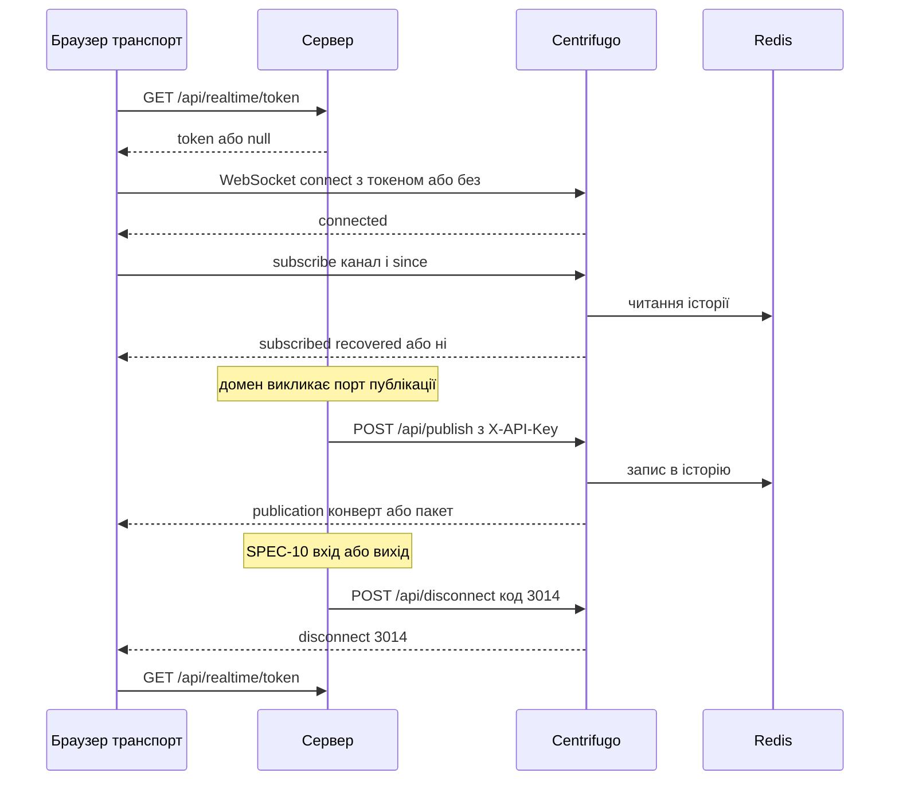
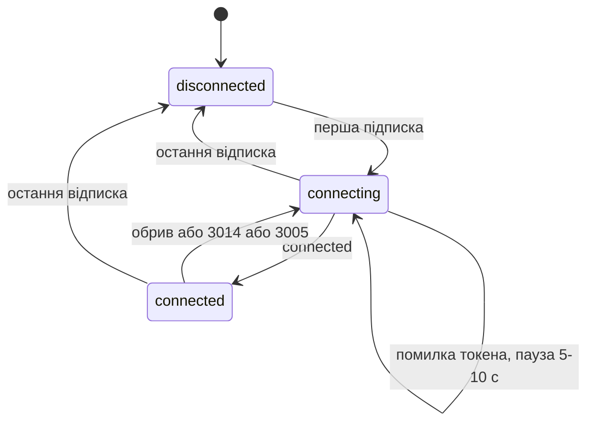

# Spec: Realtime — транспорт Centrifugo
Spec ID: SPEC-06
Status: approved
Supersedes: none

## Problem and user

Сайт обіцяє живі події: чат «Світу» й кімнат, ефір, тости, рейтинг, стан сайту, а також особисті сповіщення, замовлення, штампи й сесію (`D:/Work/Pets/Time2Fest/docs/backend/frontend-seam.md:103-107`, §3.11 `:224-245`). Сьогодні під цим немає транспорту.
- Centrifugo `v6.10.3` у стенді лише піднімається (`docker-compose.yml:44-63`, `SPEC-02:350`). Він працює без файла конфігурації, без ключа токенів і з відкритим API (`CENTRIFUGO_HTTP_API_INSECURE: 'true'`, `:51`), на рушії в пам'яті, без Redis.
- На сервері немає ні порту публікації (`server/src/ports.ts`), ні реєстру каналів (`server/src/registries/`), ні маршруту `GET /api/realtime/token` (`server/src/registries/routes.ts:9`). Сесії гостя чи акаунта ще немає (SPEC-10); є лише `Ctx.subject` для Cloudflare Access (`server/src/endpoints/types.ts:90`).
- У `web` пакета `centrifuge` немає в жодному `package.json`. У `lib/api/http` є лише домен `catalog` (`lib/api/http/domains.ts:7`). Контракти доменів уже мають `subscribe(onEvent)` без транспорту (`lib/api/contracts/{live,chat,notifications,toasts}.ts`, `packages/contracts/src/site.ts:42-68`).
- Centrifugo OSS не вміє пакувати доставку за часом: `client.write_delay`, `batch_max_delay` — лише PRO (research-centrifugo S9). Пакети 250–500 мс (FR-RT-06) мусить збирати наш сервер.

Користувачі:
- **Відвідувач без сесії.** Їх більшість: гість створюється лише при першому записі, SPEC-10.
- **Гість чи власник акаунта** з особистими каналами.
- **Агенти доменних хвиль** 07, 08, 10, 12, 15 та інших. Вони беруть порт публікації, рядок реєстру й транспорт.
- **П-RT і SPEC-23.** Вони беруть скрипти k6.

## Goals / Non-goals

**Goals**
- Реєстр класів каналів як єдине джерело імен, прав, історії й пакування. Конфігурація Centrifugo генерується з реєстру, а її синхронність перевіряється (FR-RT-01, FR-RT-02).
- Публікує лише сервер, з ключем API. Клієнт не публікує ніде (FR-RT-01).
- Ендпоінт `GET /api/realtime/token` через порт `SubjectResolver`. Без сесії — `{token:null}` і анонімне підключення лише до публічних каналів. Строк дії токена — рівномірно 45–75 хв (FR-RT-03, FR-RT-09).
- Особисті канали `#` за `sub` підключення. Права змінюються через `invalidateSubject` → `disconnect` 3014 без перезавантаження (FR-RT-02).
- Порт «опублікувати в канал» із конвертом `{type, id, version?, data?}`, ідемпотентністю за `id`, межею 64 КБ і пакуванням 300 мс для класів із прапорцем (FR-RT-04, FR-RT-06).
- Історія в Redis і відновлення. Якщо відновити не вдалося — сигнал `resync`, за яким адаптер домену перечитує знімок (FR-RT-05).
- Клієнтський транспорт у шарі `lib/api/http`: лінива бібліотека, лічильник слухачів, стан підключення, правило відкидання застарілих подій.
- Дверцята «токен для тестового суб'єкта». Секрети стенду генеруються при старті. Centrifugo є в CI.
- Скрипти k6 (стале навантаження, публікація, шквал перепідключень) для П-RT. Локальний димовий тест на 2 000 підключень.

**Non-goals**
- Будь-який домен: чат, штампи, ефір, сповіщення, замовлення, стан сайту. Жоден домен не перемикається на `http`, дошки сайту не змінюються (межа хвилі, `waves.md:152`).
- FR-RT-07 (30 000 через Cloudflare) — П-RT і SPEC-23. FR-RT-08 (опитування знімків без realtime) — SPEC-08 і домени. Тут лише стан підключення для них (AC-47).
- Будь-які зміни в справжньому Cloudflare чи на вузлі DigitalOcean. Ім'я `rt.*`, тунель, `security_level: off` і закриття походження — після SPEC-13a, окремо (AC-66, AC-67).
- Centrifugo PRO, тобто пакування Centrifugo, ліміти частоти на команду й відкликання токенів (D1). Без витрат.
- Токени підписки, серверні підписки через claim `channels`, присутність, `join_leave`, дельта-стиснення (D3).
- Ліміт підключень на суб'єкта й `client.connection_rate_limit` — налаштовує П-RT (Open question 4).
- Сервер не надсилає подію `snapshot` сам: він не знає, у якого клієнта не вдалося відновлення (D10).
- Справжня сесія, вхід, злиття гостя з акаунтом — SPEC-10. Тут лише порт і тестовий адаптер.

## User stories

- **US-1** Як агент доменної хвилі, я хочу публікувати подію в канал одним викликом порту з перевіркою класу й розміру і дізнаватися про відмову Centrifugo, не ламаючи свою транзакцію (FR-RT-01, FR-RT-04). → AC-1, AC-30 … AC-34
- **US-2** Як відвідувач без сесії, я хочу отримувати публічні події без токена, щоб перепідключення до публічних каналів не зверталося до походження (FR-RT-03, FR-RT-09). → AC-7, AC-13, AC-25, AC-48
- **US-3** Як гість чи власник акаунта, я хочу, щоб мої особисті канали читав лише я і щоб права змінювалися після входу чи виходу без перезавантаження (FR-RT-02). → AC-12, AC-22 … AC-24, AC-35, AC-36, AC-49, AC-51
- **US-4** Як відвідувач, після обриву я хочу отримати пропущене з історії, а якщо не вийшло — свіжий знімок (FR-RT-05). → AC-8, AC-9, AC-41 … AC-43
- **US-5** Як глядач чату, я хочу отримувати повідомлення кімнат пакетами раз на 250–500 мс у порядку відправлення (FR-RT-06). → AC-37 … AC-40, AC-46
- **US-6** Як власник, я хочу, щоб токени, видані о 23:50, не спливали всі разом опівночі, щоб сервер і Centrifugo витримали шквал і щоб права не обходилися підробкою (FR-RT-09, FR-RT-01). → AC-3, AC-5, AC-6, AC-14 … AC-21, AC-26 … AC-29, AC-50, AC-53, AC-54, AC-64 … AC-67
- **US-7** Як агент хвилі чи оркестратор, я хочу дверцята, стенд із секретами, Centrifugo в CI й ізоляцію робочих дерев (П-RT, SPEC-23). → AC-2, AC-4, AC-10, AC-11, AC-57 … AC-63
- **US-8** Як власник, я хочу, щоб сайт не змінився ні видимо, ні за розміром сторінок, поки домен не візьме транспорт. → AC-44, AC-45, AC-47, AC-52, AC-55, AC-56

## Acceptance criteria (EARS)

Пакети: `server`, `web` (корінь репозиторію: `lib/api/**`, `docker-compose.yml`, `.github/workflows/verify.yml`), `contracts`.

Терміни:
- **«Реєстр»** — реєстр класів каналів (контракт C8).
- **«Транспорт»** — клієнтський транспорт realtime у шарі `lib/api/http` (контракт C7).
- **«Конверт»** — контракт C3.
- **«Суб'єкт»** — результат порту `SubjectResolver` (C5).

Перевірки:
- `integration` для правил Centrifugo означає справжній Centrifugo стенду з конфігурацією класу `test` і клієнт centrifuge-js у Node.
- `integration (exclusive)` — перевірка, що ламає залежність. Вона йде лише під ексклюзивним замком `lock.mjs --mode exclusive` (`.claude/skills/local-stack/SKILL.md` §3 «Integration lock»; це «§4.3 п. 5» з `waves.md:154`).

### Реєстр і конфігурація Centrifugo

**AC-1 [server]** The channel registry shall містити рівно ці класи каналів, кожен із полями «вид» (публічний чи особистий), «історія: розмір і строк» і «пакування»: `site:state`, `live:streams`, `live:viewers`, `chat:world`, `chat:country.<ISO>`, `toasts`, `rating`, `notif:user#<id>`, `orders:user#<id>`, `user:#<id>`, плюс клас `rttest:<name>`, який існує лише в класі середовища `test` (початкові значення — C8).
Verify: unit — тест перелічує рядки реєстру й порівнює з таблицею C8.

**AC-2 [server]** The repository shall містити конфігурацію Centrifugo, згенеровану з реєстру для класів `test`, `rehearsal`, `production`, і перевірку, яка завершується з ненульовим кодом, коли збережений файл відрізняється від згенерованого.
Verify: unit — перевірка зелена на чистому дереві й падає після ручної зміни одного поля у збереженому файлі.

**AC-3 [server]** The generated configuration shall не вмикати для жодного простору імен і для каналів без простору імен жодного з дозволів `allow_publish_for_client`, `allow_publish_for_subscriber`, `allow_publish_for_anonymous`, `allow_history_for_*`, `allow_presence_for_*`.
Verify: unit — розбір згенерованих файлів трьох класів.

**AC-4 [server]** WHERE клас середовища `rehearsal` або `production`, the generated configuration shall не містити простору імен `rttest`.
Verify: unit — розбір згенерованих файлів.

**AC-5 [server]** The generated configuration shall задавати інтервал пінгу сервера 25 с (у межах 25–50 с, `cloudflare-notes.md` §8).
Verify: unit — значення `client.ping_interval` у трьох файлах.

**AC-6 [server]** The generated configuration shall дозволяти WebSocket лише з походжень сайту: у `rehearsal` і `production` — рівно походження сайту цього класу, у `test` — лише loopback-походження (`http://127.0.0.1:*`, `http://localhost:*` або перелік портів слотів).
Verify: unit — `client.allowed_origins` у трьох файлах.

**AC-7 [server]** The generated configuration shall дозволяти підключення без токена й підписку анонімів лише на публічні класи реєстру, а токени з порожнім `sub` — відхиляти.
Verify: unit — `client.allow_anonymous_connect_without_token`, `client.disallow_anonymous_connection_tokens` і `allow_subscribe_for_anonymous` лише в публічних класах.

**AC-8 [server]** The generated configuration shall задавати особистим класам строк історії ≤600 с і `history_meta_ttl` ≤3 600 с.
Verify: unit — значення трьох особистих класів у трьох файлах.

**AC-9 [server, web]** WHILE стенд запущено, Centrifugo shall працювати на рушії Redis стенду в окремій логічній базі, яку не займає жоден слот робочого дерева.
Verify: integration — після публікації в канал із історією ключі Centrifugo є в його базі й відсутні в базі слота поточного дерева.

### Префікс робочого дерева

**AC-10 [server]** WHERE клас середовища `test`, the publish port and the token endpoint shall будувати ім'я каналу як `<простір>:<префікс><решта>` (`chat:<slug>_world`, `user:<slug>_#42`, `notif:<slug>_user#42`), а для каналів без простору імен — як `<префікс><ім'я>` (`<slug>_toasts`). WHERE клас `rehearsal` чи `production`, префікс порожній, і імена дорівнюють §2.6 шва.
Verify: unit — побудова імен для кожного класу реєстру з префіксом `abc_` і з порожнім.

**AC-11 [server]** IF `T2F_CENTRIFUGO_PREFIX` непорожній і не відповідає `^[a-z0-9_]{1,40}_$`, THEN the server shall відмовитися стартувати й назвати змінну.
Verify: unit — валідація env з `a:b_`, `a#b_`, `ABC_`.

### Ендпоінт токена `GET /api/realtime/token`

**AC-12 [server]** WHEN `GET /api/realtime/token` отримано й `SubjectResolver` повертає суб'єкта, the server shall відповісти 200 `{"ok":true,"value":{"token":<JWT HS256>,"expiresAt":<ISO>}}`, де токен має лише claims `sub` (= id суб'єкта), `iat` і `exp`.
Verify: integration — розбір відповіді й claims токена; Centrifugo приймає підключення з ним.

**AC-13 [server]** WHEN `GET /api/realtime/token` отримано й `SubjectResolver` повертає `null`, the server shall відповісти 200 `{"ok":true,"value":{"token":null,"expiresAt":null}}`.
Verify: integration — запит без тестового суб'єкта.

**AC-14 [server]** The token endpoint and the test door shall ставити `exp` кожного токена в `iat` плюс випадкове рівномірне значення від 2 700 до 4 500 с.
Verify: unit — 1 000 токенів, виданих за 60 с керованого годинника: усі `exp − iat` у межах [2 700; 4 500], жодна 60-секундна корзина `exp` не містить більше 5% токенів.

**AC-15 [server]** The token endpoint shall відповідати з `Cache-Control: private, no-store` і без заголовків `Access-Control-*`.
Verify: integration — заголовки відповіді на запит із чужим `Origin`.

**AC-16 [server]** IF з одного добового відбитка IP надходить понад 30 запитів до ендпоінта токена за 60 с, THEN the server shall відповідати 429 з кодом `rate_limited` і `retryAfterMs`.
Verify: integration — 31-й запит за хвилину → 429.

**AC-17 [server]** The server shall не записувати в журнали значення токена, `T2F_CENTRIFUGO_TOKEN_SECRET` і `T2F_CENTRIFUGO_API_KEY`.
Verify: integration — перехоплений журнал під час видачі токена, публікації й `invalidateSubject` не містить цих рядків.

**AC-18 [server]** IF `SubjectResolver` повертає id, що не відповідає `^[A-Za-z0-9_-]{1,64}$`, THEN the token endpoint shall відповісти 500 з кодом `unknown` без токена.
Verify: unit — тестовий адаптер повертає `a#b`, `a,b` і рядок із 65 символів.

**AC-19 [server]** IF у класі `test` змінна `T2F_CENTRIFUGO_TOKEN_SECRET` не задана, THEN the token endpoint shall відповісти 503 з кодом `unavailable` і причиною `realtime-not-configured`.
Verify: integration — сервер без змінної.

**AC-20 [server]** IF клас середовища `rehearsal` або `production` і `T2F_CENTRIFUGO_TOKEN_SECRET`, `T2F_CENTRIFUGO_API_KEY` чи `T2F_CENTRIFUGO_URL` відсутні або два перші коротші за 32 символи, THEN the server shall відмовитися стартувати й назвати змінну.
Verify: unit — валідація env за класами; обидва секрети позначено `secret: true`.

### Права в Centrifugo

**AC-21 [server]** IF клієнт (анонім чи з токеном) надсилає команду `publish` у канал будь-якого класу, THEN Centrifugo shall відмовити з помилкою 103, і підписники цього каналу не отримують публікації.
Verify: integration — спроба в кожен клас реєстру; другий клієнт-підписник за 2 с не отримує нічого.

**AC-22 [server]** IF анонімне підключення підписується на канал особистого класу, THEN Centrifugo shall відмовити з помилкою 103.
Verify: integration — три особисті класи.

**AC-23 [server]** IF підключення з `sub` A підписується на особистий канал з id B ≠ A, THEN Centrifugo shall відмовити з помилкою 103.
Verify: integration — три особисті класи, зокрема з префіксом робочого дерева.

**AC-24 [server]** WHEN підключення з `sub` A підписується на свої три особисті канали, the system shall підтвердити підписку й доставляти в них публікації сервера.
Verify: integration — публікація через порт доходить до власника каналу.

**AC-25 [server]** WHEN анонімне підключення підписується на канал публічного класу, the system shall підтвердити підписку й доставляти в нього публікації сервера.
Verify: integration — кожен публічний клас.

**AC-26 [server]** IF клієнт підписується на канал простору імен, якого немає в реєстрі, THEN Centrifugo shall відмовити з помилкою 102.
Verify: integration — `admin:x`, `rttest2:x`.

**AC-27 [server]** IF WebSocket відкривається з `Origin`, якого немає серед дозволених (AC-6), THEN Centrifugo shall відмовити в підключенні.
Verify: integration — `Origin: https://evil.example` → підключення не встановлено.

**AC-28 [server]** IF токен підключення підписано іншим ключем або його `exp` минув, THEN Centrifugo shall відмовити в підключенні з токеном.
Verify: integration — токен із чужим ключем; токен дверцят з `ttlSeconds: 1` після 2 с.

**AC-29 [server, web]** IF виклик API сервера Centrifugo не має `X-API-Key` або ключ невірний, THEN Centrifugo shall відповісти 401 і нічого не опублікувати.
Verify: integration — `POST /api/publish` без ключа й з чужим ключем; змінної `CENTRIFUGO_HTTP_API_INSECURE` у compose немає.

### Порт публікації й зміна прав

**AC-30 [server]** WHEN домен публікує конверт у канал класу без пакування, the system shall доставити підписникам рівно цей конверт.
Verify: integration — локально підписник отримує конверт ≤1 с після виклику порту, поля збігаються.

**AC-31 [server, contracts]** IF клас каналу відсутній у реєстрі, конверт не проходить схему C3 або серіалізована публікація перевищує 65 536 байт, THEN the publish port shall повернути помилку `validation` і нічого не надіслати в Centrifugo.
Verify: unit — заглушка API Centrifugo фіксує 0 викликів для кожного з трьох випадків.

**AC-32 [server]** IF Centrifugo недоступний або відповідає 5xx на публікацію, THEN the publish port shall повернути `unavailable` не пізніше ніж за 2 с, не кидаючи виняток у код домену.
Verify: integration — порт Centrifugo закрито; виклик завершується результатом `unavailable` ≤2 с; у журналі рядок рівня warn із класом каналу без тіла конверта.

**AC-33 [server]** WHEN той самий конверт (той самий `id`) публікується в той самий канал двічі за 60 с, the system shall доставити його підписникам один раз.
Verify: integration — два виклики порту → підписник отримує одну публікацію (поле API `idempotency_key` у snake_case).

**AC-34 [contracts]** The contracts package shall визначати схему конверта C3, схему пакета C3 і відповідь ендпоінта токена C1 як спільні схеми для `server` і `web`.
Verify: unit — схеми приймають приклади C1, C3 і відхиляють конверт без `id`, `version` < 0 і пакет без `events`.

**AC-35 [server]** WHEN викликано `invalidateSubject(S)`, the system shall закрити всі підключення суб'єкта S кодом 3014 протягом 2 с.
Verify: integration — два підключення S і одне T; S отримують 3014, T — ні.

**AC-36 [server]** IF Centrifugo недоступний під час `invalidateSubject`, THEN the port shall повернути `unavailable` не пізніше ніж за 2 с і записати warn із id суб'єкта.
Verify: integration — порт Centrifugo закрито.

### Пакування

**AC-37 [server]** WHILE у канал класу з пакуванням надходять події, the publish port shall публікувати їх пакетами C3 так, що перша подія пакета чекає не довше 300 мс, а сусідні публікації одного каналу розділені щонайменше 250 мс.
Verify: integration — канал `rttest:batch`, 20 подій/с протягом 60 с: усі інтервали між публікаціями на боці видавця в межах [250; 500] мс; у підписника p95 інтервалу між пакетами в межах [250; 500] мс.

**AC-38 [server]** The publish port shall зберігати порядок подій одного каналу: підписник отримує події в порядку викликів порту, зокрема на межі двох пакетів.
Verify: integration — 1 000 подій із наростаючим лічильником у `rttest:batch`, порядок у підписника збігається.

**AC-39 [server]** IF у пакеті більше 200 подій або серіалізований пакет перевищує 65 536 байт, THEN the publish port shall розбити його на кілька публікацій у той самий момент скидання, зберігши порядок.
Verify: unit — 450 подій за одне вікно → 3 публікації, порядок збережено, кожна ≤65 536 байт.

**AC-40 [server]** IF публікація пакета повертає помилку, THEN the publish port shall відкинути цей пакет, записати warn із класом каналу й кількістю подій і скинути наступний пакет за розкладом.
Verify: integration — перша публікація отримує 503 від заглушки, наступна проходить.

### Історія й відновлення

**AC-41 [server, web]** WHEN підключення транспорту обривається на рівні мережі й відновлюється в межах строку історії класу, а пропущено не більше подій, ніж розмір історії, the transport shall доставити підписнику всі пропущені події в порядку публікації без сигналу `resync`.
Verify: integration — сокет закрито проксі на 3 с, за цей час опубліковано 5 подій у `site:state`; після перепідключення підписник має 5 подій, `recovered = true`, `resync` не викликано.

**AC-42 [server, web]** IF відновлення не вдалося (пропущено більше за розмір історії, сплив строк або змінилася епоха), THEN the transport shall викликати `onResync` рівно один раз для кожної підписки й не доставляти часткову історію.
Verify: integration — (а) пропущено `history_size + 1` подій; (б) база Redis Centrifugo очищена під час обриву (exclusive) → один `onResync`, жодної події з пропущеного.

**AC-43 [server, web]** IF контейнер Centrifugo перезапущено під час підписки, THEN the transport shall після перепідключення або доставити всі пропущені події, або викликати `onResync`.
Verify: integration (exclusive) — перезапуск контейнера; підписник має всі події з відомих зсувів або один `onResync`, без пропуску.

### Клієнтський транспорт (`web`)

**AC-44 [web]** The transport shall тримати одну підписку Centrifugo на канал незалежно від кількості слухачів і знімати її, коли відписується останній слухач.
Verify: unit — заглушка клієнта Centrifugo: 3 `subscribe` одного каналу → 1 підписка; 3 відписки → 0.

**AC-45 [web]** The transport shall відкривати WebSocket і завантажувати бібліотеку `centrifuge` динамічним імпортом лише під час першого `subscribe`.
Verify: unit — до першого `subscribe` імпорт не викликався й підключень 0.

**AC-46 [web, contracts]** The transport shall розпаковувати публікацію-пакет C3 і передавати слухачам кожен конверт окремо в порядку масиву.
Verify: unit — пакет із 3 конвертів → 3 виклики `onEvent` у порядку.

**AC-47 [web]** The transport shall показувати стан підключення `connecting`, `connected` чи `disconnected` і сповіщати слухачів стану про кожну зміну.
Verify: unit — переходи діаграми станів (Module interactions) з заглушкою клієнта.

**AC-48 [web]** WHEN ендпоінт токена повертає `token:null`, the transport shall підключатися до Centrifugo без токена.
Verify: unit — заглушка клієнта отримує порожній токен; integration — анонім підписаний на `site:state`.

**AC-49 [web]** IF оновлення токена повертає `token:null` для підключення, що мало суб'єкта, THEN the transport shall протягом 5 с перепідключитися анонімно, відновити публічні підписки й викликати `onForbidden` для кожної особистої.
Verify: integration — тестовий суб'єкт знято дверцятами скидання, `invalidateSubject` → публічна підписка жива, особиста отримала `onForbidden`.

**AC-50 [web]** IF запит до ендпоінта токена завершується помилкою мережі, 5xx чи 429, THEN the transport shall повторити запит через випадкову паузу від 5 до 10 с, лишаючись у стані `connecting`.
Verify: unit — заглушка ендпоінта: 503, далі 200; пауза в межах [5; 10] с за керованим таймером.

**AC-51 [web]** IF Centrifugo відмовляє в підписці з помилкою 103, THEN the transport shall викликати `onForbidden` один раз і не повторювати підписку.
Verify: unit — заглушка клієнта з помилкою 103 → один `onForbidden`, повторних спроб 0.

**AC-52 [web]** IF адреса realtime у збірці не задана, THEN the transport shall лишатися в стані `disconnected` без мережевих спроб.
Verify: unit — фабрика транспорту без адреси.

**AC-53 [web]** WHEN підключення обірвалося, the transport shall перепідключатися з випадковою паузою від 0,5 до 20 с, що зростає з кожною невдалою спробою.
Verify: unit — параметри `minReconnectDelay = 500`, `maxReconnectDelay = 20000` переданих клієнту; бібліотека дає повний випадковий розкид (research-centrifugo S7).

**AC-54 [web, contracts]** The transport shall відкидати конверт, у якого `version` не більший за останній прийнятий `version` цього каналу, і конверт без `version`, чий `id` є серед останніх 1 000 прийнятих `id` цього каналу.
Verify: unit (contract suite) — послідовності `v3, v2, v4` → прийнято `v3, v4`; повтор `id` → відкинуто; 1 001-й старий `id` → прийнято.

### Межі хвилі

**AC-55 [web]** The web package shall лишати `HTTP_DOMAINS` рівним `['catalog']` і не перемикати жоден адаптер домену з `sim` на `http`.
Verify: unit (static) — тест на `lib/api/http/domains.ts`.

**AC-56 [web]** WHILE жоден адаптер домену не імпортує транспорт, the site build shall не містити коду бібліотеки `centrifuge` у жодному файлі збірки сторінок.
Verify: unit (static) — пошук сигнатурного рядка бібліотеки в `out-verify/**/*.js` після `next build` дає 0 збігів.

### Дверцята

**AC-57 [server]** WHERE клас `test` і `T2F_TEST_DOORS=1`, WHEN `POST /api/_test/realtime-token` отримує `{subject:{kind,id}, ttlSeconds?}`, the server shall повернути `{token, expiresAt}`, підписаний тим самим ключем, що й ендпоінт, і запам'ятати суб'єкта як поточного тестового, щоб `GET /api/realtime/token` видавав токени для нього.
Verify: integration — виклик дверцят, потім `GET /api/realtime/token` → `sub` збігається.

**AC-58 [server]** WHEN викликано дверцята `POST /api/_test/reset`, the server shall забути поточного тестового суб'єкта.
Verify: integration — після скидання `GET /api/realtime/token` → `token:null`.

**AC-59 [server]** IF клас середовища не `test` або `T2F_TEST_DOORS` не дорівнює `1`, THEN the server shall відповідати на `/api/_test/realtime-token` єдиним 404, як на невідомий шлях.
Verify: integration — набір перевірки дверцят (зразок `server/test/unit/doors-gating.test.ts`) з новим шляхом.

### Стенд і CI

**AC-60 [server]** WHEN стенд стартує, а спільного файла секретів realtime ще немає, the stack script shall згенерувати випадкові ключ HMAC і ключ API по ≥32 символи в gitignored-файл, який читають Centrifugo і всі робочі дерева, а за наявного файла — використати наявні значення.
Verify: integration — два старти поспіль дають ті самі значення; файл у `.gitignore`; `T2F_CENTRIFUGO_TOKEN_SECRET` у `server/.env.local` дерева збігається з ключем Centrifugo.

**AC-61 [web]** The CI workflow shall запускати інтеграційний набір realtime проти сервісу Centrifugo, налаштованого лише змінними середовища.
Verify: manual — журнал запуску `verify.yml` показує пройдені тести realtime (без CI їх не спостерегти).

**AC-62 [server]** IF Centrifugo з тестовою конфігурацією недосяжний, THEN the realtime integration suite shall пропуститися з повідомленням, що називає Centrifugo, а не впасти.
Verify: integration — набір без Centrifugo → статус skipped з цим повідомленням; локально набір іде в `test:stack`.

### Скрипти k6

**AC-63 [server]** The repository shall містити скрипти k6, що запускаються образом `grafana/k6` і беруть зі змінних адресу WebSocket, кількість підключень, наростання, тривалість, джерело токена (анонім чи дверцята) й канали; сценарії — «стале підключення з підпискою» і «публікація з виміром затримки доставки».
Verify: integration — прогін на 50 підключень проти стенду завершується з 0 невдалих перевірок k6.

**AC-64 [server]** The k6 reconnect-storm scenario shall обривати всі підключення в заданому вікні, перепідключати їх і звітувати частку успішних перепідключень, частку відновлених підписок і кількість звернень до ендпоінта токена.
Verify: integration — прогін на 50 підключень: частка успіху 100%, звернень до ендпоінта токена від анонімів 0.

**AC-65 [server]** The k6 scripts shall відповідати на пінг сервера `{}` кадром `{}` і надсилати кадри протоколу JSON Centrifugo v6 (`connect`, `subscribe`).
Verify: integration — прогін тривалістю 90 с (більше за три інтервали пінгу) без розривів з кодом таймауту понгу.

### Відкладені перевірки краю (нічого не змінюється в цій хвилі)

**AC-66 [server]** WHEN Centrifugo доступний через окреме ім'я realtime (`rt.*`) через свій тунель Cloudflare із `security_level: off`, the system shall тримати підключення транспорту довше за 5 хв простою на пінгу 25 с.
Verify: e2e (live) — **відкладено**; власник перевірки — П-RT після SPEC-13a; потрібні: ім'я й тунель у `infra/cloudflare`, `ulimit -n` ≥70 000 на вузлі (`cloudflare-notes.md` §8).

**AC-67 [server]** IF запит іде на Centrifugo походження напряму, оминаючи тунель, THEN the deployment shall відмовити в підключенні.
Verify: e2e (live) — **відкладено**; власник перевірки — SPEC-13a (закриття походження, `SPEC-05:438`).

## Edge cases

- **EC-1** Вихід посеред сесії (`token:null` при оновленні) → AC-49.
- **EC-2** Злиття гостя з акаунтом змінює `sub`; старий особистий канал має закритися → AC-35 (SPEC-10 викликає `invalidateSubject` для обох id).
- **EC-3** Вкладка спала довше за строк токена; Centrifugo закрив 3005 → AC-50, AC-53 (оновлення токена й перепідключення).
- **EC-4** Перезапуск чи очищення Redis Centrifugo, епоха змінилась → AC-42.
- **EC-5** Перезапуск контейнера Centrifugo → AC-43.
- **EC-6** Багато вкладок одного суб'єкта, шквал перепідключень від одного IP → Open question 4.
- **EC-7** Пакет понад 200 подій або 64 КБ → AC-39.
- **EC-8** Одна подія понад 64 КБ → AC-31.
- **EC-9** Публікація пакета не вдалася, і підписники без обриву не дізнаються про втрату → AC-40, Open question 2.
- **EC-10** Повторна публікація того самого конверта (повтор домену) → AC-33, AC-54.
- **EC-11** Старіша версія після новішої (гонка двох видавців) → AC-54.
- **EC-12** Підроблене ім'я каналу з чужим `#id` або невідомим простором імен → AC-23, AC-26.
- **EC-13** Чужа сторінка відкриває WebSocket із браузера відвідувача → AC-6, AC-27.
- **EC-14** Збірка без адреси realtime (sim, передстартовий сайт) → AC-52.
- **EC-15** Злива запитів до ендпоінта токена → AC-16.
- **EC-16** Два тести паралельно покладаються на запам'ятованого тестового суб'єкта (він один на процес) → AC-57 (паралельні тести беруть токен прямо з відповіді дверцят).
- **EC-17** Два робочі дерева на одному Centrifugo → AC-10, AC-11.
- **EC-18** Заміна ключа HMAC без простою → Open question 3.
- **EC-19** CI не може налаштувати Centrifugo змінними → AC-62.
- **EC-20** `SubjectResolver` повертає id із `#`, `,` чи задовгий → AC-18.
- **EC-21** Анонім пробує особистий канал → AC-22, AC-51.

## Non-functional requirements

**NFR-1 [server]** WHILE 2 000 підключень k6 (90% анонімних, 10% з токенами дверцят) підписані на `rttest:batch` і `site:state`, а в `rttest:batch` іде 1 000 подій/хв протягом 10 хв, the system shall мати 0 неочікуваних розривів, p95 затримки доставки ≤1 с, пам'ять Centrifugo ≤256 МБ і пам'ять Redis ≤256 МБ.
Verify: manual (exclusive lock) — запускає ведучий хвилі через `lock.mjs --mode exclusive` лише після явного «так» оркестратора; звіт k6 і `docker stats` — у звіт хвилі. Ручна перевірка, бо 2 000 підключень не вміщаються в спільний замок і CI.

**NFR-2 [web]** WHERE домен уперше імпортує транспорт, the lazily loaded transport chunk shall займати ≤30 КБ gzip (centrifuge-js 5.8.0 — 23,2 КБ gzip, research-centrifugo S16) і не потрапляти в початкові файли сторінок.
Verify: manual — **відкладено** до першої хвилі, що перемикає домен із транспортом; у цій хвилі діє AC-56.

**NFR-3 [server, web]** The wave's full local check shall включати `node scripts/check-secrets.mjs` і `node scripts/check-research-data.mjs` із нульовим кодом виходу, а кожен тестовий ключ у тестах позначено `// check-secrets: allow test fake`.
Verify: unit (static) — обидві команди в `Verification plan` плану хвилі зелені.

**NFR-4 [server, web]** The changes to `server/src/registries/env.ts`, `docker-compose.yml` and `.github/workflows/verify.yml` shall бути лише доданими рядками, змінами всередині блоку сервісу `centrifugo` і вилученням рядка `CENTRIFUGO_HTTP_API_INSECURE`, без переформатування й перестановки інших рядків (SPEC-13a паралельно змінює ці файли).
Verify: manual — `git diff` трьох файлів у перевірці плану.

**NFR-5 [server]** The publish port and `invalidateSubject` shall записувати кожну відмову одним рядком журналу рівня warn із класом каналу, кількістю подій і кодом результату, без тіла конверта, токена чи ключа.
Verify: unit — перехоплений журнал AC-32, AC-36, AC-40.

**NFR-6 [server, web]** The stand shall використовувати образ `centrifugo/centrifugo:v6.10.3`, а `web` — точну версію `centrifuge` 5.8.x.
Verify: unit (static) — тест читає тег образу compose і запис `package.json`.

**NFR-7 [server]** WHEN П-RT проганяє скрипти AC-63, AC-64 на 30 000 підключень через Cloudflare, the system shall дати p95 затримки доставки ≤1 с при 1 000 повідомлень/хв (FR-RT-07).
Verify: load test — **відкладено**; власник перевірки — П-RT (29–30.11), остаточно SPEC-23.

## Module interactions

Межі: браузер (транспорт) ↔ сервер (ендпоінт токена); браузер ↔ Centrifugo (WebSocket); сервер (порт публікації, `invalidateSubject`) → Centrifugo (HTTP API); Centrifugo ↔ Redis (історія). Усі виклики сервера до Centrifugo синхронні, з межею 2 с; доставка клієнтам асинхронна.

Відмови на кожній стрілці: ендпоінт токена → AC-16, AC-19, AC-50; connect → AC-27, AC-28, AC-53; subscribe → AC-22, AC-23, AC-26, AC-51; історія → AC-42, AC-43; publish → AC-31, AC-32, AC-40; disconnect → AC-36.

Стани транспорту:

### C1 — `GET /api/realtime/token` (**proposed**; рядок §3.11 шва `frontend-seam.md:241`)
- Запит: без тіла й параметрів; суб'єкта визначає `SubjectResolver` (cookie сесії — SPEC-10).
- 200: `{"ok":true,"value":{"token":string|null,"expiresAt":string|null}}`. `expiresAt` — ISO-8601 UTC; обидва `null` разом.
- Помилки: 429 `rate_limited` (`retryAfterMs`); 503 `unavailable`, причина `realtime-not-configured` (лише `test`); 500 `unknown` (недійсний id суб'єкта).
- Заголовки: `Cache-Control: private, no-store`, без CORS. Рядок маршруту не `public`.
- JWT HS256, claims лише `sub`, `iat`, `exp`.

### C2 — `POST /api/_test/realtime-token` (**proposed**, лише `test` + `T2F_TEST_DOORS=1`)
- Тіло: `{"subject":{"kind":"guest"|"account","id":string},"ttlSeconds"?:integer 1–4500}`. `id` — за AC-18.
- 200: `{"ok":true,"value":{"token":string,"expiresAt":string}}`. Без `ttlSeconds` строк за AC-14.
- Побічна дія: суб'єкт стає поточним тестовим для C1, доки не викликано `POST /api/_test/reset`.
- Помилки: 400 `validation`; поза тестом — єдиний 404.

### C3 — публікація в канал (**proposed**, `packages/contracts`)
- Конверт: `{"type":string,"id":string(1–64),"version"?:integer≥0,"data"?:unknown}`. `version` монотонний у межах каналу (стан сайту, ланцюжки); версії окремих об'єктів домен тримає в `data`. Події без `version` ідемпотентні за `id`.
- Пакет (класи з пакуванням): `{"type":"batch","id":string,"events":Envelope[]}` (1–200 конвертів, ≤65 536 байт серіалізовано). Транспорт розпаковує його (AC-46).
- Схему `data` визначає домен; транспорт її не перевіряє.

### C4 — порт «опублікувати в канал» (**proposed**, сервер)
- Вхід: клас каналу з реєстру, ключ каналу (ISO країни чи id суб'єкта, де клас його має), конверт.
- Результат: `ok` (з `offset`, `epoch` Centrifugo для класів без пакування) | `queued` (класи з пакуванням) | `validation` | `unavailable`.
- Виклик API Centrifugo: `POST /api/publish` з полями `channel`, `data`, `idempotency_key` (= `id` конверта), заголовок `X-API-Key`.

### C5 — порт `SubjectResolver` (**proposed**, сервер)
- Вхід: контекст запиту. Вихід: `{"kind":"guest"|"account","id":string}` або `null`.
- `id` відповідає `^[A-Za-z0-9_-]{1,64}$` і унікальний між гостями й акаунтами (зобов'язання SPEC-10).
- Робочий адаптер до SPEC-10 завжди повертає `null`. Тестовий адаптер (лише з дверцятами) повертає суб'єкта з C2.

### C6 — порт `invalidateSubject` (**proposed**, сервер)
- Вхід: id суб'єкта. Результат: `ok` | `unavailable`.
- Виклик API Centrifugo: `POST /api/disconnect` з `user` = id і `disconnect: {code: 3014, reason: "state invalidated"}`.

### C7 — клієнтський транспорт (**proposed**, `web`, шар `lib/api/http`)
- `subscribe(channel, {onEvent, onResync, onForbidden}) → Unsubscribe` (тип `Unsubscribe` — `packages/contracts/src/result.ts:44`).
- `state()` → `connecting` | `connected` | `disconnected`; `onStateChange(listener) → Unsubscribe`.
- Адреса WebSocket — з конфігурації збірки; токен — з C1 того самого походження.
- Як це закриває «інакше — `snapshot`» карти хвиль (`waves.md:154`, FR-RT-05): після `onResync` адаптер домену перечитує свій HTTP-знімок і віддає своїм споживачам подію `snapshot` за §2.6 шва (як `SiteEvent {type:'snapshot'}`, `packages/contracts/src/site.ts:42-68`). Отже, `snapshot` формує клієнтський адаптер, а не сервер; транспорт гарантує сигнал (AC-42, AC-43).

### C8 — реєстр класів каналів (**proposed**; початкові значення, домени змінюють свої рядки)

| Клас | Вид | Історія (розмір / строк) | Пакування | Хто публікує (хвиля) |
|---|---|---|---|---|
| `site:state` | публічний | 10 / 300 с | ні | SPEC-08 |
| `live:streams` | публічний | 10 / 300 с | ні | SPEC-12 |
| `live:viewers` | публічний | 1 / 120 с | ні | SPEC-12 |
| `chat:world` | публічний | 100 / 300 с | так | SPEC-15 |
| `chat:country.<ISO>` | публічний | 100 / 300 с | так | SPEC-15 |
| `toasts` | публічний, без простору імен | 20 / 300 с | ні | хвиля тостів |
| `rating` | публічний, без простору імен | 20 / 300 с | ні | хвиля рейтингу |
| `notif:user#<id>` | особистий | 20 / 600 с | ні | хвиля сповіщень |
| `orders:user#<id>` | особистий | 20 / 600 с | ні | хвиля оплат |
| `user:#<id>` | особистий (сесія, профіль, штампи) | 20 / 600 с | ні | SPEC-10, хвиля штампів |
| `rttest:<name>` | публічний, лише `test` | 50 / 120 с | так | тести цієї хвилі |

П'ять видів особистих каналів із FR-RT-02 відповідають трьом каналам шва: сесія, профіль і штампи — `user:#<id>`; замовлення — `orders:user#<id>`; сповіщення — `notif:user#<id>`. `toasts` і `rating` ділять параметри каналів без простору імен. Якщо домену потрібні інші параметри, він переходить на свій простір імен (передача нижче).

### Передачі
- **SPEC-07 (сервер годинника):** події планувальника для вкладок публікує через C4 у клас зі свого рядка C8; відмова `unavailable` не скасовує момент.
- **SPEC-08 (стан сайту):** публікує знімок `site` у `site:state` з `version` конверта = `SiteState.version`; на `onResync` адаптер `site` перечитує `GET /api/site/state`; опитування FR-RT-08 спирається на `state()` транспорту (C7).
- **SPEC-10 (вхід):** робочий адаптер `SubjectResolver` (C5) з гарантією унікальності id; виклик `invalidateSubject` (C6) після входу, виходу й злиття — для обох id.
- **SPEC-12 (ефір):** рядки `live:streams`, `live:viewers`; `version` ланцюжків — у конверті, якщо версія одна на канал, інакше в `data`.
- **SPEC-15 (чат):** рядки `chat:*` з пакуванням; FR-CHAT-24 (оновлення не випереджає повідомлення) спирається на AC-38; рішення щодо втраченого пакета — Open question 2.
- **П-RT:** скрипти AC-63 … AC-65 із параметрами на 30 000; ліміти `client.connection_rate_limit`, `user_connection_limit` (Open question 4); перевірки AC-66, NFR-7.
- **SPEC-13a:** ім'я `rt.*`, тунель, `security_level: off`, `ulimit -n`, закриття походження (AC-66, AC-67); `T2F_CENTRIFUGO_*` — у список робочих ідентифікаторів AC-20 SPEC-02; заміна ключа HMAC (Open question 3).
- **SPEC-02 AC-10 (уточнення, не заміна):** префікс `<slug>_` ставиться після двокрапки простору імен (AC-10 цієї специфікації). Розбір `#` у Centrifugo бере id суб'єкта з частини після останнього `#`, тож префікс перед `#` його не змінює. Слаг `[a-z0-9_]` (`server/scripts/lib/worktree.mjs:92`) не містить `:`, `#` чи `,`.

### Відкладено / потрібно від краю
Ім'я realtime `rt.*` зі своїм тунелем; `security_level: off` правилом налаштувань; зона `websockets` увімкнена; пінг 25 с; `ulimit -n` ≥70 000; щонайменше два вузли `cloudflared` (`cloudflare-notes.md` §8; `SPEC-05:27,299`). WebSocket через `/api/*` не працює. Піддомени — від власника до пн 23.11 (`waves.md:156`). У цій хвилі нічого з цього не змінюється.

## Inputs and provenance

| Input | Source | Producer | Freshness | Trusted |
|---|---|---|---|---|
| Запит до C1 (cookie, `Origin`) | браузер | будь-хто | на запит | ні |
| Суб'єкт | `SubjectResolver` | сервер (SPEC-10; зараз тестовий адаптер) | на запит | так, після AC-18 |
| Тіло дверцят C2 | тест чи k6 | агенти хвиль | на запит | ні (лише `test`), схема на межі |
| Команди клієнта Centrifugo (`subscribe`, `publish`, ім'я каналу, `since`) | браузер | будь-хто | на кадр | ні |
| `Origin` WebSocket | браузер | будь-хто | на підключення | ні |
| Токен підключення в клієнта | C1 | сервер | ≤75 хв | так у Centrifugo за підписом; у клієнта — секрет сеансу |
| Конверти доменів | код сервера | доменні хвилі | на подію | так, але схема й розмір перевіряються (AC-31) |
| Публікації з Centrifugo в браузері | Centrifugo | наш сервер через API | на подію | так за каналом; `data` — за схемою домену |
| Секрети `T2F_CENTRIFUGO_TOKEN_SECRET`, `T2F_CENTRIFUGO_API_KEY` | gitignored-файл стенду; env робочих класів | скрипт стенду; власник (SPEC-13a) | на старт | так |
| `T2F_CENTRIFUGO_PREFIX` | `server/.env.local` | `server/scripts/db.mjs:73` | на старт | так, з валідацією AC-11 |
| Факти Centrifugo | research-centrifugo (Opus, 2026-11-17; centrifugal.dev, код v6.10.3, centrifuge-js 5.8.0) | дослідник | 2026-11-17 | так; «не з'ясовано» — Open question 5 |
| Факти коду | research-code (Sonnet, 2026-11-17), звірено вибірково | дослідник | 2026-11-17 | так |

## Untrusted inputs

- Запит до ендпоінта токена: ліміт частоти (AC-16), без CORS і кешу (AC-15). Id суб'єкта перевіряється на межі (AC-18).
- `Origin` WebSocket обмежено переліком (AC-6, AC-27).
- Ім'я каналу від клієнта не виконується й не довіряється:
  - невідомий простір імен → AC-26;
  - чужий `#id` → AC-23;
  - анонім до особистого → AC-22.
- Команда `publish` від клієнта завжди відхиляється (AC-3, AC-21).
- Токен: підпис і строк перевіряє Centrifugo (AC-28), значення не журналюється (AC-17), claims мінімальні (AC-12). Повторне використання вкраденого токена обмежене строком ≤75 хв і правами лише його `sub`.
- Тіло дверцят: схема, лише клас `test` (AC-57, AC-59).
- Конверти доменів: схема й ≤65 536 байт (AC-31, AC-39). Тексти людей у `data` (чат) екранує інтерфейс домену (SPEC-15), транспорт їх не інтерпретує.
- Межа «арендності»: дані одного суб'єкта не доступні іншому — особисті канали за `sub` (AC-23, AC-24). Робочі дерева розділені префіксом (AC-10).

### Нотатки для `security-reviewer`
- Ключ HMAC і ключ API — різні, ≥32 символи, у робочих класах обов'язкові (AC-20). `HTTP_API_INSECURE` прибрано (AC-29).
- Ендпоінт C1 читає cookie сесії. Чужа сторінка не прочитає відповідь без CORS, а WebSocket з чужого `Origin` відхиляється (CSWSH, AC-27).
- Права оновлюються через 3014. Якщо Centrifugo недоступний (AC-36), старе підключення зберігає права до строку токена (≤75 хв) — прийнятий ризик, бо пристрій той самий.
- Простір `rttest` і дверцята відсутні в робочих класах (AC-4, AC-59).
- Ліміти частоти на команди Centrifugo — лише PRO. Захист — ліміт на ендпоінті (AC-16) і на краю (П-RT).

## Design review

Інтерфейсу немає: хвиля не змінює `web/` видимо (AC-55, AC-56), джерела дизайну (`designs`) не стосуються. Знахідки першого проходу (research-code, research-centrifugo, ведучий хвилі):

1. Пакування за часом в OSS немає → сервер пакує → accepted → AC-37 … AC-40, D1, D8.
2. Префікс `<slug>_` на початку імені ламає простір імен → після двокрапки → accepted → AC-10, AC-11, D19.
3. Centrifugo без Redis, відновлення не перевірити перезапуском → рушій Redis, обрив моделюється мережею → accepted → AC-9, AC-41 … AC-43, D15.
4. Порожній `sub` і шквал → анонімне підключення без токена → accepted → AC-7, AC-13, AC-48, D4.
5. Розкиду строку токена на сервері Centrifugo немає → розкид у видавця → accepted → AC-14, D5.
6. Особисті канали: `#` чи токени підписки → `#` + 3014 → accepted → AC-22 … AC-24, AC-35, D3.
7. Сесії ще немає → порт `SubjectResolver` і тестовий адаптер → accepted → AC-57 … AC-59, C5, D6.
8. Буквальний секрет ловить `check-secrets` → генерація при старті → accepted → AC-60, NFR-3, D13.
9. Centrifugo немає в CI → сервіс + запасний пропуск → accepted → AC-61, AC-62, D14.
10. Перевірки через край у цій хвилі неможливі → відкладені з власником → accepted → AC-66, AC-67, NFR-7, D18.
11. Ексклюзивний замок — лише за «так» оркестратора → accepted → NFR-1, D17.
12. Сервер не знає, чиє відновлення не вдалося → `resync` у клієнта, `snapshot` — в адаптера → accepted → AC-42, C7, D10.
13. Історія особистих каналів — дані суб'єкта → ≤10 хв, рядок реєстру → accepted → AC-8, D2; підтвердження власника → deferred → Open question 1.
14. Ліміт підключень на суб'єкта → deferred → Open question 4.
15. Ротація ключа HMAC → deferred → Open question 3.
16. Втрата пакета при відмові публікації → accepted (відкинути + warn) → AC-40; політику для чату → deferred → Open question 2.

### Decisions

[А] — вирішив ведучий хвилі (бриф оркестратора, 2026-11-18). [С] — значення запропонував spec-creator під час другого проходу; потребує підтвердження ведучого (Open question 6).

- **D1 [А]** Centrifugo OSS, без PRO: пакування — видавцем-сервером, ліміти — на ендпоінті й краю. → AC-37 … AC-40, AC-16
- **D2 [А]** Історія особистих каналів ≤10 хв, `history_meta_ttl` ≤1 год; рядок у реєстрі «дані суб'єкта» без обробника, зі строком. Підтвердження власника — не блокує. → AC-8; Open question 1
- **D3 [А]** Особисті канали `#` за `sub` підключення; зміна прав — `invalidateSubject` → `disconnect` 3014. → AC-22 … AC-24, AC-35
- **D4 [А]** Без сесії — `{token:null}`, анонімне підключення, `allow_subscribe_for_anonymous` у публічних класах. → AC-7, AC-13, AC-48
- **D5 [А]** Строк токена рівномірно 45–75 хв; перевірка розподілу unit. → AC-14
- **D6 [А]** Порт `SubjectResolver`: робочий адаптер → `null` до SPEC-10; тестовий — з дверцят; дверцята лише `test` + `T2F_TEST_DOORS=1`. → AC-57 … AC-59
- **D7 [А]** Ендпоінт: `no-store`, без CORS, ~30/хв за відбитком IP, токени не журналюються; `allowed_origins` = походження сайту. → AC-6, AC-15 … AC-17, AC-27
- **D8 [А]** Пакування — прапорець класу; вікно 300 мс; межа публікації 64 КБ; синтетичний канал `test`. → AC-37 … AC-39
- **D9 [А]** Реєстр із рядків §2.6 шва + `site:state`; конфігурація генерується з перевіркою синхронності; п'ять видів FR-RT-02 → три канали. → AC-1, AC-2, C8
- **D10 [А]** `resync` у транспорті; знімок перечитує адаптер домену; сервер `snapshot` не шле. → AC-42, C7
- **D11 [А]** Конверт `{type, id, version?}` у `packages/contracts`; відкидання `version` ≤ відомої; без версії — за `id`. → AC-34, AC-54
- **D12 [А]** Стан підключення в транспорті; опитування FR-RT-08 — поза хвилею. → AC-47
- **D13 [А]** Секрети стенду генеруються при старті в gitignored-файл; `T2F_CENTRIFUGO_TOKEN_SECRET`, `T2F_CENTRIFUGO_API_KEY` обов'язкові в робочих класах; `HTTP_API_INSECURE` прибрано; лише порядкові зміни спільних файлів. → AC-20, AC-29, AC-60, NFR-4
- **D14 [А]** Centrifugo в CI сервісом через env; інакше — пропуск при недосяжності й локальний `test:stack`; вибір — у плані. → AC-61, AC-62
- **D15 [А]** Рушій Redis; обрив — на рівні мережі; перезапуск контейнера — лише «відновлено або `resync`». Уточнення до брифу: Centrifugo спільний для всіх дерев, тому база Redis у нього одна (не слотова), а ізоляцію дерев дає префікс каналів. → AC-9, AC-41 … AC-43
- **D16 [А]** k6 через `grafana/k6`, параметризовані скрипти, сценарій шквалу. → AC-63 … AC-65
- **D17 [А]** Димовий тест 1–2 тис. — ведучий хвилі під ексклюзивним замком після «так» оркестратора; `waves.md` «§4.3 п. 5» = `local-stack` §3. → NFR-1
- **D18 [А]** Перевірки краю відкладено з власником перевірки; нічого в Cloudflare й на вузлі не змінюється. → AC-66, AC-67, NFR-7
- **D19 [А]** Префікс після двокрапки простору імен; у робочих класах порожній; уточнення SPEC-02 AC-10. → AC-10, AC-11
- **D20 [А]** Межі: `HTTP_DOMAINS` незмінний; `centrifuge` не потрапляє в збірку сторінок; бюджет фрагмента — 30 КБ gzip. → AC-55, AC-56, NFR-2
- **D21 [С]** Значення: таймаут викликів API 2 с (AC-32, AC-36); ≤200 подій у пакеті (AC-39); вікно 1 000 `id` (AC-54); формат id суб'єкта `^[A-Za-z0-9_-]{1,64}$` і 500 при порушенні (AC-18); 503 `realtime-not-configured` (AC-19); `ttlSeconds` 1–4 500 у дверцятах (C2); історія класів у C8; пауза 5 с для анонімного перепідключення (AC-49).

## Traceability

| AC / NFR | From (US / EC / design review) | Packages | Verify |
|---|---|---|---|
| AC-1 | US-1 | server | unit |
| AC-2 | US-7 | server | unit |
| AC-3 | US-6 | server | unit |
| AC-4 | US-7 | server | unit |
| AC-5 | US-6, DR-10 | server | unit |
| AC-6 | US-6, EC-13 | server | unit |
| AC-7 | US-2, DR-4 | server | unit |
| AC-8 | US-4, DR-13 | server | unit |
| AC-9 | US-4, DR-3 | server, web | integration |
| AC-10 | US-7, EC-17, DR-2 | server | unit |
| AC-11 | US-7, EC-17, DR-2 | server | unit |
| AC-12 | US-3, DR-7 | server | integration |
| AC-13 | US-2, DR-4 | server | integration |
| AC-14 | US-6, DR-5 | server | unit |
| AC-15 | US-6, EC-13 | server | integration |
| AC-16 | US-6, EC-15 | server | integration |
| AC-17 | US-6 | server | integration |
| AC-18 | US-6, EC-20 | server | unit |
| AC-19 | US-6 | server | integration |
| AC-20 | US-6, DR-8 | server | unit |
| AC-21 | US-6 | server | integration |
| AC-22 | US-3, EC-21 | server | integration |
| AC-23 | US-3, EC-12 | server | integration |
| AC-24 | US-3, DR-6 | server | integration |
| AC-25 | US-2 | server | integration |
| AC-26 | US-6, EC-12 | server | integration |
| AC-27 | US-6, EC-13 | server | integration |
| AC-28 | US-6, EC-3 | server | integration |
| AC-29 | US-6, DR-8 | server, web | integration |
| AC-30 | US-1 | server | integration |
| AC-31 | US-1, EC-8 | server, contracts | unit |
| AC-32 | US-1 | server | integration |
| AC-33 | US-1, EC-10 | server | integration |
| AC-34 | US-1 | contracts | unit |
| AC-35 | US-3, EC-2, DR-6 | server | integration |
| AC-36 | US-3 | server | integration |
| AC-37 | US-5, DR-1 | server | integration |
| AC-38 | US-5 | server | integration |
| AC-39 | US-5, EC-7 | server | unit |
| AC-40 | US-5, EC-9, DR-16 | server | integration |
| AC-41 | US-4, DR-3 | server, web | integration |
| AC-42 | US-4, EC-4, DR-12 | server, web | integration |
| AC-43 | US-4, EC-5 | server, web | integration |
| AC-44 | US-8 | web | unit |
| AC-45 | US-8 | web | unit |
| AC-46 | US-5 | web, contracts | unit |
| AC-47 | US-8 | web | unit |
| AC-48 | US-2, DR-4 | web | unit |
| AC-49 | US-3, EC-1 | web | integration |
| AC-50 | US-6, EC-3 | web | unit |
| AC-51 | US-3, EC-21 | web | unit |
| AC-52 | US-8, EC-14 | web | unit |
| AC-53 | US-6, EC-3 | web | unit |
| AC-54 | US-6, EC-10, EC-11 | web, contracts | unit |
| AC-55 | US-8 | web | unit |
| AC-56 | US-8 | web | unit |
| AC-57 | US-7, DR-7, EC-16 | server | integration |
| AC-58 | US-7, DR-7 | server | integration |
| AC-59 | US-7, DR-7 | server | integration |
| AC-60 | US-7, DR-8 | server | integration |
| AC-61 | US-7, DR-9 | web | manual |
| AC-62 | US-7, EC-19, DR-9 | server | integration |
| AC-63 | US-7 | server | integration |
| AC-64 | US-6 | server | integration |
| AC-65 | US-6, DR-10 | server | integration |
| AC-66 | US-6, DR-10 | server | e2e (deferred) |
| AC-67 | US-6, DR-10 | server | e2e (deferred) |
| NFR-1 | US-6, DR-11 | server | manual |
| NFR-2 | US-8 | web | manual (deferred) |
| NFR-3 | US-7, DR-8 | server, web | unit |
| NFR-4 | US-7 | server, web | manual |
| NFR-5 | US-1 | server | unit |
| NFR-6 | US-7 | server, web | unit |
| NFR-7 | US-6, DR-10 | server | load test (deferred) |

`DR-N` — пункт N розділу Design review.

**«Готово, коли» карти хвиль (`waves.md:154`) → критерії**

| Пункт | Критерії |
|---|---|
| Публікація з клієнта → відмова | AC-3, AC-21, AC-29 |
| Особистий канал читає лише суб'єкт | AC-22 … AC-24, AC-35, AC-49 |
| Без сесії — лише публічні канали | AC-7, AC-13, AC-22, AC-25, AC-48 |
| Після обриву — з історії, інакше `snapshot` | AC-41 … AC-43 (+ C7: `snapshot` від адаптера домену за `resync`) |
| Пакети 250–500 мс | AC-37 … AC-39 |
| Строки токенів розкидані | AC-14 |
| Локальний димовий тест 1–2 тис. (ексклюзивний замок) | NFR-1 |
| Скрипти k6 для П-RT | AC-63 … AC-65 |

## Open questions

Маркерів немає; жодне питання нижче не блокує критерію.

1. Підтвердження власника щодо строку зберігання історії особистих каналів (≤10 хв, `history_meta_ttl` ≤1 год). Питання опубліковано на панелі як неблокувальне; значення конфігураційні й зворотні. (AC-8)
2. Чат: чи досить «відкинути пакет + warn» при відмові публікації, чи потрібен повтор. Вирішує SPEC-15. (AC-40, EC-9)
3. Заміна ключа HMAC без простою (`hmac_previous_secret_key` + `_valid_until`) — SPEC-13a перед репетицією. (EC-18)
4. `client.user_connection_limit` і `client.connection_rate_limit` — значення за результатами П-RT. (EC-6)
5. Чи приймає `client.allowed_origins` Centrifugo шаблон порту (`http://127.0.0.1:*`) — не з'ясовано (research-centrifugo). Якщо ні, план генерує перелік портів слотів; вимога AC-6 від цього не змінюється.
6. Підтвердження ведучим хвилі значень [С] з D21 до затвердження специфікації.
