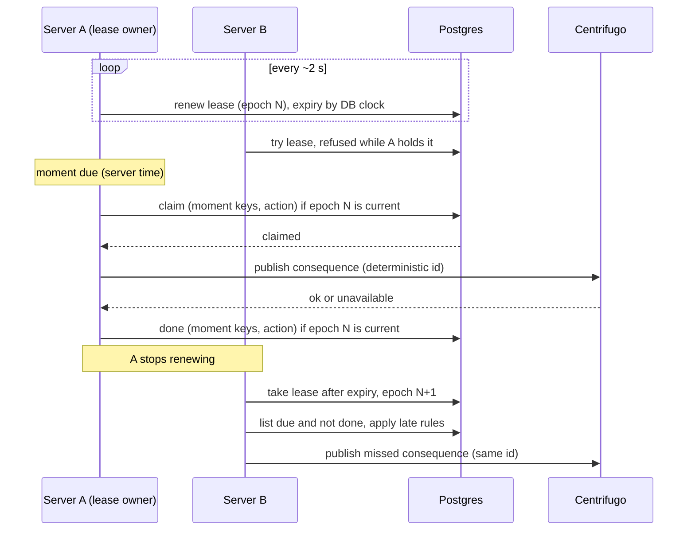
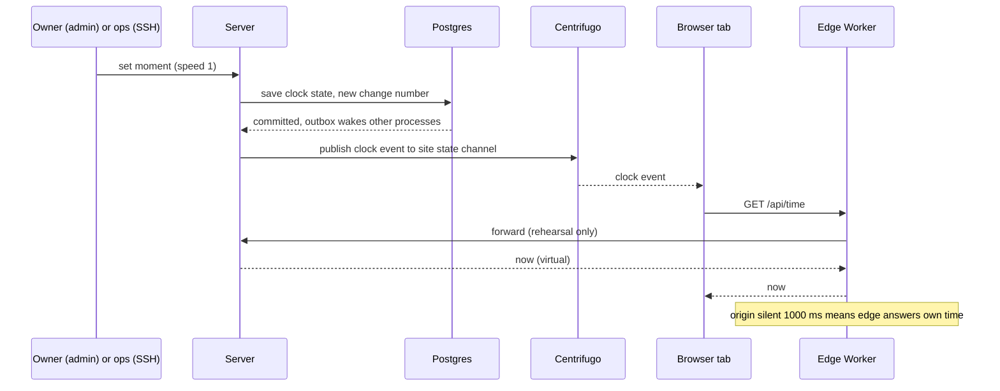

# Spec: Сервер годинника — один двигун часу, планувальник моментів «рівно раз» з орендою, віртуальний час
Spec ID: SPEC-07
Status: approved
Supersedes: none

## Problem and user

Годинник — найважливіша частина продукту: «північ має доходити завжди» (конституція II, `D:/Work/Pets/Time2Fest/.specify/memory/constitution.md:64-71`). Час і правила сьогодні живуть лише на клієнті. На сервері є тільки порт часу й тестовий годинник, а планувальника моментів немає. Що саме бракує:

**Сервер**
- Порт `Clock.now()` є (`server/src/ports.ts:70-73`). Тестовий годинник — синглтон **у пам'яті процесу** (`server/src/clock/index.ts:34-50`), тож два процеси мають різний віртуальний час.
- У класах `rehearsal` і `production` годинник завжди реальний (`server/src/clock/index.ts:80-83`; `SPEC-02:115`, AC-21, «до SPEC-07»).
- Реєстр моментів порожній і чекає цієї хвилі (`server/src/registries/moments.ts:2-15`).
- Оренди немає. Єдиний примітив, схожий на неї, — `FastStore.setIfAbsent` (`SET NX PX`, `server/src/adapters/redis.ts:78`) без продовження й без перевірки власника. Таймер режиму без нагляду крутиться на кожному процесі (`server/src/container.ts:253-284`).
- Поправки подій уже публікують подію `event-patch.changed` через транзакційну скриньку вихідних (`server/src/corrections/service.ts:37,216-226`). Шина опитує скриньку кожні 500 мс (`server/src/events/bus.ts:1-8`). Порт `momentsWithPatches` віддає події з поправками, відсортовані за моментом (`server/src/corrections/service.ts:259-286`, `ports.ts:41-50`). Підписника на ці події, що перераховував би моменти, немає (`server/src/registries/subscribers.ts:28-31`).

**Модуль правил**
- `@time2fest/rules/time` має правила однієї події (`momentTimeline`, `packages/rules/src/time/moment.ts:13-42`) і кілька величин на весь сезон (`ratingCloseAt`, `toastsOpenAt`).
- Функції, що перелічує всі моменти сезону, немає. Немає й вікна опитування.
- Лінт `t2f-time/no-rule-copy` не діє на `server/**`: корінь ігнорує `server/**` (`eslint.config.mjs:99`), а в `server/eslint.config.mjs` цього правила немає.

**Клієнт**
- Машина часу (`?t=`, `?speed=`, панель) і `TimeSource` взаємовиключні; машина не знає про сервер (`lib/time/params.ts:170-203`). Розрив прямо записано в коді: «узгодження з годинником сервера — ШВ-03, SPEC-07» (`lib/time/params.ts:172`).

**Край**
- Край у класах `rehearsal` і `production` віддає `/api/time` власним годинником (`workers/edge/src/handler.ts:18-21`). Тому віртуальна ніч на репетиції клієнтам невидима.

**Вузол**
- На вузлі один `server` (`infra/ops/node/compose.yml:95-116`, `mem_limit 1536m`). Сума лімітів сервісів уже більша за 2 ГБ вузла (`:20,46,90,116,128`).
- Синхронізації часу хоста ніхто не ставить і не перевіряє (`infra/ops/lib/*`: немає жодного збігу з `chrony|timesync|ntp`).

**Хто страждає**
- **Відвідувач.** Північ, перехід ефіру й штамп мають настати вчасно, незалежно від годинника пристрою й від того, живе сервер чи ні.
- **Агенти хвиль-підписників** (SPEC-08, 12, 14, 15, 17, 18, 19). Їм потрібні моменти «рівно раз», у фіксованому порядку, з правилами запізнення.
- **Власник.** Потрібно бачити стан свята й здоров'я планувальника, вести генеральну репетицію на віртуальному часі й отримувати тривогу, коли годинник чи планувальник збився.
- **Агенти тестів.** Потрібна машина часу сайту, узгоджена з тестовим годинником сервера в обидва боки.

## Goals / Non-goals

**Goals**
- Одне джерело часу на сервері (FR-CLK-01) і контроль годинника вузла:
  - синхронізація хоста;
  - розбіжність краю й походження понад 250 мс → тривога `page` (FR-CLK-02, FR-CLK-03).
- Перелік усіх моментів сезону — чиста функція в `@time2fest/rules`. Ключі моментів не залежать від часу, порядок однакових моментів фіксований (FR-CLK-09, FR-CLK-16).
- Планувальник:
  - виконує кожну пару (момент, дія) рівно раз;
  - id наслідків виведені з (момент, дія);
  - правила запізнення після простою;
  - групує однакові дії;
  - перераховує моменти при зміні каталогу чи поправок (FR-CLK-09 … FR-CLK-13).
- Оренда в Postgres з епохою фехтування. Перехоплення ≤10 с (FR-CLK-22).
- Спільний віртуальний час у Postgres для всіх процесів:
  - у класі `test` — тестовий годинник, узгоджений із машиною часу сайту в обидва боки (FR-CLK-15, ШВ-03);
  - у класі `rehearsal` — годинник репетиції, ним керує власник з адмін-зрізу або `ops` через SSH (FR-CLK-15, FR-CLK-17).
- Край репетиції бере час із сервера, а коли походження недоступне — з власного годинника. Production і prelaunch не змінюються (FR-CLK-19).
- Адмін-зріз «стан свята» з оновленням ≤5 с (FR-CLK-21, FR-CLK-13).
- Реєстр підписників моментів. Цією хвилею в ньому лише записувач прогону; окремо — підписник на «Поправку події змінено».
- Дверцята для ×60, оренди й збою. Команди `ops` для годинника репетиції й навчань «два екземпляри».

**Non-goals**
- Підписники моментів (ефір, штампи, чат, тости, рейтинг, сповіщення) — у своїх хвилях. Тут лише реєстр і контракт дії (розділ «Передачі»).
- Статуси трансляцій і їхній адмін-зріз — SPEC-12 (FR-LIVE-24). Доставка поправки у вкладки знімком `site` — SPEC-08 (FR-CLK-20 п. 2). Telegram і повний зріз тривог — SPEC-13b.
- Замір FR-CLK-11 «p99 ≤1 с **під навантаженням**» — SPEC-23. Тут — механізм і заміри без навантаження (NFR-5).
- Вимір FR-CLK-02 із кількох регіонів під навантаженням — SPEC-23 / П-МР. Тут — ручний вимір із двох мереж (AC-5).
- Режим без нагляду (SPEC-04, AC-32 … AC-35) лишається на власному таймері; у планувальник не переноситься (П10).
- Другий екземпляр сервера в production, а також `capacity`, що запускає другий екземпляр (SPEC-13a AC-50, без змін).
- Зміна розміру вузла репетиції для навчань без «так» власника (spec07-q2, Open question 2).
- Довільна швидкість віртуального часу для клієнтів на репетиції. Клієнти там стежать лише за «виставити момент» на швидкості 1. Прогони з іншою швидкістю на репетиції лише серверні (П6).
- Рішення підписників про приховані події (`hidden` поправки). Моменти несуть ознаку, а що з нею робити — вирішує хвиля підписника (Open question 5).
- Зміна поведінки сайту в production і prelaunch: відлік, вигляд, розмір сторінок (NFR-3).
- Перенесення клієнтського `lib/events/engineScheduler.ts` на серверний планувальник: інтерфейсні події сайту лишаються клієнтськими (`SPEC-03` Open question 1).

## User stories

- **US-1** Як відвідувач, я хочу, щоб відлік і переходи йшли від правильного часу, незалежно від годинника пристрою й навіть коли сервер недоступний (FR-CLK-01, FR-CLK-02, FR-CLK-19). → AC-1 … AC-5, AC-15 … AC-18
- **US-2** Як власник, я хочу, щоб годинник вузла був синхронізований і щоб розбіжність краю й сервера давала тривогу (FR-CLK-03). → AC-6 … AC-14
- **US-3** Як агент хвилі-підписника, я хочу отримувати кожен момент сезону рівно раз, у фіксованому порядку, з правилами запізнення й детермінованим id наслідку (FR-CLK-09, FR-CLK-10, FR-CLK-12, FR-CLK-16). → AC-19 … AC-23, AC-27 … AC-41, AC-73
- **US-4** Як власник, я хочу, щоб поправка моменту одразу перераховувала моменти без повтору виконаного (FR-CLK-09, FR-CLK-20 пп. 1, 4). → AC-24 … AC-26, AC-74
- **US-5** Як власник, я хочу, щоб моменти виконував рівно один екземпляр і щоб після падіння власника оренди інший перехоплював її за ≤10 с (FR-CLK-22). → AC-42 … AC-48, AC-70 … AC-72
- **US-6** Як власник, я хочу провести на репетиції ніч на віртуальному часі й керувати ним з адмінки, а агенти — проганяти ×60 без мене (FR-CLK-15, FR-CLK-17). → AC-49 … AC-58, AC-65, AC-66
- **US-7** Як агент тестів, я хочу, щоб машина часу сайту в інтеграційній збірці й тестовий годинник сервера були одним часом в обидва боки й щоб для ×60, оренди й збою були дверцята (FR-CLK-15, ШВ-03). → AC-59 … AC-64, AC-67 … AC-69
- **US-8** Як власник, я хочу бачити стан свята, наступні моменти, здоров'я планувальника й розбіжність часу з оновленням ≤5 с і отримувати тривогу при затримці понад 2 с (FR-CLK-13, FR-CLK-21). → AC-38, AC-39, AC-75 … AC-78

## Acceptance criteria (EARS)

Пакети:
- `server`, `rules` (`packages/rules`), `contracts` (`packages/contracts`), `edge` (`workers/edge`), `ops` (`infra/ops`);
- `web` — корінь репозиторію: `lib/time/**`, `components/dev/**`, `tests/**`, `.github/workflows/verify.yml`.

Терміни:
- **Реальний час** — годинник вузла.
- **Серверний час** — те, що повертає порт годинника: реальний час або віртуальний, коли той активний.
- **Віртуальний час** — спільний для всіх процесів стан: точка відліку, швидкість 0–600, заморожено, епоха прогону. У класі `test` це тестовий годинник, у класі `rehearsal` — годинник репетиції.
- **Момент** — запис переліку C1.
- **Дія** — рядок реєстру підписників моментів (C5).
- **Власник оренди** — процес із чинною орендою (C6).

Де брати доказ:
- «локально» — стенд `local-stack`;
- «exclusive» — під ексклюзивним замком інтеграції (`.claude/skills/local-stack/SKILL.md` §3);
- «репетиція» — `https://rehearsal.time2fest.com`.

### Джерело часу й годинник клієнта (FR-CLK-01, FR-CLK-02, П1)

**AC-1 [server]** The server shall брати час для кожного рішення планувальника, оренди моментів, адмін-зрізу й правил лише з порту годинника: у класі `production` — реальний час, у класах `test` і `rehearsal` — віртуальний, коли той активний, інакше реальний (FR-CLK-01).
Verify: unit — лінт сервера забороняє `Date.now()` / `new Date()` поза модулем годинника (`server/eslint.config.mjs:20-34`); тест порту в трьох класах.

**AC-2 [web]** WHILE клієнт не отримав жодного придатного заміру `/api/time`, the site shall вести відлік від годинника пристрою зі станом `device-fallback` і рівно одним `console.warn` на сеанс (конституція II 2.1.0; П1 [А]).
Verify: unit — `TimeSource` з підробленим `fetch`, що завжди відмовляє: стан `device-fallback`, одне попередження.

**AC-3 [web]** IF після першого придатного заміру `/api/time` перестає відповідати, THEN the site shall зберігати чинну точку відліку (стан `server`) і повторювати спроби з паузами 5, 10, 20, 60 с, не переходячи на годинник пристрою (П1 [А]).
Verify: unit — після вдалого заміру відмови не змінюють стан і `now()`.

**AC-4 [web]** WHEN годинник пристрою зсунуто на +1 год або −1 год від реального, the site shall показувати відлік до наступної півночі, що відрізняється від відліку за серверним часом не більше ніж на 1 с (FR-CLK-02).
Verify: e2e — локально, Playwright зі зсунутим годинником сторінки, порівняння з відліком без зсуву.

**AC-5 [edge]** The edge shall віддавати `GET /api/time` з відхиленням від UTC не більше 100 мс у 19 з 20 замірів з кожної з двох різних мереж (машина оператора й виконавець GitHub Actions; зсув за RTT/2 відносно машини, синхронізованої NTP) (FR-CLK-02).
Verify: manual — репетиція; доказ — таблиця замірів у звіті хвилі. Ручний, бо потребує двох мереж поза CI-стендом.

### Синхронізація вузла й розбіжність краю (FR-CLK-03, П8)

**AC-6 [ops]** WHEN `ops` готує вузол класу `rehearsal` чи `production`, the system shall встановити й увімкнути на хості демон синхронізації часу chrony із джерелом `time.cloudflare.com`, вимкнувши `systemd-timesyncd` (П8 [А]).
Verify: unit — підроблений виконавець команд показує кроки встановлення й вимкнення.

**AC-7 [ops]** IF після підготовки вузла демон синхронізації не повідомляє «синхронізовано» або зсув за модулем понад 100 мс, THEN `ops` shall завершитися з ненульовим кодом і повідомленням про стан часу вузла.
Verify: unit — підроблений вивід стану демона; manual — повторна підготовка вузла репетиції показує зсув у звіті.

**AC-8 [edge]** WHEN Worker пересилає запит на походження, the edge shall додавати заголовок `x-t2f-edge-now` зі своїм часом у мілісекундах на момент пересилання (C8).
Verify: unit — `proxy` у тестах краю: заголовок присутній і є цілим числом.

**AC-9 [edge]** IF вхідний запит клієнта вже має заголовок `x-t2f-edge-now`, THEN the edge shall відкинути значення клієнта й поставити власне.
Verify: unit — підроблений заголовок клієнта не доходить до походження.

**AC-10 [server]** IF запит містить `x-t2f-edge-now` без правильного секрету краю `x-t2f-edge`, THEN the server shall не використовувати цей заголовок для виміру розбіжності.
Verify: integration — запит із міткою й без секрету не змінює виміряну розбіжність.

**AC-11 [server]** The server shall рахувати розбіжність краю й походження за кожне 60-секундне вікно як мінімум (реальний час прибуття − `x-t2f-edge-now`) за довіреними запитами вікна й показувати останнє значення в адмін-зрізі (П8 [А]).
Verify: unit — набір міток зі змодельованою затримкою дає очікуваний мінімум.

**AC-12 [server]** IF модуль розбіжності перевищує 250 мс у трьох вікнах поспіль, THEN the server shall підняти тривогу `page` з джерелом `clock` і кодом `edge-divergence` через порт `Alarm` (FR-CLK-03).
Verify: integration — довірені запити з міткою, зсунутою на 300 мс, у трьох вікнах (тестовий годинник веде вікна) → один рядок у `alarms`.

**AC-13 [server]** WHEN модуль розбіжності у вікні більший за 100 мс і не більший за 250 мс, the server shall записати тривогу рівня `log` з джерелом `clock` і кодом `edge-divergence-warn`.
Verify: unit — підроблений порт `Alarm` отримує `level: 'log'`.

**AC-14 [server]** IF у 60-секундному вікні немає жодного довіреного запиту, THEN the server shall показувати розбіжність у стані «невідомо» без тривоги, а вимір рахувати лише за реальним часом, навіть коли віртуальний час активний.
Verify: unit — порожнє вікно → «невідомо»; активний віртуальний час не змінює виміру.

### Час краю й відмова походження (FR-CLK-19, П6)

**AC-15 [edge]** WHERE `EDGE_ENV` дорівнює `rehearsal`, the edge shall пересилати `GET /api/time` на походження й віддавати тіло `{now}` з тими самими трьома заголовками, що й у власній відповіді (`workers/edge/src/responses.ts:25-32`) (П6 [А], spec07-q1).
Verify: unit — тести обробника краю з підробленим походженням.

**AC-16 [edge]** IF у класі `rehearsal` походження не відповідає за 1 000 мс, відповідає не 2xx або тіло не має цілого `now` ≥ 0, THEN the edge shall відповісти власним часом.
Verify: unit — три випадки відмови → `{now}` від годинника краю.

**AC-17 [edge]** WHERE `EDGE_ENV` дорівнює `production` чи `prelaunch`, the edge shall відповідати на `GET /api/time` лише власним годинником, без запиту до походження.
Verify: unit — підроблене походження не отримує жодного запиту.

**AC-18 [web]** WHILE сервер походження зупинено, the site, що працює за краєм у режимі `production`, shall вести відлік, перемикати слот ефіру на моменті передачі й показувати штамп за клієнтськими правилами від часу краю (FR-CLK-19).
Verify: e2e — локально: край (`wrangler dev`, режим `production`) зі зупиненим сервером і машиною часу сторінки біля півночі. Клас `test` не годиться, бо там край пересилає `/api/time` на сервер.

### Перелік моментів сезону (FR-CLK-09, FR-CLK-16, пропозиція 3)

**AC-19 [rules]** The rules module shall експортувати чисту функцію, яка за подіями каталогу з чинними моментами й північчю кожного поясу повертає всі моменти сезону видів C1 (`celebration-start`, `poll-start`, `poll-end`, `event-reminder`, `pin-end`, `zone-midnight`, `event-moment`, `event-stamp`, `event-handover`, `celebration-end`, `rating-close`), відсортовані за часом, і нічого з годинника не читає.
Verify: unit — перелік для малого каталогу дорівнює очікуваному списку; лінт `packages/rules` забороняє `Date.now` (`eslint.config.mjs:145-151`).

**AC-20 [rules]** WHEN кілька моментів мають однаковий час, the rules module shall впорядковувати їх так: (1) `event-handover` і `pin-end`; (2) `zone-midnight`; (3) `event-stamp` за порядком подій у каталозі (`sortIndex`); (4) решта (FR-CLK-16).
Verify: unit — Кірибаті / Чатем (передача Кірибаті 10:15 UTC = північ Чатема), Непал / Індія (передача Непалу 18:30 UTC = північ Індії), пояс UTC+1 з кількома країнами.

**AC-21 [rules]** The rules module shall давати кожному моменту ключ із виду моменту й id поясу, події чи сезону, без часу в ключі, тож поправка моменту події не змінює ключ.
Verify: unit — та сама подія з поправкою ±20 хв дає ті самі ключі.

**AC-22 [rules]** The rules module shall визначати вікно опитування поясу як [північ поясу − 1 год; північ поясу + 1 год] (конституція I) як іменовану константу модуля.
Verify: unit — `poll-start` і `poll-end` для трьох поясів.

**AC-23 [server, rules]** The lint of `server/**` shall застосовувати правило `t2f-time/no-rule-copy` так само, як для сайту (пропозиція 1 [А]).
Verify: unit — файл-приклад у сервері з `midnightMs + 15 * 60_000` дає помилку лінту; повний `verify` сервера зелений.

**AC-24 [server]** The scheduler shall рахувати моменти подій від чинного моменту з поправкою, а `zone-midnight`, `pin-end`, `poll-start` і `poll-end` — від півночі поясу за tzdb, без поправок (П9 [А], spec07-q3).
Verify: unit — поправка +20 хв головної події поясу зсуває лише моменти цієї події.

### Перерахунок при зміні каталогу чи поправок (FR-CLK-09, FR-CLK-20 пп. 1, 4)

**AC-25 [server]** WHEN зафіксовано подію `event-patch.changed` або `catalog.changed`, the scheduler shall не пізніше ніж за 2 с реального часу працювати з перерахованим переліком моментів.
Verify: integration — локально, тестовий годинник: поправка −20 хв → наступні моменти в адмін-зрізі й у порядку виконання вже нові.

**AC-26 [server]** IF поправка переносить момент події, коли частину дій старого моменту вже виконано, THEN the scheduler shall не повторювати виконані пари (момент, дія), а невиконані виконати за новим моментом (FR-CLK-20 п. 4).
Verify: integration — тестовий годинник: поправка за −20 хв, за −1 хв і після старого моменту; записувач прогону має рівно один запис на пару.

### Планувальник: рівно раз, порядок, групування (FR-CLK-10, FR-CLK-11, FR-CLK-16)

**AC-27 [server]** The scheduler shall виконувати кожну пару (момент, дія) епохи прогону рівно один раз.
Verify: integration — локально й на репетиції: ×60 по всій ночі від `celebration-start` до `rating-close`, записувач прогону має рівно один запис на пару (SC-002).

**AC-28 [server]** The scheduler shall давати кожному зовнішньому наслідку дії id, детерміновано виведений із ключа дії, відсортованих ключів моментів групи й епохи прогону (C4).
Verify: unit — дві обчислення для тих самих входів дають той самий id, для іншої епохи — інший.

**AC-29 [server]** IF процес падає після публікації наслідку й до запису «виконано», THEN the scheduler shall при повторі опублікувати наслідок із тим самим id, і клієнтський транспорт доставить його підписнику один раз (FR-CLK-10).
Verify: integration — дверцята «збій між публікацією й записом “виконано”» (C7); дві публікації в канал `rttest`, один id, клієнт centrifuge-js отримує подію один раз (SPEC-06 AC-54).

**AC-30 [server]** WHEN кілька моментів групи мають один час і одну дію, the scheduler shall викликати цю дію один раз з усіма моментами групи (одне «зустріла» на момент, FR-CHAT-17).
Verify: integration — пояс UTC+1 з кількома країнами: один виклик записувача з масивом подій.

**AC-31 [server]** WHILE швидкість віртуального часу більша за 1, the scheduler shall виконувати моменти в порядку AC-20 без пропусків (FR-CLK-16).
Verify: integration — локально й на репетиції: ×60, послідовність записувача дорівнює переліку AC-19.

**AC-32 [server]** The scheduler shall починати дію не пізніше ніж через 1 000 мс реального часу після настання її моменту (p99) без навантаження, на будь-якій швидкості 1–600 (FR-CLK-11, механізм).
Verify: integration — ×60 локально й на репетиції; записувач фіксує відхилення в реальних мс, звіт дає p50/p99/максимум (NFR-5).

### Правила запізнення й стрибки часу (FR-CLK-12)

**AC-33 [server]** WHEN після простою власник оренди виявляє пропущені моменти, the scheduler shall виконати дії з правилом `always` (видача штампів, закриття рейтингу, кінець свята, зняття закріплення) незалежно від запізнення.
Verify: integration — тестовий годинник: простій 5 хв опівночі; записувач має всі дії `always`.

**AC-34 [server]** IF запізнення дії з правилом `within` (привітання опівночі, «зустріла Новий рік») перевищує 5 хв серверного часу, THEN the scheduler shall пропустити її і записати в журнал ключ моменту, дію й запізнення.
Verify: integration — тестовий годинник: простій 6 хв опівночі → пропуск із записом; простій 4 хв → виконано.

**AC-35 [server]** IF серверний час уже минув кінцеву межу дії з правилом `until` (нагадування «трансляція почалась» — момент події +15 хв), THEN the scheduler shall пропустити її з записом у журнал.
Verify: integration — тестовий годинник: простій до +16 хв.

**AC-36 [server]** WHEN віртуальний час стрибає вперед через моменти, the scheduler shall обробити пропущені моменти за AC-33 … AC-35 із запізненням, рахованим у серверному часі.
Verify: integration — стрибок тестового годинника на +30 хв за північ.

**AC-37 [server]** WHEN віртуальний час повертають назад у межах тієї самої епохи прогону, the scheduler shall не повторювати вже виконані пари (момент, дія).
Verify: integration — повернення на −10 хв після півночі: нових записів немає.

**AC-38 [server]** WHILE віртуальний час заморожено (швидкість 0), the scheduler shall не виконувати жодного моменту й не піднімати тривоги затримки.
Verify: unit — заморожений годинник, 10 с реального часу: викликів 0, тривог 0.

**AC-39 [server]** IF дія настала понад 2 с реального часу тому й ще не почалася, THEN the scheduler shall підняти тривогу `page` з джерелом `scheduler` і кодом `lag` (FR-CLK-13).
Verify: integration — записувач з затримкою 3 с → один рядок `alarms`.

**AC-40 [server]** IF дія завершилася помилкою або публікація повернула `unavailable` чи `rejected`, THEN the scheduler shall повторювати дію не частіше ніж раз на 1 с, доки правило запізнення дії її дозволяє, після чого записати її як «не виконано» в журнал, не скасовуючи інших дій моменту.
Verify: integration — записувач, що падає двічі: третя спроба успішна; інші дії моменту виконано вчасно.

**AC-41 [server]** WHILE процес не є власником оренди, the scheduler shall не піднімати тривог планувальника (`lag`, пропуски).
Verify: integration (exclusive) — два екземпляри, затримка записувача 3 с → рівно одна тривога.

### Оренда (FR-CLK-22, П2)

**AC-42 [server]** The scheduler shall допускати не більше одного власника оренди; строк оренди ~6 с і продовження кожні ~2 с рахуються годинником сервера бази, а не годинником процесу (П2 [А]).
Verify: integration — два процеси: лише один має чинну оренду в будь-який замір за 60 с.

**AC-43 [server]** WHILE процес не є власником оренди, the scheduler shall не виконувати жодної дії.
Verify: integration (exclusive) — два екземпляри одночасно, ×60: усі записи записувача від власника оренди.

**AC-44 [server]** WHEN власника оренди зупинено, the scheduler of another instance shall перехопити оренду не пізніше ніж за 10 с реального часу й обробити пропущене за AC-33 … AC-35.
Verify: integration (exclusive) — зупинка контейнера власника опівночі ×1; звіт дає час перехоплення (NFR-5). Також manual — репетиція (AC-70).

**AC-45 [server]** IF процес зі застарілою епохою оренди намагається виконати дію, THEN the scheduler shall відмовитися від неї до публікації наслідку, бо запис «почато» перевіряє епоху в тій самій транзакції.
Verify: integration — дверцята «зупинити власника оренди» (`pause`) → інший перехоплює → `resume`: старий процес не виконує жодної дії.

**AC-46 [server]** IF власник оренди не може продовжити її (база недоступна), THEN the scheduler shall припинити виконання дій до спливу строку за власним монотонним годинником процесу.
Verify: unit — підроблене сховище, що відмовляє: після строку без продовження викликів 0.

**AC-47 [server]** The scheduler shall рахувати строк оренди лише за реальним часом, незалежно від швидкості й стрибків віртуального часу.
Verify: unit — швидкість 600 і стрибок на +1 год не змінюють строку.

**AC-48 [server]** WHEN оренду перехоплено, the server shall записати в журнал попереднього й нового власника, нову епоху й час перехоплення.
Verify: integration — запис після AC-44.

### Віртуальний час: спільний стан і репетиція (FR-CLK-15, FR-CLK-17, П5–П7)

**AC-49 [server]** WHEN віртуальний час змінено, the server shall не пізніше ніж за 1 с реального часу віддавати новий серверний час у кожному процесі цього середовища з різницею між процесами не більше 50 мс (П7 [А]).
Verify: integration — два процеси, `POST /api/_test/clock` в один, `GET /api/_test/clock` в обох.

**AC-50 [server]** The server shall зберігати стан віртуального часу після перезапуску й розгортання сервера.
Verify: integration — перезапуск процесу зберігає точку відліку, швидкість і епоху; manual — розгортання на репетиції.

**AC-51 [server]** WHERE клас `rehearsal`, the admin slice shall давати власнику три дії з годинником: «виставити момент» (швидкість 1), «повернути реальний час», «почати ніч знову» (нова епоха прогону) — кожну з записом у журнал з виконавцем-власником (FR-CLK-15; П5 [А], spec07-q1).
Verify: integration — сервер класу `rehearsal` на стенді: дії через C9 змінюють стан, у журналі по запису.

**AC-52 [server]** WHERE клас `production`, the server shall не мати керування годинником: зріз показує лише стан, а маршрут C9 відповідає 404, як невідомий шлях (FR-CLK-18).
Verify: integration — сервер класу `production` на стенді.

**AC-53 [server]** IF дію з годинником запитує не власник (немає Access або роль не `owner`), THEN the server shall відмовити без зміни стану.
Verify: integration — запит із роллю, відмінною від `owner`, і без Access.

**AC-54 [ops]** WHERE клас вузла `rehearsal`, the `ops` command `clock` shall через SSH показувати стан і виконувати «виставити момент», «повернути реальний час», «почати ніч знову» й «швидкість 0–600» із записом у журнал з виконавцем `ops`, без нового HTTP-входу (C10; П5 [А], spec07-q1).
Verify: unit — підроблена ціль; manual — репетиція.

**AC-55 [ops]** IF команду `clock` запущено для класу `production`, THEN `ops` shall завершитися з ненульовим кодом до будь-якого з'єднання з вузлом.
Verify: unit.

**AC-56 [server]** WHEN віртуальний час у класі `rehearsal` змінено, the server shall опублікувати в `site:state` подію `clock` з id, виведеним з епохи прогону й порядкового номера зміни (C3; П6 [А]).
Verify: integration — після дії AC-51 клієнт centrifuge-js отримує одну подію `clock`.

**AC-57 [web]** WHERE збірка сайту класу `rehearsal`, WHEN надходить подія `clock`, the site shall пересинхронізувати `TimeSource` за `/api/time` не пізніше ніж за 5 с.
Verify: unit — `TimeSource` з підробленим транспортом; manual — репетиція: «виставити момент» → відкрита вкладка показує новий відлік.

**AC-58 [web]** WHERE збірка сайту не тестова (класи `rehearsal`, `production`, prelaunch), the site shall не містити машини часу й жодного звернення до `/api/_test/*` (FR-CLK-15: зміни машини часу на клієнтах репетиції до сервера не доходять).
Verify: unit — пошук рядка `/api/_test/` і коду машини часу у файлах робочої збірки.

### Машина часу сайту ↔ тестовий годинник (FR-CLK-15, ШВ-03, П4)

**AC-59 [web]** WHERE збірка тестова й час іде через `http` (інтеграційна збірка), WHEN сторінка відкривається без `?t=`, the site shall взяти стан тестового годинника `GET /api/_test/clock` (з поправкою RTT/2), а не збережений у `sessionStorage` стан і не типовий час машини (П4 [А]).
Verify: e2e — локально: серверний годинник на 23:59:00 Парижа → сторінка показує відлік ~60 с.

**AC-60 [web]** WHERE інтеграційна збірка, WHEN `?t=`, `?speed=`, панель машини часу чи `window.__t2f.timeMachine.set/advance` змінює час, the site shall надіслати `POST /api/_test/clock` і прив'язати відлік до стану з відповіді.
Verify: e2e — після кожного з чотирьох способів `GET /api/_test/clock` показує той самий момент з точністю 1 с і ту саму швидкість.

**AC-61 [web]** WHERE інтеграційна збірка, WHEN тестовий годинник змінено поза сторінкою, the site shall перейти на новий стан не пізніше ніж за 2 с (опитування дверцят).
Verify: e2e — `POST /api/_test/clock` з тесту → відлік на сторінці змінюється за ≤2 с.

**AC-62 [web]** IF `?t=` чи `?speed=` недійсні, THEN the site shall вивести `console.warn('[time-machine] …')` і не надсилати `POST /api/_test/clock`.
Verify: unit.

**AC-63 [web]** WHERE збірка `sim` (тестова чи демо), the site shall вести машину часу локально, як до цієї хвилі.
Verify: unit — наявні тести `lib/time`; e2e — наявний набір машини часу на `sim` зелений без змін.

**AC-64 [server, web]** WHEN в інтеграційній збірці машину часу перемотано на 5 с до півночі поясу, the server shall виконати момент `zone-midnight` цього поясу, і записувач прогону покаже запис за ≤2 с після півночі.
Verify: e2e — локально: панель → перемотування → `GET` журналу записувача.

### Репетиція: ніч і ×60 (FR-CLK-17)

**AC-65 [server]** WHERE клас `rehearsal`, the scheduler shall пройти ніч ×60, запущену командою `ops clock`, з рівно одним записом записувача на пару (момент, дія) в порядку AC-20.
Verify: manual — репетиція; журнал записувача й заміри відхилень — у звіті хвилі. Ручний, бо репетиція не має дверцят, а запуск іде через SSH.

**AC-66 [server]** WHERE клас `rehearsal`, the server shall провести повну ніч на віртуальному часі зі швидкістю 1 від моменту, виставленого власником (FR-CLK-17).
Verify: manual — генеральна репетиція з людьми (SPEC-23). Ручний за FR-CLK-17.

### Дверцята (конституція XIII)

**AC-67 [server]** WHERE клас `test` і `T2F_TEST_DOORS=1`, the server shall мати дверцята C7: «прогнати ніч ×60» (`POST` і `GET`), «зупинити власника оренди» (`POST`), «збій між публікацією й записом “виконано”» (`POST`). В інших класах вони відповідають 404, однаково з невідомим шляхом.
Verify: integration — у тесті робочої конфігурації всі нові шляхи → 404, як невідомий шлях.

**AC-68 [server]** The test-door registry test shall рахувати 18 рядків замість 14.
Verify: unit — тест переліку дверцят.

**AC-69 [server]** IF тіло нових дверцят не відповідає строгій схемі C7 (невідомі поля, швидкість поза 0–600, від'ємний час), THEN the server shall відповісти помилкою валідації без зміни стану.
Verify: unit.

### Два екземпляри на репетиції (FR-CLK-22, П3)

**AC-70 [ops]** WHERE клас вузла `rehearsal`, the `ops` command `scheduler-drill` shall:
1. перевірити вільну пам'ять вузла;
2. підняти другий `server` окремим профілем Compose зі зменшеним лімітом пам'яті;
3. зупинити власника оренди;
4. заміряти час перехоплення;
5. прибрати другий екземпляр і повернути перший;
6. залишити розмір вузла незмінним (П3 [А]).

Verify: unit — підроблена ціль; manual — репетиція, **якщо пам'ять вузла дозволяє або власник дозволив збільшення** (spec07-q2); час перехоплення — у звіті.

**AC-71 [ops]** IF вільної пам'яті вузла менше, ніж потрібно другому екземпляру, THEN `scheduler-drill` shall відмовитися до запуску будь-якого контейнера з повідомленням, скільки бракує.
Verify: unit — підроблений вивід пам'яті.

**AC-72 [ops]** IF `scheduler-drill` запущено для класу `production` або з вимогою змінити розмір вузла без окремого явного прапорця, THEN `ops` shall завершитися з ненульовим кодом без змін на вузлі.
Verify: unit.

### Реєстри підписників

**AC-73 [server]** The moments subscriber registry shall мати в цій хвилі рівно один рядок — записувач прогону. Він є в класах `test` і `rehearsal`, у `production` його немає. Він записує ключі моментів, дію, епоху, плановий і фактичний реальний час і в класі `test` публікує наслідок у `rttest`.
Verify: unit — перелік реєстру за класами; integration — записи після ×60.

**AC-74 [server]** The event subscriber registry shall мати рядок «перерахунок моментів» на теми `event-patch.changed` і `catalog.changed`.
Verify: unit — перелік реєстру (`server/src/registries/subscribers.ts`).

### Адмін-зріз «стан свята» (FR-CLK-13, FR-CLK-21, пропозиція 2)

**AC-75 [server]** The admin slice «стан свята» shall показувати:
- фазу свята;
- поточний і наступний слот ефіру;
- найближчі 10 моментів (час, вид, пояс чи подія);
- здоров'я планувальника: власник оренди, епоха, вік останнього продовження, поточна затримка, пропущені моменти за 24 год;
- розбіжність краю й походження;
- стан годинника: реальний чи віртуальний, швидкість, епоха.

Статусів трансляцій у зрізі немає.
Verify: integration — сервер на стенді з тестовим годинником на 23:50 Парижа: зріз показує очікувані значення.

**AC-76 [server]** WHILE зріз відкрито, the admin slice shall оновлювати свої дані не рідше ніж раз на 5 с (FR-CLK-21).
Verify: e2e — локально: зміна тестового годинника відображається за ≤5 с; заміряний період — у звіті (NFR-5).

**AC-77 [server]** The admin slice «стан свята» shall бути видимим лише ролі `owner`.
Verify: integration — інша роль не отримує даних зрізу.

**AC-78 [server]** IF джерело одного блоку зрізу відмовляє, THEN the admin slice shall показати для цього блоку стан помилки, а решту блоків — далі оновлювати.
Verify: integration — підроблена відмова сховища оренди.

## Edge cases

- **EC-1** Кірибаті / Чатем: передача Кірибаті збігається з північчю Чатема. → AC-20, AC-31
- **EC-2** Непал / Індія: передача Непалу збігається з північчю Індії. → AC-20, AC-31
- **EC-3** Пояс UTC+1 із кількома країнами — одне «зустріла» на момент. → AC-30
- **EC-4** Поправка за −1 хв або вже після старого моменту. → AC-26
- **EC-5** Поправка змінює склад групи, коли частину її вже виконано. → AC-26, AC-28
- **EC-6** Простій 5 хв опівночі, а також 4 й 6 хв. → AC-33, AC-34
- **EC-7** Збій між публікацією й записом «виконано». → AC-29
- **EC-8** Власника оренди призупинено (пауза GC, заморожений процес), і він прокидається після перехоплення. → AC-45
- **EC-9** База недоступна для власника оренди. → AC-46
- **EC-10** Два екземпляри піднімають одну тривогу. → AC-41
- **EC-11** Віртуальний час стрибнув уперед через кілька північ. → AC-36
- **EC-12** Віртуальний час повернули назад у тій самій епосі. → AC-37
- **EC-13** Швидкість 0 (заморожено). → AC-38
- **EC-14** Realtime повернув `unavailable` у мить півночі. → AC-40
- **EC-15** Підписник падає чи зависає. → AC-39, AC-40
- **EC-16** Два процеси бачать різний віртуальний час. → AC-49
- **EC-17** Сервер перезапущено посеред репетиційної ночі. → AC-50
- **EC-18** Клієнт підробив `x-t2f-edge-now`. → AC-9, AC-10
- **EC-19** Немає трафіку (поза сезоном, вночі на стенді) — розбіжність не виміряти. → AC-14
- **EC-20** Походження впало на репетиції — клієнти отримують реальний час замість віртуального. → AC-16 (прийнято: на репетиції без людей це допустимо)
- **EC-21** Два робочі процеси Playwright рухають той самий серверний годинник. → NFR-4
- **EC-22** Недійсні `?t=` / `?speed=`. → AC-62
- **EC-23** Сторінку відкрито у двох вкладках інтеграційної збірки, і обидві міняють годинник. → AC-61 (виграє остання зміна, обидві вкладки йдуть за сервером)
- **EC-24** Зсунутий годинник пристрою. → AC-4
- **EC-25** На вузлі репетиції бракує пам'яті для другого екземпляра. → AC-71
- **EC-26** Подія прихована поправкою (`hidden`). → Open question 5
- **EC-27** Вікно після кінця свята: `rating-close` через 12 год після останньої півночі. → AC-19, AC-27
- **EC-28** Поза сезоном моментів немає. → AC-19 (порожній перелік), AC-38 (простій без тривог)
- **EC-29** На репетиції `ops clock` виставив швидкість, відмінну від 1, а клієнти там стежать лише за швидкістю 1. → Non-goal (прогони не на швидкості 1 на репетиції лише серверні)
- **EC-30** Хтось просить керувати годинником у production. → AC-52, AC-55

## Non-functional requirements

**NFR-1 [server, edge, ops]** The wave shall не додавати жодної нової обов'язкової змінної середовища. Якщо план усе ж додасть таку змінну, вона з'являється в `infra/ops/node/server.env.example` і в `.github/workflows/verify.yml`.
Verify: unit — `infra/ops/test/env-example.test.mjs` і `ci.test.mjs` зелені.

**NFR-2 [server]** The storage changes for оренди, віртуального часу й журналу виконання shall бути лише додаванням схеми, згенерованим Payload, сумісним із попереднім образом сервера.
Verify: integration — скіл `migration-safety`: up/down/up на копії сидової бази; попередній образ стартує на новій схемі.

**NFR-3 [web]** The production and prelaunch builds shall не змінювати поведінки й розміру сторінок: `scripts/check-bundle.mjs` проходить для робочої збірки без послаблень, а клієнтський транспорт realtime завантажується для подій `clock` лише в збірці класу `rehearsal`.
Verify: unit — `node scripts/check-bundle.mjs out-verify` у повному `verify` `web`.

**NFR-4 [web]** The e2e scenarios that change the server test clock shall йти в окремому послідовному проєкті Playwright (один процес).
Verify: e2e — конфігурація проєкту; прогін із `--workers=2` зелений двічі поспіль.

**NFR-5 [server]** The wave report shall містити заміри:
- відхилення старту дій від моменту в реальних мс (p50, p99, максимум) для ×60 локально й на репетиції;
- час перехоплення оренди (локально exclusive; на репетиції — якщо AC-70 виконано);
- заміряний період оновлення адмін-зрізу;
- зсув годинника вузла репетиції за демоном синхронізації.

Verify: manual — розділ звіту хвилі; без цих чисел хвилю не позначають `implemented`.

**NFR-6 [server]** The scheduler shall перераховувати перелік для каталогу з 5 000 моментів не довше ніж за 200 мс на машині розробника.
Verify: unit — бенчмарк-тест із синтетичним каталогом.

**NFR-7 [server]** The server shall писати в журнал кожну зміну віртуального часу (виконавець, старий і новий стан, епоха), кожне перехоплення оренди й кожен пропуск чи відмову дії. Ключі й секрети в ці записи не потрапляють.
Verify: integration — записи після AC-44, AC-34, AC-51; пошук секрету краю в журналі нічого не знаходить.

**NFR-8 [server]** The scheduler shall не виконувати жодної дії, поки сервер не завантажив перелік моментів з каталогу й поправок, і не публікувати подій для вкладок із ним, поки перелік порожній.
Verify: unit — старт без каталогу: викликів 0.

## Module interactions

### Межі
| Межа | Хто → кого | Що | Спосіб | Коли інша сторона відмовляє чи повільна |
|---|---|---|---|---|
| Край → походження | Worker → сервер | `x-t2f-edge-now` на кожному пересиланні; `GET /api/time` у `rehearsal` | синхронно | походження мовчить 1 000 мс → власний час краю (AC-16) |
| Планувальник → Postgres | сервер → база | оренда, «почато» / «виконано» з епохою, стан віртуального часу | синхронно, транзакції | база недоступна → власник зупиняється до спливу строку (AC-46); тривога через `Alarm` (лише лог, якщо сховище тривог теж недоступне) |
| Скринька вихідних → процеси | сервер → сервер | `event-patch.changed`, `catalog.changed`, зміна віртуального часу | асинхронно, опитування 500 мс | запізнення шини → перерахунок ≤2 с (AC-25), годинник ≤1 с (AC-49) |
| Дія → realtime | сервер → Centrifugo | наслідки дій (підписники інших хвиль), подія `clock` | синхронно, порт `publisherOf(deps).publish` | `unavailable` / `rejected` → повтор за AC-40, момент не скасовується (SPEC-06:441) |
| Сайт → дверцята | браузер → сервер | стан тестового годинника | синхронно, опитування ≤2 с | відмова → сайт лишає чинну точку відліку й повторює |
| `ops` → вузол | машина оператора → SSH → контейнер `server` | команди `clock`, `scheduler-drill` | синхронно | немає SSH → ненульовий код, стан незмінний |
| Адмін-зріз → сервер | браузер власника → `/cms-api` (Access) | стан свята, дії з годинником | синхронно, опитування ≤5 с | помилка блоку → AC-78 |

### Виконання моменту

### Віртуальний час репетиції

### Контракти (усі нові — **proposed**, лише додаванням; перевіряє `contract-conformance`)

**C1 — Момент сезону** (`@time2fest/rules`, чиста функція; **proposed**)
- Поля:
  - `key: string` — вид + id поясу, події чи сезону, без часу;
  - `kind` — одне з одинадцяти значень AC-19;
  - `at: number` — мс UTC, чинний;
  - `rank: 1 | 2 | 3 | 4` — AC-20;
  - `order: number` — `sortIndex` для `event-stamp`;
  - `zoneId?`, `eventId?`, `countryIso?`;
  - `hidden?: boolean`.
- Вхід: події з чинними моментами (`momentsWithPatches`, `server/src/corrections/service.ts:259-286`) і північ поясів за tzdb.

**C2 — `GET /api/time`** (наявний, без змін): тіло `{ now: int ≥ 0 }`, заголовки `Cache-Control: no-store, max-age=0`, `Content-Type`, `X-Robots-Tag`. Змінюється лише те, хто відповідає в `rehearsal` (AC-15).

**C3 — Подія `clock` у `site:state`** (**proposed**, `packages/contracts`)
- Конверт `{ type: 'clock', id: 'clock:<epoch>:<seq>', data: { virtual: boolean, speed: number } }` (конверт — `packages/contracts/src/realtime.ts:3-9`).
- Публікується лише в класі `rehearsal`. Клієнт ігнорує невідомі поля.

**C4 — id наслідку дії** (**proposed**): `<actionKey>:<epoch>:<digest>`, де `digest` — детермінований підсумок відсортованих ключів моментів групи. У `production` епоха одна на сезон. Підписники кладуть його в `id` конверта чи свого запису.

**C5 — Рядок реєстру підписників моментів** (**proposed**, межа між хвилями)
- `key`, `capability`, `kinds` (види моментів C1), `late: 'always' | { within: ms } | { until: kind }`, `classes?` (у яких класах є рядок), `run(group, ctx)`.
- `group` містить моменти групи, `consequenceId` (C4), серверний `now` і запізнення.
- `run` має бути ідемпотентним за `consequenceId`.

**C6 — Оренда** (поведінка, не схема): один власник; строк ~6 с і продовження ~2 с за годинником бази; епоха зростає при кожному перехопленні; «почато» й «виконано» записуються лише з чинною епохою.

**C7 — Дверцята** (**proposed**, лише `test` + `T2F_TEST_DOORS=1`, строгі схеми в `packages/contracts`)
- `POST /api/_test/scheduler/night-run` `{ speed?: int 1..600 = 60, from?: int ms, to?: int ms }` → `{ ok, value: { epoch } }`. Ставить тестовий годинник на `from` (типово `celebration-start` − 1 хв) і нову епоху.
- `GET /api/_test/scheduler/night-run` → `{ ok, value: { epoch, records: [{ keys, action, plannedAt, startedAt, consequenceId }] } }`.
- `POST /api/_test/scheduler/lease` `{ action: 'pause' | 'resume' }` → `{ ok, value: { holder: boolean, epoch } }`. `pause` припиняє продовження й дії в цьому процесі, не звільняючи оренди.
- `POST /api/_test/scheduler/fault` `{ after: 'publish', action?: string }` → `{ ok }`. Разово: наступна дія падає після публікації й до «виконано».

**C8 — Заголовок `x-t2f-edge-now`** (**proposed**, край → походження): ціле число мс. Сервер довіряє йому лише разом із правильним `x-t2f-edge` (AC-10). Клієнтське значення край затирає (AC-9).

**C9 — Керування годинником з адмінки** (**proposed**, `/cms-api`, за Access, роль `owner`, лише `rehearsal`; у `production` — 404)
- `POST /cms-api/clock` `{ action: 'set', at: int ms } | { action: 'real' } | { action: 'restart-night' }` → `{ ok, value: { now, speed, virtual, epoch } }`.
- Помилки: валідація, `forbidden`, 404 поза `rehearsal`.

**C10 — `ops`** (**proposed**)
- `node infra/ops/ops.mjs clock <status|set --at <ISO>|real|restart-night|speed <0..600>> --env rehearsal`.
- `node infra/ops/ops.mjs scheduler-drill --env rehearsal [--resize <size>]`. `--resize` діє лише після «так» власника (spec07-q2), у типовому шляху його немає.
- Обидві команди відмовляють для `production`.

### Передачі хвилям-підписникам (SPEC-08, 12, 14, 15, 17, 18, 19)
- **Як додати дію:** один рядок C5 у реєстрі підписників моментів (`server/src/registries/moments.ts`) з видами моментів, правилом запізнення й класами. Порядок однакових моментів дає C1 (AC-20), групування — AC-30.
- **Контракт дії:**
  - ідемпотентність за `consequenceId` (C4) — повтор після збою дає той самий id (AC-29);
  - дія не читає системний годинник, лише `ctx.now`;
  - публікація — `publisherOf(deps).publish(<клас>, <ключ>, { type, id: consequenceId, … })`;
  - `unavailable` не скасовує момент (AC-40).
- **Правила запізнення з FR-CLK-12:**
  - SPEC-14 (видача штампів) — `always`;
  - SPEC-17 / SPEC-16 (зняття закріплення тостів, `pin-end`) — `always`;
  - SPEC-18 (закриття рейтингу) — `always`;
  - SPEC-12 (кінець свята для ефіру, `celebration-end`) — `always`;
  - SPEC-15 (привітання опівночі, «зустріла») — `{ within: 300 000 }`;
  - SPEC-19 (нагадування «трансляція почалась») — `{ until: 'event-handover' }`.
- **SPEC-08:** доставка поправки у вкладки — знімком `site`. Подію `clock` (C3) знімок `site` не замінює. Опитування без realtime (FR-RT-08) має враховувати, що в `rehearsal` вкладки пересинхронізуються лише за подією `clock` або за плановим циклом `TimeSource` (10 хв).
- **SPEC-12:** вікно опитування — `poll-start` / `poll-end` (AC-22).
- **SPEC-13b:** тривоги `clock/edge-divergence`, `scheduler/lag` — у Telegram і повний зріз.
- **SPEC-23:** p99 ≤1 с під навантаженням (FR-CLK-11), генеральна репетиція на швидкості 1 (AC-66), вимір FR-CLK-02 із кількох регіонів.
- **SPEC-22b:** chrony на робочому вузлі виконується тим самим кроком `ops` (AC-6).

## Inputs and provenance

| Input | Source | Producer | Freshness | Trusted |
|---|---|---|---|---|
| Реальний час вузла | годинник хоста, chrony | ОС, `ops` (AC-6) | безперервно | так, з контролем AC-11 … AC-13 |
| `x-t2f-edge-now` | заголовок запиту | Worker краю | на запит | ні, доки секрет краю не перевірено (AC-10) |
| Події каталогу й поправки | Payload (`events`, `event-patches`) | власник, імпорт каталогу | на зміну (скринька вихідних) | так (лише власник пише, SPEC-04) |
| Північ поясів | `midnightUtc` подій, tzdb | генератор каталогу | на імпорт | так |
| Стан віртуального часу | Postgres | власник (C9), `ops` (C10), дверцята (C7, лише `test`) | на зміну | так після валідації схеми й прав |
| Тіло дверцят і форми годинника | HTTP | агенти тестів, власник | на запит | ні — строга схема (AC-69, C9) |
| `?t=`, `?speed=`, панель, `window.__t2f` | адреса й сторінка | будь-хто з тестовою збіркою | на завантаження | ні — перевірка `params.ts`, лише тестова збірка (AC-58, AC-62) |
| Подія `clock` | Centrifugo `site:state` | сервер | на зміну | так за каналом; `data` за схемою C3 |
| Відповідь `/api/time` | край або походження | Worker, сервер | на запит | так у клієнта; тіло перевіряється (`TimeSource.ts:168-169`) |
| Факти коду | research-code (Sonnet, 2026-11-18) | дослідник | 2026-11-18 | так, ключові звірено |
| Зовнішні факти (chrony, контейнери, Workers, оренди) | research-external (Sonnet, 2026-11-18; ubuntu.com, man7, developers.cloudflare.com, postgresql.org/docs/16, redis.io, Kleppmann 2016-02-08) | дослідник | 2026-11-18 | так; «не встановлено» — нижче |

## Untrusted inputs

- **`x-t2f-edge-now`:**
  - край затирає значення клієнта (AC-9);
  - сервер бере його лише з чинним секретом (AC-10);
  - значення лише входить у мінімум вікна й не керує жодною дією.
  - Найгірше, що можна зробити, — хибна тривога, і то лише маючи секрет.
- **Тіло дверцят C7:** строга схема, межі швидкості й часу (AC-69). Дверцят немає поза `test` (AC-67).
- **Тіло C9:** строга схема; лише `owner` за Access (AC-53); лише `rehearsal` (AC-52); журнал (AC-51, NFR-7).
- **`ops clock`, `scheduler-drill`:** лише через SSH з ключем оператора; `production` відмовляє до з'єднання (AC-55, AC-72).
- **`?t=` / `?speed=`:** перевірка формату й меж, у робочих збірках їх немає (AC-58, AC-62).
- **Подія `clock`:** публікує лише сервер (SPEC-06 AC-3). Клієнт лише пересинхронізується за `/api/time` і час із події не бере.
- **Межа «арендності»:** продукт має одного орендаря. Ізоляцію робочих дерев дають наявні префікси (SPEC-02, SPEC-06 AC-10). Читання за id сутностей іншого орендаря тут немає.

### Нотатки для `security-reviewer`
- Новий привілейований вхід — лише C9 (за Access, лише власник, лише `rehearsal`). Керування `ops` іде через SSH, без HTTP.
- Перевірити, що збірка `production` не містить шляхів C7 і C9 і що відповідь на них збігається з невідомим шляхом.
- `x-t2f-edge-now` використовується лише разом із секретом краю. Секрет не потрапляє в журнал (NFR-7).

## Design review

Видимого інтерфейсу сайту хвиля не змінює (NFR-3). Новий лише адмін-зріз за зразком `server/src/admin/UnattendedSlice.tsx`; дошок він не має. Джерела `designs` не стосуються.

Знахідки першого проходу:
1. Розбіжність TimeSource із конституцією II → конституцію 2.1.0 уже поправлено (`constitution.md:4,67`); §12 п. 2 загальної специфікації закрито → accepted → AC-2, AC-3 (П1)
2. Оренда: Postgres чи Redis → Postgres з епохою фехтування → accepted → AC-42 … AC-48 (П2)
3. Другий екземпляр на вузлі 2 ГБ → локально exclusive + навчання `ops` без зміни розміру → accepted → AC-43, AC-44, AC-70 … AC-72 (П3); зміна розміру → deferred → Open question 2
4. Машина часу ↔ тестовий годинник → машина як вид серверного годинника, опитування ≤2 с → accepted → AC-59 … AC-64 (П4)
5. Хто керує годинником репетиції → власник з адмінки + `ops` через SSH → accepted → AC-51 … AC-55 (П5); підтвердження власника → deferred → Open question 1
6. Віртуальна ніч репетиції невидима клієнтам → край `rehearsal` пересилає `/api/time`, подія `clock` → accepted → AC-15, AC-16, AC-56, AC-57 (П6)
7. Віртуальний час не спільний між процесами → стан у Postgres → accepted → AC-49, AC-50 (П7)
8. Як міряти розбіжність → мітка краю + chrony → accepted → AC-6 … AC-14 (П8)
9. Що зсуває поправка → лише моменти своєї події → accepted → AC-24 (П9); підтвердження → deferred → Open question 3
10. Режим без нагляду → не переносити → declined → Non-goal (П10)
11. Лінт `no-rule-copy` не діє на сервері → accepted → AC-23 (пропозиція 1)
12. Адмін-зріз опитуванням ≤5 с → accepted → AC-75 … AC-78 (пропозиція 2)
13. Перелік моментів і вікно опитування — у `packages/rules` → accepted → AC-19 … AC-22 (пропозиція 3)
14. Id наслідків із часом ламають FR-CLK-20 п. 4 → ключі без часу → accepted → AC-21, AC-28
15. Тривоги дублюються на двох екземплярах → лише власник оренди → accepted → AC-41
16. Паралельні e2e ділять годинник → послідовний проєкт → accepted → NFR-4
17. FR-CLK-19 не перевірити в класі `test` → край у режимі `production` → accepted → AC-18
18. Приховані події → deferred → Open question 5

### Decisions

[А] — типовий варіант першого проходу, прийнятий сесією хвилі від імені власника, який делегував типові варіанти (2026-11-18); власник може змінити. [С] — значення запропонував spec-creator у другому проході; підтверджує ведучий хвилі (Open question 4).

- **D1 [А] П1.** Чинна поведінка `TimeSource` фіксується. §12 п. 2 загальної специфікації закрито конституцією 2.1.0 (у латку документів). → AC-2, AC-3
- **D2 [А] П2.** Оренда в Postgres з епохою фехтування, строк за годинником бази, продовження ~2 с, строк ~6 с; «почато» / «виконано» з перевіркою епохи в одній транзакції. → AC-42 … AC-48
- **D3 [А] П3.** Два екземпляри обов'язково локально (exclusive). На репетиції — `scheduler-drill` без зміни розміру, зі зменшеним лімітом і попередньою перевіркою пам'яті. Зміна розміру — лише явним прапорцем після «так» власника (**spec07-q2**). → AC-70 … AC-72
- **D4 [А] П4.** У збірці `test` + `http` машина часу — вид серверного годинника; опитування дверцят ≤2 с; `sim` і демо без змін. → AC-59 … AC-63
- **D5 [А] П5, spec07-q1.** Керують годинником репетиції власник з адмін-зрізу і `ops` через SSH (журнал з виконавцем `ops`, без HTTP). У `production` керування немає. → AC-51 … AC-55
- **D6 [А] П6, spec07-q1.** Край `rehearsal` пересилає `/api/time` на сервер, з власним часом як запасом. Подія `clock` у `site:state` з детермінованим id. Клієнти стежать лише за «виставити момент» на швидкості 1; ×60 на репетиції серверний. → AC-15 … AC-17, AC-56, AC-57, AC-65
- **D7 [А] П7.** Стан віртуального часу — у Postgres; доставка в процеси скринькою вихідних ≤1 с; переживає перезапуск; міграція лише додаванням. → AC-49, AC-50, NFR-2
- **D8 [А] П8.** Мітка `x-t2f-edge-now`, мінімум за вікно 60 с, `page` після трьох вікон понад 250 мс, `log` понад 100 мс. Chrony на хості через `ops`. → AC-6 … AC-14
- **D9 [А] П9, spec07-q3.** Поправка зсуває лише моменти своєї події; північ поясу — за tzdb. → AC-24
- **D10 [А] П10.** Режим без нагляду лишається на своєму таймері. → Non-goal
- **D11 [А] пропозиції 1–3.** Лінт для `server/**`; адмін-зріз опитуванням ≤5 с (на репетиції з керуванням, у production лише перегляд); перелік моментів і вікно опитування — у `packages/rules`. → AC-23, AC-75 … AC-78, AC-19 … AC-22
- **D12 [С]** Записувач прогону є в класах `test` і `rehearsal` (у `production` немає), бо ×60 на репетиції треба довести без дверцят. → AC-73, AC-65
- **D13 [С]** Значення:
  - перерахунок ≤2 с (AC-25);
  - запас краю 1 000 мс (AC-16);
  - пересинхронізація за `clock` ≤5 с (AC-57);
  - повтор дії раз на ≤1 с у межах правила запізнення (AC-40);
  - різниця між процесами ≤50 мс (AC-49);
  - 18 рядків дверцят (AC-68);
  - 5 000 моментів за ≤200 мс (NFR-6);
  - відхилення краю ≤100 мс у 19 з 20 замірів (AC-5).

## Traceability

| AC / NFR | From (US / EC / design review) | Packages | Verify |
|---|---|---|---|
| AC-1 | US-1 | server | unit |
| AC-2 | US-1, DR-1 | web | unit |
| AC-3 | US-1, DR-1 | web | unit |
| AC-4 | US-1, EC-24 | web | e2e |
| AC-5 | US-1 | edge | manual |
| AC-6 | US-2, DR-8 | ops | unit |
| AC-7 | US-2, DR-8 | ops | unit, manual |
| AC-8 | US-2, DR-8 | edge | unit |
| AC-9 | US-2, EC-18 | edge | unit |
| AC-10 | US-2, EC-18 | server | integration |
| AC-11 | US-2, DR-8 | server | unit |
| AC-12 | US-2, US-8 | server | integration |
| AC-13 | US-2 | server | unit |
| AC-14 | US-2, EC-19 | server | unit |
| AC-15 | US-1, US-6, DR-6 | edge | unit |
| AC-16 | US-1, EC-20, DR-6 | edge | unit |
| AC-17 | US-1, DR-6 | edge | unit |
| AC-18 | US-1, DR-17 | web | e2e |
| AC-19 | US-3, DR-13, EC-27, EC-28 | rules | unit |
| AC-20 | US-3, EC-1, EC-2 | rules | unit |
| AC-21 | US-3, DR-14 | rules | unit |
| AC-22 | US-3, DR-13 | rules | unit |
| AC-23 | US-3, DR-11 | server, rules | unit |
| AC-24 | US-4, DR-9 | server | unit |
| AC-25 | US-4 | server | integration |
| AC-26 | US-4, EC-4, EC-5 | server | integration |
| AC-27 | US-3 | server | integration |
| AC-28 | US-3, DR-14, EC-5 | server | unit |
| AC-29 | US-3, EC-7 | server | integration |
| AC-30 | US-3, EC-3 | server | integration |
| AC-31 | US-3, EC-1, EC-2 | server | integration |
| AC-32 | US-3 | server | integration |
| AC-33 | US-3, EC-6 | server | integration |
| AC-34 | US-3, EC-6 | server | integration |
| AC-35 | US-3 | server | integration |
| AC-36 | US-3, EC-11 | server | integration |
| AC-37 | US-3, EC-12 | server | integration |
| AC-38 | US-3, US-8, EC-13, EC-28 | server | unit |
| AC-39 | US-8, EC-15 | server | integration |
| AC-40 | US-3, EC-14, EC-15 | server | integration |
| AC-41 | US-3, EC-10, DR-15 | server | integration |
| AC-42 | US-5, DR-2 | server | integration |
| AC-43 | US-5, DR-3 | server | integration |
| AC-44 | US-5, DR-3 | server | integration |
| AC-45 | US-5, EC-8 | server | integration |
| AC-46 | US-5, EC-9 | server | unit |
| AC-47 | US-5, DR-2 | server | unit |
| AC-48 | US-5 | server | integration |
| AC-49 | US-6, EC-16, DR-7 | server | integration |
| AC-50 | US-6, EC-17, DR-7 | server | integration, manual |
| AC-51 | US-6, DR-5 | server | integration |
| AC-52 | US-6, EC-30 | server | integration |
| AC-53 | US-6, DR-5 | server | integration |
| AC-54 | US-6, DR-5 | ops | unit, manual |
| AC-55 | US-6, EC-30 | ops | unit |
| AC-56 | US-6, DR-6 | server | integration |
| AC-57 | US-6, DR-6 | web | unit, manual |
| AC-58 | US-6, DR-5 | web | unit |
| AC-59 | US-7, DR-4 | web | e2e |
| AC-60 | US-7, DR-4 | web | e2e |
| AC-61 | US-7, DR-4, EC-23 | web | e2e |
| AC-62 | US-7, EC-22 | web | unit |
| AC-63 | US-7, DR-4 | web | unit, e2e |
| AC-64 | US-7 | server, web | e2e |
| AC-65 | US-6, DR-6 | server | manual |
| AC-66 | US-6 | server | manual |
| AC-67 | US-7 | server | integration |
| AC-68 | US-7 | server | unit |
| AC-69 | US-7 | server | unit |
| AC-70 | US-5, DR-3 | ops | unit, manual |
| AC-71 | US-5, EC-25 | ops | unit |
| AC-72 | US-5, DR-3 | ops | unit |
| AC-73 | US-3, DR-13 | server | unit, integration |
| AC-74 | US-4 | server | unit |
| AC-75 | US-8, DR-12 | server | integration |
| AC-76 | US-8, DR-12 | server | e2e |
| AC-77 | US-8, DR-12 | server | integration |
| AC-78 | US-8, DR-12 | server | integration |
| NFR-1 | US-6, DR-7 | server, edge, ops | unit |
| NFR-2 | US-5, DR-7 | server | integration |
| NFR-3 | US-1, DR-6 | web | unit |
| NFR-4 | US-7, EC-21, DR-16 | web | e2e |
| NFR-5 | US-3, US-5, US-8 | server | manual |
| NFR-6 | US-4 | server | unit |
| NFR-7 | US-5, US-6 | server | integration |
| NFR-8 | US-3 | server | unit |

DR-N — пункт N розділу «Design review».

## Open questions

Усі питання не блокують і маркерів не мають.

1. **spec07-q1 (власнику, [А]):** підтвердити, що годинником репетиції, крім власника з адмінки, керує `ops` через SSH і що край `rehearsal` бере `/api/time` з сервера (D5, D6). Якщо власник скаже «лише я» — AC-54 і AC-65 переходять на його дію з адмінки.
2. **spec07-q2 (власнику, [А]):** чи дозволено тимчасово збільшувати вузол репетиції для `scheduler-drill`. Без «так» навчання йде лише тоді, коли пам'яті вистачає (AC-70, AC-71). Дозвіл 2026-11-17 стосувався разового прогону SPEC-13a.
3. **spec07-q3 (власнику, [А]):** поправка зсуває лише моменти своєї події, а привітання опівночі лишається за tzdb (D9). Видимим це стане в SPEC-15.
4. **Ведучому хвилі:** підтвердити значення [С] (D12, D13).
5. **Хвилям-підписникам:** що робити з моментами прихованих подій (`hidden` у C1). Планувальник їх перелічує, рішення — за підписником (EC-26).
6. **Плану:** як збірка сайту класу `rehearsal` відрізняється від production (змінна збірки) і як `check-bundle` дозволяє лінивий транспорт лише в ній (NFR-3, AC-57).
7. **SPEC-16 / SPEC-17:** який список півночей бере `pinnedUntilAt` для нових тостів після поправки (FR-CLK-20 п. 5). Від цієї хвилі там лише момент `pin-end` за tzdb.
