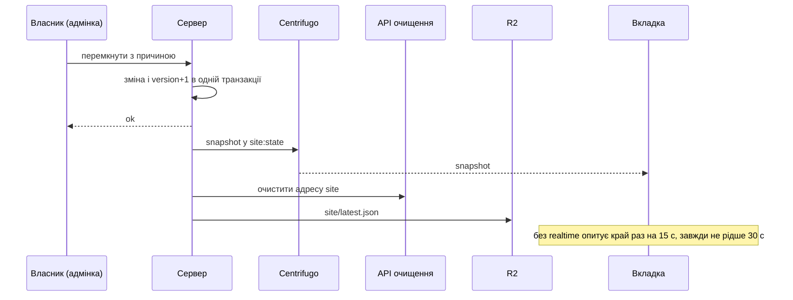
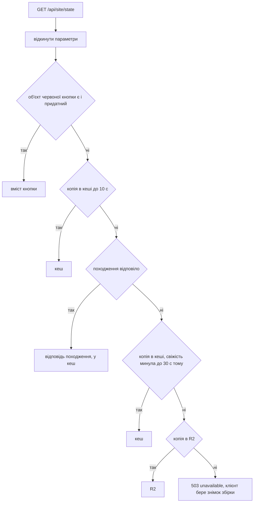

# Spec: Стан сайту, кеш краю, червона кнопка — знімок `site`, «перемкнути з причиною», порт «товари», кеш публічних знімків у Worker з порядком джерел і R2, червона кнопка, перезбирання з каталогу й заморожування, доставка поправки моменту у вкладки
Spec ID: SPEC-08
Status: implemented
Supersedes: none

## Джерела

**Хвиля й вимоги:**
- Хвиля: `D:/Work/Pets/Time2Fest/specs/002-backend/waves.md:173-185` (SPEC-08); шов ШВ-04 — `waves.md:672`; передачі — `waves.md:140`, `waves.md:1035`, `waves.md:1047-1048`, `waves.md:1057`.
- Вимоги: FR-SITE-01 … FR-SITE-07 (`specs/002-backend/spec.md:620-626`), FR-EDGE-02, -05, -06, -12 (`spec.md:504-514`), FR-CLK-20 (`spec.md:552`), FR-RT-08 (`spec.md:564`), FR-CAT-08, -09 (`spec.md:612-613`).
- Зміни сайту: §8.3 пп. 1 і 12 (`spec.md:1071`, `spec.md:1082`).
- Вимоги з двома частинами: `specs/002-backend/waves-coverage.md:50-52`.

**Рішення власника:**
- `D:/Work/Pets/Time2Fest/docs/decision.md:24` (2026-11-20) — без товарів PayPro.
- `docs/decision.md:222-227` (2026-11-18) — усі вісім видимих станів погоджено. Цей запис чинний; `waves.md` §11 п. 3 «нових не малюємо» застарів.

## Рішення власника

- **В1 (2026-11-20, остаточне).** Хвилю робимо зараз повністю, але без товарів PayPro:
  - без `import products`;
  - без жодного виклику PayPro;
  - без ключів PayPro.
  Порт «товари» має порожній стан і тестовий фейк. `import products` і прив'язка справжніх товарів — у SPEC-17 (`docs/decision.md:24`). → AC-18 … AC-22.
- **В2 (2026-11-18, остаточне).** Усі вісім видимих станів погоджено (`docs/decision.md:222-227`). Стани перемикачів показують хвилі, які володіють відмовами:
  - «оплати вимкнено» — SPEC-17;
  - «чат на паузі» — SPEC-15;
  - прихований рівень тосту — SPEC-18.
  SPEC-08 доставляє дані без видимої зміни (spec08-q5, прийнято як інформаційне). → NFR-3, Non-goals.
- **В3 (2026-11-20, остаточне; spec08-q1 «а»).** «Технічні проблеми», поки трансляції грають:
  - текст наявного `BackendDown` («Показуємо розклад із кешу. Функції акаунта тимчасово недоступні», `messages/uk.json:1057`) показується у смузі наявного `OfflineNotice` (`components/shell/Offline.tsx:23-41`, `app/(live)/layout.tsx:54`);
  - сторінка й плеєри лишаються;
  - чат, вхід і оплата показують свої наявні стани помилки;
  - нічого нового не малюється.
  → AC-56, AC-57.
- **В4 (2026-11-20, остаточне; spec08-q2 «а»).** Два вузькі ключі, лише для репетиції; робочі — у SPEC-22:
  - (а) `T2F_CF_PURGE_TOKEN` — токен Cloudflare лише з правом «Zone Cache Purge» на `time2fest.com`;
  - (б) `T2F_GITHUB_DISPATCH_TOKEN` — fine-grained токен GitHub лише «Actions: write» на `time2fest-web`.
  Код працює й без них:
  - немає токена очищення → очищення пропускається з записом у журнал, діє вікно ≤30 с;
  - немає токена GitHub → автоматичного перезбирання немає, запис у журнал.
  → AC-33, AC-34, AC-65.
- **В5 (2026-11-20, остаточне; spec08-q3 «а»).** Прогін на репетиції — окремий крок після «так» власника, **не умова злиття**:
  - червона кнопка з прогрітим кешем і зупиненим сервером;
  - спайки 2, 3 і 5;
  - без робочого домену й без платних вузлів.
  → AC-69 … AC-72.
- **В6 (2026-11-20, остаточне; spec08-q4 «а»).** Автоматичне перезбирання після зміни каталогу підключене лише до репетиції. Для production — прапорець конфігурації, типово вимкнений; вмикається в SPEC-22 зі «так» власника. Зміни, зроблені у вікні заморожування, збираються один раз о 01.01 14:00 UTC. → AC-62 … AC-64.

## Рішення сесії

Кожне — рішення сесії, ведучий хвилі може змінити. Кожне має AC або NFR, де воно перевіряється.

**Знімок і перемикачі**
- **С1. Форма знімка** — наявний `SiteState` (`packages/contracts/src/site.ts:15-73`) плюс схеми zod. Нове — лише додаванням (FR-MIG-07): необов'язкове поле `outage: 'technical'`. → AC-1, AC-2
- **С2. Доставка — завжди повний знімок**, без дельт. Подія `{type:'snapshot', id:'site:<version>', state}` у `site:state`. Адаптер сайту ігнорує `type:'clock'` (подія SPEC-07, `server/src/timekeeping/control.ts:36`). → AC-5, AC-45
- **С3. Версія.** `version` — один зростаючий лічильник сервера. Він росте разом зі зміною в одній транзакції. Публікація, очищення й копія в R2 — лише після фіксації. → AC-4 … AC-7
- **С4. «Перемкнути з причиною».** Аргументи: ключ, значення, виконавець, причина, режим `manual|auto`.
  - Причина обов'язкова.
  - `auto` дозволено лише для `payments`.
  - `auto` не знімає ручної паузи.
  - Кожна зміна — у журналі з відкатом одним кроком.
  → AC-10 … AC-14
- **С5. Рішення `isEnabled`** — одна чиста функція в `contracts`, спільна для сервера й сайту:
  - продукт і рівень тосту вимкнені, коли вимкнено їхній перемикач, батьківський перемикач або `payments`;
  - кімната вимкнена, коли вимкнено `chat`.
  → AC-15

**Товари**
- **С6. Порт «товари».** Він дає перелік заздалегідь створених товарів і вибір товару для ключа.
  - У кожному класі типовий адаптер порожній: `products: []`. Тестовий фейк має по два товари на ключ.
  - Шляху створити чи змінити суму немає.
  → AC-18 … AC-22

**Край**
- **С7. Кеш краю — лише в коді Worker'а** (Cache API). Змін зони немає:
  - без правил кешу;
  - без `cf.cacheTtl`;
  - без «Workers Caching» `[cache]`.
  Свіжість 10 с, оновлення у фоні, «старе при помилці» ≤30 с, далі копія з R2, далі 503 і значення збірки на клієнті.
  Причини:
  - Cache API не підтримує `stale-while-revalidate`;
  - `stale-if-error` зони спрацьовує лише на 500–504, а тунель, що лежить, дає 530;
  - `[cache]` пропускає код Worker'а на влучанні — перевірка червоної кнопки не спрацювала б.
  Джерела — «Дослідження».
  → AC-23 … AC-32
- **С8. Очищення — за тегом `t2f-site-state` через API зони** (глобальне; знімає записи Cache API; рішення диригента А-2 у плані, 2026-11-20 — замість очищення за адресою). Його робить сервер після фіксації. → AC-33 … AC-35
- **С9. Червона кнопка.**
  - Увімкнення: є об'єкт `site/red-button.json` у бакеті середовища. Вимкнення: об'єкт видалено.
  - Заготовлений файл: `site/prepared/technical.json`.
  - Край перевіряє об'єкт до будь-якого кешу; результат перевірки пам'ятає ≤10 с.
  - Копію в R2 край читає через прив'язку бакета за тією самою адресою. Домену бакета `static.*` немає, тож змін DNS немає.
  → AC-38 … AC-44
- **С10. Список публічних адрес** — одне джерело для рядків маршрутів сервера (`public: true`, `server/src/endpoints/types.ts:156-157`) і для Worker'а. SPEC-08 додає один рядок: `/api/site/state`, без параметрів. Тест SPEC-05, що забороняє `caches` у `workers/edge/src` (`workers/edge/test/handler.test.ts:166-174`), звужується до «лише в модулі публічного кешу». → AC-23, AC-24

**Сайт**
- **С11. Транспорт підключається лише тоді, коли задано `NEXT_PUBLIC_REALTIME_URL`.**
  - Передстартова збірка лишається без `centrifuge`.
  - Інтеграційна й репетиційна збірки — з `--allow-realtime` (`scripts/check-bundle.mjs:8-25`).
  - Production отримує прапорець у хвилі, що розгортає production.
  → AC-58
- **С12. Пауза перепідключення** (П-RT, рекомендація 5, `D:/Work/Pets/Time2Fest/docs/backend/spike-rt-report.md:41`):
  - від 1,5 с до 45 с, повний розкид;
  - після відмови рукостискання чи токена — 30–60 с.
  → AC-59, AC-60
- **С13. Ціни на сайті.** Ціни беруться з `site.products`. Якщо ключа немає — береться значення збірки, рівне нинішнім константам (`lib/offers/format.ts:5`, `lib/toast/tiers.ts:7`). Видимої зміни немає. → AC-55, NFR-3

**Перезбирання**
- **С14. Перезбирання.** `catalog.changed` → перезбирання через 150 с після останньої зміни. Спосіб: GitHub `workflow_dispatch` наявного робочого процесу розгортання репетиції (рішення диригента А-1 у плані, 2026-11-20 — замість `repository_dispatch`: ключ із правом лише Actions: write). Ручний аварійний деплой — наявний `workflow_dispatch`. → AC-61 … AC-67

## Problem and user

Власник у новорічну ніч має без деплою за секунди:
- вимкнути чат, кімнату, оплати, рівень тосту чи пас;
- виправити помилку в часі півночі.

Зараз знімка `site` на сервері немає:
- маршруту немає (`server/src/registries/routes.ts:12`);
- http-адаптера немає (`lib/api/http/domains.ts:7`);
- хук `useSiteState` не має споживачів (`lib/api/hooks/site.ts:4`);
- ціни зашиті в код сайту (`lib/offers/format.ts:5`, `lib/toast/tiers.ts:7`).

Кожна зміна потребує нової збірки, а відкриті вкладки її не бачать.

Публічні JSON край не кешує:
- `workers/edge/src/proxy.ts:2` — «no cache options»;
- `docs/backend/cloudflare-notes.md:129` — завжди `DYNAMIC`.

Тож пік читань лягає на сервер. Коли сервер лежить, у власника немає способу сказати людям «технічні проблеми»: наявний `BackendDown` не підключений до жодної сторінки (`docs/site/legal.md:178`).

Зміна каталогу в адмінці нічого не перезбирає: `repository_dispatch` немає, єдиний процес — `.github/workflows/deploy.yml:8`.

Відвідувачі — до 30 тис. одночасно опівночі (`waves.md:157`). Вони бачать застарілий стан і помилки там, де власник свідомо щось вимкнув.

## Goals / Non-goals

**Goals**
- Знімок `site` на сервері містить:
  - перемикачі;
  - товари з версіями — через порт «товари», зараз порожній;
  - `catalogVersion`;
  - поправки подій.
  Доставка у вкладки: ≤3 с на зв'язку (p95), ≤30 с без зв'язку, новим відвідувачам — одразу після очищення кешу.
- «Перемкнути з причиною» — єдиний спосіб змінити перемикач; ручну паузу оплат автоматика не знімає; `isEnabled` — для хвиль-споживачів.
- Ціну можна змінити лише вибором заздалегідь створеного товару (механізм, перевірений фейком).
- Край кешує `/api/site/state` у Worker'і з порядком джерел:
  1. червона кнопка;
  2. походження;
  3. кеш ≤30 с при помилці;
  4. R2;
  5. значення збірки.
  Випадковий параметр не доходить до походження.
- Очищення адреси й копія в R2 — після фіксації.
- Червона кнопка без сервера: ≤60 с до смуги «технічні проблеми» в усіх вкладках, плеєри грають.
- Клієнт:
  - перечитує `site` щонайменше раз на 30 с, а без realtime — раз на 15 с;
  - застосовує поправку моменту до відліку, переходу ефіру й показу штампа без перезавантаження (SC-019);
  - перепідключається за П-RT, рекомендація 5.
- Перезбирання сайту після зміни каталогу: за ≤15 хв, з вікном заморожування.

**Non-goals**
- `import products`, прив'язка справжніх товарів PayPro, будь-які виклики й ключі PayPro — SPEC-17 (В1).
- Перевірки перемикачів у споживачах — сервер відмовляє:
  - `chat-closed` — SPEC-15;
  - вимкнений продукт і ручна пауза — SPEC-17;
  - `tier-off` — SPEC-18.
  Тут лише `isEnabled` і модульні тести рішень (`waves-coverage.md:50`).
- Видимі стани перемикачів — хвилі-споживачі (В2):
  - «оплати вимкнено» — SPEC-17;
  - «чат на паузі» — SPEC-15;
  - прихований рівень тосту — SPEC-18.
- Опитування ланцюжків раз на 15 с — SPEC-12 (`waves-coverage.md:52`).
- Що робити з подією, позначеною `hidden` у поправці, на сторінках ефіру — SPEC-12. Тут знімок лише несе поле.
- Кеш інших публічних адрес (ланцюжки, тости, рейтинг): кожна хвиля додає свій рядок у список (С10).
- Влучання ≥99 % під навантаженням (спайк 7) — SPEC-23.
- Зміни зони Cloudflare (правила кешу, DNS, домен бакета) не потрібні й не робляться (С7, С9).
- Розгортання на робочий домен і робочі ключі — SPEC-22 (В4, В6).
- Багаторегіональний спайк 2 — SPEC-23 (В5).
- Видима реакція на застарілий `catalogVersion`. Відкриті вкладки не оновлюються (рішення 6.2, `docs/decision.md:522-529`); поле лише доставляється.

## User stories

- **US-1.** Як власник, я вмикаю чи вимикаю перемикач у адмін-зрізі з причиною, і відкриті вкладки бачать новий стан за ≤3 с на зв'язку й ≤30 с без нього, а нові відвідувачі — одразу.
- **US-2.** Як власник, я виправляю момент події о 23:40, і відкриті вкладки міняють відлік, перехід ефіру й показ штампа за ≤30 с без перезавантаження.
- **US-3.** Як власник, коли сервер лежить, я за інструкцією вмикаю файл червоної кнопки в панелі Cloudflare, і за ≤60 с усі вкладки показують «технічні проблеми», а трансляції грають.
- **US-4.** Як відвідувач, я бачу живий сайт, коли realtime чи сервер лежить: стан приходить з краю, з R2 або зі збірки.
- **US-5.** Як власник, я міняю ціну лише вибором заздалегідь створеного товару, а автоматична пауза оплат ніколи не знімає мою ручну паузу.
- **US-6.** Як власник, я правлю каталог в адмінці, і сайт перезбирається за ≤15 хв, крім вікна заморожування 31.12 08:00 – 01.01 14:00 UTC.
- **US-7.** Як хвиля-споживач (SPEC-15/17/18), я питаю `isEnabled(...)` і отримую одне рішення з тими самими правилами на сервері й на сайті.

## Acceptance criteria (EARS)

**Пакети:**
- `contracts` — `packages/contracts`;
- `server` — `server/`;
- `edge` — `workers/edge`;
- `ops` — `infra/ops`;
- `web` — корінь репозиторію: `lib/**`, `components/**`, `app/**`, `scripts/**`, `tests/**`, `.github/workflows/**`;
- `docs-patch` — документи операцій поза репозиторієм коду.

**Терміни:**
- **Знімок** — `SiteState`.
- **Зміна знімка** — зміна перемикача, вибір товару, збережена поправка події або нова версія каталогу.
- **Публічна адреса** — `GET /api/site/state` на хості сайту середовища.
- **Бакет середовища** — R2 зі змінних `T2F_R2_*` (`server/src/registries/env.ts:102-111`).
- **Об'єкт червоної кнопки** — `site/red-button.json` у бакеті середовища.
- **Копія в R2** — `site/latest.json` у бакеті середовища.
- **Вікно заморожування** — від 31.12 08:00:00 UTC (включно) до 01.01 14:00:00 UTC (не включно).

**Де брати доказ:**
- «локально» — стенд `local-stack`;
- «Miniflare» — Worker краю в емуляторі з Cache API і R2;
- «репетиція» — `https://rehearsal.time2fest.com`, **окремий крок за «так» власника (spec08-q3), не умова злиття**.

### Контракт і маршрут (FR-SITE-01)

**AC-1 [contracts]** The contracts package shall описувати схеми zod для `SiteState` і `SiteEvent` з полями:
- `version`;
- `at`;
- `switches` (9 ключів з `spec.md:620`);
- `products`;
- `catalogVersion`;
- `eventPatches`;
- необов'язкове `outage: 'technical'`.

Порівняно з типом SPEC-01 зміна лише додаванням.
Verify: unit — схема приймає знімок `sim` і знімок з `outage`; перевірка «лише додаванням» SPEC-01 зелена.

**AC-2 [web, server]** The `site` contract suite shall проходити з однаковими очікуваннями проти адаптерів `sim` і `http`.
Verify: integration — набір контракту `site` на `sim` і на `http` (локально).

**AC-3 [server]** WHEN надходить `GET /api/site/state`, the server shall відповідати 200 з чинним знімком, що проходить схему AC-1, і з такими заголовками:
- `Cache-Control: public, max-age=10`;
- без `Set-Cookie`, навіть коли запит несе cookie сесії.

Verify: integration — запит з cookie сесії: тіло проходить схему, заголовок `Cache-Control` точний, `Set-Cookie` відсутній.

### Знімок і версія (FR-SITE-01, FR-SITE-02, FR-CLK-20 п. 2)

**AC-4 [server]** WHEN зміна знімка фіксується, the server shall збільшити `version` щонайменше на 1 у тій самій транзакції.
Verify: integration — для кожного з чотирьох видів зміни версія росте; дві одночасні зміни перемикача дають два різні зростаючі значення.

**AC-5 [server]** WHEN транзакцію зміни знімка зафіксовано, the server shall опублікувати в `site:state` подію `{type:'snapshot', id:'site:<version>', state}` не пізніше ніж за 1 с.
Verify: integration — підписник Centrifugo отримує подію з новою версією ≤1 с після відповіді на зміну.

**AC-6 [server]** IF транзакцію зміни знімка відкочено, THEN the server shall не публікувати подію, не очищати кеш і не писати копію в R2.
Verify: integration — примусовий відкат: публікацій, запитів очищення й записів R2 — нуль.

**AC-7 [server]** IF публікація повертає `unavailable` чи `rejected`, THEN the server shall зберегти зміну й записати в журнал рівно один рядок `site/publish-failed` з версією.
Verify: integration — Centrifugo зупинено: зміна збережена, `GET /api/site/state` віддає нову версію, рядок журналу один.

**AC-8 [server]** WHEN поправку події збережено, the server shall віддавати в `eventPatches[<id події>]` значення `moment`, `isMainCelebration`, `restrained`, `hidden`, рівні збереженій поправці.
Verify: integration — поправка моменту −20 хв і `restrained` з приміткою → знімок містить ті самі значення.

**AC-9 [server]** WHEN каталог змінено, the server shall віддавати в знімку `catalogVersion`, рівний `catalogVersionOf` метаданих нового каталогу.
Verify: integration — `import catalog` зі зміненими даними → `catalogVersion` змінився й дорівнює очікуваному.

### Перемикачі (FR-SITE-04, FR-SITE-07)

**AC-10 [server]** The server shall змінювати будь-який перемикач лише через «перемкнути з причиною».
Verify: integration — запис перемикача через REST/адмін-API Payload повз цей інтерфейс → відмова, стан без змін.

**AC-11 [server]** IF причина порожня чи довша за 200 символів, THEN the server shall відмовити `invalid` без зміни стану.
Verify: unit — порожня, 200 і 201 символ.

**AC-12 [server]** WHEN перемикач змінено, the server shall дописати в журнал рівно один рядок із такими полями, з можливістю відкату одним кроком:
- виконавець;
- «було» і «стало»;
- причина;
- режим.

Verify: integration — зміна → один рядок із полями; відкат → попереднє значення, нова версія знімка.

**AC-13 [server]** IF виклик у режимі `auto` вмикає `payments`, поки чинну паузу поставлено в режимі `manual`, THEN the server shall відмовити `forbidden` і лишити `payments` вимкненим.
Verify: unit — таблиця рішень:

| Чинна пауза | Хто вмикає | Результат |
|---|---|---|
| ручна | `auto` | відмова |
| автоматична | `auto` | дозволено |
| ручна | ручне ввімкнення | дозволено |
| автоматична | ручне ввімкнення | дозволено |
| ручна | автоматична пауза | ручна лишається |

**AC-14 [server]** IF виклик у режимі `auto` стосується будь-якого перемикача, крім `payments`, THEN the server shall відмовити `forbidden`.
Verify: unit — кожен із 8 інших ключів.

**AC-15 [contracts, server, web]** The `isEnabled` decision shall повертати однаковий результат на сервері й на сайті за такими правилами:
- продукт `pass` — `pass` і `payments`;
- `passGift` — `passGift` і `payments`;
- рівень тосту — `toasts`, `toastTiers[<рівень>]` і `payments`;
- кімната чату — `chat` і `chatRooms[<кімната>] !== false`;
- `chat`, `viewersMap`, `passOffer` — власне значення.

Verify: unit — повна таблиця комбінацій в одному тесті, що імпортується і в сервер, і в сайт.

**AC-16 [server]** IF «перемкнути з причиною» чи вибір товару викликає роль, відмінна від `owner`, THEN the server shall відповісти `forbidden` без зміни стану.
Verify: integration — `content-agent`, `stream-agent`, без входу → `forbidden`.

**AC-17 [server]** The admin slice «Стан сайту» shall показувати для власника:
- 9 перемикачів із поточними значеннями;
- режим паузи `payments`;
- поле причини;
- вибір товару для кожного з 4 ключів.

WHEN порт «товари» порожній, the slice shows the text «Товарів ще немає — ціни з’являться після підключення PayPro (SPEC-17)».
Verify: unit — тест компонента зрізу з порожнім портом і з фейком.

### Товари (FR-SITE-05)

**AC-18 [server]** The server shall брати `products` знімка лише з порту «товари»; у кожному класі типовий адаптер порожній, і знімок містить `products: []`.
Verify: integration — сервер класу `test` без фейку і `rehearsal`-конфігурація: `products` порожній.

**AC-19 [server]** WHEN власник вибирає для ключа заздалегідь створений товар, the server shall поставити в знімок ціну цього товару й збільшити `priceVersion` цього ключа на 1.
Verify: integration — фейк із двома товарами для `pass`: вибір другого → ціна другого, `priceVersion` +1.

**AC-20 [server]** IF вибраного товару немає в переліку порту або він належить іншому ключу, THEN the server shall відмовити `invalid` без зміни знімка.
Verify: integration — невідомий id і id товару іншого ключа.

**AC-21 [server]** The server shall не мати маршруту, дії адмінки чи дверцят, що створюють товар або задають суму ціни.
Verify: integration — у таблиці маршрутів і дій адмінки немає запису ціни; спроба записати `price` через API Payload → відмова.

**AC-22 [server]** The server shall не робити жодного мережевого виклику PayPro і не вимагати жодної змінної PayPro в жодному класі.
Verify: unit — реєстр змінних середовища не має нових змінних PayPro; сервер стартує в класах `test` і `rehearsal` без них.

### Публічна адреса й кеш краю (FR-EDGE-02, FR-EDGE-06)

**AC-23 [edge, server]** The list of public addresses shall бути одним джерелом для рядків маршрутів сервера з `public: true` і для Worker'а.
Verify: unit — тест падає, якщо маршрут `public: true` відсутній у списку або адреса списку не має такого маршруту.

**AC-24 [edge]** WHEN запит до публічної адреси містить параметри поза дозволеним набором (для `/api/site/state` — жодного), the edge shall відкинути їх до ключа кешу й до запиту на походження.
Verify: integration (Miniflare) — 20 запитів із різними випадковими параметрами → підробка походження бачить 1 запит без параметрів.

**AC-25 [edge]** WHILE копія публічної адреси в кеші має вік ≤10 с, the edge shall віддавати її без запиту на походження.
Verify: integration (Miniflare) — 100 запитів за 10 с (час підставляється) → 1 запит на походження.

**AC-26 [edge]** WHEN копія старша за 10 с, the edge shall віддати її й оновити кеш у фоні одним запитом на походження.
Verify: integration (Miniflare) — запит на 11-й секунді: відповідь зі старою версією, після фонового запиту наступна відповідь має нову.

**AC-27 [edge]** IF походження не відповідає, THEN the edge shall віддати кешовану копію адреси `site`, доки її свіжість минула не більше ніж 30 с тому. Відмова походження — це будь-що з такого:
- помилка мережі;
- 500–504 чи 520–530;
- відповідь без JSON.

Verify: integration (Miniflare) — підробка походження відповідає 530: на 39-й секунді віку — копія; на 41-й — наступне джерело.

**AC-28 [edge]** IF походження не відповідає і кешованої копії в межах AC-27 немає, THEN the edge shall віддати 200 з копією в R2.
Verify: integration (Miniflare) — порожній кеш, 530 від походження, копія в R2 → тіло копії, `x-t2f-source: r2`.

**AC-29 [edge]** IF немає ні свіжої відповіді, ні копії в кеші, ні придатної копії в R2, THEN the edge shall віддати наявну відповідь `503 unavailable` (`workers/edge/src/responses.ts:17-22`).
Verify: integration (Miniflare) — порожній кеш і R2, походження недоступне → 503 `unavailable`.

**AC-30 [edge]** The edge shall не віддавати `Set-Cookie` у відповіді публічної адреси з жодного джерела.
Verify: integration (Miniflare) — походження додає `Set-Cookie` → його немає ні в першій відповіді, ні у відповіді з кешу.

**AC-31 [edge]** The edge shall не зберігати в кеші жодної відповіді адреси, якої немає в списку публічних.
Verify: integration (Miniflare) — два однакові запити до особистої адреси → 2 запити на походження, `Cache-Control: private, no-store` збережено.

**AC-32 [edge]** The edge configuration shall не вмикати «Workers Caching» (`[cache]`) у жодному середовищі.
Verify: unit — тест конфігурації `wrangler.json` для всіх середовищ.

### Очищення й копія в R2 (FR-EDGE-05)

**AC-33 [server]** WHEN зміну знімка зафіксовано і токен очищення задано, the server shall не пізніше ніж за 2 с запросити очищення за тегом `t2f-site-state` (А-2).
Verify: integration — підробка API очищення: один запит із точною адресою, отриманий після фіксації.

**AC-34 [server]** IF токен очищення не задано, THEN the server shall пропустити очищення й записати рядок `site/purge-skipped` на кожну зміну, а старт сервера в жодному класі не має падати (spec08-q2).
Verify: integration — без змінної: зміна проходить, рядок журналу є, сервер стартує в `test` і `rehearsal`.

**AC-35 [server]** IF API очищення відповідає помилкою, THEN the server shall повторити запит через 30 і 120 с і після третьої невдачі підняти тривогу `site/purge-failed` рівня `log`.
Verify: integration — підробка завжди відмовляє (час підставляється): 3 спроби, одна тривога.

**AC-36 [server]** WHEN зміну знімка зафіксовано, the server shall записати в копію в R2 знімок, рівний опублікованому. Невдалий запис повторюється через 30, 120 і 300 с; після вичерпання спроб — тривога `site/r2-copy-failed` рівня `page`.
Verify: integration — локальна заглушка R2: вміст дорівнює події; заглушка відмовляє → 4 спроби, одна тривога.

**AC-37 [server]** WHILE відбувається 50 змін знімка поспіль під паралельними читаннями, the server shall віддавати кожну подію й кожне читання після неї з версією, не меншою за версію зміни (спайк 6).
Verify: integration — локально: 50 змін, 20 паралельних читачів; жодного читання зі старішою версією після події.

### Червона кнопка (FR-EDGE-12, FR-SITE-06)

**AC-38 [edge]** WHILE об'єкт червоної кнопки є в бакеті середовища, the edge shall віддавати за публічною адресою `site` його вміст замість відповіді походження чи кешу.
Verify: integration (Miniflare) — прогрітий кеш, об'єкт додано → тіло об'єкта, `x-t2f-source: red-button`.

**AC-39 [edge]** WHEN об'єкт червоної кнопки додано чи видалено, the edge shall змінити відповідь публічної адреси не пізніше ніж за 15 с.
Verify: integration (Miniflare) — час підставляється: після додавання на 10-й секунді вже відповідь кнопки; після видалення так само.

**AC-40 [edge]** IF читання об'єкта червоної кнопки з R2 завершилось помилкою, THEN the edge shall віддати відповідь за звичайним порядком джерел і записати в журнал Worker'а `site/red-button-read-failed`.
Verify: integration (Miniflare) — прив'язка R2 кидає помилку → відповідь походження.

**AC-41 [edge]** IF вміст об'єкта червоної кнопки не проходить схему AC-1 або не має `outage: 'technical'`, THEN the edge shall ігнорувати його, віддати відповідь за звичайним порядком і записати `site/red-button-invalid`.
Verify: integration (Miniflare) — об'єкт з битим JSON і з об'єктом без `outage` → звичайна відповідь.

**AC-42 [server]** The server shall мати команду, що формує заготовлений файл `site/prepared/technical.json` з поточного знімка з `outage: 'technical'`, який проходить перевірку AC-41.
Verify: unit — вихід команди проходить схему й має `outage`.

**AC-43 [docs-patch]** The operations docs shall містити інструкцію для панелі Cloudflare не довшу за 10 кроків:
- як увімкнути червону кнопку (скопіювати заготовлений файл у `site/red-button.json`);
- як вимкнути її (видалити об'єкт);
- як перевірити результат (`x-t2f-source`).

Verify: manual — читання інструкції ведучим хвилі; ручне, бо це текст.

**AC-44 [web, edge, server]** WHEN сервер зупинено, кеш краю прогріто, а об'єкт червоної кнопки додано, the site shall показати смугу «технічні проблеми» (AC-56) в усіх відкритих вкладках не пізніше ніж за 60 с, і елемент плеєра лишається на сторінці.
Verify: e2e — локально: Worker у Miniflare (`wrangler dev`), зупинений сервер, дві вкладки, вимір часу від додавання об'єкта.

### Клієнт сайту (FR-SITE-02, FR-SITE-03, FR-RT-08, FR-CLK-20 п. 2, §8.3 пп. 1 і 12)

**AC-45 [web]** The `site` http adapter shall читати знімок з `/api/site/state`, приймати з `site:state` події `snapshot`, що проходять схему AC-1, і ігнорувати події `clock`, невідомих типів і ті, що не проходять схему.
Verify: unit — підробка транспорту з подіями `snapshot`, `clock`, невідомою й битою.

**AC-46 [web]** IF отриманий знімок має `version`, меншу за останню застосовану, THEN the site shall відкинути його; події, що прийшли під час завантаження знімка, накладаються після нього.
Verify: unit — хук із подією під час завантаження й зі старішим знімком.

**AC-47 [web]** WHEN надходить знімок з `outage` або перший знімок без `outage` після знімка з ним, the site shall застосувати його незалежно від `version`.
Verify: unit — знімок кнопки з версією 1 після версії 50 застосовано; наступний звичайний знімок з версією 51 знімає смугу.

**AC-48 [web]** WHILE транспорт realtime не в стані `connected` або не підключений зовсім, the site shall перечитувати `/api/site/state` кожні 15 с (±1 с).
Verify: unit — фальшиві таймери, транспорт `disconnected` і відсутній.

**AC-49 [web]** The site shall перечитувати `/api/site/state` не рідше ніж раз на 30 с за будь-якого стану realtime.
Verify: unit — фальшиві таймери, транспорт `connected` без подій: запит не пізніше 30-ї секунди.

**AC-50 [web]** WHEN транспорт викликає `onResync`, the site shall перечитати `/api/site/state` одразу.
Verify: unit — підробка транспорту.

**AC-51 [web]** IF читання `/api/site/state` не вдалося, THEN the site shall лишити останній застосований знімок, а без нього — знімок збірки зі значеннями `sim` (`lib/api/sim/site.ts:10-35`).
Verify: unit — відмова мережі з попереднім знімком і без нього.

**AC-52 [web, server]** WHEN власник змінює перемикач, the site shall показати нову версію у відкритій вкладці:
- з realtime — за p95 ≤3 с на 20 змінах;
- без realtime — за ≤30 с.

Verify: integration — локально, інтеграційна збірка, дверцята перемикача, вимір у тесті браузера; без realtime — Centrifugo зупинено.

**AC-53 [web, server]** WHEN поправку моменту події зсувають на −20 хв, the site shall змінити відлік до цієї події у відкритій вкладці не пізніше ніж за 30 с без перезавантаження (SC-019).
Verify: e2e — локально, інтеграційна збірка й тестовий годинник.

**AC-54 [web]** WHERE знімок містить поправку моменту події, the site shall використовувати виправлений момент для переходу ефіру й показу штампа цієї події.
Verify: unit — перегляд даних для ефіру й штампа з поправкою повертає новий момент; компоненти, що читають `getData()` напряму для моменту, переведено на перегляд (перелік у плані).

**AC-55 [web]** The site shall показувати ціну паса й рівнів тосту з `site.products`, а для ключа, якого в знімку немає, — значення збірки, рівні нинішнім ($5 пас; $2, $5, $10 тости).
Verify: unit — `products: []` дає нинішні ціни; фейк з іншою ціною дає її.

**AC-56 [web]** WHILE застосований знімок має `outage: 'technical'`, the site shall показувати текст `states.backendDown` у смузі `OfflineNotice` на кожній сторінці, чий макет містить `OfflineNotice`, не прибираючи вмісту сторінки й плеєрів (spec08-q1). Відсутність мережі на пристрої має перевагу: тоді смуга показує свій текст.
Verify: unit — смуга з текстом `states.backendDown` і незмінний вміст; e2e — плеєр лишається (AC-44).

**AC-57 [web]** WHEN застосовано знімок без `outage` після знімка з ним, the site shall прибрати смугу.
Verify: unit — послідовність знімків.

**AC-58 [web]** The site shall завантажувати транспорт realtime лише тоді, коли задано `NEXT_PUBLIC_REALTIME_URL`; передстартова збірка не містить `centrifuge`.
Verify: integration — `check-bundle` без `--allow-realtime` зелений на передстартовій збірці і з `--allow-realtime` на інтеграційній.

**AC-59 [web]** WHEN з'єднання realtime обірвалось, the site shall робити спробу n через випадкову паузу, рівномірну в межах [1 500, min(45 000, 1 500·2ⁿ)] мс.
Verify: unit — підставний випадок 0 і 1 для n = 0 … 6.

**AC-60 [web]** IF рукостискання чи запит токена realtime відхилено (4xx), THEN the site shall робити наступну спробу через рівномірну паузу 30–60 с.
Verify: unit — підставні випадок і годинник.

### Перезбирання (FR-CAT-08, FR-CAT-09)

**AC-61 [server]** WHEN надходить `catalog.changed`, the server shall запустити перезбирання через 150 с після останньої такої події.
Verify: integration — тестовий годинник і фейк запуску: 10 змін за 2 хв → 1 запуск через 150 с після останньої.

**AC-62 [server]** WHILE поточний час у вікні заморожування, the server shall не запускати перезбирання, позначити його відкладеним і записати рядок `site/rebuild-frozen`.
Verify: unit — межі 31.12 07:59:59, 08:00:00, 01.01 13:59:59, 14:00:00 UTC; перевірка часу — у мить запуску, не в мить зміни.

**AC-63 [server]** WHEN вікно заморожування закінчилось і є відкладене перезбирання, the server shall запустити перезбирання рівно один раз не пізніше ніж за 60 с після 01.01 14:00 UTC (spec08-q4).
Verify: integration — тестовий годинник: 3 зміни у вікні → 1 запуск о 14:00:xx.

**AC-64 [server]** WHERE середовище — `production`, the server shall запускати перезбирання лише тоді, коли прапорець `T2F_REBUILD_PRODUCTION` увімкнено (типово вимкнено); інакше — рядок `site/rebuild-disabled` (spec08-q4).
Verify: unit — конфігурація з прапорцем і без нього.

**AC-65 [server]** IF токен GitHub для запуску не задано, THEN the server shall не запускати перезбирання й записати рядок `site/rebuild-not-configured` на кожен запланований запуск, а старт сервера в жодному класі не має падати (spec08-q2).
Verify: integration — без змінної.

**AC-66 [server]** IF запуск перезбирання повернув помилку, THEN the server shall повторити його через 60 і 300 с і після третьої невдачі підняти тривогу `site/rebuild-failed` рівня `page`.
Verify: integration — фейк, що відмовляє.

**AC-67 [web, ops]** The deploy workflow shall приймати запуск `workflow_dispatch` з полями `reason` і `catalogVersion` (А-1), як і раніше розгортаючи лише `rehearsal` і лише з `master`.
Verify: unit — `infra/ops/test/workflow.test.mjs` перевіряє тригери, середовище й гілку.

### Дверцята (конституція XIII)

**AC-68 [server]** The server shall мати в класі `test` (і лише там) дверцята для таких дій:
- перемкнути перемикач (ключ, значення, режим);
- задати вміст фейку товарів;
- вибрати товар;
- додати чи видалити об'єкт червоної кнопки в тестовому R2.

Verify: integration — дверцята працюють у `test` і відповідають 404 в інших класах; `check-bundle` не знаходить `/api/_test/` у збірках сайту.

### На репетиції (окремий крок за «так» власника, spec08-q3; не умова злиття)

**AC-69 [edge, server, web]** WHEN на репетиції кеш прогріто (≥20 запитів до публічної адреси), сервер зупинено, а об'єкт червоної кнопки додано за інструкцією AC-43, the site shall показати смугу «технічні проблеми» у двох вкладках (комп'ютер і телефон) не пізніше ніж за 60 с, і трансляції грають (FR-EDGE-12, FR-SITE-06, SC-009).
Verify: manual — репетиція, вимір часу й знімки екрана у звіті хвилі; ручне, бо потрібен справжній край і зупинений вузол.

**AC-70 [edge]** WHILE на репетиції тунель зупинено 10 хв, the edge shall віддавати на `/api/site/state` 200 на кожне опитування раз на 15 с (спайк 3).
Verify: manual — репетиція, журнал опитувань із `x-t2f-source`.

**AC-71 [server, web, ops]** WHEN на репетиції змінено одну країну в каталозі, the site shall мати нову версію на краю не пізніше ніж за 15 хв (спайк 5).
Verify: manual — репетиція, час від зміни до нової версії.

**AC-72 [server, edge, web]** WHEN на репетиції 20 разів змінено перемикач, the site shall показати нову версію у відкритій вкладці за p95 ≤3 с, а новий відвідувач отримує її не пізніше ніж за 2 с після фіксації за наявності токена очищення (спайк 2, один регіон).
Verify: manual — репетиція; багаторегіональний варіант — SPEC-23.

## Edge cases

- **EC-1.** Сервер лежить, на краю живий старий знімок, власник вмикає червону кнопку → AC-38, AC-44, AC-69
- **EC-2.** Realtime живий, а сервер ні — подій немає, кнопку ввімкнено → AC-49
- **EC-3.** Власник завантажив битий чи чужий файл замість заготовленого → AC-41
- **EC-4.** Тунель лежить і дає 530, якого не обробляє `stale-if-error` зони → AC-27, AC-28
- **EC-5.** Токена очищення немає → AC-34
- **EC-6.** Два власники одночасно міняють той самий перемикач → AC-4, AC-12
- **EC-7.** Автопауза оплат під час ручної паузи, потім автовідновлення → AC-13
- **EC-8.** Подія знімка прийшла під час HTTP-завантаження → AC-46
- **EC-9.** Файл кнопки має версію, меншу за ту, що бачить вкладка → AC-47
- **EC-10.** Правка каталогу о 31.12 07:59, запуск припадає на вікно → AC-62
- **EC-11.** Вкладка спала годину й прокинулась → AC-49
- **EC-12.** Порт «товари» порожній на сторінці паса → AC-55
- **EC-13.** Токена GitHub немає → AC-65
- **EC-14.** Centrifugo лежить → AC-7, AC-48
- **EC-15.** Потік запитів із випадковими параметрами → AC-24
- **EC-16.** Подію позначено `hidden` у поправці → Non-goal (SPEC-12)
- **EC-17.** Шквал перепідключень після оновлення Cloudflare чи відмови рукостискання → AC-59, AC-60
- **EC-18.** Власник вибирає товар, поки оплати на паузі → AC-19 (незалежні)
- **EC-19.** Перше розгортання: копії в R2 ще немає, а походження лежить → AC-29, AC-51
- **EC-20.** Пристрій без мережі, а кнопку ввімкнено → AC-56 (перевага в «немає мережі»)
- **EC-21.** Вибір товару з id іншого ключа → AC-20
- **EC-22.** Сторінка, чий макет не має `OfflineNotice` → Open question 1

## Non-functional requirements

**NFR-1 [contracts]** The snapshot shall займати не більше 32 КБ у JSON з 300 поправками подій і 4 товарами (межа події realtime — 64 КБ, `waves.md:1047`).
Verify: unit — серіалізований знімок-зразок.

**NFR-2 [edge]** The edge shall додавати до кожної відповіді публічної адреси два заголовки:
- `x-t2f-source` зі значенням `red-button`, `origin`, `cache` або `r2`;
- `x-t2f-site-version`.

Verify: integration (Miniflare) — кожне джерело з AC-25 … AC-28, AC-38.

**NFR-3 [web]** The site shall не мати видимих змін, крім смуги AC-56: дошки без різниці понад 0,1 % проти еталонних знімків.
Verify: integration (layout fidelity) — дошки сторінок паса, тостів і ефіру на `http` з порожнім портом товарів.

**NFR-4 [edge]** The edge shall робити не більше одного читання об'єкта червоної кнопки з R2 на екземпляр Worker'а за 10 с.
Verify: integration (Miniflare) — 1 000 запитів за 10 с → лічильник читань R2 ≤1.

**NFR-5 [web]** The site shall не додавати нових рядків інтерфейсу: смуга використовує наявний ключ `states.backendDown` у всіх чотирьох мовах.
Verify: unit — набір ключів `messages/*.json` без змін.

## Module interactions

### Межі

| Хто → кого | Що | Синхронно? | Коли друга сторона відмовляє |
|---|---|---|---|
| Браузер → край | `GET /api/site/state` | так | AC-51 |
| Браузер ← Centrifugo | подія `snapshot` у `site:state` | ні | AC-48, AC-49 |
| Край → R2 | об'єкт червоної кнопки, копія | так | AC-40, AC-29 |
| Край → походження (тунель) | `GET /api/site/state` | так | AC-27, AC-28 |
| Сервер → Centrifugo | публікація | ні, після фіксації | AC-7 |
| Сервер → API очищення Cloudflare | очищення за адресою | ні, після фіксації | AC-34, AC-35 |
| Сервер → R2 | копія `site/latest.json` | ні, після фіксації | AC-36 |
| Сервер → GitHub Actions | `repository_dispatch` | ні, через 150 с | AC-65, AC-66 |
| Власник → панель Cloudflare → R2 | об'єкт червоної кнопки | ручне | AC-41 |

### Зміна знімка

### Порядок джерел на краю для `/api/site/state`

### Контракти (усі нові — **proposed**, лише додаванням; перевіряє `contract-conformance`)

**`GET /api/site/state`** (публічна; параметрів немає)
- 200: `SiteState` (AC-1), `Cache-Control: public, max-age=10`, без `Set-Cookie`.
- На краю додаються `x-t2f-source` і `x-t2f-site-version`.
- Відмова: `503 {ok:false, error:{code:'unavailable', retryAfterMs:5000}}` від краю (AC-29).

**`SiteState`** (наявний тип + додавання):

| Поле | Тип | Обов'язкове |
|---|---|---|
| `version` | number | так |
| `at` | string (ISO) | так |
| `switches` | `chat, toasts, pass, passGift, payments, viewersMap, passOffer`: boolean; `chatRooms`: Record<string, boolean>; `toastTiers`: `{'2','5','10': boolean}` | так |
| `products` | масив `{key: 'pass'\|'toast:2'\|'toast:5'\|'toast:10', price: {amount (центи), currency:'USD'}, priceVersion}` | так (може бути порожнім) |
| `catalogVersion` | string | так |
| `eventPatches` | Record<id події, `{moment?, isMainCelebration?, restrained?: {note?}, hidden?}`> | так |
| `outage` | `'technical'` | ні (**нове**) |

**Подія `site:state`:**
- `{type:'snapshot', id:'site:<version>', state: SiteState}`.
- Поряд іде наявна подія `clock` SPEC-07; клієнт `site` її ігнорує.

**Перемкнути з причиною** (`POST /cms-api/site/switch`, лише `owner`):
- Тіло: `{key, value: boolean, reason: string 1..200, room?: string, tier?: '2'|'5'|'10'}`. Режим для власника — `manual`. Режим `auto` — лише внутрішній виклик CAP-PAY (SPEC-17).
- Відмови:
  - `invalid` (причина, ключ);
  - `forbidden` (роль; `auto` на ручну паузу; `auto` не для `payments`).

**Вибір товару** (`POST /cms-api/site/product`, лише `owner`):
- Тіло: `{key, productId, reason}`.
- Відмови: `invalid` (`unknown-product`), `forbidden`.

**Об'єкти R2 бакета середовища:**
- `site/latest.json` — копія (`SiteState`);
- `site/prepared/technical.json` — заготовлений файл;
- `site/red-button.json` — увімкнена кнопка (`SiteState` з `outage`).

**Запуск перезбирання:** `repository_dispatch`, `event_type: 'catalog-changed'`, `client_payload: {catalogVersion}`.

**Змінні (лише назви; proposed):**
- `T2F_CF_PURGE_TOKEN`, `T2F_CF_ZONE_ID`, `T2F_SITE_URL` — очищення;
- `T2F_GITHUB_DISPATCH_TOKEN` — запуск перезбирання;
- `T2F_REBUILD_PRODUCTION` — типово вимкнено.

Усі необов'язкові в кожному класі (AC-34, AC-65).

### Передачі

- **SPEC-15, SPEC-17, SPEC-18:**
  - перевірки споживачів через `isEnabled` (AC-15);
  - видимі стани перемикачів (В2);
  - режим `auto` для автопаузи — SPEC-17.
- **SPEC-17:** адаптер порту «товари» для PayPro й `import products`.
- **SPEC-12:** опитування ланцюжків раз на 15 с; рядок публічної адреси ланцюжків у списку (С10).
- **SPEC-22:** робочі ключі очищення й GitHub; `T2F_REBUILD_PRODUCTION`; прапорець realtime у production-збірці.
- **SPEC-23:** спайк 7 (влучання ≥99 %), багаторегіональний спайк 2.

## Inputs and provenance

| Вхід | Джерело | Хто створює | Свіжість | Довіра |
|---|---|---|---|---|
| Перемикачі | адмін-зріз | власник (Access) | одразу | довірений після перевірки ролі |
| Причина перемикання | адмін-зріз | власник | одразу | ні — текст |
| Товари | порт «товари» (зараз порожній / фейк) | SPEC-17 | одразу | ні — перевіряється на межі |
| Поправки подій | `event-patches` | власник (SPEC-04) | одразу | довірений |
| `catalogVersion` | каталог | `import catalog` / адмінка | одразу | довірений |
| Об'єкт червоної кнопки | R2 | власник через панель Cloudflare | ≤15 с | ні — файл вручну |
| Копія в R2 | R2 | сервер | після кожної зміни | ні — перевіряється схемою на сайті |
| Параметри запиту | браузер | будь-хто | — | ні |
| Події `site:state` | Centrifugo | сервер | ≤1 с | ні — перевіряються схемою |

## Untrusted inputs

- **Причина перемикання** — обмежено 200 символами (AC-11); в адмінці показується як текст (React-екранування).
- **Об'єкт червоної кнопки** — перевіряється схемою; без `outage` ігнорується (AC-41).
- **Копія в R2 і події `site:state`** — перевіряються схемою на сайті; непридатні ігноруються (AC-45).
- **Параметри запиту** — відкидаються до ключа кешу й до походження (AC-24).
- **Товари з порту** — вибір лише з переліку порту й за ключем (AC-20).
- **Межі доступу:**
  - лише роль `owner` (AC-16);
  - відповідь публічної адреси однакова для всіх і не несе даних суб'єкта (AC-3, AC-30).

## Design review

**Знахідки першого проходу:**

1. «Технічні проблеми» — наявний `BackendDown` замінює весь `<main>` (`lib/api/ApiGuard.tsx:15-26`), плеєри зупинились би. Рішення: текст у смузі `OfflineNotice` → accepted (власник, spec08-q1 «а») → AC-56, AC-57; сторінки без `OfflineNotice` → deferred → Open question 1.
2. Ключі очищення й GitHub → accepted (власник, spec08-q2 «а»), код працює без них → AC-33, AC-34, AC-65.
3. Перевірки на репетиції → accepted (власник, spec08-q3 «а»), окремий крок → AC-69 … AC-72.
4. Автоматичне перезбирання лише для репетиції, production — прапорцем; вікно заморожування → accepted (власник, spec08-q4 «а») → AC-62 … AC-64.
5. Видимі стани перемикачів — у хвилях-споживачах → accepted (spec08-q5) → Non-goal; NFR-3.
6. Кеш у Worker'і без змін зони → accepted (С7) → AC-23 … AC-32.
7. Домен бакета `static.*` (`content-freshness.md:174`) потребував би DNS → declined → Non-goal; копію читає Worker (С9).
8. Пауза перепідключення П-RT, рекомендація 5 → accepted (С12) → AC-59, AC-60.
9. Ціни зі знімка при порожньому порті → значення збірки → accepted (С13) → AC-55.
10. Файл кнопки з нижчою версією → правило `outage` → accepted → AC-47.
11. `JournalEntry` без поля причини (`server/src/audit/ports.ts:46-48`) → причина в рядку журналу → accepted → AC-12.
12. `waves.md` §11 п. 3 застарів проти `docs/decision.md:222-227` → чинний запис 2026-11-18 → accepted → В2.

### Decisions

`spec08-q1` … `spec08-q4` — власник відповів «а» (як радили) 2026-11-20; рішення остаточні.

- **D1 (spec08-q1)** — В3 → AC-56, AC-57
- **D2 (spec08-q2)** — В4 → AC-33, AC-34, AC-65
- **D3 (spec08-q3)** — В5 → AC-69 … AC-72
- **D4 (spec08-q4)** — В6 → AC-62 … AC-64
- **D5 (spec08-q5, прийнято)** — В2 → Non-goals, NFR-3
- **D6 (2026-11-20, остаточне)** — В1 → AC-18 … AC-22

## Traceability

| AC / NFR | From (US / EC / design review) | Packages | Verify |
|---|---|---|---|
| AC-1 | US-1, DR-10 | contracts | unit |
| AC-2 | US-1 | web, server | integration |
| AC-3 | US-1, US-4 | server | integration |
| AC-4 | US-1, EC-6 | server | integration |
| AC-5 | US-1 | server | integration |
| AC-6 | US-1 | server | integration |
| AC-7 | US-4, EC-14 | server | integration |
| AC-8 | US-2 | server | integration |
| AC-9 | US-6 | server | integration |
| AC-10 | US-5 | server | integration |
| AC-11 | US-1 | server | unit |
| AC-12 | US-1, EC-6, DR-11 | server | integration |
| AC-13 | US-5, EC-7 | server | unit |
| AC-14 | US-5 | server | unit |
| AC-15 | US-7 | contracts, server, web | unit |
| AC-16 | US-1 | server | integration |
| AC-17 | US-1, US-5 | server | unit |
| AC-18 | US-5, EC-12 | server | integration |
| AC-19 | US-5, EC-18 | server | integration |
| AC-20 | US-5, EC-21 | server | integration |
| AC-21 | US-5 | server | integration |
| AC-22 | US-5 | server | unit |
| AC-23 | US-4, DR-6 | edge, server | unit |
| AC-24 | US-4, EC-15 | edge | integration |
| AC-25 | US-4, DR-6 | edge | integration |
| AC-26 | US-4, DR-6 | edge | integration |
| AC-27 | US-4, EC-4 | edge | integration |
| AC-28 | US-4, EC-4 | edge | integration |
| AC-29 | US-4, EC-19 | edge | integration |
| AC-30 | US-4 | edge | integration |
| AC-31 | US-4 | edge | integration |
| AC-32 | US-3, DR-6 | edge | unit |
| AC-33 | US-1, DR-2 | server | integration |
| AC-34 | US-1, EC-5, DR-2 | server | integration |
| AC-35 | US-1 | server | integration |
| AC-36 | US-4 | server | integration |
| AC-37 | US-1 | server | integration |
| AC-38 | US-3, EC-1 | edge | integration |
| AC-39 | US-3 | edge | integration |
| AC-40 | US-3 | edge | integration |
| AC-41 | US-3, EC-3 | edge | integration |
| AC-42 | US-3 | server | unit |
| AC-43 | US-3 | docs-patch | manual |
| AC-44 | US-3, EC-1 | web, edge, server | e2e |
| AC-45 | US-1 | web | unit |
| AC-46 | US-1, EC-8 | web | unit |
| AC-47 | US-3, EC-9, DR-10 | web | unit |
| AC-48 | US-4, EC-14 | web | unit |
| AC-49 | US-3, EC-2, EC-11 | web | unit |
| AC-50 | US-1 | web | unit |
| AC-51 | US-4, EC-19 | web | unit |
| AC-52 | US-1 | web, server | integration |
| AC-53 | US-2 | web, server | e2e |
| AC-54 | US-2 | web | unit |
| AC-55 | US-5, EC-12, DR-9 | web | unit |
| AC-56 | US-3, EC-20, DR-1 | web | unit |
| AC-57 | US-3, DR-1 | web | unit |
| AC-58 | US-4 | web | integration |
| AC-59 | US-4, EC-17, DR-8 | web | unit |
| AC-60 | US-4, EC-17, DR-8 | web | unit |
| AC-61 | US-6 | server | integration |
| AC-62 | US-6, EC-10, DR-4 | server | unit |
| AC-63 | US-6, DR-4 | server | integration |
| AC-64 | US-6, DR-4 | server | unit |
| AC-65 | US-6, EC-13, DR-2 | server | integration |
| AC-66 | US-6 | server | integration |
| AC-67 | US-6 | web, ops | unit |
| AC-68 | US-1, US-3, US-5 | server | integration |
| AC-69 | US-3, EC-1, DR-3 | edge, server, web | manual |
| AC-70 | US-4, DR-3 | edge | manual |
| AC-71 | US-6, DR-3 | server, web, ops | manual |
| AC-72 | US-1, DR-3 | server, edge, web | manual |
| NFR-1 | US-1 | contracts | unit |
| NFR-2 | US-3, US-4 | edge | integration |
| NFR-3 | DR-5, DR-9 | web | integration |
| NFR-4 | US-3 | edge | integration |
| NFR-5 | DR-1 | web | unit |

«DR-N» — пункт N розділу Design review. Рівень `integration` для Miniflare означає тест Worker'а в емуляторі з Cache API і R2.

## Open questions

Маркерів немає; питання нижче не блокують.

1. **Відкладено, не блокує (EC-22):** на сторінках, чий макет не має `OfflineNotice`, смуги кнопки немає. Відповідь власника «а» на spec08-q1 означає «у смузі `OfflineNotice`», тож тут без змін: на цих сторінках немає живих даних. Чи додавати смугу в інші макети — може вирішити оркестратор пізніше (нова шов-задача).
2. **Закрито 2026-11-20:** власник відповів «а» на spec08-q1 … q4; В3 … В6 остаточні.
3. **Плану:** бібліотека тестів Worker'а в емуляторі (Miniflare чи пул vitest для Workers) і як підставляти час кешу й R2. Фальшиві таймери Vitest на них не діють.
4. **Плану:** перелік компонентів, що читають момент події з `getData()` напряму (AC-54); `content-freshness.md:313`.

## Дослідження

- Cache API — лише в одному дата-центрі, без `stale-while-revalidate` і `stale-if-error`; `cache.put` не зберігає відповідь із `Set-Cookie`. Джерела:
  - https://developers.cloudflare.com/workers/runtime-apis/cache/ (2026-10-29);
  - https://developers.cloudflare.com/cache/concepts/cache-control/ (2026-06-30).
- Очищення за адресою глобальне й знімає записи Cache API; P50 ≈ 250 мс; Free — 800 адрес/с, 100 адрес на запит; право «Cache Purge» на зону. Джерела:
  - https://developers.cloudflare.com/workers/reference/how-the-cache-works/ (2026-10-29);
  - https://developers.cloudflare.com/cache/how-to/purge-cache/ (2026-09-29);
  - https://blog.cloudflare.com/instant-purge-for-all/ (оновлено 2026-07-15).
- `stale-if-error` зони спрацьовує лише на 500–504: https://developers.cloudflare.com/cache/concepts/cache-control/. Що дає тунель, який лежить (530/1033), — не встановлено; висновок дослідника.
- «Workers Caching» `[cache]` віддає влучання без коду Worker'а: https://developers.cloudflare.com/workers/cache/ (2026-10-30).
- R2 має сильну узгодженість; `head`/`get` — Class B, $0,36 за млн, 10 млн безплатно. Джерела:
  - https://developers.cloudflare.com/r2/reference/consistency/ (2026-11-10);
  - https://developers.cloudflare.com/r2/pricing/ (2026-10-30).
  Затримка читання офіційно не опублікована.
- Miniflare емулює Cache API і R2; кешування через `fetch` з `cf` не емулює; фальшиві таймери Vitest на кеш і R2 не діють. Джерела:
  - https://developers.cloudflare.com/workers/testing/miniflare/storage/cache/ (2026-04-17);
  - https://developers.cloudflare.com/workers/testing/vitest-integration/known-issues/ (2026-11-12).
- `repository_dispatch` — документований спосіб запустити робочий процес ззовні: https://docs.github.com/en/rest/repos/repos#create-a-repository-dispatch-event.
