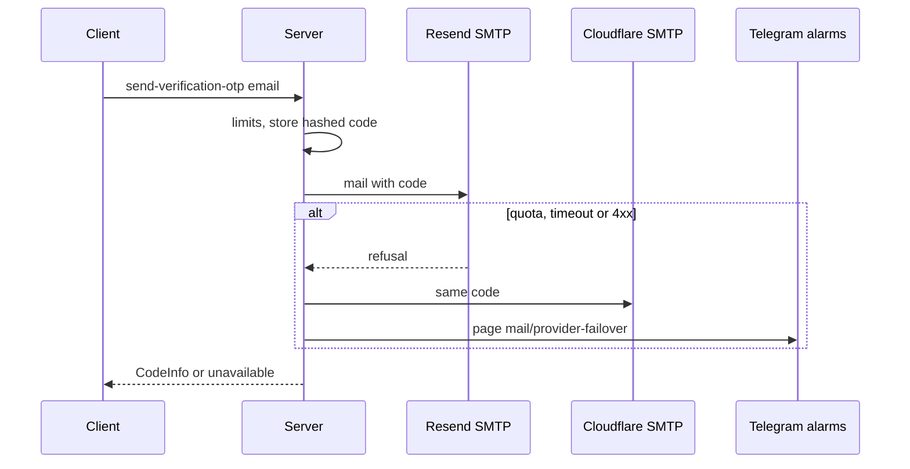

# Spec: Вхід і листи — пристрій зі стійкою cookie, гість при першому записі, вхід кодом на пошту й через Google, сесія на сезон, події сесії, поштовий модуль із запасним постачальником, лічильником і тривогами, обробник «дані суб'єкта»
Spec ID: SPEC-10
Status: approved
Supersedes: none

## Джерела

- Хвиля: `D:/Work/Pets/Time2Fest/specs/002-backend/waves.md:200-212` (SPEC-10), рішення власника 24.11 `:214`; передачі SPEC-05 `:141`, SPEC-06 `:1068`; спільні файли `:554-555`; ризики Р6 `:757`, Р16 `:767`.
- Вимоги (14): FR-ID-01…06, -13, -18 (`specs/002-backend/spec.md:630-660`), FR-MAIL-01…06 (`:596-601`); плюс FR-PLAT-13 (`:497`), FR-EDGE-07/-10 (`:509`, `:512`), FR-PLAT-14 (`:498`). Сліпі зони В-18, В-19, В-20 (`review-blind-spots.md:94-98`).
- Шов клієнта: `docs/backend/frontend-seam.md` §3.6 (l.190-196), §3.11 (l.241), §E3 (l.402-410); контракт `web/lib/api/contracts/auth.ts`; числа симулятора `web/lib/auth/sim.ts`, `web/lib/api/sim/auth.ts`; поведінка UI `web/components/auth/useAuthFlow.ts:26-251`.
- Нотатки досліджень (2026-11-25, тека сесії `spec-10/`): `research-code.md` («нотатки коду»), `research-better-auth.md` («нотатки BA»), `research-mail.md` («нотатки пошти»).
- Рішення власника: `docs/decision.md:9` (2026-11-25: хвиля стартує без окремого «так»; живих листів і дій у кабінетах — без власника), `:21-27` (2026-11-24: Resend основний, Cloudflare Email Service запасний, `mail.time2fest.com`, Pro за сигналом 70/добу й до 30.12, ключ → `SMTP_PASSWORD`), `:29-45` (Google OAuth закрито власником), `:741` (код 6 цифр без посилань, вхід на весь сезон).

## Рішення власника

- **В1.** Основний поштовик — Resend через SMTP (`smtp.resend.com`, змінні `SMTP_HOST`/`SMTP_PORT`/`SMTP_USER`/`SMTP_PASSWORD`), домен відправника `mail.time2fest.com`. → AC-36, AC-47
- **В2.** Запасний — Cloudflare Email Service через SMTP (`smtp.mx.cloudflare.net:465`, змінні `SMTP_FALLBACK_*`); при відмові Resend через ліміт/квоту — автоматичне перемикання без втрати коду входу. → AC-37…AC-40
- **В3.** Лічильник надісланих листів за добу UTC і тривога `page` у Telegram (SPEC-13b) на 70 листів/добу. → AC-42
- **В4.** Нагадування власнику 30.12 про перехід Resend на Pro, якщо ще не перейшов. → AC-45
- **В5.** Тести — лише фейки (Mailpit, фейк SMTP, фейк Google OIDC); живих листів і живого Google у хвилі немає. → AC-53, AC-55, NFR-6

## Питання власнику (перший прохід, не блокують)

- **[Q1]** Кінець сезону для сесії — прийнято за замовчуванням: `T2F_SEASON_END`, типово `2027-01-15T00:00:00Z`; сесія живе `min(вхід + 60 діб, кінець сезону)`. → AC-26
- **[Q2]** Ліміт створення гостей за добовим відбитком IP (FR-ID-01) — прийнято за замовчуванням: 60 гостей за 10 хв на відбиток (запас для NAT кампусів і кафе), понад — `rate_limited`. → AC-4
- **[Q3]** Google повертає `email_verified=false` для пошти наявного акаунта — прийнято за замовчуванням: не входимо й не створюємо другий акаунт, повернення з `error=failed` (FR-ID-18 вимагає перевіреної пошти). → AC-21
- **[Q4]** Добова стеля запасного постачальника (Cloudflare не публікує число) — прийнято за замовчуванням: `SMTP_FALLBACK_DAILY_CEILING`, типово 100; тривоги 80 % і для нього. → AC-43, AC-44
- **[Q5]** Оцінка піку листів за ніч (FR-MAIL-06) — прийнято за замовчуванням: розрахунок у документі хвилі (коди входу й зміни пошти; SPEC-19 додає нагадування); перевірку «стеля ≥3× піку» робить власник при переході на Pro. → AC-58

## Рішення сесії

Кожне — рішення сесії `[А]`, ведучий хвилі може змінити; кожне перевіряється в AC або NFR.

- **[А1] Better Auth 1.7.x окремо від Payload.** Власні таблиці через Kysely на окремому пулі pg (не колекції Payload; `admins` лишається окремим, В5 SPEC-04); `payload-auth` відхилено (одна адмін-система, один супровідник — нотатки BA §2). Таблиці створює міграція Payload; `schema:check` ловить розбіжність схеми після оновлення BA. → AC-57
- **[А2] Через наявний диспетчер.** `basePath /api/auth` усередині єдиного catch-all `/api/*` після перевірки секрету краю; нових файлів маршрутів Next немає. Дозволений лише перелік шляхів BA з контракту; решта (пароль, зміна пошти, видалення, verify-email) — 404. → AC-34
- **[А3] Плагіни:** `anonymous` (гість лише при першому записі), `emailOTP` (6 цифр, хеш, параметри FR-ID-03), Google через `genericOAuth` з `providerId: google` і discovery URL зі змінної — один шлях коду для робочого Google і фейка. `emailAndPassword` вимкнено. → AC-6…AC-23
- **[А4] Свої ліміти поверх BA.** Пошта — лише хешем у ключах; добовий відбиток IP і другий ключ /48 для IPv6 (передача SPEC-05). Вбудований ліміт BA лишається як запобіжник. → AC-8…AC-10
- **[А5] Пристрій — своя cookie `t2f_device`** поза префіксом BA; вихід її не чіпає; id пристрою пишеться в кожну сесію. → AC-1, AC-2
- **[А6] Кеш cookie сесії вимкнено** — відкликання діє з наступного запиту. → AC-27
- **[А7] Пошта:** один поштовий порт, два SMTP-транспорти; код зберігається **до** відправлення; запасний отримує той самий код і той самий `Message-ID`; класифікація відмови за класом відповіді й текстом (`quota`, `rate`, `too many`, `limit`, `not verified`), бо тексти SMTP Resend не документовані (нотатки пошти §1). Після перемикання основний вважається зламаним: квота — до 00:00 UTC, інше — 5 хв. → AC-37…AC-40
- **[А8] Обидва постачальники відмовили** → `unavailable`; спроба не рахується в ліміти 30 с / 5 за 10 хв / 10 за добу, код недійсний — людина просто пробує ще раз. → AC-40
- **[А9] Пріоритет кодів:** з 80 % добової стелі листи інших класів (з'являться в SPEC-17/19) відмовляються, коди йдуть до 100 %. → AC-44
- **[А10] Нагадування 30.12 — тривога `page`** від поштової задачі ops, не момент сезону: 30.12 і 31.12 о 09:00 за Києвом, поки `T2F_MAIL_PLAN=free`. → AC-45
- **[А11] Обхід бага BA #11533** (мертва cookie сесії розлогінює після нового входу): з запитів на шляхи входу прибирається недійсна cookie сесії; e2e «відкликати → увійти знову». → AC-25
- **[А12] Прив'язка Google лише за `email_verified=true`** — налаштування «довірений постачальник» не обходить FR-ID-18. → AC-20, AC-21
- **[А13] Токен сесії** вирізається з JSON-відповідей `/api/auth/*` (BA #12947): сайт працює лише на cookie. → AC-14

## Problem and user

Відвідувач сайту зараз не може увійти: сервер не має ні акаунтів, ні сесій, ні пошти (`noSessionSubjects`, `adapters/noSessionSubjects.ts`; BA у репозиторії немає — нотатки коду §0). Без входу не працюють пас на акаунті, графік, бани, злиття (SPEC-11) і особисті канали (SPEC-06). Власник у новорічну ніч не може дозволити, щоб вичерпана стеля Resend Free (100/добу) мовчки зламала вхід (В-19).

## Goals / Non-goals

**Goals:** пристрій і гість за FR-ID-01/02; вхід кодом і Google з причинами клієнтського контракту; сесія на сезон; події сесії ≤3 с; поштовий модуль з перемиканням, лічильником, тривогами; обробник FR-PLAT-13; дверцята й фейки; рядки `auth` про код і Google зелені на `http`.

**Non-goals:**
- Профіль, нік, прапор, графік, пас (приєднання, `pass-owned`), бани, повне злиття гість → акаунт з правилами A-3, зміна пошти, `linkGoogle`/`google-taken`, видалення акаунта — SPEC-11 / SPEC-20. Тут лише переносяться рядки самого входу (пристрій, сесії) і є точка розширення для обробників злиття.
- Перемикання домену `auth` на `http` — SPEC-11 (waves.md:207).
- Листи-нагадування (FR-NOTIF-08) — SPEC-19; листи повернень — SPEC-17. Тут лише клас листа «інше» для правила пріоритету.
- Живі листи, налаштування DNS (SPF/DKIM/DMARC, онбординг Cloudflare), робочий Google-клієнт — власник (див. Open questions, «Справи власника»).
- HTTP API Resend — лише якщо живі тексти SMTP виявляться непридатними (окреме рішення).

## User stories

- **US-1** Як відвідувач, я читаю сайт без створення гостя, а мій пристрій лишається тим самим після входів і виходів. → AC-1…AC-5
- **US-2** Як відвідувач, я входжу кодом із листа й бачу зрозумілу причину, коли щось не так. → AC-6…AC-16
- **US-3** Як відвідувач, я входжу через Google і повертаюсь на свою сторінку; з поштою наявного акаунта потрапляю в нього. → AC-17…AC-25
- **US-4** Як учасник, я лишаюсь увійшовши весь сезон, а вихід чи вхід на одній вкладці бачать інші ≤3 с. → AC-26…AC-35
- **US-5** Як відвідувач, я отримую лист із кодом за секунди, навіть коли основний постачальник відмовив. → AC-36…AC-40, AC-48, AC-59
- **US-6** Як власник, я дізнаюсь у Telegram про 70 листів/добу, 80 % стелі, перемикання постачальника й неперехід на Pro до 30.12. → AC-41…AC-46, AC-58
- **US-7** Як суб'єкт даних, я можу отримати й стерти свої дані входу. → AC-49, AC-50
- **US-8** Як розробник і агент, я перевіряю все на фейках через дверцята, без живих листів. → AC-47, AC-51…AC-57

## Acceptance criteria (EARS)

**Пакети:** `server` (`server/`), `contracts` (`packages/contracts/`), `web` (клієнт `web/lib/api/http/*`), `fakes` (`fakes/`, compose), `docs-patch` (документи поза репозиторієм: `docs/backend/secrets.md`, `alarms.md`, `docs/services/mail.md`, `google.md`).

### Пристрій і гість (FR-ID-01, FR-ID-02)

**AC-1 [server]** WHEN не-публічна відповідь `/api/*` іде на запит без `t2f_device`, the server shall встановити `t2f_device` (128 біт випадкових, `Secure; HttpOnly; SameSite=Lax; Path=/`, без `Domain`, `Max-Age` 400 діб).
Verify: integration — перший запит отримує cookie з цими атрибутами; другий з нею — не отримує нову.

**AC-2 [server]** WHEN людина входить, виходить і входить іншим акаунтом на тому ж пристрої, the server shall записати в обидві сесії той самий id пристрою й не змінювати `t2f_device`.
Verify: e2e — вхід A → вихід → вхід B: id пристрою в сесіях A і B однаковий, cookie незмінна.

**AC-3 [server]** WHEN надходить `GET /api/auth/get-session` або публічна адреса без сесії, the server shall не створювати рядків гостя чи акаунта.
Verify: integration — 100 таких запитів → кількість рядків користувачів не змінилась.

**AC-4 [server]** WHEN маршрут, позначений «потребує суб'єкта», викликано без сесії, the server shall створити гостя, прив'язаного до пристрою, IF відбиток IP уже створив 60 гостей за 10 хв, THEN відповісти `rate_limited` з `retryAfterMs`.
Verify: integration — тестовий маршрут запису створює рівно одного гостя; 61-й з одного відбитка за 10 хв → `rate_limited`.

**AC-5 [server]** WHEN гість не мав активності 30 діб і жоден обробник «дані суб'єкта» не повертає для нього даних, the server shall видалити гостя разом із його сесіями.
Verify: integration — тестовий годинник +30 діб → гість без даних видалений, гість із даними тестового обробника лишився.

### Вхід кодом (FR-ID-03, FR-ID-04)

**AC-6 [server, contracts]** WHEN `POST /api/auth/email-otp/send-verification-otp` має коректну пошту, the server shall відповісти `CodeInfo` (`email`, `intent`, `sentAt`, `resendAt = sentAt + 30 с`, `expiresAt = sentAt + 10 хв`, `attemptsLeft = 5`) однаково за формою для нової й наявної пошти, не створюючи акаунта.
Verify: integration — дві відповіді (нова / наявна) відрізняються лише значеннями `email` і часу; рядок користувача для нової пошти відсутній.

**AC-7 [server]** IF пошта не проходить перевірку формату, THEN the server shall відповісти `validation` з причиною `email` і не відправляти листа.
Verify: integration — `a@`, порожньо, 255+ символів → `validation/email`, у Mailpit нічого.

**AC-8 [server]** IF новий код для тієї ж пошти просять раніше 30 с, THEN the server shall відповісти `rate_limited/wait` з `retryAfterMs`.
Verify: integration — другий запит через 10 с → `wait`, `retryAfterMs` 19 000–20 000.

**AC-9 [server]** IF за 10 хв уже видано 5 кодів на цю пошту, або на цей добовий відбиток IP, або на цю мережу IPv6 /48, THEN the server shall відповісти `rate_limited/too-many` з `retryAfterMs`.
Verify: integration — шостий запит за кожним із трьох ключів окремо → `too-many`.

**AC-10 [server]** IF на пошту за добу UTC уже видано 10 кодів, THEN the server shall відповісти `rate_limited/too-many` з `retryAfterMs` до 00:00 UTC.
Verify: integration — 11-й код (тестовий годинник між вікнами) → `too-many`.

**AC-11 [server]** IF введено хибний код, THEN the server shall відповісти `validation/wrong-code` з `attemptsLeft`, зменшеним на 1.
Verify: integration — хибний код → `attemptsLeft: 4`.

**AC-12 [server]** IF введено п'ятий хибний код, THEN the server shall відповісти `rate_limited/too-many-attempts` і спалити код так, що правильний код після цього не входить.
Verify: integration — 5 хибних → `too-many-attempts`; правильний → `wrong-code`.

**AC-13 [server]** IF код старший за 10 хв, THEN the server shall відповісти `conflict/expired`.
Verify: integration — дверцята «прострочити код» → `expired`.

**AC-14 [server]** WHEN `POST /api/auth/sign-in/email-otp` має правильний код, the server shall встановити cookie сесії й відповісти `SignInOutcome` (`isNew`, `email`) без токена сесії в тілі.
Verify: integration — `isNew: true` для нової пошти й `false` для наявної; тіло не містить `token`.

**AC-15 [server]** WHEN видано новий код, the server shall зробити попередній код цієї пошти недійсним.
Verify: integration — старий код після нового → `wrong-code`.

**AC-16 [server]** The server shall зберігати коди лише у вигляді хешу.
Verify: integration — у сховищі кодів немає шести цифр виданого коду.

### Google і прив'язка гостя (FR-ID-05, FR-ID-18)

**AC-17 [server]** WHEN `POST /api/auth/sign-in/social` має `returnPath` — шлях власного сайту, the server shall після успішного повернення з Google переспрямувати на `returnPath` із `signin=google` і `new=1` для нового акаунта, зберігши `#hash`.
Verify: e2e (фейк OIDC) — `/countries/ua?x=1#a` → `/countries/ua?x=1&signin=google&new=1#a`.

**AC-18 [server]** IF `returnPath` абсолютний, починається з `//` чи `\`, має керівні символи або закодовані роздільники, THEN the server shall повернути на `/`.
Verify: e2e — `https://evil.example/`, `//evil.example`, `/%2F%2Fevil` → `/`.

**AC-19 [server]** WHEN людина скасувала вхід у Google, the server shall повернути на `returnPath` з `error=cancelled`.
Verify: e2e — фейк OIDC відповідає `access_denied` → `?error=cancelled`, клієнт показує `conflict/cancelled`.

**AC-20 [server]** WHEN Google повертає перевірену пошту (`email_verified=true`) наявного акаунта, the server shall увійти в цей акаунт і прив'язати до нього Google без створення другого акаунта.
Verify: integration — акаунт кодом, потім Google з тією ж поштою → один користувач, два способи входу.

**AC-21 [server]** IF Google повертає неперевірену пошту наявного акаунта, THEN the server shall не входити, не створювати акаунта й повернути на `returnPath` з `error=failed`.
Verify: integration — фейк з `email_verified=false` → рядків не додано, `error=failed`.

**AC-22 [server]** IF документ discovery або обмін кодом Google недоступні 10 с, THEN the server shall відповісти на `sign-in/social` кодом `unavailable` або повернути з `error=failed` після колбеку.
Verify: integration — фейк OIDC зупинено → `unavailable`.

**AC-23 [server]** WHEN гість входить кодом або через Google, the server shall перенести на акаунт пристрій і дані зареєстрованих обробників злиття, видалити гостя й повторити перенос без дублікатів при повторному виклику.
Verify: integration — гість із тестовим рядком → після входу рядок на акаунті, гостя немає; повторний виклик обробника нічого не змінює.

**AC-24 [server]** IF обробник злиття кинув помилку, THEN the server shall все одно завершити вхід, записати задачу повтору й підняти тривогу `log` `auth/link-retry`.
Verify: integration — тестовий обробник кидає → сесія є, задача повтору є, тривога в `log-alarms`.

**AC-25 [server]** WHEN запит на вхід несе cookie відкликаної сесії, the server shall завершити вхід зі встановленою новою cookie сесії.
Verify: e2e — вхід, відкликати сесію з іншого пристрою, увійти знову → `get-session` повертає користувача (BA #11533).

### Сесія, суб'єкт і події (FR-ID-06, FR-ID-13, передачі SPEC-05 і SPEC-06)

**AC-26 [server]** WHEN створюється сесія, the server shall поставити cookie з префіксом `__Secure-`, `HttpOnly; Secure; SameSite=Lax; Path=/`, без `Domain`, із закінченням `min(зараз + 60 діб, T2F_SEASON_END)`, а після кінця сезону — `зараз + 60 діб`.
Verify: integration — атрибути cookie й `expiresAt` за тестовим годинником до й після кінця сезону.

**AC-27 [server]** WHEN сесію відкликано, the server shall відповідати на наступний запит із її cookie як без сесії.
Verify: integration — відкликати → наступний `get-session` → `user: null`.

**AC-28 [server]** WHEN людина виходить на пристрої A, the server shall лишити дійсними її сесії на інших пристроях.
Verify: integration — дві сесії, вихід на A → сесія B дійсна.

**AC-29 [server]** WHEN сесію створено або завершено, the server shall опублікувати подію `session` у канал `user:#<id>` суб'єкта й викликати `invalidateSubject` для старого й нового id.
Verify: integration (Centrifugo) — друга вкладка отримує `session` ≤3 с після входу й після виходу.

**AC-30 [server]** The server shall визначати суб'єкта з cookie сесії (акаунт або гість, id за `SUBJECT_ID`) замість `noSessionSubjects` і передавати в ліміти частоти ключі `subject` і `device`.
Verify: integration — токен realtime несе id суб'єкта; рядок ліміту з ключем `device` рахує окремо для двох пристроїв.

**AC-31 [web]** WHEN `get-session` показує зміну суб'єкта в цій вкладці без перезавантаження, the client realtime transport shall запросити новий токен підключення.
Verify: e2e — вхід без перезавантаження → нове підключення з id акаунта, особисті події доходять.

**AC-32 [server]** The server shall брати IP лише з перевіреного заголовка краю `x-t2f-client`, прибираючи з запиту до BA клієнтські `x-forwarded-for`, `x-real-ip` і внутрішній заголовок IP.
Verify: integration — підроблений `X-Forwarded-For` не змінює ключ ліміту (FR-EDGE-07).

**AC-33 [server]** IF POST на `/api/auth/*` має чужий `Origin`, THEN the server shall відповісти 403.
Verify: integration — `Origin: https://evil.example` → 403.

**AC-34 [server]** IF шлях `/api/auth/*` не входить у перелік дозволених (`get-session`, `email-otp/send-verification-otp`, `sign-in/email-otp`, `sign-in/social`, `callback/google`, `sign-out`, вхід гостя), THEN the server shall відповісти 404.
Verify: integration — `sign-up/email`, `delete-user`, `change-email` → 404.

**AC-35 [server, contracts]** WHEN `get-session` має сесію, the server shall відповісти формою `Session` клієнтського контракту з `user` (`id`, `email`, `via`, `signedInAt`, `name?`), `guestId` і полями паса в нейтральному стані (`hasPass: false`, решта `null`) до SPEC-11.
Verify: integration — відповідь проходить схему `Session` з `packages/contracts`.

### Пошта (FR-MAIL-01…06, рішення власника 24.11)

**AC-36 [server]** WHEN код видано, the server shall передати лист постачальнику ≤5 с: відправник `@mail.time2fest.com`, українською, текст і HTML, код, строк 10 хв, «якщо це не ви — проігноруйте», без посилань для входу, із заголовками `Auto-Submitted: auto-generated` і `Resend-Idempotency-Key` = id коду.
Verify: integration (Mailpit) — лист з'являється ≤5 с, вміст і заголовки за переліком, у тексті немає `http`.

**AC-37 [server]** IF основний постачальник відмовив з'єднанням, тайм-аутом 4 с, автентифікацією, відповіддю 4xx або 5xx з текстом про квоту чи ліміт, THEN the server shall надіслати той самий код через запасного рівно один раз і відповісти як на успіх.
Verify: integration — Mailpit основного з хаосом `Sender:451:100` і фейк SMTP з `451 4.7.1` після DATA та з текстом `daily quota`: у запасному Mailpit один лист із тим самим кодом, вхід цим кодом успішний.

**AC-38 [server]** IF основний постачальник відхилив саму адресу (5xx на `RCPT TO` без тексту про ліміт), THEN the server shall не перемикатися й відповісти `validation/email`.
Verify: integration — хаос `Recipient:550:100` → `validation/email`, запасний не викликався.

**AC-39 [server]** WHILE основний позначено зламаним (квота — до 00:00 UTC, інше — 5 хв), the server shall слати листи одразу через запасного.
Verify: integration — після перемикання наступний лист іде в запасний без звернення до основного; після 00:00 UTC (тестовий годинник) — знову в основний.

**AC-40 [server]** IF обидва постачальники відмовили, THEN the server shall відповісти `unavailable`, не рахувати спробу в ліміти AC-8…AC-10 і підняти тривогу `page` `mail/all-providers-down`.
Verify: integration — обидва Mailpit з хаосом → `unavailable`; одразу повторний запит не отримує `wait`; тривога в скриньці.

**AC-41 [server]** WHEN відбулося перемикання на запасного, the server shall підняти тривогу `page` `mail/provider-failover` не частіше одного разу за період «зламаний».
Verify: integration — 10 перемикань за 5 хв → одна тривога.

**AC-42 [server]** WHEN кількість листів основного постачальника за добу UTC досягла 70, the server shall підняти тривогу `page` `mail/daily-70` один раз за добу.
Verify: integration — дверцята лічильника 69 → лист → тривога; 71-й лист → нової немає.

**AC-43 [server]** WHEN лічильник постачальника досягає 80 % його добової стелі (`T2F_MAIL_DAILY_CEILING`, типово 100; `SMTP_FALLBACK_DAILY_CEILING`, типово 100), the server shall підняти тривогу `page` `mail/ceiling-80` один раз за добу на постачальника.
Verify: integration — стеля 10, восьмий лист → тривога з деталлю `provider`.

**AC-44 [server]** WHILE лічильник основного ≥80 % стелі, the server shall відмовляти листам класу «інше» (`unavailable`) і слати коди до 100 %, а після 100 % — коди через запасного до його стелі.
Verify: integration — стеля 10: тестовий лист «інше» на 8-му → відмова; коди 9–10 — основний; 11-й — запасний; стелі обох вичерпано → `unavailable`.

**AC-45 [server]** WHILE `T2F_MAIL_PLAN=free`, the server shall 30.12 і 31.12 о 09:00 `Europe/Kyiv` підняти тривогу `page` `mail/plan-free` («перевести Resend на Pro») один раз на день.
Verify: integration — тестовий годинник 30.12 09:00 → тривога; `T2F_MAIL_PLAN=pro` → немає; 29.12 → немає.

**AC-46 [server]** The server shall мати в реєстрі «тривоги й метрики» домен `mail` без позначки «зарезервовано» з рядками `daily-70`, `ceiling-80`, `provider-failover`, `all-providers-down`, `plan-free` і метрикою `mail.sent` за постачальниками, а рядок `mail` зрізу «Моніторинг» — показувати лічильник доби замість «немає провайдера» (SPEC-13b AC-65).
Verify: unit — сканер реєстру зелений; integration — зріз показує лічильник.

**AC-47 [server]** IF у класі `test` хост SMTP, хост запасного SMTP або discovery URL Google не loopback, THEN the server shall відмовитись стартувати з назвою змінної в помилці.
Verify: unit — `SMTP_HOST=smtp.resend.com` у `test` → старт падає; значення паролів у журналі замасковані.

**AC-48 [server]** The server shall не записувати адреси пошти й коди в журнали, тривоги, аудит і деталі помилок.
Verify: integration — повний прогін входу, перемикання й відмов із перехопленням stdout: пошук унікальної адреси й кожного коду → 0 збігів.

### Дані суб'єкта (FR-PLAT-13)

**AC-49 [server]** WHEN викликано «віддати» для суб'єкта, the handler `auth` shall повернути пошту, ім'я з Google, способи входу (без токенів), сесії (створено, закінчується, id пристрою) і id пристроїв.
Verify: integration — експорт для акаунта з кодом і Google: поля за переліком, полів `accessToken`/`idToken`/`refreshToken` немає.

**AC-50 [server]** WHEN викликано «стерти», the handler `auth` shall видалити користувача, способи входу, сесії й коди його пошти та опублікувати подію `session`, а реєстр «дані суб'єкта» — мати рядки `auth` і `auth-codes` (декларативний, строк — 10 хв).
Verify: integration — після стирання рядків немає, друга вкладка отримала `session`; unit — рядки реєстру.

### Контракти, дверцята, фейки, документи

**AC-51 [contracts]** The contracts package shall додати лише додаванням `AUTH_REASONS` (`wrong-code`, `expired`, `too-many-attempts`, `wait`, `too-many`, `email`, `cancelled`) і схеми тіл `requestCode {email, intent}`, `verifyCode {email, otp}`, `google {returnPath}` та події `session`.
Verify: unit — перевірка поверхні контрактів «лише додаванням» зелена; схеми відкидають зайві поля.

**AC-52 [server]** WHERE `T2F_ENV=test` і `T2F_TEST_DOORS=1`, the server shall мати дверцята: останній код за унікальним отримувачем (пошук Mailpit), прострочити код, задати користувача фейк Google, задати лічильник листів.
Verify: integration — кожні дверцята працюють у `test` і повертають 404 поза ним.

**AC-53 [fakes]** The stack shall піднімати фейк Google OIDC `ghcr.io/navikt/mock-oauth2-server:7.0.2`, другий Mailpit для запасного з увімкненим хаосом і фейк SMTP із відповідями `451 4.7.1` після DATA та текстами квоти.
Verify: integration — перевірки здоров'я трьох служб у `stack.mjs` зелені.

**AC-54 [web]** The `auth` http adapter shall проходити рядки набору `auth` про код і Google на `http` проти сервера з фейками (перемикання домену лишається на SPEC-11).
Verify: e2e — рядки коду й Google набору `auth` зелені з адаптером `http`.

**AC-55 [server]** The test suites shall надсилати листи лише в Mailpit і фейк SMTP і звертатися лише до фейк OIDC.
Verify: integration — у `test` транспорт до не-loopback хоста не створюється (AC-47); журнал підключень фейків показує всі звернення.

**AC-56 [server]** The server shall використовувати унікальні адреси отримувачів у тестах, бо Mailpit спільний для дерев.
Verify: unit — генератор тестових адрес додає id дерева й випадковий суфікс; дверцята AC-52 шукають лише за отримувачем.

**AC-57 [server]** The schema check shall падати, коли BA очікує таблицю чи стовпець, якого немає після міграцій.
Verify: integration — `schema:check` на свіжій базі зелений; з видаленим стовпцем — червоний з назвою.

**AC-58 [docs-patch]** The wave shall оновити `secrets.md` (змінні SMTP, запасного, Google, BA, `T2F_MAIL_PLAN`, стелі), `alarms.md` (рядки пошти), `services/mail.md` і `services/google.md`, і записати оцінку піку листів за ніч (FR-MAIL-06).
Verify: manual — оркестратор звіряє чернетку патча з реєстрами; ніщо автоматичне не читає документи поза репозиторієм.

**AC-59 [docs-patch]** The sender domain shall мати SPF, DKIM і DMARC з вирівнюванням для Resend і Cloudflare, а лист із кодом — доходити в Gmail і Outlook не в спам.
Verify: manual — справа власника (живий лист і DNS потребують «так»); доказ — «Show original» Gmail: SPF/DKIM/DMARC = PASS.

## Edge cases

- **EC-1** Два запити коду одночасно для однієї пошти → лише один проходить, другий `wait`. → AC-8
- **EC-2** Гість на двох вкладках входить у дві різні пошти одночасно → кожна сесія коректна, гість переноситься один раз. → AC-23
- **EC-3** Google з поштою, вже прив'язаною до іншого Google-акаунта — `google-taken` у профілі. → Non-goal (SPEC-11)
- **EC-4** Тайм-аут основного після прийому листа → запасний може надіслати другий лист з тим самим кодом; код один, вхід працює. → AC-37
- **EC-5** Перехід доби UTC під час зламаного основного → основний пробується знову після 00:00. → AC-39
- **EC-6** IPv6-клієнт міняє /64 у межах /48 → ліміт кодів спрацьовує за /48. → AC-9
- **EC-7** Запит без перевіреного заголовка краю (`noaddr`) → ліміти за поштою й пристроєм працюють. → AC-9, AC-32
- **EC-8** Пошта з великими літерами чи пробілами → нормалізується до порівняння й лімітів. → AC-6
- **EC-9** Вхід після кінця сезону → сесія на 60 діб. → AC-26
- **EC-10** Обробник «стерти» іншої можливості впав → стирання `auth` все одно виконано, помилку повідомлено. → AC-50
- **EC-11** Справжні тексти SMTP Resend для квоти невідомі. → OQ-список, пункт 2

## Non-functional requirements

**NFR-1 [server]** The server shall передавати лист із кодом постачальнику ≤5 с для 95 % запитів при 20 запитах коду на секунду.
Verify: integration — 200 запитів за 10 с у Mailpit, p95 часу до прийому ≤5 с.

**NFR-2 [server]** The server shall відповідати на `get-session` ≤50 мс p95 на локальному стеку.
Verify: integration — 500 запитів, p95 ≤50 мс.

**NFR-3 [server]** The server shall тримати не більше 8 листів на секунду на основного постачальника (ліміт Resend 10/с на команду).
Verify: unit — 30 листів у чергу за 1 с → у транспорт ≤8 за кожну секунду.

**NFR-4 [server]** IF швидке сховище (Redis) недоступне, THEN the server shall відмовляти в запиті коду (`unavailable`), а не пропускати без лімітів.
Verify: integration — Redis зупинено → `unavailable`.

**NFR-5 [server]** The server shall не зберігати сиру IP-адресу й обрізати user-agent у сесії до 128 символів.
Verify: integration — у рядку сесії поле IP порожнє, user-agent ≤128.

**NFR-6 [server]** The test and CI runs shall не надсилати жодного живого листа й не звертатися до Google.
Verify: integration — AC-47 + журнал з'єднань фейків; CI без мережевих змінних постачальників.

**NFR-7 [server]** The server shall не надсилати листів із кодом понад 10 на пошту за добу незалежно від постачальника.
Verify: integration — 11-й запит → `too-many`, у Mailpit 10 листів.

## Module interactions

- **Клієнт → сервер:** маршрути `/api/auth/*` за AC-34; помилки — `ApiError` з причинами AC-51; Google — повна навігація з поверненням на свій шлях.
- **Сервер → Google / фейк OIDC:** discovery, авторизація з PKCE, обмін коду, перевірка id_token за JWKS; збій → AC-22.
- **Сервер → Resend / Cloudflare:** SMTP з тайм-аутом 4 с на спробу; збої → AC-37…AC-40.
- **Сервер → Centrifugo:** подія `session` і `invalidateSubject`; збій публікації не скасовує вхід (результат `queued`/`unavailable` пише `log`). → AC-29
- **Сервер → тривоги SPEC-13b:** `raise` ніколи не кидає. → AC-41…AC-45

**Контракт (proposed, лише додаванням):** тіла `requestCode {email: string ≤254, intent: 'signin'|'signup'}` → `CodeInfo`; `verifyCode {email, otp: 6 цифр}` → `SignInOutcome`; `google {returnPath: string ≤512}` → `{kind:'redirect', url}`; подія `session {type:'session', id, data:{reason:'signed-in'|'signed-out'|'erased'}}`. Помилки: `validation/email|wrong-code`, `conflict/expired|cancelled`, `rate_limited/wait|too-many|too-many-attempts` з `retryAfterMs`, `unavailable`.

## Inputs and provenance

| Input | Source | Producer | Freshness | Trusted |
|---|---|---|---|---|
| Пошта, код, `returnPath` | тіло запиту | відвідувач | на запит | ні |
| `x-t2f-client` (IP, країна) | край | Worker SPEC-05 | на запит | так, лише з секретом краю |
| id_token, профіль Google | Google / фейк | Google | на вхід | ні, доки підпис і issuer не перевірено |
| Відповіді SMTP | Resend / Cloudflare | постачальник | на лист | ні |
| `T2F_MAIL_PLAN`, стелі | змінні вузла | власник | на старт | так |

## Untrusted inputs

- Пошта, код, `returnPath` → перевірка на межі й обмеження розміру (AC-7, AC-18, AC-51), ліміти (AC-8…AC-10), ніколи в журнали (AC-48).
- Профіль Google → перевірка id_token і `email_verified` (AC-20, AC-21); ім'я лише як текст (екранування — клієнт).
- Тексти SMTP → лише класифікація, не показуються людям і не пишуться з адресою (AC-37, AC-48).
- Клієнтські заголовки адреси → відкидаються (AC-32).

## Design review

- DR-1 Ліміти коду симулятора (`sim.ts`) — accepted → AC-6…AC-13.
- DR-2 «Ще раз попросити токен» для вкладки без сесії (передача SPEC-06) — accepted → AC-31.
- DR-3 Ключ /48 для IPv6 (передача SPEC-05, S6) — accepted → AC-9.
- DR-4 Обидва постачальники впали → `unavailable` замість «лист затримується» — accepted [А8] → AC-40.
- DR-5 HTTP API Resend замість SMTP — declined → Non-goal (рішення власника В1).
- DR-6 Конфлікт «довірений Google» проти FR-ID-18 — accepted [А12] → AC-21.

## Traceability

| AC / NFR | From | Packages | Verify |
|---|---|---|---|
| AC-1 | US-1, FR-ID-02 | server | integration |
| AC-2 | US-1, FR-ID-02 | server | e2e |
| AC-3 | US-1, FR-ID-01 | server | integration |
| AC-4 | US-1, FR-ID-01, Q2 | server | integration |
| AC-5 | US-1, FR-ID-01 | server | integration |
| AC-6 | US-2, FR-ID-04, EC-8 | server, contracts | integration |
| AC-7 | US-2, FR-ID-03 | server | integration |
| AC-8 | US-2, FR-ID-03, EC-1 | server | integration |
| AC-9 | US-2, FR-ID-03, DR-3, EC-6, EC-7 | server | integration |
| AC-10 | US-2, FR-ID-03 | server | integration |
| AC-11 | US-2, FR-ID-03 | server | integration |
| AC-12 | US-2, FR-ID-03 | server | integration |
| AC-13 | US-2, FR-ID-03 | server | integration |
| AC-14 | US-2, FR-ID-04, А13 | server | integration |
| AC-15 | US-2, FR-ID-03 | server | integration |
| AC-16 | US-2, А3 | server | integration |
| AC-17 | US-3, FR-ID-05 | server | e2e |
| AC-18 | US-3, FR-ID-05 | server | e2e |
| AC-19 | US-3, FR-ID-05 | server | e2e |
| AC-20 | US-3, FR-ID-18 | server | integration |
| AC-21 | US-3, FR-ID-18, Q3, DR-6 | server | integration |
| AC-22 | US-3 | server | integration |
| AC-23 | US-3, EC-2 | server | integration |
| AC-24 | US-3 | server | integration |
| AC-25 | US-3, А11 | server | e2e |
| AC-26 | US-4, FR-ID-06, Q1, EC-9 | server | integration |
| AC-27 | US-4, А6 | server | integration |
| AC-28 | US-4, FR-ID-06 | server | integration |
| AC-29 | US-4, FR-ID-13 | server | integration |
| AC-30 | US-4, передача SPEC-06 | server | integration |
| AC-31 | US-4, DR-2 | web | e2e |
| AC-32 | US-4, FR-EDGE-07, EC-7 | server | integration |
| AC-33 | US-4 | server | integration |
| AC-34 | US-4, А2 | server | integration |
| AC-35 | US-4 | server, contracts | integration |
| AC-36 | US-5, FR-MAIL-01, FR-MAIL-04, В1 | server | integration |
| AC-37 | US-5, FR-MAIL-03, В2, EC-4 | server | integration |
| AC-38 | US-5, FR-MAIL-03 | server | integration |
| AC-39 | US-5, А7, EC-5 | server | integration |
| AC-40 | US-5, FR-MAIL-03, DR-4 | server | integration |
| AC-41 | US-6, В2 | server | integration |
| AC-42 | US-6, В3 | server | integration |
| AC-43 | US-6, FR-MAIL-06, Q4 | server | integration |
| AC-44 | US-6, FR-MAIL-06, А9 | server | integration |
| AC-45 | US-6, В4, А10 | server | integration |
| AC-46 | US-6, SPEC-13b AC-65 | server | unit, integration |
| AC-47 | US-8, В5 | server | unit |
| AC-48 | US-5, FR-MAIL-05 | server | integration |
| AC-49 | US-7, FR-PLAT-13 | server | integration |
| AC-50 | US-7, FR-PLAT-13, EC-10 | server | integration, unit |
| AC-51 | US-8 | contracts | unit |
| AC-52 | US-8 | server | integration |
| AC-53 | US-8, В5 | fakes | integration |
| AC-54 | US-8, waves.md:207 | web | e2e |
| AC-55 | US-8, В5 | server | integration |
| AC-56 | US-8 | server | unit |
| AC-57 | US-8, А1 | server | integration |
| AC-58 | US-6, FR-MAIL-06, Q5 | docs-patch | manual |
| AC-59 | US-5, FR-MAIL-02 | docs-patch | manual |
| NFR-1 | US-5, FR-MAIL-01 | server | integration |
| NFR-2 | US-4 | server | integration |
| NFR-3 | US-5 | server | unit |
| NFR-4 | US-2, FR-PLAT-14 | server | integration |
| NFR-5 | US-7, FR-EDGE-10 | server | integration |
| NFR-6 | US-8, В5 | server | integration |
| NFR-7 | US-2, FR-ID-03 | server | integration |

## Open questions

Маркерів немає; питання нижче не блокують.

1. **Власнику ([Q1]–[Q5])** — див. «Питання власнику»; усе прийнято за замовчуванням.
2. **Справи власника (живе, після злиття):** SPF/DKIM/DMARC `mail.time2fest.com` для Resend і онбординг Cloudflare `cf-bounce.mail.time2fest.com` (DNS — лише після «так»); ключі в `SMTP_PASSWORD` / `SMTP_FALLBACK_PASSWORD`; перший живий лист у Gmail і Outlook (AC-59); прогрів домену з 25.11; одноразово зняти справжні тексти відмов SMTP Resend (пароль, ліміт, неперевірений домен) і додати їх у тести AC-37 (EC-11); робочий Google-клієнт (SPEC-22b); перехід на Pro (AC-45).
3. **Плану:** чи викликаються хуки видалення сесії BA на `sign-out`, `revokeSessions`, `deleteUser` (1.7.28) — інакше подію AC-29 публікує сам сервер.
