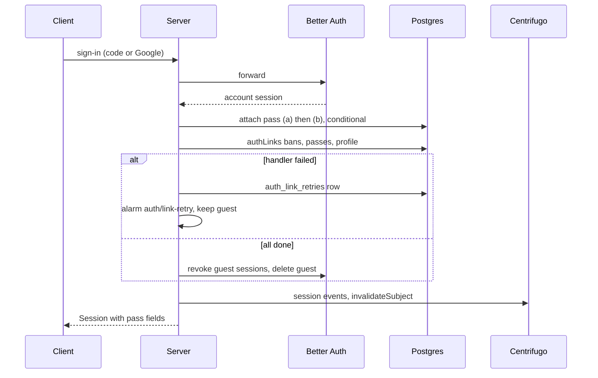

# Spec: Права й профіль — пас на акаунті й на пристрої (приєднання рівно раз, строк до кінця свята), таблиця «пристрій × сесія», бани й тимчасовий блок за відбитком IP, злиття гостя в акаунт, нік, прапор, налаштування, «Мій графік», зміна пошти, Google акаунта, обробники «дані суб'єкта»
Spec ID: SPEC-11
Status: approved
Supersedes: none

## Джерела

- Хвиля: `D:/Work/Pets/Time2Fest/specs/002-backend/waves.md:224-235` (картка SPEC-11), передачі SPEC-10 `:215-219`, SPEC-09 `:1108-1112`, вимоги до поточних хвиль від SPEC-24 `:978-992`, ризик Р6 `:767`, ШВ-06 `:703`, пакет видимих станів `:694`.
- Вимоги (21): FR-ID-07…12, FR-ID-14…17 (`specs/002-backend/spec.md:636-659`), FR-PROF-01…11 (`:664-674`); плюс FR-PLAT-13 (`:497`), FR-EDGE-10 (`:512`), FR-PRIV-03/06 (`:904`, `:907`), припущення A-3 (`:1145`), A-11 (`:1153`), A-22.
- Шов клієнта: `docs/backend/frontend-seam.md` §3.6 (l.190-196), §3.7 (l.198-203), §3.11 (l.228-262); контракти `web/lib/api/contracts/auth.ts:42-70` (`Session`, `passNight` — `:55`), `web/lib/api/contracts/profile.ts:1-82`, `web/lib/api/contracts/chat.ts:23,81-84`; правило графіка `web/lib/schedule/countryZone.ts:13-66`; правило ніку `packages/rules/src/text/nick.ts`.
- Нотатки досліджень (2026-11-26, тека сесії `spec-11/`): `research-docs.md` («нотатки документів»), `research-code.md` («нотатки коду»), `research-better-auth.md` («нотатки BA»).

## Рішення власника

- **В1.** Пас приєднується до акаунта рівно раз — до того, що станеться першим: перший акаунт, у який увійшли на цьому пристрої (будь-яка пошта), або вхід з поштою оплати на будь-якому пристрої; акаунт зі своїм пасом чужого паса не отримує (`docs/decision.md:619-624`, відповідь 1(а); конституція VII). → AC-5…AC-12
- **В2.** Пас діє до кінця свята, на яке куплено; куплений після кінця — на наступне (відповідь 3(а)). → AC-13…AC-15
- **В3.** Блок нових гостей за добовим відбитком IP ≤24 год після бану (Н-5(б), поправка конституції VI). → AC-23…AC-25
- **В4.** Листи-нагадування — функція паса, з перемикачем у налаштуваннях (відповідь 9(б), `decision.md:592`). → AC-36
- **В5.** Графік — до 4 країн у поясі, п'ята — «Замінити?»; графік — функція паса (`decision.md:1126`). Злиття гостя в акаунт (A-11, `decision.md:756`). → AC-37…AC-42, AC-50…AC-53
- **В6.** PayPro відмовив 25.11, можливий Creem, тости можуть прибрати (`decision.md:9`) — права не залежать від постачальника оплати й від тостів. → AC-16, Non-goals
- **В7.** Видимі стани «на яке свято пас», перемикач листів-нагадувань, `google-taken`, `forbidden` графіка — у пакеті видимих станів 26–27.11 (`waves.md:694,703`; власник затвердив стани 18.11, `decision.md:427-432`). Хвиля не зупиняється: поля й причини — у контракті й сервері, на сайті — лише проводка; малювання станів і перезйомка дощок — поза хвилею. → AC-59, Non-goals
- **В8.** Тести — лише фейки (Mailpit, фейк OIDC); живих листів і живого Google немає (SPEC-10 В5). → NFR-6

## Питання власнику (перший прохід, не блокують)

- **[Q1]** Прив'язка Google, пошта якого відрізняється від пошти акаунта — прийнято за замовчуванням: дозволено для явної прив'язки з кабінету; пошта акаунта не змінюється, вхід через цей Google веде в той самий акаунт. → AC-46
- **[Q2]** Типове значення `reminderEmails` — прийнято за замовчуванням: увімкнено (людина сама додає події в графік; кожен лист має відписку одним кліком, FR-NOTIF-08). → AC-36
- **[Q3]** Щоб блок FR-ID-17 діяв з моменту бану, сервер тримає у швидкому сховищі зв'язок «суб'єкт → його добовий відбиток» до опівночі UTC (лише в Redis, не в базі, не з повідомленнями) — прийнято за замовчуванням. → AC-23, NFR-5
- **[Q4]** Бан пристрою, похідний від бану акаунта, лишається після стирання акаунта до зняття власником — прийнято за замовчуванням (захист від повернення порушника). → AC-57
- **[Q5]** Перелік особливих прапорів — прийнято за замовчуванням: як на сайті (`earth`, `EU`, `un`, `GB-ENG`, `GB-SCT`, `GB-WLS`, `pride`, `trans`, `bisexual`; `components/chat/FlagField.tsx:24`, `components/primitives/Flag.tsx:15,59`), ширше за FR-PROF-02. → AC-33

## Рішення сесії

Кожне — рішення сесії `[А]`, ведучий хвилі може змінити; кожне перевіряється в AC або NFR.

- **[А1] Better Auth 1.7.28** першою фазою (транзакційне `deleteUser`, вето `delete.before`, виправлення одночасних OTP; нотатки BA §6); прогін наборів `auth-*` після оновлення. → AC-60
- **[А2] Гостя не видаляє Better Auth** (`disableDeleteAnonymousUser`). Наш крок злиття відкликає сесії гостя завжди, а видаляє гостя лише коли всі обробники злиття успішні, відкритого повтору немає й на пристрої немає неприєднаного паса; інакше гостя прибирає `auth-guest-prune`, який знає обидві умови. Очікування SPEC-10 AC-23 «гостя немає» змінюється відповідно. → AC-49, AC-50
- **[А3] Пас — власний запис** (свято, джерело `purchase|gift|admin`, пошта оплати, пристрій, приєднаний акаунт, видано, відкликано), без зв'язку з тостами й постачальником. Інваріант «один активний пас на акаунт на свято» тримає база; приєднання — одна умовна зміна «лише якщо ще не приєднано»; відмова через інваріант = «в акаунта вже є пас» → пас лишається на пристрої. Видача ідемпотентна за `grantRef`. → AC-5…AC-12, AC-16
- **[А4] Приєднання — крок завершення кожного входу акаунта** (код чи Google, з гостем чи без), не хук Better Auth, що вирішує продукт; збій → `auth_link_retries` + тривога `auth/link-retry`, як у SPEC-10. Порядок: спершу шлях (а) пристрою, потім (б) пошти. Зміна пошти приєднання не запускає. → AC-7, AC-8
- **[А5] Свято паса** — ключ сезону `YYYY-YY` з каталогу; кінець поточного свята — `T2F_SEASON_END` (SPEC-10 [Q1]), наступного — та сама дата +1 рік; час — лише годинник сервера. → AC-13…AC-15
- **[А6] Бани** — на акаунт, гостя, пристрій; безстрокові; бан акаунта поширюється на кожен пристрій, де в акаунта була чи з'явиться сесія; зняття — у зрізі адмінки власника з журналом. Інтерфейс `isBlocked(subject, ctx)` для SPEC-15/16/17. → AC-18…AC-26
- **[А7] Профіль — власні записи**, ключ — id суб'єкта без каскаду з `users` (повтор злиття працює й після видалення гостя). Нік унікальний без урахування регістру серед гостей і акаунтів; звільняється при прибиранні гостя й стиранні акаунта. → AC-27…AC-32
- **[А8] Графік зберігається як id подій**; правило «4 країни в поясі» — одна чиста функція спільного пакета правил, без «сторінка = країна» й «одне місто на пояс» (SPEC-24: регіон — нова подія-місто в поясі); сайт і сервер викликають ту саму. → AC-37…AC-42
- **[А9] Злиття A-3** — обробники `authLinks` (`bans`, `passes`, `profile`): профіль — поле, задане в акаунта, перемагає, незадані поля беруть значення гостя; нік гостя, що не потрапив в акаунт, звільняється; графік — спершу події акаунта, далі країни гостя, доки є місце в поясі; бан гостя переходить на акаунт. Після злиття — `invalidateSubject` для обох id. → AC-50…AC-53
- **[А10] Події:** причини `session` доповнюються `pass-granted`, `pass-attached`, `pass-revoked`; нова подія `profile` без даних (клієнт перечитує `GET /api/me/profile`). → AC-17, AC-35
- **[А11] Зміна пошти — власний потік:** хеш коду в `auth_verifications` під власним ідентифікатором, наш поштовий сервіс, ліміти FR-ID-03; гонка за адресу (унікальність) → `taken`. Вбудований потік BA не використовуємо (мовчить про зайняту адресу, нотатки BA §3). → AC-43…AC-45
- **[А12] Google:** прив'язка — link-social BA через наш маршрут; `account_already_linked_to_different_user` → `google-taken`; унікальність `(provider_id, account_id)` у способах входу; відв'язка — наш маршрут: способи = перевірена пошта + постачальники, відмова лише коли Google — єдиний спосіб (`conflict`/`last-method`). → AC-46…AC-48
- **[А13] Ліміти частоти:** `PATCH /api/me/profile`, перевірка ніку, дії графіка — 30 за хвилину на суб'єкта; запит коду зміни пошти — ліміти FR-ID-03. → AC-58

## Problem and user

Сервер уже впускає людей (SPEC-10), але сесія віддає пас у нейтральному стані (`server/src/auth/response.ts:110-124`), обробників злиття немає (`server/src/registries/authLinks.ts:23`), маршрутів `/api/me/*` немає, а нік, графік і налаштування живуть лише на пристрої (`lib/api/sim/profile.ts`). Людина, що заплатила $5, не може бути певна, що пас переїде в її акаунт рівно раз і не загубиться; порушник чату повертається новим гостем; нік не унікальний; графік не доходить до сповіщень (SPEC-19), а платежі (SPEC-17), чат (SPEC-15/16) і паспорт (SPEC-14) не мають кого спитати «чи є пас» і «чи заблоковано».

## Goals / Non-goals

**Goals:** записи паса й обидва шляхи приєднання з атомарністю; кожен рядок FR-ID-14 на sim і http; свято паса в сесії; бани й блок за відбитком з інтерфейсом для інших хвиль; злиття A-3; профіль, нік, прапор, налаштування, графік, зміна пошти, Google; рядки «дані суб'єкта» `bans`, `passes`, `profile`; домени `auth` і `profile` на `http`.

**Non-goals:**
- Оплата, вебхуки, повернення, видача паса за тост $10 — SPEC-17/18 (тут лише інтерфейс `grantPass`/`revokePass`).
- `profile.exportData`, `profile.deleteAccount` на клієнті й повторне підтвердження кодом — SPEC-20 (їхні рядки набору позначено «до SPEC-20»).
- Перевірка банів у відправленні чату, тостах, `chat.authorPath` — SPEC-14/15/16/17 через інтерфейси цієї хвилі; домен `chat` лишається `sim` до SPEC-16.
- Листи-нагадування й сповіщення за графіком — SPEC-19 (тут лише налаштування й графік).
- Малювання нових видимих станів і перезйомка дощок — пакет видимих станів (В7).
- Сторінки поясів і регіонів — SPEC-24.
- Окремий робочий процес бану від модераторів (скарги) — SPEC-15/16; тут — інтерфейс і зріз адмінки власника.

## User stories

- **US-1** Як гість, що купив пас, я маю його на цьому пристрої одразу, а після входу він переїжджає в мій акаунт рівно раз. → AC-1…AC-12
- **US-2** Як людина з пасом, я бачу, на яке свято він діє, а інші вкладки й пристрої дізнаються про зміни ≤3 с. → AC-13…AC-17
- **US-3** Як власник і модератор, я баню порушника так, що новий гість з його пристрою чи адреси не пише в чат і не платить за тост, і знімаю бан в адмінці. → AC-18…AC-26
- **US-4** Як учасник, я маю унікальний нік, прапор і налаштування, однакові на всіх пристроях. → AC-27…AC-36
- **US-5** Як власник паса, я веду «Мій графік» до 4 країн у поясі. → AC-37…AC-42
- **US-6** Як власник акаунта, я міняю пошту кодом і прив'язую чи відв'язую Google. → AC-43…AC-48
- **US-7** Як гість, що входить в акаунт, я не втрачаю ніку, графіка й паса. → AC-49…AC-53
- **US-8** Як суб'єкт даних, я отримую й стираю свої дані профілю, пасів і банів. → AC-54…AC-57
- **US-9** Як розробник і агент, я перевіряю все через набори контрактів і дверцята на фейках. → AC-58…AC-64

## Acceptance criteria (EARS)

**Пакети:** `server` (`server/`), `contracts` (`packages/contracts/`), `rules` (`packages/rules/`), `web` (`web/lib/api/*`, sim і http), `docs-patch` (документи поза репозиторієм).

### Пас і таблиця «пристрій × сесія» (FR-ID-07…11, FR-ID-14)

**AC-1 [server, contracts]** The server shall віддавати в `get-session` поля `hasPass`, `passOn`, `passSince`, `passNight`, `devicePass`, обчислені лише сервером з записів паса, сесії й пристрою.
Verify: integration — відповідь проходить `sessionSchema`; клієнтське поле в запиті на стан не впливає.

**AC-2 [server, web]** The `auth` contract suite shall перевіряти кожен з 8 рядків таблиці FR-ID-14 (`spec.md:643-656`) на `sim` і на `http`.
Verify: e2e — 8 рядків зелені в обох стовпчиках `contract-run`.

**AC-3 [server]** WHEN гість оплатив пас без входу, the server shall записати неприєднаний пас на пристрій з поштою оплати й віддавати сесії цього пристрою `hasPass: true`, `passOn: 'device'`, `devicePass: {email, since}`.
Verify: integration — двері видачі паса на пристрій → рядок 2 таблиці.

**AC-4 [server]** WHILE на пристрої неприєднаний пас, the server shall давати його будь-якій сесії цього пристрою без паса на акаунті (`passOn: 'device'`).
Verify: integration — рядок 7: акаунт зі своїм пасом виходить → гість пристрою має `passOn: 'device'`.

**AC-5 [server]** WHEN акаунт без паса входить на пристрої з неприєднаним пасом, the server shall приєднати цей пас до акаунта (шлях (а)) і віддати `hasPass: true`, `passOn: 'account'`, `devicePass: null`.
Verify: integration — рядок 4 таблиці; запис паса має id акаунта.

**AC-6 [server]** WHEN акаунт без паса з перевіреною поштою, що збігається з поштою оплати неприєднаного паса, входить на будь-якому пристрої, the server shall приєднати цей пас (шлях (б)).
Verify: integration — пас на пристрої A, вхід з тією поштою на B → пас на акаунті; рядок 8 для A.

**AC-7 [server]** WHEN обидва шляхи можливі при одному вході, the server shall приєднати лише пас цього пристрою, а пас за поштою лишити неприєднаним.
Verify: integration — два неприєднані паси (пристрій і пошта) → приєднано пас пристрою, другий без змін.

**AC-8 [server]** WHEN акаунт зі своїм пасом входить на пристрої з неприєднаним пасом, the server shall не приєднувати пас і віддати `passOn: 'account'`, `devicePass: {email, since}`.
Verify: integration — рядок 5 таблиці; пас пристрою без власника.

**AC-9 [server]** WHEN людина виходить з акаунта, до якого на цьому пристрої приєднано пас, the server shall віддати пристрою `hasPass: false` (пас лишається на акаунті).
Verify: integration — рядок 6 таблиці.

**AC-10 [server]** IF два входи (з одного пристрою, або пристрій і пошта оплати на іншому) одночасно приєднують паси, THEN the server shall приєднати рівно один пас до одного акаунта й не дати жодному акаунту двох активних пасів на одне свято.
Verify: integration — два з'єднання з бар'єром «другий чекає блокування» (`pg_stat_activity`): той самий пас → другий отримує 0 рядків; різні паси одного акаунта → другий відмовлено, його пас лишився на пристрої; плюс прикладна гонка двох входів з одним cookie гостя.

**AC-11 [server]** The server shall відповідати `passOwnedByEmail(email) = true`, коли пас має акаунт з цією перевіреною поштою або є неприєднаний пас з цією поштою оплати.
Verify: integration — три випадки (пас акаунта, неприєднаний, немає) → `true`, `true`, `false`.

**AC-12 [server]** WHEN пас приєднано за поштою на іншому пристрої, the server shall опублікувати подію `session` у канали суб'єктів пристрою, де пас був, протягом 3 с.
Verify: integration (Centrifugo) — вкладка пристрою A отримує `session` ≤3 с, `devicePass` стає `null`.

### Свято паса, видача й відкликання (FR-ID-15, інтерфейс для SPEC-17)

**AC-13 [server]** WHEN пас видано до кінця поточного свята, the server shall записати свято поточного сезону й віддавати в сесії `passNight` цього сезону.
Verify: integration — тестовий годинник до й під час свята → `passNight: '2026-27'`.

**AC-14 [server]** WHEN пас видано після кінця поточного свята, the server shall записати наступне свято.
Verify: unit + integration — годинник після `T2F_SEASON_END` → `passNight: '2027-28'`.

**AC-15 [server]** WHEN годинник сервера минає кінець свята паса, the server shall віддавати для нього `hasPass: false`.
Verify: integration — тестовий годинник +1 с після кінця → `hasPass: false`, `passOn: null`.

**AC-16 [server]** The pass interface shall приймати `grantPass({holder: {account} | {device, paymentEmail}, source: 'purchase'|'gift'|'admin', grantRef})` і повертати той самий пас на повторний `grantRef`, а власнику з активним пасом на це свято відповідати `conflict`/`pass-owned` без видачі.
Verify: integration — подвійний виклик з одним `grantRef` → один запис; видача власнику паса → `pass-owned`.

**AC-17 [server]** WHEN пас видано, приєднано чи відкликано (`revokePass(grantRef)`), the server shall опублікувати `session` з причиною `pass-granted`, `pass-attached` чи `pass-revoked` власнику (акаунту або суб'єктам пристрою) протягом 3 с.
Verify: integration (Centrifugo) — три події в другій вкладці; після відкликання `hasPass: false`.

### Бани й блок за відбитком (FR-ID-16, FR-ID-17)

**AC-18 [server]** The server shall відповідати `isBlocked(subject, ctx)` як `{blocked: false}` або `{blocked: true, kind: 'account'|'guest'|'device'|'ip-day', until: Ms|null}`.
Verify: unit — форма відповіді для кожного виду; integration — бан акаунта → `kind: 'account'`, `until: null`.

**AC-19 [server]** WHEN гостя забанено, а він входить в акаунт, the server shall перенести бан на акаунт.
Verify: integration — бан гостя → вхід → `isBlocked(акаунт).blocked = true`.

**AC-20 [server]** WHEN акаунт забанено, the server shall поширити бан на кожен пристрій, де в акаунта є чи з'явиться сесія.
Verify: integration — бан → вихід → новий гість того ж пристрою: `isBlocked` `kind: 'device'`.

**AC-21 [server]** WHILE бан не знято, the server shall тримати його без строку (`until: null`).
Verify: integration — тестовий годинник +400 діб → бан діє.

**AC-22 [server]** WHEN власник знімає бан у зрізі адмінки, the server shall зняти бан і похідні бани пристроїв та записати дію в журнал аудиту.
Verify: integration — `/cms-api/bans/*` власником → `isBlocked` `false`, рядок журналу; не-власник → 403.

**AC-23 [server]** WHEN суб'єкта забанено, the server shall позначити заблокованими його добовий відбиток IP поточної доби (якщо відомий з його записів цієї доби) і відбиток кожного його наступного запиту з TTL до зміни відбитка (≤24 год).
Verify: integration — запис суб'єкта, бан, новий пристрій з тієї ж адреси → новий гість `kind: 'ip-day'`.

**AC-24 [server]** WHILE відбиток заблоковано, the server shall віддавати для гостей, створених з цього відбитка, `isBlocked` `kind: 'ip-day'`, а для акаунтів і давніших гостей — ні.
Verify: integration — новий гість заблокований, акаунт з тієї ж адреси — ні, гість, створений до бану, — ні.

**AC-25 [server]** WHEN відбиток змінюється (опівніч UTC), the server shall припинити блок `ip-day`.
Verify: integration — тестовий годинник після 00:00 UTC → новий гість не заблокований.

**AC-26 [server]** The server shall не зберігати IP чи відбиток разом із баном, профілем, пасом чи повідомленнями в базі.
Verify: integration — після бану з `ip-day` у таблицях банів, профілів, пасів немає полів IP чи відбитка; ключі лише в Redis з TTL.

### Нік, прапор, налаштування (FR-PROF-01…03, FR-PROF-09…11)

**AC-27 [server]** WHEN нік зберігається чи перевіряється (`POST /api/chat/nick-check`), the server shall застосувати спершу вердикт SPEC-09 `verdict({kind: 'nick'})`, IF вердикт `block` THEN відмовити `validation` з причиною правила (`short`, `long`, `link`, `forbidden`).
Verify: integration — 4 причини з відповідних ніків.

**AC-28 [server]** IF вердикт ніку `review`, THEN the server shall відмовити `validation`/`forbidden`.
Verify: integration — двері модерації дають `review` → `forbidden`, нік не збережено.

**AC-29 [server]** IF нік без урахування регістру й крайових пробілів уже має інший гість чи акаунт, THEN the server shall відмовити `validation`/`taken`.
Verify: integration — `Ліра` зайнято → `ліра ` → `taken`; власний нік знову — успіх.

**AC-30 [server]** IF двоє одночасно зберігають той самий вільний нік, THEN the server shall зберегти його одному, а другому відповісти `taken`.
Verify: integration — два паралельні `PATCH` → один успіх, один `taken`.

**AC-31 [server]** WHEN гостя прибрано або акаунт стерто, the server shall звільнити його нік.
Verify: integration — прибирання гостя тестовим годинником і стирання акаунта → нік знову вільний.

**AC-32 [server]** The server shall не писати текст ніку в журнали.
Verify: integration — після відмов AC-27…AC-30 у журналі немає тексту ніку.

**AC-33 [server]** WHEN прапор зберігається, the server shall приймати лише ISO 3166-1 alpha-2 країн каталогу або особливі коди [Q5], IF код інший THEN відповісти `validation`/`invalid-input`.
Verify: integration — `UA`, `pride` → успіх; `XX`, `<b>` → `invalid-input`.

**AC-34 [server]** The server shall віддавати `detectedFlag` з країни запиту краю (`ctx.client.country`), `null` для `unknown`, і ігнорувати `detectedFlag` з тіла.
Verify: integration — заголовок краю `PL` → `detectedFlag: 'PL'`; тіло з `detectedFlag: 'US'` нічого не змінює.

**AC-35 [server]** WHEN налаштування, нік, прапор чи графік змінено, the server shall опублікувати подію `profile` у канал суб'єкта протягом 3 с.
Verify: integration (Centrifugo) — друга вкладка отримує `profile` ≤3 с і перечитує однакові налаштування.

**AC-36 [server, contracts]** The server shall зберігати налаштування `hour12`, `homeCountry` (ISO каталогу або `null`), `homeZoneId` (пояс каталогу або `null`), `showPassport`, `showPath`, `passportHints`, `quietDefault`, `reminderEmails` (типово `true` [Q2]) і відкидати інші ключі `validation`/`invalid-input`.
Verify: integration — повний набір зберігається й читається; невідомий ключ і чужий пояс → `invalid-input`.

### Графік (FR-PROF-04, FR-PROF-05)

**AC-37 [rules, web, server]** The schedule rule shall бути однією чистою функцією над подіями (`eventId`, `zoneId`, `countryIso`), яку викликають сайт і сервер, без припущень «сторінка = країна» й «одне місто на пояс».
Verify: unit — одна таблиця випадків проходить через обгортку сайту й сервера; випадок «дві події-міста однієї країни в поясі» рахується однією країною.

**AC-38 [server]** WHEN додається подія, the server shall додати всі події тієї ж країни в цьому поясі.
Verify: integration — `toggle` однієї події → у графіку всі події країни в поясі.

**AC-39 [server]** IF у поясі вже 4 країни (або всі країни поясу, якщо їх менше), THEN the server shall відмовити `conflict`/`schedule-full` без змін.
Verify: integration — п'ята країна через `toggle` і через `PUT` → `schedule-full`, графік незмінний.

**AC-40 [server]** WHEN виконується заміна, the server shall прибрати країну `outIso` поясу й додати нову атомарно, зберігши позицію.
Verify: integration — `replace` → рівно 4 країни; паралельний `toggle` не дає 5.

**AC-41 [server]** IF суб'єкт без паса змінює графік, THEN the server shall відмовити `forbidden`.
Verify: integration — гість без паса → `forbidden`; з пасом пристрою → успіх.

**AC-42 [server]** IF у графіку є id невідомої чи прихованої події, THEN the server shall відмовити `validation`/`invalid-input` без змін.
Verify: integration — невідомий id → `invalid-input`.

### Пошта й Google акаунта (FR-PROF-06, FR-PROF-07)

**AC-43 [server]** WHEN акаунт просить зміну пошти, the server shall надіслати код на нову адресу з лімітами FR-ID-03 і повернути `pendingEmail`, IF адреса та сама THEN `validation`/`same-email`, IF має інший акаунт THEN `conflict`/`taken`, IF некоректна THEN `validation`/`email`.
Verify: integration — успіх (лист у Mailpit) і три відмови; 2-й запит за 30 с → `rate_limited`/`wait`.

**AC-44 [server]** WHEN код підтверджено, the server shall змінити пошту акаунта (перевірена), лишити пас акаунта на ньому й опублікувати `session`, IF адресу тим часом зайняли THEN `conflict`/`taken`.
Verify: integration — успіх і гонка з входом нового акаунта на ту адресу → `taken`; хибний код → `wrong-code`, прострочений → `expired`.

**AC-45 [server]** WHEN акаунт скасовує зміну, the server shall видалити очікуваний код і віддати `pendingEmail: null`.
Verify: integration — після скасування старий код → `expired`.

**AC-46 [server]** WHEN акаунт прив'язує Google, the server shall повернути на `returnPath` з прив'язаним Google (`googleLinked: true`), навіть якщо пошта Google інша [Q1], IF цей Google має інший акаунт THEN повернути з `error=google-taken`.
Verify: integration (фейк OIDC) — успіх з іншою поштою; Google іншого акаунта → `google-taken`.

**AC-47 [server]** IF два входи чи прив'язки одночасно пишуть той самий Google-ідентифікатор, THEN the server shall зберегти один спосіб входу, а другому відповісти `google-taken`.
Verify: integration — паралельні прив'язки двох акаунтів → один рядок способу входу.

**AC-48 [server]** WHEN акаунт відв'язує Google, the server shall видалити спосіб, IF Google — єдиний спосіб (пошта не перевірена) THEN відмовити `conflict`/`last-method`.
Verify: integration — акаунт кодом + Google → відв'язано; акаунт лише Google без перевіреної пошти → `last-method`.

### Злиття гостя в акаунт (FR-ID-12, FR-PROF-08)

**AC-49 [server]** WHEN гість входить в акаунт, the server shall відкликати сесії гостя й видалити гостя, лише коли всі обробники злиття успішні, відкритого повтору немає й на пристрої немає неприєднаного паса.
Verify: integration — успіх → гостя немає; обробник кидає → гість є; пас на пристрої лишився → гість є.

**AC-50 [server]** WHILE гостя лишено через повтор або пас пристрою, the guest prune job shall не прибирати його, доки повтор не закрито й пас не приєднано чи не скінчився.
Verify: integration — тестовий годинник +31 доба → гість лишився; повтор закрито → прибрано.

**AC-51 [server]** WHEN гостя злито, the server shall перенести нік, прапор і налаштування за правилом «поле акаунта перемагає» й звільнити нік гостя, що не потрапив в акаунт.
Verify: integration — акаунт з ніком і гість з ніком → нік акаунта, нік гостя вільний; акаунт без ніку → нік гостя.

**AC-52 [server]** WHEN гостя злито, the server shall об'єднати графіки: події акаунта, далі країни гостя, доки в поясі є місце.
Verify: integration — 3 країни акаунта + 2 гостя в поясі → 4 країни, з них 3 акаунта.

**AC-53 [server]** WHEN обробник злиття викликано вдруге для тієї ж пари, the server shall нічого не змінити й викликати `invalidateSubject` для гостя й акаунта після першого злиття.
Verify: integration — повтор → без змін; спостерігач невалідації бачить обидва id.

### Дані суб'єкта (FR-PLAT-13)

**AC-54 [server]** WHEN викликано «віддати», the handlers `profile`, `passes`, `bans` shall повернути нік, прапор, налаштування, графік, очікувану зміну пошти; паси (свято, джерело, видано, місце); чинні бани (вид, з якого часу).
Verify: integration — експорт через `runSubjectDataInScope` має перелічені поля й не має відбитків.

**AC-55 [server]** WHEN викликано «стерти» для акаунта, the handler `profile` shall видалити профіль і графік та звільнити нік, а `passes` — прибрати з приєднаних пасів id акаунта й пошту, лишивши неприєднані паси на пошті оплати (FR-PRIV-05).
Verify: integration — після стирання профілю немає, нік вільний, неприєднаний пас пристрою діє.

**AC-56 [server]** The subject-data run shall виконати всі рядки (`auth`, `bans`, `passes`, `profile`, …), навіть коли один падає.
Verify: integration — доданий рядок, що падає → решта виконані, результат `ok: false` з назвою.

**AC-57 [server]** WHEN стерто акаунт з баном, the handler `bans` shall видалити бан акаунта й лишити похідні бани пристроїв [Q4].
Verify: integration — після стирання новий гість пристрою заблокований.

### Контракти, перемикання, дверцята

**AC-58 [server]** The server shall обслуговувати `GET/PATCH /api/me/profile`, `PUT /api/me/schedule`, `POST /api/me/schedule/toggle|replace`, `POST|DELETE /api/me/email`, `POST /api/me/email/verify`, `POST|DELETE /api/me/google`, `POST /api/chat/nick-check` лише для суб'єкта власної сесії (без id суб'єкта в запиті), з лімітами [А13], IF дія лише для акаунта, а суб'єкт — гість, THEN `unauthorized`.
Verify: integration — гість на `/api/me/email` → `unauthorized`; 31-й `PATCH` за хвилину → `rate_limited`; підставлений id у тілі відкинуто як `invalid-input`.

**AC-59 [contracts, web]** The contracts package shall додати лише додаванням причини профілю (`taken`, `schedule-full`, `same-email`, `google-taken`, `last-method`), причини події `session` [А10], подію `profile` і схеми тіл маршрутів AC-58, а сайт — пропровести поля в наявні місця без нових видимих станів (В7).
Verify: unit — перевірка поверхні контрактів «лише додаванням» і закріплення словників зелені.

**AC-60 [web]** The site shall мати `HTTP_DOMAINS` з `auth` і `profile` та http-адаптер `profile`, а набори `auth` і нового `profile` — зелені на `sim` і `http`, де лише рядки `exportData`/`deleteAccount` пропущено з позначкою «до SPEC-20».
Verify: e2e — `contract-run`: обидва домени зелені в обох стовпчиках, пропуски лише з позначкою.

**AC-61 [web]** The sim adapters shall мати ті самі відмови, що й сервер (`forbidden` графіка без паса, `schedule-full`, `taken`), щоб набір `profile` ішов на `sim`.
Verify: e2e — набір `profile` на `sim` зелений.

**AC-62 [server]** WHERE `T2F_ENV=test` і `T2F_TEST_DOORS=1`, the server shall мати дверцята й сид-фікстури: пас на акаунті, на пристрої, приєднаний; бан (акаунт, гість, пристрій, `ip-day`); злиття — зареєстровані в реєстрі дверцят і очищувані `reset`.
Verify: integration — кожні дверцята працюють у `test` і дають 404 поза ним; `reset` очищує паси, бани, профілі.

**AC-63 [server]** The server shall закріпити Better Auth 1.7.28 і пройти набори `auth-*` після оновлення.
Verify: integration — `schema:check` і набори `auth-*` зелені на 1.7.28.

**AC-64 [docs-patch]** The wave shall оновити `frontend-seam.md` §3.6/§3.7/§6.1/§8 (застарілий текст «пас на пошті оплати»), `docs/site/account.md`, `pass.md`, `schedule.md` (розділи «Код» і «Відомі межі»), `alarms.md`, `code-map.md`.
Verify: manual — оркестратор звіряє чернетку патча; документи поза репозиторієм автоматично не читаються.

## Edge cases

- **EC-1** Гість купив пас і стер cookie до входу → пас пристрою втрачено на цьому пристрої, шлях (б) за поштою лишається. → AC-6
- **EC-2** Скопійована cookie пристрою дає пас на кількох пристроях до приєднання — прийнятий ризик A-22. → Non-goal
- **EC-3** Два неприєднані паси з однією поштою оплати (гонка двох покупок) → приєднується один, найраніший; другий лишається на своєму пристрої (повернення — SPEC-17). → AC-7, AC-10
- **EC-4** Акаунт міняє пошту на пошту оплати неприєднаного паса → приєднання лише при наступному вході. → AC-44, [А4]
- **EC-5** Нік змінено в іншій вкладці → подія `profile`, форма перечитує. → AC-35
- **EC-6** Вердикт ніку недоступний (постачальники ШІ впали) → запасний фільтр SPEC-09. → AC-27
- **EC-7** Злиття під час відкритої заміни графіка на гостьовій вкладці → графік за правилом AC-52, вкладка отримує `profile`. → AC-52, AC-35
- **EC-8** Бан під час написання повідомлення → перевірка при відправленні в SPEC-15. → Non-goal
- **EC-9** Стерти акаунт з неприєднаним пасом на пристрої й відкритим замовленням → пас лишається на пошті оплати; замовлення — SPEC-17/20. → AC-55
- **EC-10** Спільний NAT (кампус) після бану → давні гості й акаунти пишуть, нові гості — ні до опівночі UTC. → AC-24, AC-25
- **EC-11** Бан, виданий о 23:59 UTC, триває хвилину за `ip-day` — межа відбитка (FR-EDGE-10). → AC-25
- **EC-12** Пас на свято, що скінчилось, і купівля наступного → два записи, активний — наступний. → AC-14, AC-15
- **EC-13** Регіон SPEC-24 як нова подія-місто в поясі → та сама країна, не нова. → AC-37

## Non-functional requirements

**NFR-1 [server]** The server shall відповідати на `get-session` з полями паса ≤50 мс p95 на локальному стеку.
Verify: integration — 500 запитів з пасом пристрою, p95 ≤50 мс.

**NFR-2 [server]** The server shall доставляти подію `profile` чи `session` про пас у другу вкладку ≤3 с p95.
Verify: integration (Centrifugo) — 20 змін налаштувань, p95 ≤3 с.

**NFR-3 [server]** The server shall тримати інваріант «один активний пас на акаунт на свято» на рівні бази для будь-якого шляху запису.
Verify: integration — пряма вставка другого активного паса тому ж акаунту → помилка унікальності.

**NFR-4 [server]** The server shall приймати тіла `/api/me/*` ≤4 КБ, а графік — ≤512 id подій.
Verify: integration — 4,1 КБ → 413; 513 id → `invalid-input`.

**NFR-5 [server]** The server shall тримати ключі відбитків банів і зв'язок «суб'єкт → відбиток» лише в Redis з TTL до опівночі UTC (≤24 год).
Verify: integration — TTL ключів ≤ секунд до 00:00 UTC; у базі ключів немає.

**NFR-6 [server]** The test and CI runs shall не надсилати живих листів і не звертатися до Google.
Verify: integration — `noMailNetwork` і журнал фейку OIDC.

**NFR-7 [server]** IF Redis недоступний, THEN `isBlocked` shall відповідати лише за банами з бази, без блоку `ip-day`, і писати журнал `bans/fast-store-down`.
Verify: integration — Redis зупинено → бан акаунта діє, `ip-day` ні, рядок журналу.

## Module interactions

- **Клієнт → сервер:** маршрути AC-58; помилки — `ApiError` з причинами AC-59; Google-прив'язка — повна навігація з поверненням.
- **Сервер → Better Auth:** вхід, link-social, сесії; збій хука злиття не скасовує вхід (AC-49, SPEC-10 AC-24).
- **Сервер → Centrifugo:** `session`, `profile`, `invalidateSubject`; збій публікації не скасовує дію, пише журнал (SPEC-10 AC-29).
- **Сервер → модерація (SPEC-09):** вердикт ніку; недоступність — запасний фільтр (EC-6).
- **Сервер → Redis:** відбитки банів; недоступність → NFR-7.
- **Інші хвилі → сервер (внутрішні інтерфейси, proposed):** `grantPass`, `revokePass(grantRef)`, `hasPass(subject, device) → {hasPass, passOn, passSince, passNight}`, `passOwnedByEmail(email)` — SPEC-17/18/19/14; `isBlocked(subject, ctx)` — SPEC-15/16/17; «нік і прапор суб'єкта» `{nick, flagCode}` і `showPath` — SPEC-14/15/17; налаштування `reminderEmails` і графік — SPEC-19; рядки «дані суб'єкта» — SPEC-20.

**Контракт (proposed, лише додаванням):** `PATCH /api/me/profile {nick?, flagCode?, detectedFlag? (ігнор), settings?}` → `Profile`; `PUT /api/me/schedule {eventIds: string[] ≤512}`, `POST .../toggle {eventId}`, `POST .../replace {outIso, eventId}` → `string[]`; `POST /api/me/email {email ≤254}`, `POST /api/me/email/verify {code: 6 цифр}`, `DELETE /api/me/email` → `Profile`; `POST /api/me/google {returnPath ≤512}` → `{kind:'redirect', url}`, `DELETE /api/me/google` → `Profile`; `POST /api/chat/nick-check {nick}` → `void`. Подія `session` — причини + `pass-granted|pass-attached|pass-revoked`; подія `profile {type:'profile', id, data:{}}`. Помилки: `validation/short|long|link|forbidden|taken|email|same-email|invalid-input`, `conflict/schedule-full|taken|google-taken|last-method|pass-owned`, `forbidden` (графік без паса), `unauthorized`, `rate_limited/wait|too-many`.

## Inputs and provenance

| Input | Source | Producer | Freshness | Trusted |
|---|---|---|---|---|
| Нік, прапор, налаштування, id подій, пошта, код | тіло запиту | відвідувач | на запит | ні |
| Країна запиту, добовий відбиток | край (`x-t2f-client`) | Worker SPEC-05 | на запит | так, лише з секретом краю |
| Профіль Google (sub, пошта) | Google / фейк OIDC | Google | на прив'язку | ні, доки id_token не перевірено |
| Каталог подій, поясів, сезону | база каталогу | SPEC-04 | на імпорт | так |
| `T2F_SEASON_END` | змінна вузла | власник | на старт | так |
| Виклики `grantPass`/`revokePass` | інші можливості | SPEC-17/18 | на подію | так (лише з підписаного вебхука) |

## Untrusted inputs

- Нік → вердикт і правила (AC-27, AC-28), унікальність (AC-29), не в журнали (AC-32), розмір (NFR-4); екранування — клієнт.
- Прапор, налаштування → перелік дозволених значень (AC-33, AC-36).
- id подій → лише відомі події каталогу, розмір (AC-42, NFR-4).
- Пошта й код → формат і ліміти FR-ID-03 (AC-43, AC-44).
- `returnPath`, профіль Google → правило повернення SPEC-10 і перевірка id_token (AC-46).
- Суб'єкт — лише з сесії, без id у запиті; зріз банів — лише власник (AC-58, AC-22).

## Design review

- DR-1 Гість видаляється BA до кінця злиття (нотатки BA §1-2) — accepted [А2] → AC-49, AC-50.
- DR-2 Гонка різних пасів одного акаунта не закривається перевіркою «не існує» (нотатки BA §2) — accepted [А3] → AC-10, NFR-3.
- DR-3 Приєднання за шляхом (а) без гостьової сесії (вхід після виходу) — accepted [А4] → AC-5.
- DR-4 Вбудована зміна пошти BA мовчить про зайняту адресу — declined → [А11], AC-43.
- DR-5 Відв'язка BA блокує акаунт «код + Google» — declined → [А12], AC-48.
- DR-6 Немає унікальності `(provider_id, account_id)` — accepted → AC-47.
- DR-7 Блок за відбитком у момент бану потребує зв'язку «суб'єкт → відбиток» — accepted [Q3] → AC-23, NFR-5.
- DR-8 Правило графіка лише на сайті й прив'язане до набору даних сайту — accepted [А8] → AC-37.
- DR-9 Нові видимі стани (свято паса, перемикач, `google-taken`, `forbidden`, `last-method`) — deferred → пакет В7, Non-goals.
- DR-10 Застарілий текст «пас на пошті оплати» в шві — accepted → AC-64.

## Traceability

| AC / NFR | From | Packages | Verify |
|---|---|---|---|
| AC-1 | US-1, FR-ID-07 | server, contracts | integration |
| AC-2 | US-1, FR-ID-14 | server, web | e2e |
| AC-3 | US-1, FR-ID-08 | server | integration |
| AC-4 | US-1, FR-ID-14 | server | integration |
| AC-5 | US-1, FR-ID-09, В1, DR-3 | server | integration |
| AC-6 | US-1, FR-ID-09, EC-1 | server | integration |
| AC-7 | US-1, FR-ID-09, А4, EC-3 | server | integration |
| AC-8 | US-1, FR-ID-09 | server | integration |
| AC-9 | US-1, FR-ID-14 | server | integration |
| AC-10 | US-1, FR-ID-10, DR-2, EC-3 | server | integration |
| AC-11 | US-1, FR-ID-11 | server | integration |
| AC-12 | US-2, FR-ID-13 | server | integration |
| AC-13 | US-2, FR-ID-15, В2 | server | integration |
| AC-14 | US-2, FR-ID-15, EC-12 | server | unit, integration |
| AC-15 | US-2, FR-ID-15, EC-12 | server | integration |
| AC-16 | US-2, В6, А3 | server | integration |
| AC-17 | US-2, FR-ID-13, А10 | server | integration |
| AC-18 | US-3, FR-ID-16, А6 | server | unit, integration |
| AC-19 | US-3, FR-ID-16 | server | integration |
| AC-20 | US-3, FR-ID-16 | server | integration |
| AC-21 | US-3, FR-ID-16 | server | integration |
| AC-22 | US-3, FR-ID-16 | server | integration |
| AC-23 | US-3, FR-ID-17, Q3, DR-7 | server | integration |
| AC-24 | US-3, FR-ID-17, EC-10 | server | integration |
| AC-25 | US-3, FR-ID-17, EC-11 | server | integration |
| AC-26 | US-3, FR-PRIV-03 | server | integration |
| AC-27 | US-4, FR-PROF-01, EC-6 | server | integration |
| AC-28 | US-4, FR-PROF-09 | server | integration |
| AC-29 | US-4, FR-PROF-01, A-11 | server | integration |
| AC-30 | US-4, FR-PROF-01 | server | integration |
| AC-31 | US-4, FR-PROF-10 | server | integration |
| AC-32 | US-4 | server | integration |
| AC-33 | US-4, FR-PROF-02, Q5 | server | integration |
| AC-34 | US-4, FR-PROF-02 | server | integration |
| AC-35 | US-4, FR-PROF-03, EC-5 | server | integration |
| AC-36 | US-4, FR-PROF-03, FR-PROF-11, Q2 | server, contracts | integration |
| AC-37 | US-5, FR-PROF-04, DR-8, EC-13 | rules, web, server | unit |
| AC-38 | US-5, FR-PROF-04 | server | integration |
| AC-39 | US-5, FR-PROF-04 | server | integration |
| AC-40 | US-5, FR-PROF-04 | server | integration |
| AC-41 | US-5, FR-PROF-05 | server | integration |
| AC-42 | US-5 | server | integration |
| AC-43 | US-6, FR-PROF-06, DR-4 | server | integration |
| AC-44 | US-6, FR-PROF-06, EC-4 | server | integration |
| AC-45 | US-6, FR-PROF-06 | server | integration |
| AC-46 | US-6, FR-PROF-07, Q1 | server | integration |
| AC-47 | US-6, FR-PROF-07, DR-6 | server | integration |
| AC-48 | US-6, FR-PROF-07, DR-5 | server | integration |
| AC-49 | US-7, FR-ID-12, DR-1 | server | integration |
| AC-50 | US-7, FR-ID-12, DR-1 | server | integration |
| AC-51 | US-7, FR-PROF-08, A-3 | server | integration |
| AC-52 | US-7, FR-PROF-08, A-3, EC-7 | server | integration |
| AC-53 | US-7, FR-ID-12 | server | integration |
| AC-54 | US-8, FR-PLAT-13 | server | integration |
| AC-55 | US-8, FR-PLAT-13, FR-PRIV-05, EC-9 | server | integration |
| AC-56 | US-8, FR-PLAT-13 | server | integration |
| AC-57 | US-8, FR-PLAT-13, Q4 | server | integration |
| AC-58 | US-9, А13 | server | integration |
| AC-59 | US-9, В7, DR-9 | contracts, web | unit |
| AC-60 | US-9, waves.md:232 | web | e2e |
| AC-61 | US-9 | web | e2e |
| AC-62 | US-9, waves.md:233 | server | integration |
| AC-63 | US-9, А1 | server | integration |
| AC-64 | US-9, DR-10 | docs-patch | manual |
| NFR-1 | US-2 | server | integration |
| NFR-2 | US-2, US-4, FR-ID-13 | server | integration |
| NFR-3 | US-1, FR-ID-10, DR-2 | server | integration |
| NFR-4 | US-4, US-5 | server | integration |
| NFR-5 | US-3, FR-EDGE-10, Q3 | server | integration |
| NFR-6 | US-9, В8 | server | integration |
| NFR-7 | US-3, FR-PLAT-14 | server | integration |

## Зміни після планування (2026-11-26, рішення ведучого хвилі)

- **AC-31:** гість, у якого з даних поза входом є лише профіль (нік), прибирається `auth-guest-prune` через 30 днів неактивності; нік звільняється.
- **AC-50:** завдання `auth-link-retry` (щогодини, з орендою) повторює відкриті рядки `auth_link_retries` тим самим обробником; успіх видаляє рядок (= закрито) і знову перевіряє умови видалення гостя; після 24 спроб — тривога `auth/link-retry`. Збій приєднання паса не губиться.
- **AC-62:** записи паса, бану й злиття — набори дверцят, не рядки реєстру сиду (той пише лише колекції Payload).
- **AC-44:** після зміни пошти — подія `session` з новою причиною `email-changed`.
- **AC-16:** для власника `{device, paymentEmail}` `pass-owned` — коли на пристрої вже є активний неприєднаний пас на це свято або `passOwnedByEmail(paymentEmail)`.
- **US-3 / AC-22:** зріз адмінки власника робить і бан (акаунт, гість, пристрій за id), і зняття, обидва з журналом.
- **AC-2, AC-60:** перевіряються наборами контрактів на рівні node (`contract-run`), не браузерним e2e.

## Open questions

Маркерів немає; питання нижче не блокують.

1. **Власнику ([Q1]–[Q5])** — див. «Питання власнику»; усе прийнято за замовчуванням.
2. **Пакет видимих станів (В7):** тексти й вигляд «на яке свято пас», перемикача листів, `google-taken`, `forbidden` графіка, `last-method` — після затвердження власником; хвиля лише проводить поля.
3. **Плану:** чи `hasPass` для паса наступного свята (купленого між святами) вмикає функції паса одразу — за FR-ID-15 так (пас діє від видачі до кінця свого свята); підтвердити в тестах AC-14.
