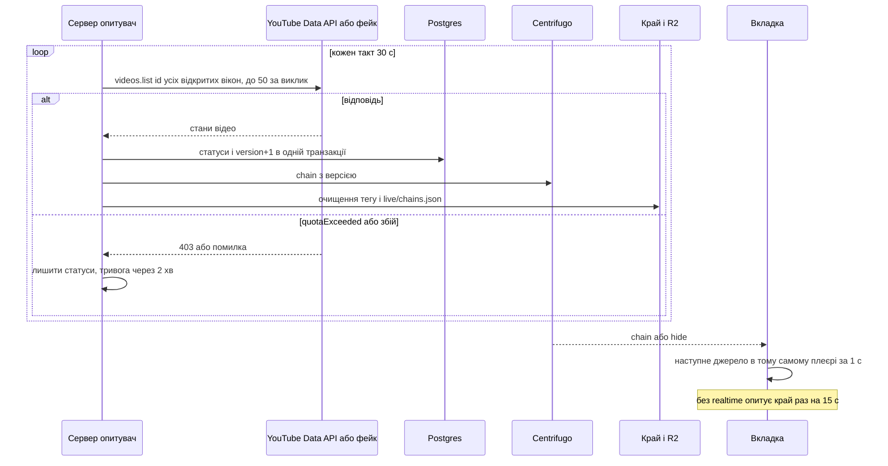
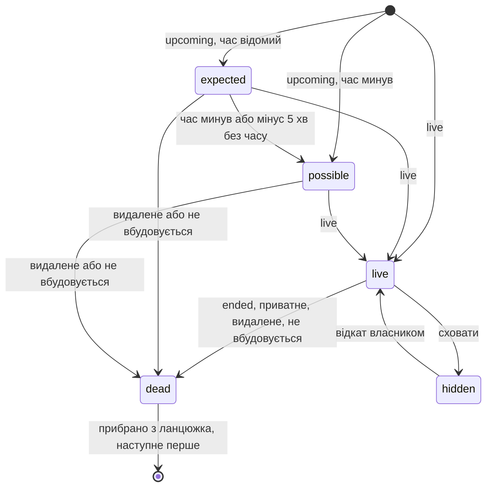

# Spec: Ефір — ланцюжки однією кешованою адресою з версією, статуси джерел опитуванням YouTube Data API у межах квоти, «сховати джерело», автозаміна мертвого, застарілі статуси, адмін-зріз ефіру, глядачі на Time2Fest і за країнами, `import chains`, фейк YouTube, зберігання даних YouTube ≤30 днів
Spec ID: SPEC-12
Status: approved
Supersedes: none

## Джерела

**Хвиля й вимоги:**
- Хвиля: `D:/Work/Pets/Time2Fest/specs/002-backend/waves.md:224-235` (SPEC-12); шов ШВ-07 — `waves.md:675`; Р11 — `waves.md:743`; передачі до SPEC-12 від SPEC-04/06/07/08 — `waves.md:1036-1081`.
- Вимоги (20): FR-LIVE-01 … -07, -11, -12, -14, -15, -18 … -26 (`specs/002-backend/spec.md:679-710`). FR-LIVE-08 … -10, -13, -16, -17 — SPEC-21a/b.
- Нотатки політики YouTube API (2026-11-21): `D:/Work/Pets/Time2Fest/docs/backend/youtube-notes.md` — далі «нотатки», §1 … §7.
- Нотатки першого проходу: `docs/specs/SPEC-12-live.pass1.md`.

**Рішення власника:** `D:/Work/Pets/Time2Fest/docs/decision.md:9-17` (2026-11-21, «Ефір») і уточнення q4 від оркестратора 2026-11-21 (нижче, В4).

## Рішення власника

- **В1 (q1).** Справжній адаптер YouTube Data API пишеться за тим самим інтерфейсом, що й фейк, але в цій хвилі працює **лише фейк**: жодного виклику справжнього API. Димовий тест справжнім ключем (≤1 000 одиниць, удень, з попередженням, не 29.12–01.01) — **після злиття**, поза цією специфікацією (передача SPEC-22b). → AC-39, AC-40, NFR-5.
- **В2 (q2).** Країна глядача — визначення Cloudflare за IP у момент підключення; лише лічильники в пам'яті; по людині нічого не зберігається; показуються країни, де ≥3 людей; вимикач `viewersMap`. → AC-59 … AC-63.
- **В3 (q3).** Довгі новинні ефіри — у ланцюжку лише від 20 хв **до** моменту події до 15 хв **після**. Оператор (оркестратор) вимикає джерело з ланцюжка одразу за словом власника. → AC-52, AC-57.
- **В4 (q4, уточнення оркестратора 2026-11-21 — замінює початкове формулювання q4).** Рядок біля плеєра: **«Зараз на Time2Fest {count} людей»** — {count} — кількість **людей** на сайті (не країн), із назвою сайту; джерело — присутність, лічильник лише в пам'яті, нічого по людині (як В2); рядок ховається вимикачем; тексти 4 мовами; перелік країн «Звідки дивляться» з ≥3 людьми лишається. Причина — політика YouTube API §III.E.4.h: власні лічильники мають бути позначені як не від YouTube (нотатки §3). Видима зміна ⇒ оновлення файлів `docs/site/` і перезйомка еталонних дошок. → AC-61, AC-62, AC-64 … AC-67, AC-77, AC-78.
- **Квота — цифри з консолі Google власника 21.11** (`D:/Work/Pets/Time2Fest/docs/services/google.md`; збігаються з документацією, `decision.md:17`). Поточна витрата — 0.

  | Кошик | На добу | На хвилину |
  |---|---|---|
  | Queries (загальний: `videos.list` та ін., 1 одиниця за виклик `list`) | 10 000 | 1 800 000; на користувача 180 000 |
  | Search Queries (`search.list`) | 100 | 100 |
  | Video Batch Get Stats Queries (`videos.batchGetStats`) | 10 000 | 600 |

  Скидання — опівночі за тихоокеанським часом (31.12/01.01 — 08:00 UTC, посеред свята). Усе — параметри конфігурації з цими типовими значеннями. `videos.batchGetStats` для статусів **непридатний**: його частини — `id`, `snippet`, `contentDetails`, `statistics`, без `liveStreamingDetails` (нотатки §4, `youtube-notes.md:102`), тож live / upcoming / ended він не розрізняє; статистику ми не беремо (AC-75). Істина статусів — `videos.list`; ця хвиля `batchGetStats` не викликає, кошик лише показується в адмінці. → AC-31 … AC-37, AC-50, NFR-1.

## Рішення сесії

Кожне — рішення сесії, ведучий хвилі може змінити. Кожне має AC або NFR, де воно перевіряється. [А1] … [А15] — з першого проходу (`SPEC-12-live.pass1.md:14-28`); змінені позначено «(змінено)».

**Адреса й доставка**
- **[А1] `chains()` без параметрів.** `GET /api/live/chains` віддає ланцюжки всіх подій з версією однією публічною адресою (ШВ-07); `?eventIds` зникає з `lib/api/contracts/live.ts:39-42` і з `frontend-seam.md` §3.2. → AC-3, AC-4
- **[А2] Край:** свіжість 10 с, «старе при помилці» ≤10 хв (FR-EDGE-02), копія R2 `live/chains.json`, власний тег очищення `t2f-live-chains`, повтори й тривоги — як у `server/src/site/fanout.ts`. → AC-11 … AC-15
- **[А3] Версії на клієнті:** беремо вищу, старішу ігноруємо; `hide` прибирає джерело. Сьогодні `applyStreamEvent` версію й `hide` ігнорує (`lib/api/contracts/live.ts:58-70`). → AC-17, AC-18
- **[А4] Опитування** як `lib/api/http/site.ts`: 15 с без realtime, не рідше 30 с завжди, одразу на `resync`. → AC-19

**Статуси й квота**
- **[А5] Статуси лишаються `live | expected | possible`** (`lib/data/types.ts:89`); «пробувати» публікується як `possible` (плеєр уже вважає його придатним, `lib/player/chain.ts:53-68`); приховане чи мертве джерело зникає з ланцюжка (нового `none` немає). → AC-27, AC-28
- **[А6]** Плеєр викликає `reportSourceError` на кодах 2, 5, 100, 101, 150, 153 (сьогодні його не викликає ніхто). → AC-41
- **[А7]** Мертве джерело сервер замінює наступним (FR-LIVE-18); усі мертві → порожній ланцюжок і наявна сцена відліку. → AC-30
- **[А8] (змінено) Квота — конфігурація з типовими значеннями з консолі власника 21.11:** загальний кошик 10 000 одиниць/добу (1 800 000/хв); кошик пошуку 100 викликів/добу і 100/хв; кошик `batchGetStats` 10 000/добу і 600/хв (не використовується); одиниць за виклик `list` — 1; id в одному `videos.list` — 50; стеля позачергових перевірок 500 одиниць/добу; резерв 1 000 одиниць, нижче якого працюють лише статуси поточних півночей; тривога на 80 % кожного кошика. Доба — за `America/Los_Angeles`. Число з коду не береться. → AC-31 … AC-37
- **[А9] (змінено) Найзавантаженіша ніч** перераховано на цифрах консолі власника 21.11 з окремим кошиком пошуку — NFR-1 (3 340 / 6 100 одиниць доби 1 проти 10 000; раніше ~5 300 з пошуком у загальному кошику). Пошук не витрачає загальних одиниць, тож «≤100 пошуків» картки — це окремий кошик і з 10 000 не конкурує. Ця хвиля не робить жодного пошуку (SPEC-21a).
- **[А10]** «Вважати пояс наживо» ставить джерелам подій поясу `live` до кінця вікна (+1 год) або до відкату власником; рядок журналу, відкат одним кроком. → AC-54
- **[А11]** «Замінити джерело за videoId» додає джерело як `possible` і ставить одну позачергову перевірку; лише власник, агентам — відмова. → AC-55
- **[А12]** Адмін-зріз: новий слот першого екрана й `/cms-api/live/*` за Cloudflare Access і роллю `owner`, суворе тіло ≤1 КБ (`server/src/admin/cmsEndpoints.ts`). → AC-50, AC-56
- **[А13]** Фейк YouTube як `fakes/ai/`: статус, вбудовування, live/upcoming/ended, «квоту вичерпано», кошик пошуку вичерпано — через `/_control`; дверцята `video-status` (заглушка `server/src/test-doors/registry.ts:147`) реалізовано. → AC-71, AC-72
- **[А14]** `import chains` — рядок у `server/src/registries/imports.ts`: сухий прогін і звіт «додати / змінити / без змін / змінено в адмінці — пропущено»; змінене в адмінці не перезаписується. → AC-68 … AC-70
- **[А15]** Правила «−5 хв» і «2 хв без свіжої перевірки» рахуються в такті опитувача за часом сервера (тестовий годинник SPEC-07), не окремим моментом. → AC-28, AC-36

**Нові**
- **[А16] (q3) «Сховати джерело» покриває ручне вимкнення новинного ефіру** — та сама дія: ≤3 с з realtime, ≤30 с без, журнал і відкат одним кроком. Бракувало лише виконавця: оркестратор не має входу власника в адмінку. Тому та сама дія доступна командою сервера `live hide` (подія, джерело, причина) — її запускає оператор на вузлі; рядок журналу має виконавця «оператор» і причину; відкат — з адмінки. Ключам агентів дія недоступна. → AC-51, AC-52
- **[А17] (q4) Який лічильник людей.** {count} — люди **на всьому сайті** зараз, а не в кімнаті: текст каже «на Time2Fest», рядок однаковий на всіх сторінках ефіру, а число кімнати на малих країнах було б 0–3. Людина = браузер із живим підключенням realtime; кілька вкладок одного браузера — одна людина; без realtime людина не рахується. Лічильник лише в пам'яті, як В2. → AC-61
- **[А18] (q4) Вимикач — окремий `viewersCount`**, а не `viewersMap`. Причина: власник може сховати мале число на початку ночі й лишити карту країн, або навпаки; обидва вимикачі — через «перемкнути з причиною» SPEC-08 і `isEnabled`. Додавання до `SiteState.switches` — лише додаванням (FR-MIG-07), типово увімкнено. → AC-66
- **[А19] (q4) Де стоїть рядок і які ключі.** Число людей замінює число країн **у всіх трьох місцях, де лічильник стоїть біля плеєра**: головний рядок підпису на десктопі (`components/live/Caption.tsx:360-364`, ключ `watchersFrom`), рядок підпису на планшеті-портреті (`Caption.tsx:308-314`, `watchersShort`) і рядок під плеєром на телефоні (`components/home/HomeLive.tsx:241-246`, `components/country/CountryLive.tsx:269`, `watchersShort`). Інакше на телефоні лишився б рядок «Дивляться люди з N країн» без назви сайту поруч із плеєром — саме те, чого уникає В4. Нові ключі `player.peopleNow` і `player.peopleNowShort` у 4 файлах `messages/*.json`; `watchersFrom` і `watchersShort` видаляються (значення змінюється з країн на людей — стара назва вводила б в оману). `nav.viewersFrom` («Звідки дивляться», `messages/uk.json:547`) і `nav.viewersList` (`uk.json:548`, у коді не вживається) — без змін: це перелік країн, не лічильник біля плеєра. → AC-64, AC-65
- **[А20] Відповідність статусів YouTube** (нотатки §6): `liveBroadcastContent=live` → `live`; `upcoming` зі `scheduledStartTime` у майбутньому → `expected` зі `startsAt`; `upcoming`, чий `scheduledStartTime` минув → `possible`; `none` після `actualEndTime`, приватне, видалене, не вбудовується → джерело мертве. → AC-27
- **[А21] Подія з поправкою `hidden`** (передача SPEC-08, `SPEC-08-site-state.md:173`): її ланцюжок не віддається. → AC-10
- **[А22] Демо-значення людей** у тестовій і демо-збірці (`sim`) — стала 12 480 (на місці нинішніх 140 країн, `lib/presence/viewers.ts:11`); у робочій збірці без даних рядка немає (чесне число, рішення 2026-11-12). → AC-67

## Problem and user

**Глядач** у новорічну ніч дивиться трансляцію з ланцюжка джерел. Сьогодні:
- `live` не на сервері: `HTTP_DOMAINS = ['catalog','site']` (`lib/api/http/domains.ts:7`); схем ланцюжків у `packages/contracts` немає;
- статуси — знімок з `data/streams.json` на мить збирання (`data/streams.json:5`): мертве джерело лишається в ланцюжку, доки плеєр кожного глядача окремо не впаде на помилці;
- `hide` клієнт ігнорує (`lib/api/contracts/live.ts:59`), звіт про помилку плеєра не шле ніхто;
- «Зараз дивляться люди з 140 країн» — вигадка `sim` (`lib/presence/viewers.ts:11-32`), а за політикою YouTube власний лічильник біля плеєра має бути позначений як не від YouTube (нотатки §3).

**Власник** не може за секунди сховати джерело, що показує не те (новинний ефір перейшов на іншу тему), змінити основне джерело, «вважати пояс наживо», коли перевірки не встигають, і не бачить стану квоти. Квота YouTube Data API — 10 000 одиниць на добу, скидання о 08:00 UTC посеред свята; перевищення означає, що статуси зупиняться в найгірший момент. Дані YouTube за політикою не можна тримати довше 30 днів (нотатки §1), а R2 і край — теж зберігання.

## Goals / Non-goals

**Goals**
- Ланцюжки всіх подій — одна публічна адреса з версією; край кешує її; копія в R2; клієнт накладає події з версією; без realtime опитує раз на 15 с.
- Статуси джерел у вікнах ±1 год — не рідше разу на 30 с одним об'єднаним циклом для всіх відкритих вікон; поза вікнами — рідко; квота рахується за тихоокеанською добою окремо для двох кошиків; найзавантаженіша ніч уміщається з запасом (NFR-1).
- «Сховати джерело» ≤3 с з realtime і ≤30 с без; плеєр переходить на наступне джерело ≤1 с у тому самому видимому плеєрі.
- Автозаміна мертвого, правило застарілих статусів з тривогою, «−5 хв → пробувати», «вважати пояс наживо».
- Адмін-зріз ефіру на першому екрані.
- Глядачі: перелік країн з ≥3 людьми (`viewersMap`) і число людей на Time2Fest біля плеєра (`viewersCount`); нічого по людині.
- Події не опівночі — зі своїм `startsAt` і власним вікном.
- `import chains` з `data/streams.json`; фейк YouTube; дані YouTube — не довше 30 днів, включно з R2.

**Non-goals**
- Список каналів, черга кандидатів, пошук `search.list`, перегляд плейлистів, режими публікації агентом (FR-LIVE-08 … -10, -13, -16, -17) — SPEC-21a/b. Тут лише лічильник кошика пошуку й відмова понад стелю.
- Жодного виклику справжнього YouTube API в цій хвилі; димовий тест справжнім ключем і робочий префікс R2 — SPEC-22b (В1).
- Показ `concurrentViewers` / `viewCount` YouTube — не робимо; ці поля не запитуються й не зберігаються.
- oEmbed, RSS каналів, мініатюри `_live` як засіб статусу — ні (сіра зона політики, нотатки §5); скрейпінг — ніколи.
- Тривоги до власника каналами доставки (пошта, Telegram) — SPEC-13b; тут лише рядки тривог із рівнем.
- Кімнати, мультиперегляд, чат, штамп — SPEC-14, SPEC-15, SPEC-19; штамп не читає стан плеєра (нотатки §3) — правило їхнє.
- Число людей у кімнаті країни — ні; лічильник один, на весь сайт ([А17]).
- Новий дизайн — ні: лише текст рядка біля плеєра (В4).
- Позначка «Made for Kids» — Open question 2.

## User stories

- **US-1.** Як глядач, я бачу трансляцію, яка справді йде: мертве чи приховане джерело зникає, і плеєр за ≤1 с переходить на наступне в тому самому вікні.
- **US-2.** Як власник, я ховаю джерело, міняю основне, перевизначаю статус, «вважаю пояс наживо» чи ставлю джерело за videoId з першого екрана адмінки, і відкриті вкладки бачать це за ≤3 с (≤30 с без realtime).
- **US-3.** Як власник, я кажу оркестратору «новина вже про інше — прибери джерело», і він прибирає його одразу, з журналом і відкатом.
- **US-4.** Як власник, я бачу стан квоти обох кошиків і отримую тривогу на 80 % і коли статуси застаріли понад 2 хв; квота не закінчується посеред ночі.
- **US-5.** Як глядач, я бачу біля плеєра «Зараз на Time2Fest N людей» і перелік країн, звідки дивляться (≥3 людей), а власник може сховати кожне окремим вимикачем.
- **US-6.** Як глядач, я бачу подію не опівночі (салют о 22:50) з її власним часом початку.
- **US-7.** Як оркестратор, я заливаю ланцюжки з `data/streams.json` однією ідемпотентною командою з сухим прогоном, а тести ганяю на фейку YouTube.
- **US-8.** Як власник, я певен, що дані YouTube не лежать довше 30 днів ні в базі, ні в R2, ні в журналах.

## Acceptance criteria (EARS)

**Пакети:**
- `contracts` — `packages/contracts`;
- `server` — `server/`; сюди ж `fakes/youtube/` (його перевіряє інтеграційний набір сервера);
- `edge` — `workers/edge`;
- `web` — корінь репозиторію: `lib/**`, `components/**`, `app/**`, `messages/**`, `scripts/**`, `tests/**`;
- `docs-patch` — документи поза репозиторієм коду (`D:/Work/Pets/Time2Fest/docs/site/`).

**Терміни:**
- **Момент події** — північ події чи власний `startsAt` події не опівночі, з поправкою `eventPatches` (SPEC-08).
- **Вікно події** — від моменту −1 год (включно) до моменту +1 год (не включно).
- **Відкрите вікно** — вікно, що містить поточний час сервера.
- **Такт** — один цикл опитувача, типово раз на 30 с.
- **Загальний кошик / кошик пошуку** — ліміти YouTube Data API (В «Квота»).
- **Доба квоти** — доба `America/Los_Angeles`; 31.12/01.01 межа — 08:00 UTC.
- **Поле YouTube** — будь-яке значення, отримане від YouTube Data API (статус, `embeddable`, `privacyStatus`, `scheduledStartTime`, `actualStartTime`, `actualEndTime`), разом із `fetchedAt`.
- **Мертве джерело** — за [А20].
- **Публічна адреса ланцюжків** — `GET /api/live/chains`.
- **Фейк** — фейк YouTube у `fakes/youtube/`.

**Де брати доказ:** «локально» — стенд `local-stack`; «Miniflare» — Worker краю в емуляторі з Cache API і R2; тестовий годинник — SPEC-07.

### Контракт, адреса, версія (FR-LIVE-01, FR-LIVE-02)

**AC-1 [contracts]** The contracts package shall описувати схеми zod для `StreamSource`, `StreamChain`, `StreamEvent`, `ChainsResponse`, `ViewerSummary` (з необов'язковим `people`) і `SourceErrorReport`; порівняно з типами `lib/api/contracts/live.ts` і `lib/data/types.ts:86-129` зміна лише додаванням.
Verify: unit — схеми приймають ланцюжки `sim` з `data/streams.json`; перевірка «лише додаванням» SPEC-01 зелена.

**AC-2 [web, server]** The `live` contract suite shall проходити з однаковими очікуваннями проти адаптерів `sim` і `http`.
Verify: integration — набір контракту `live` на `sim` і на `http` (локально, скіл `contract-conformance`).

**AC-3 [server]** WHEN надходить `GET /api/live/chains`, the server shall відповідати 200 з `{version, at, chains}` — ланцюжками всіх подій каталогу — з `Cache-Control: public, max-age=10` і без `Set-Cookie`, навіть коли запит несе cookie сесії.
Verify: integration — запит із cookie: тіло проходить схему AC-1, ланцюжків стільки, скільки подій з джерелами, заголовки точні.

**AC-4 [contracts, web]** The `LiveService.chains` contract shall не мати параметрів, і `frontend-seam.md` §3.2 не згадує `?eventIds` ([А1]).
Verify: unit — тип `chains()` без аргументів компілюється, з аргументом — ні; grep `eventIds` у `frontend-seam.md` §3.2 — нуль.

**AC-5 [server]** WHEN зміну ланцюжка зафіксовано, the server shall у тій самій транзакції збільшити `version` щонайменше на 1 і не пізніше ніж за 1 с опублікувати в `live:streams` подію `chain` чи `hide` з цією версією.
Verify: integration — підписник Centrifugo отримує подію з новою версією ≤1 с після фіксації; дві одночасні зміни дають дві різні зростаючі версії.

**AC-6 [server]** IF транзакцію зміни ланцюжка відкочено, THEN the server shall не публікувати подію, не очищати кеш і не писати копію в R2.
Verify: integration — примусовий відкат: публікацій, очищень і записів R2 — нуль.

**AC-7 [server]** IF публікація в `live:streams` повертає `unavailable` чи `rejected`, THEN the server shall зберегти зміну й записати рівно один рядок журналу `live/publish-failed` з версією.
Verify: integration — Centrifugo зупинено: `GET /api/live/chains` віддає нову версію, рядок один.

**AC-8 [server]** The server shall зберігати для кожного джерела поля FR-LIVE-02: тип (приймається лише `youtube`; `iframe-official`, `hls`, `none` — лише в моделі), вид, мітку, назву, порядок, необов'язковий `startsAt`, статус, `embeddable`, `lastChecked`, ручне перевизначення статусу, права й докази, геообмеження.
Verify: unit — модель приймає джерело з усіма полями; джерело з типом `hls` у публічний ланцюжок не потрапляє.

**AC-9 [server]** WHILE джерело має ручне перевизначення статусу (`override`), the server shall не змінювати його статус і порядок опитувачем, автозаміною чи `import chains`.
Verify: integration — фейк каже `ended` для джерела з `override: live` → статус лишається `live`, рядок журналу `live/override-kept`.

**AC-10 [server]** WHILE подія має поправку `hidden`, the server shall не віддавати її ланцюжок у публічній адресі й не опитувати її джерела ([А21]).
Verify: integration — поправка `hidden` → ланцюжка в відповіді немає, фейк не отримує її id.

### Край і R2 (FR-LIVE-01, FR-LIVE-07)

**AC-11 [edge, server]** The list of public addresses shall містити `/api/live/chains` без дозволених параметрів, тож край відкидає будь-які параметри до ключа кешу й до запиту на походження.
Verify: unit — тест єдиного списку SPEC-08 (AC-23) зелений з новим рядком; integration (Miniflare) — 20 запитів із випадковими параметрами → 1 запит на походження без параметрів.

**AC-12 [edge]** WHILE копія публічної адреси ланцюжків у кеші має вік ≤10 с, the edge shall віддавати її без запиту на походження, а старшу — віддавати й оновлювати у фоні одним запитом.
Verify: integration (Miniflare) — 100 запитів за 10 с → 1 запит на походження; запит на 11-й с → стара версія, наступний — нова.

**AC-13 [edge]** IF походження не відповідає (помилка мережі, 500–504, 520–530, не JSON), THEN the edge shall віддати кешовану копію, доки її свіжість минула не більше ніж 10 хв тому, далі — копію в R2, далі — `503 unavailable`.
Verify: integration (Miniflare) — 530 від походження: на 9 хв 59 с — кеш, на 10 хв 1 с — R2 (`x-t2f-source: r2`), без R2 — 503.

**AC-14 [server]** WHEN зміну ланцюжка зафіксовано і токен очищення задано, the server shall не пізніше ніж за 2 с запросити очищення за тегом `t2f-live-chains`; без токена — рядок `live/purge-skipped`; на помилку — повтори через 30 і 120 с і тривога `live/purge-failed` рівня `log`.
Verify: integration — підробка API очищення: один запит після фіксації; без змінної — рядок; підробка відмовляє (час підставляється) — 3 спроби, одна тривога.

**AC-15 [server]** WHEN зміну ланцюжка зафіксовано, the server shall записати в R2 `live/chains.json`, рівний опублікованій відповіді AC-3; невдалий запис повторюється через 30, 120 і 300 с, далі — тривога `live/r2-copy-failed` рівня `page`.
Verify: integration — локальна заглушка R2: вміст дорівнює відповіді; заглушка відмовляє → 4 спроби, одна тривога.

### Клієнт сайту (FR-LIVE-01, FR-LIVE-05, FR-LIVE-25)

**AC-16 [web]** The `live` http adapter shall бути в `HTTP_DOMAINS`, читати `/api/live/chains`, приймати з `live:streams` події, що проходять схему AC-1, і ігнорувати невідомі й биті.
Verify: unit — підробка транспорту з подіями `chain`, `source`, `hide`, невідомою й битою.

**AC-17 [web]** IF подія чи відповідь має `version`, меншу за останню застосовану, THEN the site shall відкинути її; події, що прийшли під час завантаження, накладаються після нього ([А3]).
Verify: unit — `applyStreamEvent` з подією старішої версії повертає ту саму мапу; подія під час завантаження застосована.

**AC-18 [web]** WHEN надходить подія `hide`, the site shall прибрати джерело з ланцюжка події.
Verify: unit — `applyStreamEvent` з `hide` повертає ланцюжок без джерела.

**AC-19 [web]** WHILE транспорт realtime не в стані `connected`, the site shall перечитувати `/api/live/chains` кожні 15 с (±1 с), а за будь-якого стану — не рідше ніж раз на 30 с і одразу на `onResync`.
Verify: unit — фальшиві таймери: транспорт `disconnected`, відсутній, `connected` без подій, `onResync`.

**AC-20 [web]** IF читання `/api/live/chains` не вдалося, THEN the site shall лишити останні застосовані ланцюжки, а без них — ланцюжки збірки з `data/streams.json`.
Verify: unit — відмова мережі з попереднім станом і без нього.

**AC-21 [web, server]** WHEN власник ховає джерело, the site shall прибрати його з відкритої вкладки з realtime за p95 ≤3 с на 20 приховуваннях.
Verify: integration — локально, інтеграційна збірка, дверцята й тест браузера з виміром часу.

**AC-22 [web, server, edge]** WHILE realtime недоступний, the site shall прибрати приховане джерело з відкритої вкладки не пізніше ніж за 30 с, зокрема коли очищення кешу краю не вдалося (опитування 15 с + свіжість краю 10 с).
Verify: e2e — Centrifugo зупинено, Worker у Miniflare, підробка очищення відмовляє; вимір часу від приховування.

**AC-23 [web]** The site shall завантажувати транспорт realtime на сторінках ефіру лише за заданого `NEXT_PUBLIC_REALTIME_URL`; передстартова збірка не містить `centrifuge`.
Verify: integration — `scripts/check-bundle.mjs` без `--allow-realtime` зелений на передстартовій збірці й з ним — на інтеграційній.

### Опитування статусів і квота (FR-LIVE-03, -11, -12, -14, -15, -18, -21, -22, -26)

**AC-24 [server]** WHILE вікно події відкрите, the server shall оновлювати статус кожного її джерела з videoId не рідше ніж раз на 30 с.
Verify: integration — фейк і тестовий годинник: за 10 хв вікна в кожного джерела `lastChecked` ніколи не старший за 30 с.

**AC-25 [server]** The server shall в одному такті опитувати разом id усіх відкритих вікон одним об'єднаним циклом пакетами ≤B id (типово 50), тож викликів у такті рівно ⌈A/B⌉, де A — кількість різних id відкритих вікон.
Verify: unit — три вікна, що перекриваються, 30 id → 1 виклик; 75 id → 2 виклики; той самий id у двох вікнах рахується раз.

**AC-26 [server]** WHILE джерело не входить у жодне відкрите вікно, the server shall перевіряти його не частіше ніж раз на 6 год і не рідше ніж раз на 7 днів.
Verify: unit — планувальник на 14 днів підставного часу: інтервали між перевірками джерела в межах [6 год, 7 днів].

**AC-27 [server]** WHEN перевірка повертає стан відео, the server shall ставити статус за таблицею [А20]:

| Від YouTube | Статус у ланцюжку |
|---|---|
| `live` | `live` |
| `upcoming`, `scheduledStartTime` у майбутньому | `expected`, `startsAt` = `scheduledStartTime` |
| `upcoming`, `scheduledStartTime` минув | `possible` |
| `none` з `actualEndTime`, приватне, видалене, немає у відповіді | мертве |

Verify: unit — таблиця на відповідях фейка.

**AC-28 [server]** WHEN до моменту події лишається ≤5 хв, the server shall в найближчому такті публікувати джерела `expected` без `startsAt` як `possible` ([А15]).
Verify: integration — тестовий годинник: о −5 хв 30 с статус `expected`, у першому такті після −5 хв — `possible`.

**AC-29 [server]** IF перевірка показує, що відео не публічне або `embeddable` = false, THEN the server shall не віддавати це джерело в публічному ланцюжку (FR-LIVE-15).
Verify: integration — фейк ставить `embeddable: false` → джерела немає в `GET /api/live/chains` і в події `chain`.

**AC-30 [server]** WHEN джерело стає мертвим, the server shall сам, без моделі, прибрати його з публічного ланцюжка, щоб першим стало наступне за порядком живе джерело, а коли живих не лишилось — віддати порожній ланцюжок (FR-LIVE-18, [А7]).
Verify: integration — фейк: основне джерело `ended` → наступне перше в події `chain`; усі мертві → `sources: []`.

**AC-31 [server]** The server shall рахувати витрати окремо для загального кошика (одиниці) і кошика пошуку (виклики) за добою квоти, зараховуючи кожен виклик — і невдалий — щонайменше в 1 одиницю чи 1 виклик.
Verify: unit — виклики о 07:59:59 і 08:00:00 UTC 01.01 потрапляють у різні доби; виклик із 400 від фейка зараховано.

**AC-32 [server]** WHILE залишок загального кошика менший за резерв (типово 1 000), the server shall робити лише перевірки статусів відкритих вікон; інші класи йдуть за порядком FR-LIVE-12: позачергові перевірки → кандидати → плейлисти → пошук.
Verify: unit — лічильник із залишком 999: дозволено лише клас «статуси поточних півночей»; із залишком 5 000 порядок черги збігається з переліком.

**AC-33 [server]** IF виклик пошуку перевищив би стелю кошика пошуку (типово 100 на добу), THEN the server shall відмовити `quota-exhausted` без мережевого запиту.
Verify: unit — порт пошуку з лічильником 100 → 101-й виклик відхилено, фейк не отримав запиту.

**AC-34 [server]** WHEN витрата будь-якого кошика вперше за добу квоти досягає 80 %, the server shall підняти рівно одну тривогу `live/quota-80` рівня `page` з назвою кошика.
Verify: unit — 8 000 одиниць → одна тривога; 8 500 → без нової; нова доба → знову можлива.

**AC-35 [server]** IF фейк чи API відповідає 403 `quotaExceeded`, THEN the server shall припинити виклики цього кошика до межі доби квоти, лишити останні статуси й записати один рядок `live/quota-exceeded`.
Verify: integration — фейк: `quotaExceeded` → нуль викликів до 08:00 UTC наступної доби (тестовий годинник), статуси незмінні.

**AC-36 [server]** IF для події у відкритому вікні немає свіжої перевірки довше за 2 хв, THEN the server shall не пізніше ніж за 2 хв підняти тривогу `live/statuses-stale` рівня `page`, а поза вікнами — рядок рівня `log`.
Verify: integration — фейк: квоту вичерпано о 20:00 UTC 31.12 (тестовий годинник) → тривога `page` до 20:04 UTC; вікон немає → лише `log`.

**AC-37 [server]** The server shall брати з конфігурації, з типовими значеннями з [А8], кожне число квоти: добові й хвилинні ліміти трьох кошиків, одиниці за виклик, B, такт, вікно, стелю позачергових, резерв, поріг тривоги, часовий пояс доби.
Verify: unit — зміна кожного параметра в конфігурації змінює поведінку відповідного тесту; grep у модулі квоти не знаходить чисел 10000, 1800000, 600, 100, 50 поза типовою конфігурацією.

**AC-38 [server]** The server shall мати рівно одну змінну ключа YouTube Data API і жодного механізму перемикання на інший ключ чи проєкт (FR-LIVE-14).
Verify: unit — реєстр змінних має одну змінну YouTube; security review — немає списків ключів чи ротації.

**AC-39 [server]** The server shall у класах `test`, `rehearsal` і в CI використовувати фейк; справжній адаптер має той самий інтерфейс і проходить той самий набір порту проти фейка, але жоден клас у цій хвилі його не вмикає (В1).
Verify: integration — набір порту YouTube проти обох адаптерів, справжній — з адресою фейка; конфігурація кожного класу вибирає фейк.

**AC-40 [server]** WHERE клас — `rehearsal` і вибрано справжній адаптер, the server shall тримати добовий підбюджет ≤1 000 одиниць у лічильниках AC-31 і відмовляти будь-якому виклику з 29.12 00:00 до 01.01 23:59:59 UTC (FR-LIVE-21).
Verify: unit — тестовий годинник: 1 001-ша одиниця й виклик 30.12 відхилено без мережі.

### Звіти плеєра (FR-LIVE-04, FR-LIVE-20)

**AC-41 [web]** WHEN плеєр отримує помилку з кодом 2, 5, 100, 101, 150 чи 153, the site shall викликати `reportSourceError` з подією, джерелом і кодом не частіше ніж раз на 30 с на джерело ([А6]).
Verify: unit — підробка плеєра: дві помилки за 10 с → один звіт; код 3 → без звіту.

**AC-42 [server]** IF тіло `POST /api/live/source-errors` більше за 1 КБ, не проходить схему, має код поза переліком AC-41 чи невідомі подію або джерело, THEN the server shall відповісти 400 `invalid` без перевірки.
Verify: integration — кожен із п'яти випадків.

**AC-43 [server]** WHEN надходить придатний звіт, the server shall не пізніше ніж за 10 с перевірити джерело позачергово, не частіше ніж раз на 30 с на джерело, а якщо джерело вже перевіряється в такті цього 30-секундного вікна — без окремого виклику.
Verify: integration — 5 звітів на джерело за 20 с → 1 перевірка ≤10 с; звіт на джерело відкритого вікна → 0 додаткових викликів.

**AC-44 [server]** WHILE стелю позачергових перевірок (типово 500 одиниць/добу) вичерпано, the server shall приймати звіти з 202 без викликів YouTube.
Verify: integration — скрипт шле звіти на 40 джерел раз на 30 с годину → витрата позачергових ≤ стелі, усі відповіді 202.

**AC-45 [server]** The server shall не змінювати статус джерела самим звітом плеєра: статус змінює лише результат перевірки.
Verify: integration — 100 звітів на джерело, фейк каже `live` → статус `live`.

**AC-46 [web]** WHEN джерело, що грає, приховано чи стало мертвим, the site shall не пізніше ніж за 1 с від отримання події почати наступне джерело в тому самому видимому плеєрі (`loadVideoById`), не створюючи другого плеєра (спайк 4).
Verify: e2e — локально: подія `hide` через дверцята; вимір від отримання події до `PLAYING`/`BUFFERING` наступного id ≤1 с; плеєрів на сторінці — один.

### Правила плеєра YouTube (нотатки §2)

**AC-47 [web]** The site shall мати на сторінці не більше одного плеєра, що грає автоматично, і ставити на паузу чи вивантажувати кожен плеєр, якого не видно.
Verify: e2e — кімната з трьома трансляціями й згорнута панель: `getPlayerState` невидимих ≠ `PLAYING`; автозапуск — в одного.

**AC-48 [web]** The site shall не мати жодного елемента поверх iframe плеєра, а область плеєра — не меншою за 200×200 px на кожному брейкпойнті.
Verify: e2e — `elementFromPoint` у 9 точках iframe повертає iframe; розмір на p390, t834, d1520 ≥200×200.

**AC-49 [web]** The site shall вбудовувати плеєр з передачею Referer (`strict-origin-when-cross-origin`, без `noreferrer`) і параметром `origin`.
Verify: unit — атрибути iframe і параметри адреси вбудовування.

### Адмін-зріз ефіру (FR-LIVE-05, FR-LIVE-24)

**AC-50 [server]** The admin slice «Ефір» on the first screen shall показувати власнику: живі джерела поточного й наступного слота; дії «сховати», «зробити основним», «перевизначити статус», «вважати пояс наживо», «замінити за videoId»; стан квоти трьох кошиків (витрачено, %, час скидання в UTC).
Verify: unit — тест компонента зрізу з даними фейка; manual — репетиція (FR-LIVE-24), бо перший екран перевіряє власник.

**AC-51 [server]** WHEN власник ховає джерело, the server shall прибрати його з публічного ланцюжка, опублікувати подію `hide` (AC-5) і дописати рядок журналу з виконавцем, причиною й відкатом одним кроком.
Verify: integration — приховування → подія й рядок; відкат → джерело повернулось, нова версія.

**AC-52 [server]** WHEN оператор за словом власника запускає команду сервера `live hide` з подією, джерелом і причиною (q3, ручне вимкнення новинного ефіру), the server shall виконати те саме приховування, що AC-51, з виконавцем «оператор» у журналі ([А16]).
Verify: integration — команда в класі `test`: подія `hide` ≤1 с, рядок з виконавцем «оператор», відкат з адмінки повертає джерело; без причини — код ≠ 0.

**AC-53 [server]** WHEN власник робить джерело основним чи перевизначає його статус, the server shall змінити порядок чи статус, поставити `override` для перевизначення й дописати рядок журналу з відкатом одним кроком.
Verify: integration — кожна дія й її відкат.

**AC-54 [server]** WHEN власник «вважає пояс наживо», the server shall поставити всім джерелам подій цього поясу з відкритим вікном статус `live` до кінця вікна або до відкату, з рядком журналу ([А10]).
Verify: integration — тестовий годинник: після кінця вікна статуси знову від опитувача; відкат одразу повертає попередні.

**AC-55 [server]** WHEN власник ставить джерело за videoId, the server shall додати його в ланцюжок зі статусом `possible` і поставити одну позачергову перевірку ([А11]).
Verify: integration — фейк отримує рівно один запит цього id ≤10 с; джерело в події `chain`.

**AC-56 [server]** IF `/cms-api/live/*` викликає роль, відмінна від `owner`, або тіло більше за 1 КБ, THEN the server shall відповісти `forbidden` чи `invalid` без зміни стану.
Verify: integration — `content-agent`, `stream-agent`, без входу, тіло 1 025 байт.

### Довгі новинні ефіри (FR-LIVE-06)

**AC-57 [server]** WHERE джерело позначене як довгий новинний ефір, the server shall віддавати його в публічному ланцюжку лише від моменту події −20 хв (включно) до +15 хв (не включно); межі — конфігурація (В3).
Verify: unit — межі −20:01, −20:00, +14:59, +15:00 від моменту, і з поправкою моменту SPEC-08.

### Події не опівночі (FR-LIVE-26)

**AC-58 [server]** The server shall віддавати ланцюжки подій не опівночі з `startsAt` їхнього власного моменту, рахувати їхнє вікно опитування від цього моменту й не включати їх у живі джерела поточного й наступного слота.
Verify: integration — подія з `data/` о 22:50 UTC (Париж): `startsAt` збігається, опитування 21:50–23:50 UTC, у слоті півночі її немає.

### Глядачі (FR-LIVE-19, В2, В4)

**AC-59 [server]** The server shall визначати країну глядача за визначенням Cloudflare IP-країни запиту, що відкриває його підключення realtime, і не враховувати відсутні й службові коди (`XX`, `T1`).
Verify: integration — підключення з заголовками `UA`, `XX`, без заголовка → враховано лише `UA`.

**AC-60 [server]** The server shall раз на 30–60 с публікувати в `live:viewers` і віддавати на `GET /api/live/viewers` перелік лише тих країн, де зараз ≥3 підключених людей, без чисел по країнах.
Verify: integration — дверцята: 3 люди з `PL`, 2 з `DE` → лише `PL`; інтервал подій у межах [30, 60] с.

**AC-61 [server]** The server shall віддавати в агрегаті `people` — кількість браузерів із живим підключенням до сайту, де кілька вкладок одного браузера — одна людина ([А17]).
Verify: integration — 3 браузери, один із двома вкладками → `people: 3`; після закриття браузера ≤60 с → 2.

**AC-62 [server]** WHILE вимкнено `viewersMap`, the server shall віддавати порожній перелік країн, а WHILE вимкнено `viewersCount` — агрегат без `people`.
Verify: integration — кожна з чотирьох комбінацій вимикачів.

**AC-63 [server]** The server shall не зберігати в базі, журналах, логах чи R2 IP-адресу, країну чи ідентифікатор підключення окремої людини; лічильники живуть лише в пам'яті й після перезапуску починаються з нуля.
Verify: integration — після 100 підключень grep бази, журналу й логів сервера не знаходить IP та ідентифікаторів; security review.

**AC-64 [web]** WHILE агрегат має `people` > 0 і `viewersCount` увімкнено, the site shall показувати біля плеєра `player.peopleNow` на місці `watchersFrom` і `player.peopleNowShort` на місцях `watchersShort` ([А19]), а інакше — не показувати рядка.
Verify: unit — `Caption`, `HomeLive`, `CountryLive` з `people` 12 480, 0, без поля й з вимкненим вимикачем.

**AC-65 [web]** The message files shall містити `player.peopleNow` і `player.peopleNowShort` у `messages/uk.json`, `en.json`, `es.json`, `fr.json` з такими текстами й не містити `watchersFrom` і `watchersShort`; `nav.viewersFrom` і `nav.viewersList` без змін:

| Мова | `peopleNow` | `peopleNowShort` |
|---|---|---|
| uk | `Зараз на Time2Fest {count, plural, one {# людина} few {# людини} many {# людей} other {# людини}}` | `На Time2Fest {count, plural, one {# людина} few {# людини} many {# людей} other {# людини}}` |
| en | `Right now on Time2Fest: {count, plural, one {# person} other {# people}}` | `On Time2Fest: {count, plural, one {# person} other {# people}}` |
| es | `Ahora en Time2Fest: {count, plural, one {# persona} other {# personas}}` | `En Time2Fest: {count, plural, one {# persona} other {# personas}}` |
| fr | `En ce moment sur Time2Fest : {count, plural, one {# personne} other {# personnes}}` | `Sur Time2Fest : {count, plural, one {# personne} other {# personnes}}` |

Verify: unit — тест ключів повідомлень: значення збігаються, ICU розбирається, `12 480` дає «12 480 людей».

**AC-66 [contracts, server, web]** The `SiteState.switches` shall мати новий ключ `viewersCount` (лише додаванням, типово `true`), що змінюється лише через «перемкнути з причиною» SPEC-08, а `isEnabled('viewersCount')` повертає власне значення ([А18]).
Verify: unit — схема й таблиця `isEnabled` SPEC-08 (AC-15) з новим ключем; integration — перемикання з причиною → рядок журналу, знімок із `false`.

**AC-67 [web]** The `sim` adapter shall у тестовій і демо-збірці віддавати `people: 12 480`, а в робочій збірці без даних присутності — агрегат без `people` ([А22]).
Verify: unit — `sim` з `IS_TEST_BUILD` true і false.

### `import chains` і сид (К6)

**AC-68 [server]** WHEN `import chains` запускається без `--apply`, the server shall вивести звіт «додати / змінити / без змін / змінено в адмінці — пропущено» за `data/streams.json` і нічого не записувати в базу, журнал і R2.
Verify: integration — сухий прогін на порожній і заповненій базі: записів — нуль.

**AC-69 [server]** WHEN `import chains --apply` виконано двічі поспіль, the server shall після другого мати той самий стан і звіт з нулем доданих і змінених, ніколи не перезаписуючи джерело, змінене в адмінці чи з `override`.
Verify: integration — два запуски; джерело, змінене в адмінці між ними, лишилось; реєстр імпорту має рядок `chains`.

**AC-70 [server]** WHEN `pnpm stack` чи дверцята скидання наповнюють базу, the server shall заповнити ланцюжки з `data/streams.json` зі станом, рівним `import chains --apply` на порожній базі.
Verify: integration — порівняння відповіді AC-3 після сиду й після імпорту.

### Фейк YouTube і дверцята

**AC-71 [server]** The YouTube fake shall відповідати на `videos.list` для ≤50 id (більше — 400), віддавати для кожного id стан, заданий через `/_control` (`live`, `upcoming` зі `scheduledStartTime`, `ended`, `none`, приватне, видалене, `embeddable: false`), відповідати 403 `quotaExceeded` для загального кошика чи кошика пошуку за командою й рахувати виклики.
Verify: integration — набір фейка: кожен стан, 51 id, обидва `quotaExceeded`, лічильник.

**AC-72 [server]** The server shall мати в класі `test` (і лише там) дверцята: стан відео у фейку (`video-status`), стан лічильників квоти, підключення-фікстури глядачів (країна, браузер), приховування джерела.
Verify: integration — дверцята працюють у `test` і дають 404 в інших класах; `check-bundle` не знаходить `/api/_test/` у збірках сайту.

### Зберігання даних YouTube (FR-LIVE-23, нотатки §1)

**AC-73 [server]** The server shall зберігати кожне поле YouTube з `fetchedAt` і щодоби оновлювати через `videos.list` або видаляти кожне поле з `fetchedAt`, старішим за 30 днів, у базі, журналах і копії R2.
Verify: integration — тестовий годинник +31 день без перевірок: полів YouTube старших за 30 днів — нуль у базі, журналі й `live/chains.json`.

**AC-74 [server]** IF videoId джерела не перевірено через `videos.list` 30 днів, THEN the server shall не віддавати це джерело в публічному ланцюжку й копії R2, доки перевірка не вдасться.
Verify: integration — фейк недоступний 31 день (тестовий годинник) → джерела немає; перша вдала перевірка повертає його.

**AC-75 [server]** The server shall не запитувати й не зберігати `statistics`, `concurrentViewers`, `viewCount` і назви відео від YouTube, а архів сезону містить лише videoId, наші мітки, порядок і рішення.
Verify: unit — параметр `part` запитів фейку без `statistics`; схема архіву без полів YouTube.

### Видима зміна, вигляд і документи

**AC-76 [web, server]** WHEN домен `live` перемкнено на `http`, the site shall виглядати так само, як на `sim`, крім рядка AC-64: дошки сторінок ефіру без різниці понад 0,1 % проти еталонних знімків із фікстурами сервера.
Verify: integration (layout fidelity) — скіл `layout-fidelity`, дошки головної й сторінки країни на `http` з дверцятами AC-72.

**AC-77 [docs-patch]** The site docs shall описувати рядок «Зараз на Time2Fest N людей», ключі `peopleNow` / `peopleNowShort`, вимикачі `viewersCount` і `viewersMap` і джерело числа у `docs/site/home.md` (рядки складу, станів і меж, нині `home.md:16`, `:37`, `:95`, `:226`), `docs/site/country.md` і `docs/site/00-overview.md:132`.
Verify: manual — читання ведучим хвилі; ручне, бо це текст.

**AC-78 [web]** The reference boards, що показують рядок біля плеєра (головна: `cap-*`, `full-*`, `player-*` з підписом; сторінка країни — відповідники), shall бути перезняті з інтеграційної збірки за `board-tools/README.md`, а перелік перезнятих — у розділах «Еталонні дошки» файлів AC-77.
Verify: integration — скрипт зйомки: нові знімки є, решта дошок без різниці понад 0,1 %; перелік у `docs/site` збігається зі знятими.

## Edge cases

- **EC-1.** Новинний ефір перейшов на іншу тему посеред вікна → AC-52, AC-57
- **EC-2.** Квоту вичерпано о 20:00 UTC 31.12 → AC-35, AC-36
- **EC-3.** Межа доби квоти о 08:00 UTC посеред ночі → AC-31, NFR-1
- **EC-4.** Три вікна поясів відкриті одночасно → AC-25
- **EC-5.** Один videoId у двох ланцюжках → AC-25
- **EC-6.** Трансляція ще `upcoming`, хоча час минув → AC-27
- **EC-7.** `expected` без часу о −5 хв → AC-28
- **EC-8.** Усі джерела ланцюжка мертві → AC-30
- **EC-9.** Скрипт шле тисячі звітів плеєра → AC-42, AC-43, AC-44, NFR-4
- **EC-10.** Звіт від одного геоблокованого глядача → AC-45
- **EC-11.** Власник перевизначив статус, а фейк каже `ended` → AC-9
- **EC-12.** Realtime лежить і очищення не вдалося під час приховування → AC-22
- **EC-13.** Подія realtime прийшла під час завантаження ланцюжків → AC-17
- **EC-14.** Походження лежить довше за 10 хв → AC-13, AC-20
- **EC-15.** Подію сховано поправкою `hidden` → AC-10
- **EC-16.** Подія не опівночі (Париж 22:50 UTC) → AC-58
- **EC-17.** У країні 2 глядачі → AC-60
- **EC-18.** Одна людина з п'ятьма вкладками → AC-61
- **EC-19.** Сервер перезапустився посеред ночі → AC-63 (лічильники з нуля, за ≤60 с відновлюються)
- **EC-20.** Глядач через Tor чи без визначеної країни → AC-59
- **EC-21.** Робоча збірка без даних присутності → AC-64, AC-67
- **EC-22.** Не вбудовується після зміни налаштувань автором → AC-29
- **EC-23.** Позасезоння: джерела не перевірялись 30 днів → AC-73, AC-74
- **EC-24.** Справжній ключ потрапив у CI → NFR-5
- **EC-25.** Імпорт після правки в адмінці → AC-69
- **EC-26.** Відео «Made for Kids» → Open question 2
- **EC-27.** Агент пробує сховати джерело → AC-56

## Non-functional requirements

**NFR-1 [server]** The status poller shall на найзавантаженішій ночі витрачати не більше 80 % загального кошика в кожній добі квоти за формулою
`U_доби = Σ_тактів ⌈A(t)/B⌉ + C_поз + R`, де A(t) — різні id відкритих вікон у такті, B = 50, такт T = 30 с, C_поз — стеля позачергових (500), R = ⌈N/B⌉ · 24/6 — перевірки поза вікнами раз на 6 год для N id сезону; пошук — окремий кошик, у цій хвилі 0.
Оцінка на цифрах консолі власника 21.11 (вікна від 09:00 UTC 31.12 до 13:00 UTC 01.01, N ≤1 000 → R = 80):
- доба 1 (09:00 31.12 → 08:00 01.01, 23 год = 2 760 тактів): A ≤50 → 2 760 + 500 + 80 = **3 340 (33 %)**; A ≤100 → 5 520 + 580 = **6 100 (61 %)**;
- доба 2 (08:00 → 13:00 01.01, 5 год = 600 тактів): A ≤50 → **1 180 (12 %)**; A ≤100 → **1 780 (18 %)**;
- пошук: 0 зі 100 (SPEC-21a планує свої ≤100 в окремому кошику); `batchGetStats`: 0;
- за хвилину: ≤2 виклики на такт — далеко від 1 800 000/хв; доби квоти розділяє 08:00 UTC 01.01.
Verify: unit — прогін планувальника опитувача з тестовим годинником на `data/schedule.json` і ланцюжках сиду, розмноженених до 10 id на подію: витрата кожної доби ≤8 000 і збігається з формулою ±1 %.

**NFR-2 [contracts, server]** The live payload shall займати не більше 64 КБ на подію realtime (`chain`) і не більше 512 КБ на відповідь AC-3 для 300 подій по 10 джерел.
Verify: unit — серіалізовані зразки.

**NFR-3 [server, web]** The system shall не мати ключа YouTube у відповідях, подіях, логах, журналі, збірках сайту й репозиторії: у коді — лише назва змінної.
Verify: unit — `check-bundle` і пошук значення тестового ключа в логах інтеграційного набору → нуль; security review.

**NFR-4 [server]** The server shall приймати не більше 10 звітів плеєра за хвилину з однієї IP-адреси (обмежувач SPEC-02), понад це — 429 без перевірки.
Verify: integration — 11-й звіт за хвилину → 429.

**NFR-5 [server]** The test suites shall падати на будь-якій спробі мережевого запиту до `*.googleapis.com` чи `youtube.com`, а CI не має змінної ключа YouTube.
Verify: integration — запобіжник мережі в наборі сервера; перевірка `verify.yml` на відсутність змінної.

**NFR-6 [server]** The viewers aggregation shall рахувати агрегат для 30 000 підключень не довше за 100 мс.
Verify: unit — 30 000 підставних підключень, вимір часу.

**NFR-7 [web]** The site shall не додавати рядків інтерфейсу, крім `player.peopleNow` і `player.peopleNowShort`.
Verify: unit — різниця ключів `messages/*.json` проти `master`: додано лише ці два, видалено лише `watchersFrom`, `watchersShort`.

## Module interactions

### Межі

| Хто → кого | Що | Синхронно? | Коли друга сторона відмовляє |
|---|---|---|---|
| Браузер → край | `GET /api/live/chains`, `GET /api/live/viewers` | так | AC-20 |
| Край → походження | `GET /api/live/chains` | так | AC-13 |
| Край → R2 | `live/chains.json` | так | AC-13 |
| Браузер ← Centrifugo | `live:streams`, `live:viewers` | ні | AC-19 |
| Браузер → сервер | `POST /api/live/source-errors` | так | звіт губиться; плеєр сам переходить далі (`lib/player/chain.ts`) |
| Сервер → YouTube Data API (у цій хвилі — фейк) | `videos.list` пакетами | так, у такті | AC-35, AC-36 |
| Сервер → Centrifugo | публікація | ні, після фіксації | AC-7 |
| Сервер → API очищення Cloudflare | тег `t2f-live-chains` | ні | AC-14 |
| Сервер → R2 | `live/chains.json` | ні | AC-15 |
| Власник → адмінка; оператор → команда сервера | дії ефіру | так | AC-56 |

### Опитування й приховування

### Статус джерела

### Контракти (нові — **proposed**, лише додаванням; перевіряє `contract-conformance`)

**`GET /api/live/chains`** (публічна; параметрів немає)
- 200: `{version: number, at: ISO, chains: StreamChain[]}`; `Cache-Control: public, max-age=10`; без `Set-Cookie`; на краю — `x-t2f-source`.
- Відмова краю: `503 {ok:false, error:{code:'unavailable', retryAfterMs:5000}}`.

**`StreamSource`** — наявний тип `lib/data/types.ts:91-116`; публічно віддаються лише джерела `youtube`, публічні, що вбудовуються, не приховані, у межах AC-57 і AC-74. Поля YouTube несуть свіжість через `lastChecked`.

**Подія `live:streams`** — наявна `StreamEvent` (`lib/api/contracts/live.ts:9-15`), `version` стає обов'язковою на сервері.

**`GET /api/live/viewers`** і подія `live:viewers` — `ViewerSummary`: `{countries: {iso, name, flagCode}[], people?: number, at: ISO}`; `people` — **нове**, необов'язкове.

**`POST /api/live/source-errors`** — тіло `{eventId, sourceId, code}`, ≤1 КБ, `code` ∈ {2, 5, 100, 101, 150, 153}.
- 202 — прийнято (і понад стелю, AC-44); 400 `invalid`; 429 `rate-limited`.

**`/cms-api/live/*`** (лише `owner`, тіло ≤1 КБ): `hide`, `unhide` (відкат), `main`, `override`, `zone-live`, `replace` — усі з `{eventId, sourceId|zoneId|videoId, reason}`; відмови `invalid`, `forbidden`, `not-found`.

**Команда сервера `live hide <eventId> <sourceId> --reason <текст>`** — той самий ефект, що `hide` (AC-52).

**Команда `import chains [--apply]`** — рядок `chains` у реєстрі імпорту SPEC-04.

**`SiteState.switches.viewersCount: boolean`** — **нове** (AC-66).

**Об'єкти R2:** `live/chains.json` (копія відповіді AC-3).

**Змінні (лише назви; proposed):** `T2F_YOUTUBE_API_KEY` (у цій хвилі не задається ніде), `T2F_YOUTUBE_BASE_URL` (адреса фейка). Очищення — змінні SPEC-08.

### Передачі

- **SPEC-21a:** список каналів, черга кандидатів, `search.list` у межах окремого кошика (лічильник і відмова — тут, AC-31, AC-33), перегляд плейлистів, повне додавання каналів і кандидатів у адмінці.
- **SPEC-21b:** публікація агентом (`agentPublish`).
- **SPEC-19:** штамп за присутність, незалежно від стану плеєра.
- **SPEC-14:** кімната й мультиперегляд — правила AC-47 для кількох плеєрів.
- **SPEC-15:** чат.
- **SPEC-13b:** доставка тривог `live/quota-80`, `live/statuses-stale`, `live/r2-copy-failed` власнику.
- **SPEC-22b:** димовий тест справжнім ключем (≤1 000 одиниць, удень, з попередженням, не 29.12–01.01) після злиття; робочий ключ; робочий префікс R2.
- **Оркестратор (не код):** аудит квоти YouTube — лише якщо оцінка NFR-1 зі справжніми розмірами ланцюжків (SPEC-21a) перевищить ~60 % (нотатки §4); на цифрах 21.11 — 33–61 %, тож зараз не потрібен.

## Inputs and provenance

| Вхід | Джерело | Хто створює | Свіжість | Довіра |
|---|---|---|---|---|
| Ланцюжки (videoId, мітка, порядок, вид) | `data/streams.json` → `import chains`; адмінка | оркестратор, власник | при імпорті / одразу | довірені після перевірки схеми |
| Стан відео | YouTube Data API (у хвилі — фейк) | YouTube | ≤30 с у вікні, ≤7 днів поза ним | ні — перевіряється схемою на межі |
| Звіт плеєра | браузер | будь-хто | одразу | ні |
| IP-країна | заголовок Cloudflare | край | у мить підключення | частково — службові коди відкидаються |
| Підключення realtime | Centrifugo | браузер | живе | ні |
| Дії ефіру | адмінка / команда сервера | власник / оператор | одразу | довірені після ролі |
| Причина дії | адмінка / команда | власник / оператор | одразу | ні — текст |
| Поправки подій, вимикачі | знімок `site` | власник (SPEC-04/08) | ≤30 с | довірені |
| Копія в R2 | R2 | сервер | після кожної зміни | ні — схема на сайті |
| Параметри запиту | браузер | будь-хто | — | ні |

## Untrusted inputs

- **Стан відео від YouTube** — перевіряється схемою; невідомі значення → джерело не публікується (AC-27, AC-29); назви відео не беруться (AC-75).
- **Звіт плеєра** — ≤1 КБ, схема, перелік кодів, наявні подія й джерело (AC-42); обмеження частоти (AC-43, NFR-4); сам статусу не змінює (AC-45).
- **IP-країна** — службові коди відкидаються (AC-59); нічого по людині не зберігається (AC-63).
- **Причина дії** — ≤200 символів, у адмінці — текст із React-екрануванням (AC-56; як SPEC-08 AC-11).
- **Події realtime і копія R2** — схема на сайті; биті ігноруються (AC-16).
- **Параметри запиту** — відкидаються (AC-11).
- **Межі доступу:** лише `owner` чи команда на вузлі (AC-52, AC-56); публічні відповіді однакові для всіх і не несуть даних суб'єкта (AC-3, AC-60).

## Design review

**Знахідки першого проходу (`SPEC-12-live.pass1.md:30-41`) і рішення:**

1. `live` не на `http`, схем немає → accepted → AC-1, AC-2, AC-16.
2. `viewers` на `http` з малою кількістю людей ≠ `sim` → фікстура дверцятами → accepted → AC-72, AC-76.
3. `check-bundle` і realtime на сторінках ефіру → accepted → AC-23.
4. Префікс R2 лише для репетиції → копія тестується заглушкою; робочий — SPEC-22b → accepted → AC-15, Передачі.
5. «Сховати» без realtime при невдалому очищенні → accepted → AC-22.
6. Квоту вичерпано → стоп, останні статуси, тривога → accepted → AC-35, AC-36.
7. Події не опівночі → accepted → AC-58.
8. Звіти плеєра недовірені → accepted → AC-42 … AC-45, NFR-4.
9. `override` ніхто не читає → accepted → AC-9.
10. Спайк 4 → accepted → AC-46.
11. Вигляд без змін, один плеєр, нічого поверх → accepted → AC-47 … AC-49, AC-76.

**Питання власнику:**

12. q1 справжній адаптер — accepted (В1) → AC-39, AC-40, NFR-5; димовий тест → declined у цій хвилі → Non-goal, SPEC-22b.
13. q2 країна глядача — accepted (В2) → AC-59 … AC-63.
14. q3 довгі новини −20/+15 хв — accepted (В3) → AC-57; ручне вимкнення → accepted ([А16]) → AC-52.
15. q4 рядок біля плеєра — accepted в уточненні (В4) → AC-61, AC-64 … AC-67, AC-77, AC-78; початковий варіант «люди з N країн на Time2Fest» → declined (замінено уточненням) → Non-goal.
16. Квота — окремий кошик пошуку → accepted → AC-31 … AC-37, NFR-1.
17. Нотатки політики: 30 днів → AC-73 … AC-75; правила плеєра → AC-47 … AC-49; власні лічильники позначено як Time2Fest → AC-65; `concurrentViewers` → declined → Non-goal; oEmbed/RSS → declined → Non-goal; «Made for Kids» → deferred → Open question 2.

## Traceability

| AC / NFR | From (US / EC / design review) | FR | Packages | Verify |
|---|---|---|---|---|
| AC-1 | US-1, DR-1 | FR-LIVE-01, -02 | contracts | unit |
| AC-2 | US-1, DR-1 | FR-LIVE-01 | web, server | integration |
| AC-3 | US-1 | FR-LIVE-01 | server | integration |
| AC-4 | US-1 | FR-LIVE-01 | contracts, web | unit |
| AC-5 | US-2 | FR-LIVE-01, -05 | server | integration |
| AC-6 | US-2 | FR-LIVE-01, -07 | server | integration |
| AC-7 | US-2 | FR-LIVE-01 | server | integration |
| AC-8 | US-1 | FR-LIVE-02 | server | unit |
| AC-9 | US-2, EC-11, DR-9 | FR-LIVE-02 | server | integration |
| AC-10 | US-1, EC-15 | FR-LIVE-01 | server | integration |
| AC-11 | US-1 | FR-LIVE-01 | edge, server | unit, integration |
| AC-12 | US-1 | FR-LIVE-01 | edge | integration |
| AC-13 | US-1, EC-14 | FR-LIVE-01, -07 | edge | integration |
| AC-14 | US-2 | FR-LIVE-01, -25 | server | integration |
| AC-15 | US-1, DR-4 | FR-LIVE-07 | server | integration |
| AC-16 | US-1, DR-1 | FR-LIVE-01 | web | unit |
| AC-17 | US-1, EC-13 | FR-LIVE-01 | web | unit |
| AC-18 | US-2 | FR-LIVE-05 | web | unit |
| AC-19 | US-2 | FR-LIVE-25 | web | unit |
| AC-20 | US-1, EC-14 | FR-LIVE-01 | web | unit |
| AC-21 | US-2 | FR-LIVE-05, -25 | web, server | integration |
| AC-22 | US-2, EC-12, DR-5 | FR-LIVE-25 | web, server, edge | e2e |
| AC-23 | US-1, DR-3 | FR-LIVE-25 | web | integration |
| AC-24 | US-1 | FR-LIVE-03 | server | integration |
| AC-25 | US-4, EC-4, EC-5 | FR-LIVE-03, -12 | server | unit |
| AC-26 | US-4, US-8 | FR-LIVE-03, -23 | server | unit |
| AC-27 | US-1, EC-6 | FR-LIVE-02, -22 | server | unit |
| AC-28 | US-1, EC-7 | FR-LIVE-22 | server | integration |
| AC-29 | US-1, EC-22 | FR-LIVE-15 | server | integration |
| AC-30 | US-1, EC-8 | FR-LIVE-18 | server | integration |
| AC-31 | US-4, EC-3, DR-16 | FR-LIVE-11 | server | unit |
| AC-32 | US-4, DR-16 | FR-LIVE-12, -20 | server | unit |
| AC-33 | US-4, DR-16 | FR-LIVE-12 | server | unit |
| AC-34 | US-4 | FR-LIVE-12 | server | unit |
| AC-35 | US-4, EC-2, DR-6 | FR-LIVE-11, -22 | server | integration |
| AC-36 | US-4, EC-2, DR-6 | FR-LIVE-22 | server | integration |
| AC-37 | US-4, DR-16 | FR-LIVE-11, -12 | server | unit |
| AC-38 | US-4 | FR-LIVE-14 | server | unit |
| AC-39 | US-7, DR-12 | FR-LIVE-21 | server | integration |
| AC-40 | US-7, DR-12 | FR-LIVE-21 | server | unit |
| AC-41 | US-1 | FR-LIVE-04 | web | unit |
| AC-42 | US-1, EC-9, DR-8 | FR-LIVE-04 | server | integration |
| AC-43 | US-1, EC-9, DR-8 | FR-LIVE-04, -20 | server | integration |
| AC-44 | US-4, EC-9 | FR-LIVE-20 | server | integration |
| AC-45 | US-1, EC-10, DR-8 | FR-LIVE-04, -22 | server | integration |
| AC-46 | US-1, DR-10 | FR-LIVE-05, -18 | web | e2e |
| AC-47 | US-1, DR-11, DR-17 | FR-LIVE-05 | web | e2e |
| AC-48 | US-1, DR-11, DR-17 | FR-LIVE-15 | web | e2e |
| AC-49 | US-1, DR-17 | FR-LIVE-15 | web | unit |
| AC-50 | US-2, US-4 | FR-LIVE-24 | server | unit, manual |
| AC-51 | US-2 | FR-LIVE-05, -24 | server | integration |
| AC-52 | US-3, EC-1, DR-14 | FR-LIVE-05, -06 | server | integration |
| AC-53 | US-2 | FR-LIVE-02, -24 | server | integration |
| AC-54 | US-2 | FR-LIVE-22, -24 | server | integration |
| AC-55 | US-2 | FR-LIVE-24 | server | integration |
| AC-56 | US-2, EC-27 | FR-LIVE-24 | server | integration |
| AC-57 | US-3, EC-1, DR-14 | FR-LIVE-06 | server | unit |
| AC-58 | US-6, EC-16, DR-7 | FR-LIVE-26 | server | integration |
| AC-59 | US-5, EC-20, DR-13 | FR-LIVE-19 | server | integration |
| AC-60 | US-5, EC-17, DR-13 | FR-LIVE-19 | server | integration |
| AC-61 | US-5, EC-18, DR-15 | FR-LIVE-19 | server | integration |
| AC-62 | US-5, DR-13, DR-15 | FR-LIVE-19 | server | integration |
| AC-63 | US-5, EC-19, DR-13 | FR-LIVE-19 | server | integration |
| AC-64 | US-5, EC-21, DR-15 | FR-LIVE-19 | web | unit |
| AC-65 | US-5, DR-15, DR-17 | FR-LIVE-19 | web | unit |
| AC-66 | US-5, DR-15 | FR-LIVE-19 | contracts, server, web | unit, integration |
| AC-67 | US-5, EC-21, DR-2 | FR-LIVE-19 | web | unit |
| AC-68 | US-7 | FR-LIVE-01 | server | integration |
| AC-69 | US-7, EC-25 | FR-LIVE-01, -02 | server | integration |
| AC-70 | US-7 | FR-LIVE-01 | server | integration |
| AC-71 | US-7 | FR-LIVE-21, -22 | server | integration |
| AC-72 | US-7, DR-2 | FR-LIVE-21 | server | integration |
| AC-73 | US-8, EC-23, DR-17 | FR-LIVE-23 | server | integration |
| AC-74 | US-8, EC-23, DR-17 | FR-LIVE-23 | server | integration |
| AC-75 | US-8, DR-17 | FR-LIVE-23 | server | unit |
| AC-76 | US-1, US-5, DR-2, DR-11 | FR-LIVE-01, -19 | web, server | integration |
| AC-77 | US-5, DR-15 | FR-LIVE-19 | docs-patch | manual |
| AC-78 | US-5, DR-15 | FR-LIVE-19 | web | integration |
| NFR-1 | US-4, EC-3, DR-16 | FR-LIVE-03, -11, -12 | server | unit |
| NFR-2 | US-1 | FR-LIVE-01 | contracts, server | unit |
| NFR-3 | US-4 | FR-LIVE-14 | server, web | unit |
| NFR-4 | EC-9, DR-8 | FR-LIVE-04 | server | integration |
| NFR-5 | EC-24, DR-12 | FR-LIVE-21 | server | integration |
| NFR-6 | US-5 | FR-LIVE-19 | server | unit |
| NFR-7 | US-5, DR-15 | FR-LIVE-19 | web | unit |

«DR-N» — пункт N розділу Design review. Покриття FR: -01 … -07, -11, -12, -14, -15, -18 … -26 — кожна має ≥1 рядок.

## Open questions

Маркерів немає; питання нижче не блокують.

1. **Плану:** як браузер ідентифікує себе для «кілька вкладок — одна людина» (AC-61) без збереження чогось по людині на сервері; як пробросити IP-країну Cloudflare до підключення Centrifugo (AC-59).
2. **Відкладено, не блокує (EC-26):** перевірка «Made for Kids» і вимкнення аналітики для таких відео (нотатки §2, §III.E.4.j) — до запуску вирішить оркестратор; у цій хвилі `madeForKids` не читається.
3. **Плану:** у якому файлі `docs/site` описано сторінку кімнати, якщо рядок там теж з'являється (AC-77).
