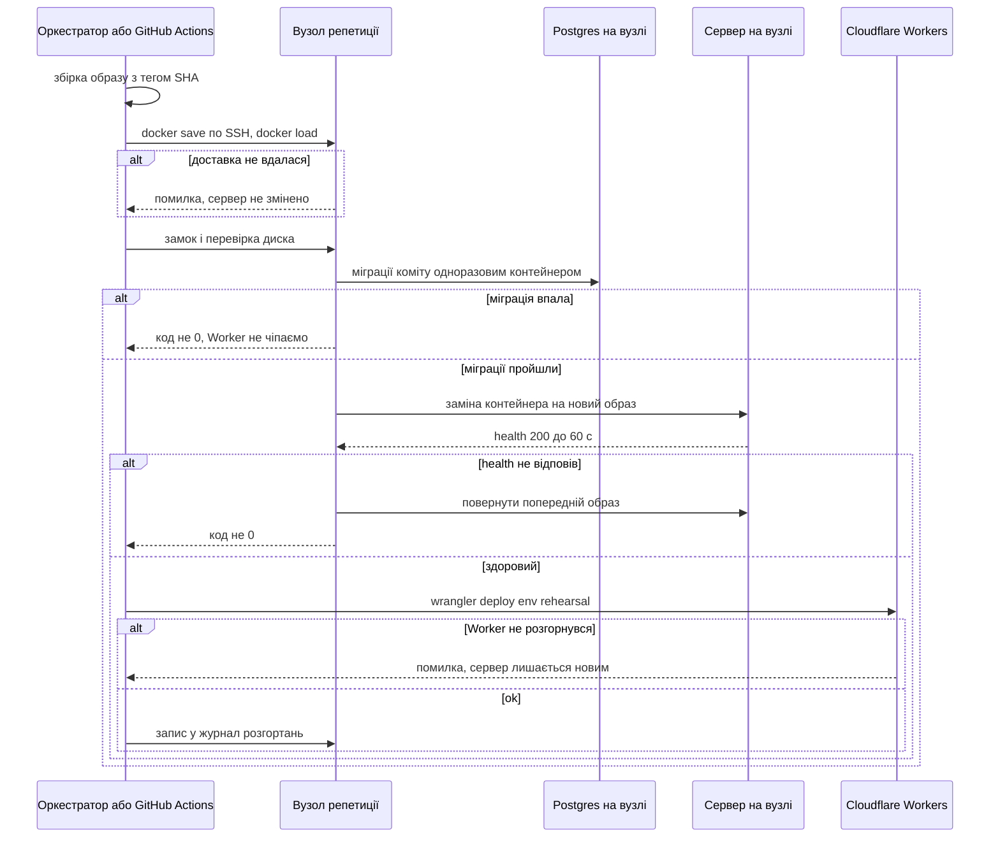
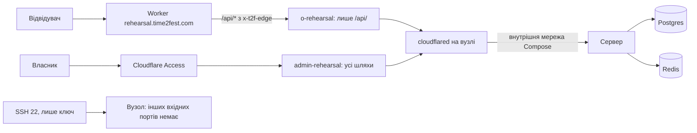

# Spec: Сервер, репетиційне середовище, розгортання, відкат
Spec ID: SPEC-13a
Status: approved
Supersedes: none

## Problem and user

Справжнього сервера немає: сервер SPEC-02 живе лише в Docker на машині власника, а край SPEC-05 перевірено тільки на `test.time2fest.com` із тунелем з ноутбука (`docs/backend/cloudflare-notes.md` §11). Образу Docker сервера немає. `server/scripts/stack.mjs start` вимагає git (`scripts/lib/worktree.mjs:32-47`). Розгортання сервера немає, а Worker’а — лише `workers/edge/scripts/deploy.mjs` без відкату. `infra/cloudflare` знає лише середовище `test` (`infra/cloudflare/lib/config.mjs:29-38`). `PRODUCTION_DENYLIST` порожній (`server/src/platform/env.ts:40`). Заміни секрету краю без простою немає (SPEC-05 OQ-1, EC-16). Скрипта потужності на ніч немає (FR-OPS-03), правила «поза сезоном — мала потужність» теж (FR-OFF-03).

Без цього кожна хвиля дізнається про розбіжності «в бою» лише після запуску. Відкат у ніч свята стає ручною роботою. Робочі секрети можуть потрапити до агентів.

Користувачі:
- **власник** — вводить робочі секрети сам, відкочує однією командою, має відомий простій при збільшенні потужності 26–27.12 і поверненні 02.01;
- **оркестратор і агенти хвиль** — розгортають `master` на репетицію й перевіряють свої «готово, коли» за Cloudflare;
- **SPEC-22b** — бере той самий конвеєр для робочого середовища.

## Goals / Non-goals

**Goals**
- Образ сервера з тегом коміту; Compose-проєкт вузла (Postgres, Redis, сервер, `cloudflared`), у якому сервер досяжний лише з `cloudflared`.
- Одна команда розгортання і одна команда відкату. Обидві працюють локально (ціль «локальний вузол» у Docker Desktop) і по SSH; розгортання ще й з `workflow_dispatch`. Міграції — лише вперед.
- Середовище `rehearsal` у `workers/edge` і `infra/cloudflare`: тунель `t2f-rehearsal`, імена `o-rehearsal.time2fest.com` і `admin-rehearsal.time2fest.com`, Worker на `rehearsal.time2fest.com`.
- Перенесення імені між Worker’ами — команда, перевірена на іменах репетиції (основа SPEC-22b).
- Заміна `T2F_EDGE_SECRET` без відхилених запитів (закриває SPEC-05 OQ-1).
- Заповнений `PRODUCTION_DENYLIST` (закриває SPEC-02 OQ-1).
- Порядок робочих секретів (`secrets.md`) і приклад змінних вузла.
- Скрипт потужності з адаптерами провайдерів: DigitalOcean і фейк. Режим «поза сезоном», замір простою.
- Повтор на справжньому вузлі: SPEC-05 AC-10, AC-15, AC-49 і SPEC-04 AC-11.

**Етапи.** Кожен критерій позначено етапом:
- **S1** — локально, без сервера й без змін у Cloudflare;
- **S1b** — лише Cloudflare, без сервера;
- **S2** — справжній вузол.

S2 починається після того, як власник створить вузол (OQ-1) і дасть ключі R2 (OQ-3). Критерій із кількома етапами перевіряється на кожному з них.

**Пакети:**
- `ops` — новий пакет скриптів вузла, розгортання й потужності (теку обирає планувальник, напр. `infra/ops`; рядок `verify` додає ця хвиля, AC-43);
- `server`;
- `edge` — `workers/edge`;
- `infra` — `infra/cloudflare`;
- `docs-patch` — тексти поза репозиторієм у латці документації хвилі (`spec-13a/docs-patch.md` у теці спільних нотаток).

**Залежність від SPEC-04.** SPEC-04 зливається в `master` до початку реалізації, гілка робить rebase. Критерії, що посилаються на хост адмінки (`T2F_ADMIN_HOST`), змінні Access (`T2F_ACCESS_*`, `T2F_OWNER_EMAILS`), змінні R2 (`T2F_R2_*`) і SPEC-04 AC-1, AC-11, спираються на злитий код SPEC-04.

**Non-goals**
- Копії бази й відновлення, тривоги в Telegram (зокрема «походження недоступне»), моніторинг, лічильники витрат, безперервний зовнішній зонд — SPEC-13b. Тут лише разовий зонд простою (AC-53).
- Робочий вузол, робочі секрети, розгортання на `time2fest.com`/`www`/`admin`, перенесення основного домену, `import catalog` у робоче, середовище GitHub з погодженням власника для `production` — SPEC-22b. Тут ціль `production` має лише запобіжники (AC-21, AC-23), у цій хвилі її не виконують.
- Centrifugo на вузлі realtime, 30 тис. підключень, `ulimit`, кілька копій `cloudflared`, остаточні нічні розміри, підвищення рівня облікового запису DigitalOcean — П-RT і SPEC-23. Вузол realtime тут — каркас без застосунків (AC-49).
- Два екземпляри сервера й оренда планувальника (FR-CLK-22, перевірка), синхронізація часу вузла, керування годинником репетиції з адмінки — SPEC-07. Сервіс Centrifugo в Compose вузла — SPEC-06.
- Текст політики приватності — SPEC-17 (ШВ-16). Публікація до 1.12 — оркестратор, цільовою командою `prelaunch` (AC-21) після «так» власника на основний домен.
- Адаптер Hetzner — лише якщо власник обере Hetzner (AC-45 тримає інтерфейс нейтральним).
- Реєстр образів (рішення [А] 2; ціна — повна доставка образу щоразу), керована база, SSH через тунель з Access (C9: складність і втрата доступу, якщо тунель ляже), нульовий простій при зміні розміру (база на тому самому вузлі простоює).
- Прийняті обмеження збірки репетиції `test` + `http` (C1):
  - до перемикання доменів на `http` сайт репетиції показує «сервер недоступний» (`lib/api/ApiGuard.tsx:13-24`);
  - машина часу працює лише в браузері, бо дверцята годинника в `rehearsal` — 404 (SPEC-02 AC-21).
- Живий запуск workflow GitHub і замір його тривалості — після першого пушу, поза хвилею.
- Автоматична перевірка сумісності нової міграції з попереднім образом: правило AC-44 застосовує рецензія `migration-safety`, окремого інструмента немає.
- Відмінності Docker Desktop від Linux-вузла: локальний вузол не доводить SSH, брандмауерів, API провайдера, справжнього Cloudflare репетиції й тривалості на справжньому залізі — це перевіряє S2 (AC-55, AC-57).

## User stories

- **US-1** Як оркестратор, я хочу розгорнути коміт на репетицію однією командою — з машини чи з GitHub Actions, — щоб хвилі перевірялися на справжньому сервері (FR-OPS-03, картка 13a). → AC-1 … AC-23, AC-42
- **US-2** Як власник, я хочу відкотити Worker і сервер однією командою за ≤5 хв, не чіпаючи схеми бази. → AC-24 … AC-27, AC-44, NFR-1, NFR-2
- **US-3** Як власник, я хочу вводити робочі секрети сам за інструкцією; агенти бачать лише тестові й репетиційні значення (FR-PLAT-09, FR-PLAT-11). → AC-38 … AC-41, NFR-4
- **US-4** Як агент хвилі, я хочу живе репетиційне середовище за Cloudflare із закритим походженням і адмінкою за Access. → AC-28 … AC-32, AC-54 … AC-57
- **US-5** Як власник, я хочу збільшувати й зменшувати потужність скриптом із заміряним простоєм, а поза сезоном — малу потужність без вузла realtime (FR-OPS-03, FR-OFF-03). → AC-45 … AC-53, NFR-3, NFR-5
- **US-6** Як SPEC-22b, я хочу перевірену команду перенесення імені між Worker’ами з поверненням. → AC-33, AC-34
- **US-7** Як власник, я хочу замінити секрет краю так, щоб жоден запит не отримав відмови через секрет. → AC-35 … AC-37

## Acceptance criteria (EARS)

Позначення:
- **«локальний вузол»** — той самий Compose-файл вузла в Docker Desktop машини власника. Доставка — `docker load` без SSH, назва проєкту не `t2f`, без портів 5433 і 6380 на хості; запуск — в ексклюзивному замку RAM (`docs/backend/sdd-routing.md` §7).
- **«вузол репетиції»** — справжній сервер S2.
- **«журнал розгортань»** — файл на вузлі (на локальному вузлі — у його теці стану).
- **«Єдиний 404»** — відповідь SPEC-05 AC-15.
- **Команди** — у розділі Module interactions.

### Образ і вузол

**AC-1 [ops, server] S1** WHEN команда розгортання збирає образ сервера з коміту, the system shall позначити образ тегом повного SHA коміту (40 hex) і запускати з нього сервер без теки `.git` у контейнері.
Verify: integration — локальний вузол: у контейнері немає `.git`; `GET /api/health` повертає `commit`, що дорівнює SHA.

**AC-2 [server] S1** WHERE клас середовища `rehearsal` чи `production`, the server shall слухати адресу й порт зі змінних схеми (`T2F_HOST`, `T2F_SERVER_PORT`; `T2F_HOST` додається в схему), а для класу `test` лишається loopback SPEC-02 AC-61.
Verify: integration — `rehearsal` з `T2F_HOST=0.0.0.0` приймає з’єднання в мережі Compose; некоректний `T2F_HOST` → вихід ≠0 з назвою змінної (SPEC-02 AC-19).

**AC-3 [ops] S1** The node Compose project shall мати сервіси `postgres`, `redis`, `server`, `cloudflared` і жодного порту, опублікованого на хості; усі образи, крім сервера, закріплені за дайджестом.
Verify: unit — розбір Compose-файлу: немає `ports`, у кожного стороннього образу `@sha256:`; integration — `docker compose port` для кожного сервісу локального вузла порожній.

**AC-4 [ops] S1** The node Compose project shall робити порт сервера досяжним лише з внутрішньої мережі, спільної з `cloudflared`.
Verify: integration — локальний вузол: з’єднання з хоста на порт сервера відхилено; з контейнера `cloudflared` `GET /api/health` з секретом краю → 200.

**AC-5 [server] S1** WHEN база й Redis відповідають в межах 2 с, the server shall відповідати на `GET /api/health` (запит, що пройшов перевірку секрету краю) 200 з тілом `{"ok":true,"commit":"<SHA образу>"}` і `Cache-Control: private, no-store`.
Verify: integration — сервер на локальному вузлі: тіло й заголовок як вказано; без `x-t2f-edge` → єдиний 404.

**AC-6 [server] S1** IF база чи Redis не відповідають в межах 2 с, THEN the server shall відповідати на `GET /api/health` 503 з тілом `{"ok":false}` без назв хостів чи тексту помилки.
Verify: integration — зупинений `redis` локального вузла → 503, тіло рівно `{"ok":false}`.

**AC-7 [ops] S1, S2** WHEN вузол перезавантажується, the node Compose project shall запустити всі свої сервіси без жодної команди людини.
Verify: unit — у кожного сервісу політика перезапуску `unless-stopped`; manual (S2) — перезавантаження вузла репетиції, через ≤3 хв `GET /api/health` через край → 200.

**AC-8 [ops] S1, S2** WHEN команда підготовки вузла запускається проти вузла, створеного власником (вхід root за ключем), the system shall створити користувача `deploy` з ключем власника, вимкнути вхід root і паролі SSH, залишити в брандмауері вузла вхідним лише TCP 22 і встановити Docker. Повторний запуск нічого не змінює.
Verify: unit — перелік кроків підготовки й перевірка «вже зроблено» на фейковому транспорті; e2e (S2) — після запуску `ssh root@` і вхід паролем відхилено, `ssh deploy@` працює, другий запуск звітує «без змін».

### Розгортання

**AC-9 [ops] S1, S2** WHEN оркестратор запускає `pnpm deploy:env -- --env rehearsal`, the system shall виконати кроки в порядку: збірка образу → доставка на вузол → міграції коміту одноразовим контейнером → заміна контейнера сервера → перевірка здоров’я → розгортання Worker’а, і записати кожен крок у журнал розгортань.
Verify: integration — локальний вузол: порядок кроків у журналі, після успіху `GET /api/health` дає новий SHA; e2e (S2) — `https://rehearsal.time2fest.com/api/health` дає SHA розгорнутого коміту.

**AC-10 [ops] S1** IF `--env` не з переліку `rehearsal`, `prelaunch`, `production`, `--commit` не коміт репозиторію чи ціль не IPv4-адреса або ім’я хоста, THEN the system shall відмовити до будь-якої дії з кодом 2, не вставляючи жодного аргументу в командний рядок оболонки.
Verify: unit — значення з `;`, `$(…)`, пробілами й невідомим середовищем → код 2, фейковий виконавець команд не викликано.

**AC-11 [ops] S1** IF робоче дерево має незакомічені зміни, THEN the system shall відмовити в розгортанні до збірки з кодом ≠0.
Verify: unit — фейковий стан git із зміненим файлом → відмова, кроків збірки 0.

**AC-12 [ops] S1** IF міграція завершується помилкою, THEN the system shall залишити попередній контейнер сервера, не розгортати Worker і вийти з кодом ≠0, назвавши крок «міграції».
Verify: integration — локальний вузол із навмисно хибною міграцією в тестовій гілці: сервер віддає попередній SHA, Worker не викликано (фейковий wrangler), код ≠0.

**AC-13 [ops] S1** IF новий сервер не відповідає 200 на `GET /api/health` протягом 60 с після заміни, THEN the system shall повернути контейнер на попередній образ, не розгортати Worker і вийти з кодом ≠0.
Verify: integration — образ, що не стартує (хибна змінна в тестовому оточенні), → за ≤90 с здоров’я дає попередній SHA, викликів wrangler 0.

**AC-14 [ops] S1** IF розгортання Worker’а завершується помилкою після успішної заміни сервера, THEN the system shall залишити новий сервер (FR-MIG-07), записати в журнал незавершене розгортання і вийти з кодом ≠0, назвавши крок «Worker».
Verify: unit — фейковий wrangler повертає помилку → запис журналу зі станом `worker-failed`, сервер не перемикався назад.

**AC-15 [ops] S1** The system shall записувати кожне розгортання й відкат у журнал розгортань полями: `at`, `env`, `commit`, `imageBefore`, `imageAfter`, `workerVersionBefore`, `workerVersionAfter`, `edgeSecretGeneration`, `result`, `failedStep` — без жодного значення секрету.
Verify: integration — після розгортання й відкату на локальному вузлі в записах є всі поля; сторожове значення секрету в журналі не зустрічається.

**AC-16 [ops] S1** WHEN розгортання завершується успішно, the system shall залишити на вузлі три останні образи сервера, ніколи не видаляючи поточного й попереднього.
Verify: integration — п’ять розгортань поспіль на локальному вузлі → лишаються образи трьох останніх SHA.

**AC-17 [ops] S1** IF на вузлі вже йде розгортання чи відкат того самого середовища, THEN the system shall відмовити другій команді з кодом ≠0, нічого не змінюючи.
Verify: integration — дві паралельні команди на локальному вузлі → рівно одна виконує кроки, друга відмовляє з назвою замка.

**AC-18 [ops] S1** IF на вузлі вільно менше 5 ГБ диска, THEN the system shall відмовити до доставки образу.
Verify: unit — фейковий звіт про диск 4,9 ГБ → відмова, доставки 0.

**AC-19 [ops] S1** The deploy and rollback commands shall ніколи не запускати міграцію `down`.
Verify: unit — фейковий виконавець фіксує всі команди розгортання й відкату; жодна не містить виклику `down`.

**AC-20 [ops] S1** The deploy command shall не записувати секретів Worker’а; секрет краю змінюють лише команди генерації й заміни (AC-37, AC-38).
Verify: unit — у прогоні розгортання фейковий wrangler не отримує `secret put`.

**AC-21 [ops, edge] S1** IF ціль — середовище `prelaunch` чи `production` або будь-яке ім’я `time2fest.com`, `www.time2fest.com`, `admin.time2fest.com`, а команда не має одночасно `--confirm <середовище>` і `--allow-main-domain`, THEN the system shall вийти з кодом 2 без жодної зміни.
Verify: unit — кожна з цих цілей без прапорців і лише з одним із них → код 2, викликів wrangler і SSH 0; `prelaunch` з обома — лише розгортання Worker’а, без кроків сервера.

**AC-22 [ops] S1** IF ціль — адреса `178.20.157.85`, THEN the system shall відмовити з кодом 2 за будь-яких прапорців (FR-OPS-03).
Verify: unit — ця адреса з `--confirm` і `--allow-main-domain` → код 2.

**AC-23 [ops] S1** WHILE середовище `production` і час між 31.12 08:00 та 01.01 14:00 UTC, IF команда розгортання чи відкату не має `--emergency`, THEN the system shall відмовити з кодом 2 (FR-OPS-04).
Verify: unit — підставний годинник 31.12 08:00:00, 01.01 13:59:59 → відмова; 01.01 14:00:00 → дозволено; з `--emergency` → дозволено.

### Відкат

**AC-24 [ops, edge] S1, S1b, S2** WHEN власник чи оркестратор запускає `pnpm rollback:env -- --env rehearsal [--to <sha>]`, the system shall спершу повернути Worker на версію `workerVersionBefore` з останнього успішного запису журналу, потім замінити контейнер сервера на образ `imageBefore` (або образ `--to`) і записати відкат у журнал.
Verify: integration (S1) — локальний вузол: після відкату здоров’я дає попередній SHA; unit — фейковий wrangler отримує `rollback` із записаною версією; e2e (S1b) — Worker репетиції повертається на записану версію; e2e (S2) — `https://rehearsal.time2fest.com/api/health` дає попередній SHA.

**AC-25 [ops] S1** The rollback command shall не запускати міграцій і не змінювати файл змінних вузла.
Verify: integration — таблиця міграцій і контрольна сума файлу змінних до й після відкату однакові.

**AC-26 [ops] S1** IF у журналі немає успішного попереднього розгортання чи на вузлі немає його образу, THEN the system shall відмовити з кодом ≠0 без змін.
Verify: unit — порожній журнал і видалений образ → відмова, викликів wrangler і Docker 0.

**AC-27 [ops] S1** IF `edgeSecretGeneration` цільового запису менше за поточне покоління секрету краю, THEN the system shall відмовити у відкаті Worker’а з поясненням про заміну секрету.
Verify: unit — запис покоління 1 при поточному 2 → відмова з текстом про секрет краю.

### Cloudflare репетиції

**AC-28 [infra] S1, S1b** The infra script shall мати середовище `rehearsal`: тунель `t2f-rehearsal`, ім’я `o-rehearsal.time2fest.com` з ingress лише `^/api/` на сервер, ім’я `admin-rehearsal.time2fest.com` з ingress усіх шляхів на сервер, обидва — проксійовані CNAME; `plan`/`apply` обробляє `test` і `rehearsal` разом, а повторний `apply` звітує «без змін».
Verify: unit — бажаний стан містить обидва імена й ingress, що закінчується `http_status:404`; e2e (S1b) — `apply`, потім `plan` → «без змін»; `test` не зачеплено.

**AC-29 [infra] S1, S1b** The infra script shall включати `o-rehearsal.time2fest.com` у вираз наявного правила блокування імен тунелю і не включати туди `admin-rehearsal.time2fest.com`, не створюючи нового власного правила WAF.
Verify: unit — вираз правила `t2f-block-tunnel-hosts`; кількість власних правил не зросла; e2e (S1b) — `https://o-rehearsal.time2fest.com/api/time` → 403 Cloudflare.

**AC-30 [infra] S1** WHERE команді передано `--with-access`, the infra script shall створювати чи оновлювати застосунок Access для `admin-rehearsal.time2fest.com` з окремим `aud` і політикою на пошти лише з локальної змінної власника, ніколи з git.
Verify: unit — без прапорця застосунку в плані немає; з прапорцем пошти беруться зі змінної середовища, а в бажаному стані в репозиторії їх немає. Живе створення — після «так» власника (OQ-2).

**AC-31 [edge] S1b** WHEN оркестратор розгортає середовище `rehearsal` Worker’а, the system shall зібрати сайт у `test` + `http` у теку `out-edge-rehearsal` і віддавати його статикою на `https://rehearsal.time2fest.com`.
Verify: e2e (S1b) — `/` → 200 `text/html`; `*.workers.dev` імені Worker’а → 404.

**AC-32 [edge] S1b** WHEN GET рівно `https://rehearsal.time2fest.com/api/time`, the Worker shall відповісти за SPEC-05 AC-10 без походження.
Verify: e2e (S1b) — поки вузла немає: 200, `now` у межах ±1 000 мс, заголовки AC-10 SPEC-05.

**AC-33 [ops, edge] S1b** WHEN оркестратор запускає команду перенесення імені для імені репетиції, the system shall прив’язати ім’я до другого Worker’а розгортанням цього Worker’а з тим самим Custom Domain, повернути його назад тим самим способом і записати в журнал проміжок недоступності імені.
Verify: e2e (S1b) — `rehearsal.time2fest.com` переходить на `t2f-edge-rehearsal-alt` (заголовок або тіло двійника розрізняються) і назад; зонд щосекунди фіксує проміжок у журналі.

**AC-34 [ops] S1** IF перенесення імені вимагає явного від’єднання, THEN the system shall від’єднувати лише прив’язку імені репетиції, яку його журнал записав як створену ним, і відмовляти для будь-чого іншого, зокрема `time2fest.com`, `www`, `admin`.
Verify: unit — від’єднання прив’язки без запису в журналі → відмова; основний домен → відмова навіть із записом.

### Секрети

**AC-35 [server] S1** WHERE задано `T2F_EDGE_SECRET_PREVIOUS`, the server shall приймати `x-t2f-edge`, що дорівнює `T2F_EDGE_SECRET` або `T2F_EDGE_SECRET_PREVIOUS`, порівнянням за сталий час.
Verify: integration — обидва значення → 200 на `/api/health`; третє → єдиний 404.

**AC-36 [server] S1** IF `T2F_EDGE_SECRET_PREVIOUS` коротший за 32 символи чи дорівнює `T2F_EDGE_SECRET`, THEN the server shall відмовитися стартувати, назвавши змінну без значення.
Verify: unit — `loadEnv` у класі `rehearsal` з обома випадками → `failing` містить `T2F_EDGE_SECRET_PREVIOUS`.

**AC-37 [ops] S1, S2** WHEN оркестратор запускає заміну секрету краю, the system shall виконати кроки в порядку: (1) сервер отримує новий секрет і старий як `PREVIOUS`, перезапуск; (2) новий секрет — у Worker; (3) перевірка через край; (4) прибрати `PREVIOUS`, перезапуск; і збільшити покоління секрету в журналі.
Verify: integration — локальний вузол із клієнтом, що шле старий, а після кроку 2 новий секрет: жодної відповіді 404 через секрет; e2e (S2) — зонд через `rehearsal.time2fest.com` під час заміни без 404.

**AC-38 [ops] S1, S1b** The system shall генерувати секрети репетиції (`PAYLOAD_SECRET`, `T2F_EDGE_SECRET`, пароль Postgres) криптографічним генератором (≥32 байти), зберігати їх лише в git-ignored файлі `.local` (режим 0600), у файлі змінних вузла (0600) і в секретах Worker’а, а передавати лише через stdin.
Verify: unit — фейкові виконавці: жодне значення не з’являється в аргументах команд, stdout, stderr чи журналі; файл має режим 0600 (на Windows — перевірка шляху в `.gitignore`); e2e (S1b) — після генерації `wrangler secret list` репетиції містить `T2F_EDGE_SECRET`.

**AC-39 [server] S1** The env schema shall мати в `PRODUCTION_DENYLIST` `time2fest-prod`, `o.time2fest.com`, `t2f_production`, `t2f:production:` і позначати `T2F_R2_BUCKET` (SPEC-04) і `T2F_REDIS_PREFIX` як ізольовані, щоб клас `rehearsal` чи `test` із таким значенням відмовлявся стартувати (SPEC-02 AC-20).
Verify: unit — кожен ідентифікатор у відповідній змінній класу `rehearsal` → `failing` з назвою змінної; значення репетиції (`time2fest-rehearsal`, `o-rehearsal.time2fest.com`, `t2f_rehearsal`, `t2f:rehearsal:`) проходять.

**AC-40 [ops] S1** The node env example shall перелічувати кожну змінну реєстру змінних сервера, обов’язкову в `rehearsal` чи `production`, з порожнім значенням.
Verify: unit — тест порівнює назви з реєстром (`server/src/registries/env.ts` після SPEC-04) і падає на кожній відсутній чи заповненій.

**AC-41 [docs-patch] S1** The docs patch shall містити текст `docs/backend/secrets.md`:
- перелік змінних за класами (лише назви);
- хто генерує кожну й де вона живе (файл вузла 0600, секрети Worker’а, секрети GitHub Actions);
- порядок введення робочих секретів власником;
- порядок заміни секрету краю;
- примітку «зміна `PAYLOAD_SECRET` анулює ключі агентів» (SPEC-04 OQ-7);
- права токенів `DIGITALOCEAN_TOKEN`, R2 і ключа розгортання GitHub;
- правило «агенти не бачать робочих значень».

Verify: manual — ведучий хвилі перевіряє кожен пункт переліку в тексті; grep тексту на шаблони секретів (`sdd-format`, security «Secret Detection») — порожньо.

### CI і репозиторій

**AC-42 [ops] S1** The deploy workflow shall запускатися лише `workflow_dispatch` з входом `env` типу `choice` зі значенням лише `rehearsal`, без `pull_request_target`, з діями, закріпленими за SHA, із секретами лише за назвами, і викликати ту саму команду `pnpm deploy:env`.
Verify: unit — тест розбирає YAML workflow і перевіряє кожну умову. Живий запуск — поза хвилею (немає пушу).

**AC-43 [ops] S1** The verify config shall мати один рядок `ops` (`files`, `full`) у `.claude/sdd-engineering.json`, а ті самі кроки — у `.github/workflows/verify.yml`; інші рядки не змінюються.
Verify: unit — розбір обох файлів; diff `.claude/sdd-engineering.json` зачіпає лише новий рядок.

**AC-44 [ops] S1** The skill `migration-safety` shall містити правило: «нова міграція сумісна з кодом попереднього образу; відкат SPEC-13a `down` не запускає».
Verify: unit (static) — grep рядка в `.claude/skills/migration-safety/SKILL.md`.

### Потужність

**AC-45 [ops] S1** The capacity and node-creation commands shall звертатися до провайдера лише через інтерфейс адаптера, який фейковий адаптер і адаптер DigitalOcean проходять одним набором контрактних тестів; назви й поля DigitalOcean трапляються лише в його адаптері та його конфігурації.
Verify: unit — набір на обох адаптерах (DigitalOcean — проти записаних HTTP-відповідей); grep `droplet|digitalocean` поза адаптером → порожньо.

**AC-46 [ops] S1** The capacity command shall за замовчуванням лише друкувати план, а змінювати ресурси — тільки з `--confirm <середовище>`.
Verify: unit — без прапорця фейковий адаптер не отримує змінних викликів.

**AC-47 [ops] S1** IF ресурс провайдера не має обох тегів `t2f-managed` і `t2f-env-<середовище>`, THEN the capacity command shall відмовитися змінювати чи видаляти його.
Verify: unit — вузол фейка без тегу → відмова з назвою ресурсу, викликів видалення 0.

**AC-48 [ops] S1, S2** WHEN власник збільшує чи повертає потужність основного вузла, the capacity command shall змінювати лише CPU і RAM, без диска, на розмір зі списку дозволених у конфігурації середовища.
Verify: unit — запит до фейка без зміни диска; розмір поза списком → відмова; manual (S2, якщо OQ-4 «так») — репетиція `s-2vcpu-4gb` → `s-4vcpu-8gb` → назад, простій записано.

**AC-49 [ops] S1, S2** WHEN команда створює чи прибирає вузол realtime, the system shall створювати його з тегами й підготовкою AC-8 і прибирати його видаленням, а не вимкненням; Compose-профіль вузла realtime не містить застосунків, крім `cloudflared`.
Verify: unit — фейк отримує `create` і `delete`, `power_off` — ніколи; manual (S2, якщо OQ-4 «так») — тимчасовий вузол `s-2vcpu-4gb` створено й видалено, час записано.

**AC-50 [ops] S1** The capacity command shall ніколи не запускати другого екземпляра сервера (FR-CLK-22): зміна потужності основного вузла лише вертикальна, а Compose-профіль вузла realtime не має сервісу `server`.
Verify: unit — у плані будь-якої команди немає кроку старту сервера поза основним вузлом; розбір профілю realtime.

**AC-51 [ops] S1, S2** WHEN власник запускає режим «поза сезоном», the capacity command shall привести основний вузол до розміру поза сезоном (`s-2vcpu-4gb` для DigitalOcean) і видалити вузол realtime, а команда стану — показати розбіжність із цим станом (FR-OFF-03).
Verify: unit — фейк зі збільшеним вузлом і вузлом realtime → план «зменшити, видалити»; після виконання стан без розбіжностей; manual (S2) — після прогону OQ-4 стан репетиції без розбіжностей.

**AC-52 [ops] S1** IF API провайдера відповідає помилкою чи обмеженням частоти, THEN the capacity command shall зупинитися, надрукувати вже виконані кроки, і повторний запуск має завершити роботу без повторення виконаних кроків.
Verify: unit — фейк повертає 429 на другому кроці; повтор виконує лише кроки з другого.

**AC-53 [ops] S1, S2** WHEN команда розгортання, відкату, перенесення імені чи потужності вмикає зонд простою, the system shall щосекунди запитувати `GET /api/health` через край і записувати простій — від останньої успішної відповіді походження до першої наступної — у секундах у журнал.
Verify: unit — підставний годинник і послідовність відповідей 200, 503, 503, 200 → простій 2 с; manual (S2) — числа для розгортання, відкату й зміни розміру в журналі й латці документації.

### Повтор на репетиції

**AC-54 [server, ops] S2** WHEN запит до сервера йде з вузла в мережі Compose без `x-t2f-edge`, the server shall відповісти єдиним 404 (SPEC-05 AC-15 наживо).
Verify: e2e (S2) — `/api/health` і невідомий шлях з контейнера `cloudflared` без секрету й з хибним → однакові статус, заголовки й тіло.

**AC-55 [infra, ops] S2** IF запит іде на `o-rehearsal.time2fest.com` повз Worker або на будь-який порт вузла репетиції, крім TCP 22, THEN the edge and node shall відмовити: Cloudflare — 403 для `/api/time`, `/api/webhooks/paypro`, `/connection/websocket`, вузол — без прийнятого з’єднання (SPEC-05 AC-49 наживо).
Verify: e2e (S2) — три запити → 403, у журналі сервера їх немає; сканування TCP-портів 1–65535 вузла з іншої машини → відкритий лише 22.

**AC-56 [server, infra] S2** IF запит до адмінки репетиції не пройшов Cloudflare Access чи йде повз край, THEN the edge and server shall відмовити: `admin-rehearsal.time2fest.com` без входу Access — вхід Access чи 403 без запиту на сервер; `o-rehearsal.time2fest.com` з `Host` адмінки — 403; IP вузла — без з’єднання (SPEC-04 AC-11 наживо).
Verify: e2e (S2, після OQ-2) — три запити й журнал сервера без них; manual — власник входить в адмінку репетиції через Access (≈2 хв).

**AC-57 [ops] S2** WHEN `master` розгорнуто на вузол репетиції, the system shall віддавати `https://rehearsal.time2fest.com/` 200, а `https://rehearsal.time2fest.com/api/health` — 200 з SHA цього коміту.
Verify: e2e (S2, після OQ-3) — обидва запити після `pnpm deploy:env -- --env rehearsal` з `master`.

## Edge cases

- **EC-1** Перше розгортання, попереднього немає. → AC-9, AC-26
- **EC-2** SSH обривається під час доставки. → AC-9 (контейнер не замінюється до кінця доставки), AC-17 (замок знято, повтор)
- **EC-3** Дві команди одночасно (людина й CI). → AC-17
- **EC-4** Диск вузла заповнений образами. → AC-16, AC-18
- **EC-5** Відкат після заміни секрету краю. → AC-27
- **EC-6** Новий код додав обов’язкову змінну, відкат на старий образ. → AC-25 (файл змінних не змінюється; старий код зайву змінну ігнорує)
- **EC-7** Міграція несумісна з попереднім образом. → AC-44; автоматичної перевірки немає → Non-goal
- **EC-8** Відкат Worker’а вдався, сервера — ні. → AC-24, AC-15 (`failedStep`)
- **EC-9** Вузол, створений вручну, має вхід паролем. → AC-8
- **EC-10** Ресурс провайдера створено вручну без тегів. → AC-47
- **EC-11** Обмеження частоти API провайдера посеред зміни. → AC-52
- **EC-12** Помилкова ціль `time2fest.com` чи старий сервер. → AC-21, AC-22
- **EC-13** Розгортання в ніч свята. → AC-23
- **EC-14** Немає ключів R2 — сервер репетиції не стартує (схема SPEC-04). → OQ-3
- **EC-15** Власник обирає Hetzner. → AC-45; адаптер Hetzner → Non-goal
- **EC-16** Вузол перезавантажився. → AC-7
- **EC-17** Сайт репетиції показує «сервер недоступний», машина часу лише в браузері. → Non-goal
- **EC-18** Docker Desktop поводиться інакше, ніж Linux-вузол. → Non-goal; S2 повторює ключові перевірки (AC-55, AC-57)
- **EC-19** Перенесення Custom Domain вимагає явного від’єднання. → AC-34
- **EC-20** Аргумент команди містить метасимволи оболонки. → AC-10

## Non-functional requirements

**NFR-1 [ops, edge] S1b, S2** The rollback command shall завершуватися ≤5 хв від старту до моменту, коли `GET /api/health` через край дає попередній SHA, а Worker стоїть на записаній версії, у найгіршому з трьох прогонів.
Verify: manual (S2) — три відкати на репетиції з часом у журналі; S1b — час відкату Worker’а окремо.

**NFR-2 [ops, server] S2** The deploy and rollback commands shall тримати простій `/api/*` (крім `/api/time`) ≤60 с за зондом AC-53.
Verify: manual (S2) — числа зонда для розгортання й відкату в журналі.

**NFR-3 [ops] S2** The capacity command shall записувати в журнал і латку документації заміряний простій кожної зміни розміру й час створення та видалення вузла realtime у секундах. Межу не задано (FR-OPS-03 вимагає лише заміру).
Verify: manual (S2, якщо OQ-4 «так»; інакше — «не перевірено наживо», лише фейк).

**NFR-4 [ops, server] S1** The system shall не виводити жодного значення секрету в stdout, stderr, журнал розгортань, журнал сервера чи артефакти CI (FR-PLAT-09).
Verify: unit — сторожові значення секретів у прогонах розгортання, відкату, заміни й генерації не знаходяться в жодному захопленому виводі.

**NFR-5 [ops] S1** The capacity and node-creation commands shall друкувати ціну за годину кожного ресурсу, що створюється чи збільшується, до запиту `--confirm`.
Verify: unit — план фейка містить ціну за годину для кожного платного кроку.

## Module interactions

Учасники — сервіси й зовнішні системи, не модулі коду.

Відмови на стрілках: доставка → AC-9, AC-17; диск → AC-18; міграції → AC-12; здоров’я → AC-13; Worker → AC-14. Відкат іде у зворотному порядку: Worker на записану версію → сервер на попередній образ (AC-24), без міграцій (AC-25); відмови → AC-26, AC-27.

Відмови: ім’я тунелю повз Worker → AC-29, AC-55; адмінка без Access → AC-56; сервер чи тунель недоступні → 503 Worker’а (SPEC-05 AC-9), `/api/time` працює (AC-32).

### Контракти

**`GET /api/health`** — **proposed**. Край → сервер, синхронно, лише з секретом краю. У контракти `web` не входить; рядок у `frontend-seam.md` §3.11 — у латці документації.
- Запит без тіла й параметрів.
- 200: `{ ok: true; commit: string }` — `commit` (обов’язкове) — 40 hex. Умова — AC-5.
- 503: `{ ok: false }` — AC-6.
- Без секрету — єдиний 404 (SPEC-05 AC-15).

**Команди** (корінь робочого простору; **proposed**). Код 0 — успіх; 2 — відмова запобіжника чи аргументу; інший ≠0 — збій кроку з назвою.

| Команда | Аргументи |
|---|---|
| `pnpm deploy:env -- --env <rehearsal\|prelaunch\|production>` | `[--target local\|<хост>] [--commit <sha>] [--confirm <env>] [--allow-main-domain] [--emergency] [--probe]` |
| `pnpm rollback:env -- --env <…>` | `[--to <sha>] [--confirm <env>] [--emergency] [--probe]` |
| `pnpm node:bootstrap -- --host <хост>` | — |
| `pnpm edge:secret -- --env rehearsal` | `--generate` чи `--rotate` |
| `pnpm edge:move-domain -- --name <ім’я> --to <worker>` | — |
| `pnpm capacity -- --env <…>` | `plan\|night\|back\|off-season\|realtime-create\|realtime-delete\|status [--size <розмір>] [--confirm <env>]` |

**Запис журналу розгортань** — поля AC-15. `result`: `ok` | `failed` | `worker-failed` | `rolled-back`.

**Змінні вузла** (лише назви):
- додаються: `T2F_HOST`, `T2F_EDGE_SECRET_PREVIOUS`; образ задає SHA для `commit`;
- для команд — `DIGITALOCEAN_TOKEN`, `CLOUDFLARE_API_TOKEN`, `CLOUDFLARE_API_TOKEN_INFRA`;
- решта — реєстр сервера після SPEC-04.

## Inputs and provenance

| Input | Source | Producer | Freshness | Trusted |
|---|---|---|---|---|
| Аргументи команд (`--env`, `--commit`, `--target`, `--to`) | людина чи вхід `workflow_dispatch` | оркестратор, власник | на запуск | ні — AC-10 |
| Коміт і робоче дерево | git | розробка | на запуск | так після AC-11 |
| Відповіді API провайдера (розміри, стан вузлів, теги) | DigitalOcean API | провайдер | на запит | частково — перевіряється AC-45, AC-47, AC-52 |
| Стан вузла, створеного власником | вузол | власник | одноразово | ні — AC-8 перевіряє й приводить |
| Відповіді `wrangler` і API Cloudflare | Cloudflare | Cloudflare | на запит | так (офіційний клієнт), помилки → AC-14 |
| Журнал розгортань | вузол | ця хвиля | на кожну команду | так (пише лише користувач `deploy`) |
| Секрети репетиції | генератор на машині власника чи вузлі | ця хвиля | на генерацію чи заміну | так, лише stdin — AC-38 |
| Пошти власника для Access | змінна середовища власника | власник | на запуск | так, ніколи в git — AC-30 |
| Ключі R2 репетиції, токен DO | кабінети провайдерів | власник | одноразово | так, лише назви в репозиторії — AC-41 |
| Рішення C1–C17 | [А] сесія хвилі, 2026-11-17 | ведучий хвилі | — | так |
| Факти провайдерів (ціни, рівні, зміна розміру, оплата) | `spec-13a/research-providers.md` (digitalocean.com/pricing/droplets, docs.digitalocean.com/platform/resource-limits, …/droplets/how-to/resize, 2026-11-17) | дослідник | 2026-11-17 | так, із джерелами |
| Факти коду | `spec-13a/research-code.md` (`file:line`) | дослідник | master 36825b7 | так |

## Untrusted inputs

- Аргументи команд і вхід workflow — перелік дозволених значень, формат SHA й хоста, жодної вставки в командний рядок оболонки: AC-10, AC-42.
- Відповіді API провайдера — діяти лише на ресурсах з тегами, зупинятися на помилці: AC-47, AC-52; провайдер-нейтральний інтерфейс — AC-45.
- Стан вузла, створеного вручну, — приводиться до відомого стану підготовкою: AC-8.
- Запити ззовні до вузла й імен тунелю — відмова: AC-4, AC-29, AC-54 … AC-56.
- `GET /api/health` не розкриває хостів і тексту помилок: AC-6.

## Design review

Інтерфейсу немає: хвиля видимо не змінює `web/` (дизайн-джерела не стосуються). Рішення — [А] сесія хвилі, 2026-11-17, і рішення [А] 1–9 брифу. Відповіді власника, яких ще немає, закодовано як припущення з запасним варіантом (OQ-1 … OQ-4).

| # | Знахідка чи пропозиція | Рішення | Куди |
|---|---|---|---|
| A1, C1 | Збірка `test` + `http` на репетиції: «сервер недоступний» і машина часу лише в браузері | accepted (як у картці) | AC-31; Non-goal |
| A2 | Немає `build:edge:rehearsal` | accepted | AC-31 |
| A3 | `infra/cloudflare` знає лише `test`; `PUT` фази — разом | accepted | AC-28 |
| A4 | Канал до адмінки репетиції не визначено; ім’я `admin-rehearsal.time2fest.com` | accepted | AC-28, AC-29, AC-30, AC-56 |
| A5, C2 | Loopback проти мережі Compose | accepted: внутрішня мережа, без опублікованих портів | AC-2, AC-3, AC-4, AC-55 |
| A6, C3 | Старт без git, міграції одноразовим контейнером | accepted | AC-1, AC-9 |
| A7, C4 | Немає точки здоров’я | accepted: `GET /api/health` (proposed) | AC-5, AC-6 |
| A8 | Визначення простою | accepted | AC-53, NFR-2, NFR-3 |
| A9 | FR-CLK-22 при збільшенні | accepted: лише вертикально, другого екземпляра немає | AC-50; перевірка двох екземплярів — Non-goal (SPEC-07) |
| A10, C5 | Неоднозначна «попередня версія» Worker’а; відкат через заміну секрету | accepted | AC-15, AC-20, AC-24, AC-27 |
| A11, C11 | Список робочих ідентифікаторів і ізоляція змінних | accepted | AC-39 |
| A12 | Ключі R2 обов’язкові в репетиції | deferred | OQ-3 |
| A13 | Пакет `ops` без `verify` | accepted | AC-43 |
| A14 | Правило `migration-safety` | accepted | AC-44 |
| A15 | `prelaunch`/`production` забирають основний домен | accepted | AC-21 |
| A16, C17 | Перенесення імені на іменах репетиції | accepted: повторна прив’язка розгортанням двійника; явне від’єднання — лише свого | AC-33, AC-34; видалення двійника → OQ-5 |
| A17 | Етап S1b | accepted | AC-24, AC-28 … AC-33, AC-38 |
| A18 | AC-15 SPEC-05 наживо — лише з вузла | accepted | AC-54 |
| A19, C10 | Повна доставка образу без реєстру | accepted як ціна рішення | Non-goal; NFR-2 |
| A20, C9 | SSH відкритий лише з ключем; SSH через тунель | accepted / declined | AC-8; Non-goal |
| A21 | Назва файлу `SPEC-13a-…` | accepted | цей файл |
| C6 | Порядок розгортання й автоповернення | accepted | AC-9, AC-12, AC-13, AC-14 |
| C7 | Три образи, ≥5 ГБ | accepted | AC-16, AC-18 |
| C8 | Заміна секрету краю | accepted | AC-35, AC-36, AC-37 |
| C10 | Межі ≤5 хв і ≤60 с | accepted | NFR-1, NFR-2 |
| C12 | Захист старого сервера | accepted | AC-22 |
| C13 | Заморожування для `production` | accepted | AC-23 |
| C14 | Workflow лише `workflow_dispatch` | accepted | AC-42 |
| C15 | Ціль «локальний вузол» | accepted | AC-1 … AC-27 (Verify) |
| C16 | Скрипт потужності | accepted | AC-45 … AC-53, NFR-5 |
| B1(a) | Перший вузол | припущення: створює власник вручну | AC-8; OQ-1 |
| B1(b) | Прогін потужності < $1 і токен DO | deferred | OQ-4 |
| B1(c) | Ключ розгортання GitHub | не потрібен у хвилі | AC-41 (опис) |
| B2 | Застосунок Access адмінки репетиції | deferred | AC-30; OQ-2 |
| B4 | Окремий робочий вузол | припущення (а): окремий вузол у SPEC-22b | AC-39 (назви); OQ-6 |

## Traceability

| AC / NFR | From (US / EC / design review) | Packages | Verify |
|---|---|---|---|
| AC-1 | US-1, A6 | ops, server | integration |
| AC-2 | US-1, A5 | server | integration |
| AC-3 | US-4, A5 | ops | unit, integration |
| AC-4 | US-4, A5 | ops | integration |
| AC-5 | US-1, A7 | server | integration |
| AC-6 | US-1, A7 | server | integration |
| AC-7 | US-4, EC-16 | ops | unit, manual |
| AC-8 | US-4, EC-9, B1(a) | ops | unit, e2e |
| AC-9 | US-1, EC-1, EC-2, C6 | ops | integration, e2e |
| AC-10 | US-1, EC-20 | ops | unit |
| AC-11 | US-1, C6 | ops | unit |
| AC-12 | US-1, C6 | ops | integration |
| AC-13 | US-1, C6 | ops | integration |
| AC-14 | US-1, C6 | ops | unit |
| AC-15 | US-1, US-2, EC-8, A10 | ops | integration |
| AC-16 | US-1, EC-4, C7 | ops | integration |
| AC-17 | US-1, EC-3 | ops | integration |
| AC-18 | US-1, EC-4, C7 | ops | unit |
| AC-19 | US-1, US-2, A14 | ops | unit |
| AC-20 | US-1, A10 | ops | unit |
| AC-21 | US-1, US-6, EC-12, A15 | ops, edge | unit |
| AC-22 | US-1, EC-12, C12 | ops | unit |
| AC-23 | US-1, EC-13, C13 | ops | unit |
| AC-24 | US-2, EC-8, A10 | ops, edge | integration, unit, e2e |
| AC-25 | US-2, EC-6 | ops | integration |
| AC-26 | US-2, EC-1 | ops | unit |
| AC-27 | US-2, EC-5, A10 | ops | unit |
| AC-28 | US-4, A3, A4 | infra | unit, e2e |
| AC-29 | US-4, A4 | infra | unit, e2e |
| AC-30 | US-4, A4, B2 | infra | unit |
| AC-31 | US-4, A1, A2 | edge | e2e |
| AC-32 | US-4, A17 | edge | e2e |
| AC-33 | US-6, A16 | ops, edge | e2e |
| AC-34 | US-6, EC-19, A16 | ops | unit |
| AC-35 | US-7, C8 | server | integration |
| AC-36 | US-7, C8 | server | unit |
| AC-37 | US-7, C8 | ops | integration, e2e |
| AC-38 | US-3, A17 | ops | unit, e2e |
| AC-39 | US-3, A11, B4 | server | unit |
| AC-40 | US-3 | ops | unit |
| AC-41 | US-3, B1(c) | docs-patch | manual |
| AC-42 | US-1, C14 | ops | unit |
| AC-43 | US-1, A13 | ops | unit |
| AC-44 | US-2, EC-7, A14 | ops | unit |
| AC-45 | US-5, EC-15 | ops | unit |
| AC-46 | US-5, C16 | ops | unit |
| AC-47 | US-5, EC-10 | ops | unit |
| AC-48 | US-5, C16 | ops | unit, manual |
| AC-49 | US-5, C16 | ops | unit, manual |
| AC-50 | US-5, A9 | ops | unit |
| AC-51 | US-5, C16 | ops | unit, manual |
| AC-52 | US-5, EC-11 | ops | unit |
| AC-53 | US-5, A8 | ops | unit, manual |
| AC-54 | US-4, A18 | server, ops | e2e |
| AC-55 | US-4, A5 | infra, ops | e2e |
| AC-56 | US-4, A4 | server, infra | e2e, manual |
| AC-57 | US-4, US-1 | ops | e2e |
| NFR-1 | US-2, C10 | ops, edge | manual |
| NFR-2 | US-2, A8, C10 | ops, server | manual |
| NFR-3 | US-5, A8 | ops | manual |
| NFR-4 | US-3 | ops, server | unit |
| NFR-5 | US-5, C16 | ops | unit |

**Покриття «Готово, коли» картки (`specs/002-backend/waves.md:241`) і вимог**

| Пункт | Критерії |
|---|---|
| Репетиція живе на новому сервері за Cloudflare (тунель — за `cloudflare-notes.md` §3) | AC-1 … AC-8, AC-28, AC-29, AC-31, AC-32, AC-57 |
| Розгортання однією командою з `master` (GitHub Actions, wrangler, образ з тегом коміту, міграції лише вперед) | AC-9 … AC-23, AC-42 |
| Відкат однією командою ≤5 хв, міграції не відкочуються, правило `migration-safety` | AC-24 … AC-27, AC-19, AC-44, NFR-1, NFR-2 |
| Маршрут Worker’а на домені перемикається й відкочується тим самим скриптом (основа SPEC-22b) | AC-21, AC-33, AC-34 |
| Порядок робочих секретів, `secrets.md`, лише назви в репозиторії | AC-38 … AC-41, NFR-4 |
| Повторено на репетиції: закриття походження (SPEC-05) | AC-32, AC-54, AC-55 |
| Повторено на репетиції: Access і відмова прямому запиту до адмінки (SPEC-04) | AC-30, AC-56 |
| Скрипт потужності прогнано на репетиції із заміром простою | AC-45 … AC-53, NFR-3, NFR-5 |
| Поза сезоном — мала потужність, вузла realtime немає | AC-51 |
| Політика приватності на домені цим конвеєром до 1.12 | AC-21 (ціль `prelaunch`); публікація — Non-goal (оркестратор) |
| FR-OPS-03 (новий сервер, старий не чіпаємо, скрипт потужності, другий екземпляр не перехоплює планувальник, замір простою) | AC-22, AC-45 … AC-50, AC-53, NFR-3 |
| FR-OFF-03 (поза сезоном мала потужність, вузла realtime немає) | AC-49, AC-51 |

## Open questions

Маркерів немає. Пункти нижче не блокують жодного критерію: кожен має припущення й запасний варіант.

1. **Перший вузол (B1a).** Припущення: власник створює вузол DigitalOcean `s-2vcpu-4gb` FRA1 Ubuntu 24.04 зі своїм ключем SSH вручну; підготовка — AC-8. Поки вузла немає, критерії S2 лишаються «не виконано, чекає вузла». Якщо власник обере Hetzner, інтерфейс адаптера не змінюється (AC-45), а адаптер Hetzner додається окремо.
2. **Застосунок Access для `admin-rehearsal.time2fest.com` (B2, питання `spec13a-q2`, рекомендовано — скриптом).** До «так» AC-30 перевіряється лише unit, а AC-56 чекає.
3. **Ключі R2 для кошика `time2fest-rehearsal` (B3, `spec13a-q3`).** Без них сервер репетиції не стартує (схема SPEC-04) — передумова S2 для AC-57 і всіх критеріїв S2.
4. **Прогін потужності на репетиції < $1 і `DIGITALOCEAN_TOKEN` (B1b, `spec13a-q4`).** Без «так» AC-48, AC-49, AC-51 і NFR-3 лишаються «не перевірено наживо», лише фейк.
5. **Двійник `t2f-edge-rehearsal-alt`** лишається після перевірки AC-33; видалити його можна лише після «так» власника.
6. **Окремий робочий вузол (B4).** Припущення (а) — окремий вузол у SPEC-22b; назви робочих ресурсів закріплено домовленістю (AC-39, `secrets.md`).
7. **Не встановлено:**
   - чи повертає `wrangler rollback` значення секретів — AC-27 робить відповідь неважливою;
   - чи працює `payload migrate` без dev-залежностей — вирішує план образу (AC-1, AC-9);
   - тривалість розгортання з GitHub Actions — вимірюється після першого пушу.
