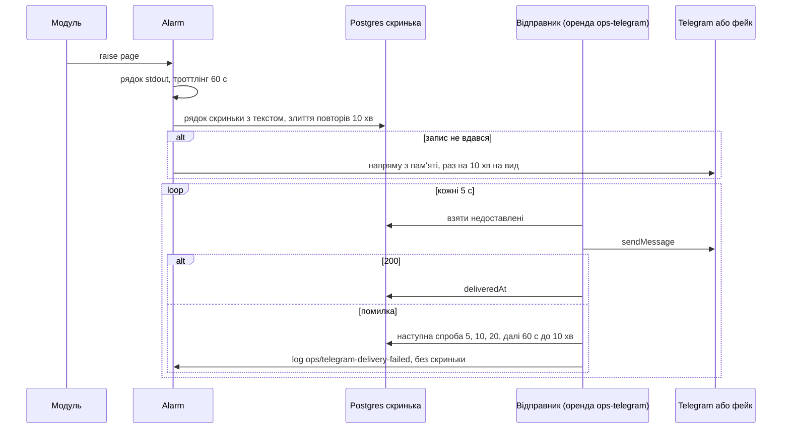
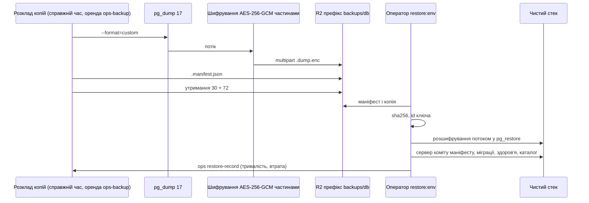

# Spec: Тривоги в Telegram із щогодинним «усе гаразд» і ранковим підсумком, реєстр «тривоги й метрики», моніторинг ночі на одному екрані, шифровані копії бази в R2 із заміряним відновленням, лічильники витрат платних сервісів
Spec ID: SPEC-13b
Status: approved
Supersedes: none

## Джерела

**Хвиля й вимоги:**
- Хвиля: `D:/Work/Pets/Time2Fest/specs/002-backend/waves.md:263-271` (SPEC-13b); реєстр власників `waves.md:532`; ризики К2 `:1016`, В1 `:1021`, Д3 `:1033`; справа власника пн 30.11 `:939`; передачі до 13b від SPEC-04/07/08/09/12/13a — `waves.md:239`, `:257`, `:1046`, `:1066`, `:1077`, `:1092`.
- Вимоги (5): FR-OPS-01 (`specs/002-backend/spec.md:913`), FR-OPS-02 (`:914`), NFR-11 (`:897`), NFR-12 (`:898`), NFR-13 (`:965`). Реалізує доставку інтерфейсу FR-PLAT-12 (`:496`). Перелік `page`-тривог FR-OPS-08 (`:920`) цілком належить SPEC-22a; тут — лише механізм і рядки вже злитих хвиль.
- Нотатки досліджень (2026-11-24): `research-code.md`, `research-docs.md` у теці нотаток сесії `spec-13b/` — далі «нотатки коду», «нотатки документів».

**Рішення власника:** `D:/Work/Pets/Time2Fest/docs/decision.md:512` («нічні тривоги — лише Telegram»), `:371` (Telegram і повний зріз — 13b), `:436` (режим без нагляду), `:154`, `:508` (стеля AI $50/ніч, $100/міс, тривоги 50/80 %), `:64` (2026-11-22: власник «закрив» бота Telegram і тестовий канал). Власник спить і наперед погодив усю хвилю; питання першого проходу прийнято за замовчуванням оркестратора і не блокують.

## Рішення власника

- **В1 (відповідь 12).** Нічні тривоги доходять до власника **лише** в Telegram; пошта для тривог не використовується. → AC-1 … AC-17.
- **В2.** Стеля AI — $50 за ніч і $100 за місяць, тривоги 50 % (`log`) і 80 % (`page`); суми — параметри конфігурації (SPEC-09). Ця хвиля лише показує їх у загальному реєстрі витрат і не дублює тривоги. → AC-60, AC-61.
- **В3.** Будь-яка робота з DNS, платним, видаленням чи робочими ключами — лише після «так» власника (`docs/services/README.md`). Тому в цій хвилі: жодного живого повідомлення в Telegram, жодного робочого бакета R2, жодної платної машини. → AC-15, AC-48, AC-54, NFR-5.

## Питання власнику (перший прохід, не блокують)

- **[Q1]** Бот і канали Telegram: `decision.md:64` каже «закрито», `docs/services/telegram.md` — «бота не створено». Де лежать токен і id чатів? — прийнято за замовчуванням: хвиля працює **лише з фейком** `fakes/telegram/`; справжній адаптер за тим самим портом вмикається змінними `T2F_TELEGRAM_BOT_TOKEN`, `T2F_TELEGRAM_CHAT_ID`, `T2F_TELEGRAM_TEST_CHAT_ID`; перше живе повідомлення — у тестовий канал після злиття, за словом власника (передача оркестратору / SPEC-22b).
- **[Q2]** Час контрольних повідомлень — прийнято за замовчуванням: щогодини о :00 UTC протягом свята (правило `isCelebrating` з `@time2fest/rules`); поза святом — один ранковий підсумок о 09:00 за Києвом.
- **[Q3]** Ключ шифрування копій — прийнято за замовчуванням: 32 байти в `T2F_BACKUP_KEY` лише на вузлі й у сховищі оператора; власник тримає офлайн-копію (папір або менеджер паролів). Втрата ключа = копії не відновити.
- **[Q4]** Розклад і зберігання копій — прийнято за замовчуванням: щодня о 03:00 UTC; щогодини з 26.12 00:00 до 02.01 23:59 за Києвом; зберігаємо 30 щоденних і 72 годинні; видаляємо лише власні об'єкти під `backups/db/`.
- **[Q5]** Redis не копіюється (присутність, ліміти, добова сіль — тимчасові) — прийнято за замовчуванням: так; правило «без `edge:salt:*`» закріплено тестом на майбутнє.
- **[Q6]** Замір відновлення на чистій машині DigitalOcean (платна тимчасова машина) — прийнято за замовчуванням: у цій хвилі замір на чистому локальному стеку Docker з реальної копії репетиції; замір на чистій машині DO — після «так» власника, разом із повторним заміром на остаточній схемі (SPEC-22b, Д3).
- **[Q7]** Витрати на сервер — прийнято за замовчуванням: оцінка з конфігурації ($12/міс) плюс години нічних розмірів, які записує команда оператора; викликів API DigitalOcean ця хвиля не робить.
- **[Q8]** Постійна зовнішня перевірка походження (FR-OPS-08 «сервер недоступний») — прийнято за замовчуванням: **переноситься в SPEC-22a** ([А14]); до того тиша щогодинного «усе гаразд» є сигналом для власника.

## Рішення сесії

Кожне — рішення сесії, ведучий хвилі може змінити. Кожне має AC або NFR, де воно перевіряється.

**Доставка**
- **[А1] Обгортка, не заміна.** Порт `Alarm` (`server/src/ports.ts:14-26`) не змінюється. Нова реалізація обгортає наявний `createAlarm` (`server/src/platform/logger.ts:83`): рядок stdout і троттлінг 60 с лишаються як є; додаються стоки «сховище» (усі рівні) і «Telegram» (лише `page`). `raise` і далі ніколи не кидає (SPEC-02 AC-56). → AC-1, AC-2
- **[А2] Скринька в Postgres.** `page` спершу записується в скриньку доставки (`alarm-deliveries`), потім її розсилає відправник раз на 5 с під орендою `ops-telegram` (той самий механізм, що `createPgLiveLease`, `server/src/adapters/payloadLive.ts:418`). Переживає перезапуск і другий екземпляр. → AC-2, AC-3, AC-8
- **[А3] Повтори в межах 60 с, далі — до 10 хв.** Спроби через 5, 10, 20 с, далі кожні 60 с до 10 хв від підняття; `429` — чекати `retry_after`; `400`/`403` від Telegram (чат не той, бота вигнали) — без повторів. Остаточна невдача → `log`-тривога `ops/telegram-delivery-failed`, яка **ніколи** не йде в скриньку (без рекурсії). → AC-4, AC-5
- **[А4] Злиття повторів і стеля зливи.** Той самий `source`+`code` протягом 10 хв після надісланого повідомлення — нове не шлеться, зростає лічильник; наступне повідомлення цього виду несе «повторилось N разів». Загальна стеля — 20 повідомлень за 10 хв на середовище; надлишок — одним підсумком. → AC-6, AC-7
- **[А5] Текст** — українською, звичайний текст без `parse_mode`, ≤1 000 символів; деталі — лише ключі з білого списку рядка реєстру; жодних email, IP, ніків, текстів повідомлень, токенів. → AC-10, AC-11
- **[А6] Маршрут за класом середовища:** `test` — лише фейк на loopback; `rehearsal` — лише тестовий канал (`T2F_TELEGRAM_TEST_CHAT_ID`), чат власника ігнорується; `production` — чат власника. → AC-13, AC-14
- **[А7] `log`-тривоги зберігаються** (колекція `log-alarms`, 30 днів) і йдуть у ранковий підсумок; окремо не шлються. → AC-12, AC-20

**Контрольні повідомлення**
- **[А8] Справжній час.** Контрольні повідомлення, копії, утримання, межі вікна 26.12–02.01 і лічильники витрат рахуються за **справжнім настінним годинником** (`realClock`, `server/src/clock`), ніколи за віртуальним годинником сезону SPEC-07 (`clockFor`). Прискорений чи зсунутий тестовий годинник не міняє розкладу. → AC-22
- **[А9] Вікно свята** — `isCelebrating(realNow, zones)` з `packages/rules/src/time/celebration.ts:9` (перша північ −2 год … остання +2 год) на зонах каталогу; без каталогу — запасне вікно 31.12 08:00 UTC – 01.01 14:00 UTC. → AC-18, AC-19

**Реєстр і моніторинг**
- **[А10] Реєстр «тривоги й метрики»** — кодовий `server/src/registries/ops.ts`: рядок на домен (`clock`, `scheduler`, `catalog`, `site`, `live`, `moderation`, `ops`, `telegram`, `spend`, `platform`, і зарезервовані `edge`, `payments`, `chat`, `presence`, `mail`, `toasts`). Кожен рядок — коди тривог (рівень, значення, що робити, білий список деталей) і постачальники метрик. Сканер-тест змушує кожну наступну хвилю додати рядок. → AC-24 … AC-29
- **[А11] Зріз «Моніторинг»** — слот `50-ops` (`server/src/registries/adminSlots.ts`), шаблон `LiveSlice`: опитування `GET /cms-api/ops/overview` раз на 5 с у видимій вкладці; лише `owner`; кожен блок незалежний (як `festivalState`, `server/src/scheduler/festival.ts:92`). Ролі «оператор» в адмінці немає — оркестратор читає те саме командою `ops status` на вузлі. → AC-30 … AC-38
- **[А12] Облік R2 обгорткою `ObjectStore`.** Один лічильник операцій класу A/B і «остання вдала / невдала копія» за префіксом (`catalog`, `site`, `live`, `backups`) — дає і метрику «остання копія в R2», і лічильник Cloudflare. → AC-39, AC-64

**Копії**
- **[А13] Де робиться копія.** У процесі сервера: тікер (`server/src/unattended/ticker.ts`) під орендою `ops-backup`, `pg_dump` клієнтом PostgreSQL 17, доданим в образ сервера; дамп іде потоком через шифрування в R2 без відкритого тексту на диску. Причина: одне місце для тривог, метрик, оренди й журналу; другий вузол (`server2`) копію не дублює. Якщо план знайде, що образ росте неприйнятно, — бічний контейнер у `infra/ops/node/compose.yml` з тими самими вимогами (AC-40 … AC-52). → AC-40, AC-47
- **[А14] Зовнішня перевірка походження — у SPEC-22a.** Причини: (1) у Worker краю немає `scheduled` і немає місця для токена бота — це друге місце для секрету й нова поверхня розгортання краю у всіх середовищах; (2) повний перелік FR-OPS-08 належить 22a (16–17.12, до запуску); (3) розмір хвилі M. Тут: зарезервований рядок `edge/origin-down` (`page`, власник SPEC-22a) і правило «тиша контрольного повідомлення = канал або сервер зламано». → AC-29, Передачі
- **[А15] Шифрування — AES-256-GCM частинами** у Node `crypto` (без залежностей, однаково в сервері й `infra/ops`): заголовок формату з версією та id ключа, частини по 64 КіБ із власним nonce і тегом, номер частини й прапор «остання» в AAD (захист від обрізання й перестановки). `age` відхилено: потребує бінарника чи бібліотеки на обох боках. → AC-41
- **[А16] Втрата даних** вимірюється як найбільший проміжок між моментами знімка двох сусідніх успішних копій (знімок = початок `pg_dump`); у годинному вікні ≤60 хв. Повна найгірша втрата — проміжок плюс тривалість копії (на нинішньому розмірі — хвилини); див. Design review п. 6. → AC-57, NFR-2
- **[А17] Команди.** Сервер: `pnpm --dir server ops <status|backup-now|restore-record|spend-record>` (`server/src/cli/ops.ts`). Оператор: `pnpm backup:env` і `pnpm restore:env` (`infra/ops/ops.mjs` підкоманди `backup`, `restore`; виконання на вузлі — наявним шляхом `exec`). → AC-38, AC-52, AC-53, AC-63

**Витрати**
- **[А18] Реєстр витрат** — рядки `ai`, `mail`, `server`, `cloudflare`, `youtube`; місячний період UTC (AI — і ніч, як SPEC-09). Пороги 50 % `log` / 80 % `page`, кожен раз на період на весь кластер (умовне оновлення, як `claimAlarm` у `server/src/adapters/pgAiSpend.ts:71`). Стелі — параметри глобалу `ops-settings` з типовими значеннями. → AC-60 … AC-66

## Problem and user

**Власник** спить у новорічну ніч. Сьогодні тривога — лише рядок stdout (`createAlarm`, `server/src/platform/logger.ts:83`): її ніхто не прочитає, доки власник не відкриє логи. `page` зберігаються без деталей і видні лише в зрізі «Режим без нагляду»; `log` не зберігаються зовсім (нотатки коду §1). Якщо зламається сам канал, власник про це не дізнається.

**Стан ночі** розкиданий по п'яти зрізах (Стан свята, Ефір, Модерація, Стан сайту, Режим без нагляду); загального екрана з тривогами, затримкою планувальника, розбіжністю часу, квотою й витратами немає.

**База** живе в одному томі Docker на одному вузлі (`infra/ops/node/compose.yml`, том `pgdata`); копій немає взагалі (нотатки коду §5). Втрата вузла посеред свята — втрата паспортів, штампів, оплат.

**Витрати** рахуються лише для AI (SPEC-09); сервер, Cloudflare, листи — ніде.

Користувачі:
- **власник** — отримує тривоги й «усе гаразд» у Telegram, бачить один екран, певен у копіях;
- **оркестратор** — читає стан командою на вузлі, відновлює базу однією командою;
- **хвилі після 13b** — додають рядок у реєстр і перевіряють свої тривоги в тестовому каналі.

## Goals / Non-goals

**Goals**
- `page` доходить у Telegram ≤60 с; переживає перезапуск, другий екземпляр, 429 і зливу; невдача доставки — у журнал без рекурсії.
- Щогодинне «усе гаразд» у свято, ранковий підсумок щодня.
- Реєстр «тривоги й метрики» з рядком на домен і сканером, що не пропускає незареєстрований код; помічник «тривога доходить у тестовий канал».
- Зріз «Моніторинг» з метриками злитих хвиль (час, планувальник, каталог, стан сайту, ефір, модерація й AI, копії, Telegram, витрати); чого ще немає — «немає даних».
- Шифровані копії бази в R2 щодня, з 26.12 по 02.01 щогодини; утримання; тривоги збою й застарілості.
- Відновлення однією командою на чистий стек із заміром: ≤60 хв, втрата ≤1 год.
- Лічильники витрат AI, листів, сервера, Cloudflare (+ квота YouTube) з порогами 50/80 %.

**Non-goals**
- Жодного живого повідомлення в Telegram і жодного виклику `api.telegram.org` у цій хвилі ([Q1]).
- Робочий бакет і префікс R2, робочі ключі — SPEC-22b.
- Постійна зовнішня перевірка походження — SPEC-22a ([А14]).
- Повний перелік тривог FR-OPS-08, правила сну, матриця відмов NFR-14 — SPEC-22a; ця хвиля дає механізм.
- Метрики й тривоги оплат, чату, присутності, листів, тостів, помилок плеєрів за містами — хвилі 15–19 додають рядки (FR-OPS-01 частково; Traceability).
- Копія Redis — ні ([Q5]).
- Замір на чистій машині DO — після «так» власника ([Q6]).
- Виклики API DigitalOcean чи білінгу Cloudflare для витрат — ні ([Q7]); Cloudflare — лише власний облік операцій R2.
- Видима зміна сайту — немає; `layout-fidelity` пропускається (AC-70).
- Prometheus, Grafana, сторонній моніторинг — ні.

## User stories

- **US-1.** Як власник, я отримую в Telegram українською тривогу `page` не пізніше ніж за 60 с — одну, а не сотню, — і знаю, що зробити.
- **US-2.** Як власник, я щогодини в ніч свята бачу «усе гаразд» і розумію, що тиша означає поломку каналу чи сервера; зранку бачу підсумок `log`-тривог.
- **US-3.** Як власник, я на одному екрані бачу відкриті тривоги (і підтверджую їх), затримку планувальника, розбіжність часу, квоту, стан сайту, AI, копії, Telegram і витрати.
- **US-4.** Як власник, я певен, що база копіюється зашифрованою в R2 і відновлюється за ≤60 хв із втратою ≤1 год.
- **US-5.** Як власник, я бачу витрати кожного платного сервісу проти стелі й отримую тривогу на 80 %.
- **US-6.** Як автор наступної хвилі, я додаю рядок у реєстр і одним помічником перевіряю, що моя тривога доходить у тестовий канал.
- **US-7.** Як оркестратор, я читаю стан моніторингу командою на вузлі й відновлюю базу однією командою.

## Acceptance criteria (EARS)

**Пакети:**
- `server` — `server/`; сюди ж `fakes/telegram/` (перевіряє інтеграційний набір сервера);
- `infra` — `infra/ops/` (команди `backup`, `restore`, приклади змінних вузла);
- `docs-patch` — документи поза репозиторієм (`D:/Work/Pets/Time2Fest/docs/`), чернетка — файл `docs-patch.md` у теці нотаток сесії `spec-13b/`.

**Терміни:**
- **Вид тривоги** — пара `source` + `code`, як її передано в `raise`.
- **Скринька** — колекція `alarm-deliveries` у Postgres.
- **Фейк** — `fakes/telegram/server.mjs`.
- **Тестовий канал** — у тестах фейк; на репетиції — `T2F_TELEGRAM_TEST_CHAT_ID`.
- **Справжній час** — `realClock` ([А8]).
- **Вікно свята** — [А9]. **Годинне вікно копій** — 26.12 00:00 … 02.01 23:59 `Europe/Kyiv`.
- **Префікс копій** — `<T2F_R2_PREFIX>backups/db/`.
- **Чистий стек** — новий Compose-проєкт із новими томами, жодного рядка в базі.

**Де брати доказ:** «локально» — стенд `local-stack` (Postgres, Redis, s3mock `r2`); «exclusive» — набір `*.exclusive.test.ts` із замком; підставлений час — ін'єкція настінного годинника в модулі `ops`.

### Доставка тривог (FR-PLAT-12, FR-OPS-02)

**AC-1 [server]** The `Alarm` implementation shall для кожного `raise` писати той самий рядок stdout, що й нині (`level:'alarm'`, троттлінг 60 с, `suppressed`), і не кидати, навіть коли сховище, скринька і Telegram недоступні.
Verify: unit — підставні стоки кидають і зависають: `raise` повертається синхронно, рядок stdout ідентичний знімку до хвилі.

**AC-2 [server]** WHEN піднято тривогу рівня `page`, the server shall записати в скриньку рядок із видом, рівнем, очищеними деталями (AC-11) і готовим текстом (AC-10) та доставити його в тестовий канал не пізніше ніж за 60 с від `raise`.
Verify: integration — `POST /api/_test/alarm` рівня `page` → фейк отримав одне `sendMessage` ≤60 с; рядок скриньки має `deliveredAt`.

**AC-3 [server]** IF процес зупинився, поки рядок скриньки не доставлено, THEN the next process shall доставити його не пізніше ніж за 60 с після старту, рівно один раз.
Verify: integration — фейк `down`, тривога, зупинка процесу, фейк `up`, новий процес → одне повідомлення.

**AC-4 [server]** IF Telegram відповів помилкою мережі чи 5xx, THEN the sender shall повторити через 5, 10 і 20 с, далі кожні 60 с до 10 хв від `raise`; на `429` — не раніше `retry_after`; на `400` і `403` — без повторів.
Verify: unit — підставний годинник і відповіді: моменти спроб точні; `400` → одна спроба.

**AC-5 [server]** IF доставку рядка остаточно не вдалося, THEN the server shall позначити рядок `failed`, записати рядок журналу `ops.telegram-delivery-failed` і підняти `log`-тривогу `ops/telegram-delivery-failed` — не частіше разу на 10 хв — яка не потрапляє в скриньку.
Verify: integration — фейк `down` 11 хв (підставний час): одна `log`-тривога, рядок журналу, жодного нового рядка скриньки від неї; без нескінченного циклу.

**AC-6 [server]** WHEN той самий вид `page` піднято знову протягом 10 хв після надісланого повідомлення, the server shall не слати нового повідомлення, а збільшити лічильник повторів; наступне повідомлення цього виду після 10 хв shall містити «повторилось N разів».
Verify: unit — 50 підйомів `scheduler/lag` за 10 хв → 1 повідомлення; підйом на 11-й хв → друге з «повторилось 49 разів».

**AC-7 [server]** WHILE за останні 10 хв надіслано 20 повідомлень тривог, the server shall не слати нових окремо, а через 10 хв надіслати одне підсумкове «ще N тривог, див. Моніторинг» із переліком доменів.
Verify: unit — 40 різних видів за хвилину → 20 повідомлень + 1 підсумок.

**AC-8 [server]** WHILE працюють два екземпляри сервера, the system shall доставляти кожен рядок скриньки рівно один раз (оренда `ops-telegram`).
Verify: integration (exclusive) — два процеси, 30 тривог → 30 повідомлень у фейку, дублікатів 0.

**AC-9 [server]** IF запис у скриньку не вдався (Postgres недоступний), THEN the process shall надіслати тривогу напряму з пам'яті не частіше разу на 10 хв на вид у процесі й записати рядок stdout `alarm_outbox_failed`.
Verify: integration (exclusive, deps-down) — Postgres зупинено, `page` → фейк отримав повідомлення ≤60 с.

**AC-10 [server]** The alarm message shall бути звичайним текстом українською без `parse_mode`, ≤1 000 символів: позначка «ТРИВОГА», клас середовища, назва домену й значення з реєстру, що робити, час за Києвом і UTC, деталі з білого списку, підказка «Підтвердити: адмінка → Моніторинг».
Verify: unit — знімки тексту для 3 видів; довгі деталі обрізано до 1 000 символів.

**AC-11 [server]** The alarm text and stored details shall містити лише ключі з білого списку рядка реєстру зі значеннями-числами чи кодами ≤64 символів; email, IP, ніки, тексти повідомлень, токени й URL із токенами — ніколи.
Verify: unit — деталі з підкладеними email, IPv4/IPv6, текстом і значенням тестового токена → у тексті й рядку скриньки їх немає.

**AC-12 [server]** WHEN піднято тривогу рівня `log`, the server shall зберегти її в `log-alarms` (вид, очищені деталі, час) і видаляти записи, старші за 30 днів; окремого повідомлення не слати.
Verify: integration — `log`-тривога → рядок у колекції, у фейку нуль повідомлень; прибирання з підставним часом видаляє 31-денні.

**AC-13 [server]** The Telegram sink shall обирати отримувача за класом: `test` — лише `T2F_TELEGRAM_API_BASE` на loopback; `rehearsal` — лише `T2F_TELEGRAM_TEST_CHAT_ID`; `production` — лише `T2F_TELEGRAM_CHAT_ID`.
Verify: unit — матриця класів і змінних: на репетиції заданий чат власника ігнорується з одним рядком попередження; у `test` нелокальна адреса → сток вимкнено.

**AC-14 [server]** IF токен чи потрібний id чату не задано, THEN the server shall стартувати з вимкненим стоком Telegram, записати один рядок `ops/telegram-not-configured` і показувати «Telegram: не налаштовано» в моніторингу; WHERE клас `production`, the env check shall вимагати `T2F_TELEGRAM_BOT_TOKEN` і `T2F_TELEGRAM_CHAT_ID` (як і `T2F_BACKUP_KEY` за AC-67).
Verify: unit — `env.check` для `production` без змінних → відмова з назвами змінних; `rehearsal` без них → старт.

**AC-15 [server]** The real adapter shall надсилати `POST <api base>/bot<token>/sendMessage` з `chat_id`, `text`, `disable_web_page_preview:true` по HTTPS з тайм-аутом 10 с і ніколи не писати токен чи URL з ним у логи, помилки, журнал чи скриньку.
Verify: unit — справжній адаптер проти фейка: тіло точне; примусова помилка мережі → у логах немає значення токена.

**AC-16 [server]** The fake shall емулювати `sendMessage` (200, 400 «chat not found», 403, 429 з `retry_after`, 5xx) і мати `/_control/{calls,down,mode,reset}`, лише на `127.0.0.1`, без залежностей, як `fakes/youtube/server.mjs`.
Verify: integration — набір фейка: кожен режим дає очікувану відповідь; `calls` повертає отримані повідомлення.

**AC-17 [server]** The test suites shall падати на будь-якій спробі мережевого запиту до `api.telegram.org`, а CI не має змінних `T2F_TELEGRAM_*`.
Verify: integration — запобіжник мережі; перевірка `.github/workflows/verify.yml` на відсутність змінних.

### Контрольні повідомлення й ранковий підсумок (FR-OPS-02)

**AC-18 [server]** WHILE справжній час у вікні свята, the server shall щогодини о :00 UTC (і в мить початку вікна) надсилати в тестовий канал «Усе гаразд» або «Зв'язок працює; відкритих тривог: N» з класом середовища, кількістю відкритих `page`, віком останньої копії й станом доставки.
Verify: unit — підставний час 31.12 07:00 … 01.01 15:00 UTC на зонах сиду: повідомлення рівно в 08:00, 09:00 … 14:00; текст за знімком.

**AC-19 [server]** IF зони каталогу недоступні, THEN the heartbeat shall брати запасне вікно 31.12 08:00 UTC – 01.01 14:00 UTC і писати рядок `ops/heartbeat-fallback-window`.
Verify: unit — підставне сховище каталогу кидає → розклад за запасним вікном.

**AC-20 [server]** The server shall щодня о 09:00 `Europe/Kyiv` надсилати ранковий підсумок: кількість `log`-тривог за 24 год за доменами (до 10 найчастіших видів), відкриті `page`, вік останньої копії, відсотки витрат, що перевищили 50 %.
Verify: integration — сид 7 `log`-тривог трьох доменів, підставний час 09:00 Києва → одне повідомлення з точними числами.

**AC-21 [server]** The system shall надсилати рівно одне контрольне повідомлення на годинний слот і один підсумок на добу на весь кластер (оренда `ops-heartbeat` і унікальний ключ слоту); IF слот пропущено через перезапуск, THEN надіслати його, якщо минуло ≤10 хв, інакше пропустити з рядком журналу.
Verify: integration (exclusive) — два екземпляри → одне повідомлення на слот; перезапуск о :05 → догнано, о :15 → пропуск і рядок.

**AC-22 [server]** The heartbeat, digest, backup schedule, retention and spend periods shall рахуватися за справжнім часом, незалежно від швидкості й зсуву тестового годинника SPEC-07.
Verify: unit — тестовий годинник ×60 і зсув на 31.12: розклад модулів `ops` не змінився.

**AC-23 [server]** The monitoring shall показувати час останнього доставленого контрольного повідомлення, і WHILE у вікні свята минуло понад 70 хв без доставки, the monitoring shall позначити блок Telegram червоним.
Verify: unit — вигляд блоку з підставними даними.

### Реєстр «тривоги й метрики» (FR-OPS-01, FR-PLAT-12, правило В1 карти)

**AC-24 [server]** The registry `server/src/registries/ops.ts` shall мати рядок на домен (`clock`, `scheduler`, `catalog`, `site`, `live`, `moderation`, `ops`, `telegram`, `spend`, `platform`, а також зарезервовані `edge`, `payments`, `chat`, `presence`, `mail`, `toasts` з хвилею-власником), відсортований, з `assertRegistry`; кожен код — рівень, значення й дія українською, білий список деталей.
Verify: unit — `assertRegistry`: сортування, унікальність видів, непорожні тексти.

**AC-25 [server]** The registry shall містити кожен вид, що піднімається сьогодні, з рівнями таблиці «Початкові рядки» нижче, включно з передачами SPEC-07/08/09/12.
Verify: unit — порівняння з таблицею.

**AC-26 [server]** The scanner test shall знаходити кожен рядковий літерал коду, переданий у `alarm.raise` чи помічник тривог у `server/src`, і падати з `файл:рядок`, якщо виду немає в реєстрі.
Verify: unit — сканер на чистому дереві зелений; підкладений файл із `raise({source:'x', code:'y'})` → падіння з назвою файлу.

**AC-27 [server]** IF піднято незареєстрований вид, THEN the server shall доставити його з доменом «невідомо» і, WHERE клас `test`, записати в `log-alarms` позначку `ops/unregistered-alarm`, яку інтеграційний набір перевіряє наприкінці (нуль).
Verify: integration — підйом незареєстрованого виду дверцятами → позначка є; перевірка кінця набору її ловить.

**AC-28 [server]** The test helper `expectAlarmInTestChannel(kind, trigger)` shall запускати тригер і чекати у фейку повідомлення з назвою домену й значенням із реєстру ≤60 с; ця хвиля перевіряє ним по одному виду з кожного злитого домену й усі свої коди `ops/*`, `spend/*`.
Verify: integration — помічник зелений для `clock/edge-divergence`, `scheduler/lag`, `catalog-r2-copy-failed` (код каталогу SPEC-04), `site/rebuild-failed`, `live/quota-80`, `mod/spend_80`, `ops/backup-failed`, `ops/backup-stale`, `spend/cloudflare-80`.

**AC-29 [server]** The registry shall позначати `site/publish-failed` і `live/publish-failed` як `log`-тривоги (крім наявного рядка `warn`), а `*-skipped`, `rebuild-frozen`, `rebuild-disabled`, `rebuild-not-configured` — як «інфо, не тривога»; `edge/origin-down` — зарезервовано, `page`, власник SPEC-22a.
Verify: unit — рядки реєстру; integration — збій публікації realtime → одна `log`-тривога.

### Моніторинг (FR-OPS-01)

**AC-30 [server]** The admin dashboard shall мати слот `50-ops` «Моніторинг», доступний лише ролі `owner`; ролям агентів — `403 forbidden` на `/cms-api/ops/*`.
Verify: integration — запити з роллю `content-agent`, `stream-agent` → 403; `owner` → 200; тест `admin-slots` бачить новий слот.

**AC-31 [server]** WHEN надходить `GET /cms-api/ops/overview`, the server shall відповідати блоками `alarms`, `logAlarms`, `time`, `scheduler`, `catalog`, `site`, `live`, `moderation`, `backups`, `telegram`, `spend`, `pending`; збій одного постачальника дає `errors:[<блок>]` і не ламає решту.
Verify: integration — постачальник `live` кидає → 200, `errors:['live']`, інші блоки заповнено.

**AC-32 [server]** The monitoring shall показувати відкриті `page`-тривоги (до 100, нові зверху) з деталями й кнопкою «Підтвердити» через наявний `POST /cms-api/alarms/:id/acknowledge`; підтвердження видно ≤5 с.
Verify: integration — сид 2 тривог, підтвердження однієї → у наступному опитуванні одна.

**AC-33 [server]** The monitoring shall показувати `log`-тривоги за 24 год, згруповані за доменом і видом, з кількістю й часом останньої.
Verify: unit — вигляд із підставними даними.

**AC-34 [server]** The monitoring shall показувати метрики злитих хвиль: розбіжність часу краю й сервера (SPEC-07, поріг 250 мс), затримку й оренду планувальника (`SchedulerHandle.status()`, поріг 2 с), версію каталогу й останню копію R2 (AC-39), стан сайту й вимикачі (SPEC-08), квоту YouTube у відсотках і застарілість статусів (SPEC-12), стан постачальників AI і витрати ночі й місяця (SPEC-09), копії (AC-56), Telegram (AC-23) і витрати (AC-60).
Verify: integration — локально з сидом: кожна метрика збігається з наявним зрізом свого домену.

**AC-35 [server]** WHERE метрики FR-OPS-01 ще немає в коді (помилки плеєрів за містами, автоперемикання, чат, оплати, вебхуки, автопауза, перебір карток, повернення, присутність, підключення realtime, черга модерації, листи, PayPro), the monitoring shall показувати рядок «немає даних» із хвилею-власником з реєстру й не вигадувати числа.
Verify: unit — блок `pending` збігається з зарезервованими рядками реєстру.

**AC-36 [server]** The overview response shall бути ≤64 КБ, з `Cache-Control: no-store`, без значень секретів, і зріз опитує її раз на 5 с лише у видимій вкладці.
Verify: unit — серіалізований зразок; integration — пошук значень тестових секретів у відповіді → нуль.

**AC-37 [server]** The monitoring texts shall лежати в `server/src/admin/messages.ts`, вигляд — чиста функція `OpsView` з `data-testid` на кожному блоці.
Verify: unit — рендер `OpsView` із підставними даними; рядків українською поза `messages.ts` — нуль (grep).

**AC-38 [server]** WHEN оператор запускає `pnpm --dir server ops status` на вузлі, the command shall друкувати той самий огляд у JSON без секретів і нічого не змінювати.
Verify: integration — команда проти локального стека: JSON проходить ту саму схему, що відповідь AC-31.

**AC-39 [server]** The R2 object store shall рахувати операції класу A (запис, список, multipart, видалення) і класу B (читання, `head`) і запам'ятовувати останню вдалу й невдалу операцію за префіксом (`catalog`, `site`, `live`, `backups`).
Verify: unit — обгортка над підставним сховищем: лічильники й час точні; integration — копія каталогу в s3mock збільшує клас A на 1.

### Копії бази (NFR-11)

**AC-40 [server]** The backup job shall запускатися за справжнім часом щодня о 03:00 UTC, а в годинному вікні копій — щогодини о :00 `Europe/Kyiv`; не більше однієї копії водночас на кластер (оренда `ops-backup`).
Verify: unit — розклад на 25.12 … 03.01 із підставним часом: 1 копія на добу поза вікном, 24 у вікні; integration (exclusive) — два екземпляри → одна копія на слот.

**AC-41 [server]** The backup shall бути `pg_dump --format=custom` бази сервера, зашифрованим потоком AES-256-GCM частинами за [А15] ключем `T2F_BACKUP_KEY` (32 байти base64), без відкритого тексту на диску й у R2.
Verify: unit — шифрування/розшифрування 200 МБ: збіг; обрізаний, переставлений чи змінений файл → відмова; integration — у s3mock перші байти — заголовок формату, не `PGDMP`.

**AC-42 [server]** IF мажорна версія `pg_dump` не дорівнює мажорній версії сервера Postgres, THEN the backup shall не починатися й підняти `page` `ops/backup-failed` зі `stage:'version'`.
Verify: unit — підставні версії 16 і 17 → тривога; 17 і 17 → копія.

**AC-43 [server]** The backup shall вивантажувати шифрований файл у `<префікс копій><UTC yyyymmddThhmmssZ>.dump.enc` (multipart для >16 МБ) і **після** нього — маніфест `<…>.manifest.json`: розмір, sha256 шифрованого файлу, id ключа, час початку знімка, тривалість, версія Postgres, остання міграція, кількість рядків ключових колекцій, коміт сервера.
Verify: integration — копія в s3mock: обидва об'єкти; sha256 і розмір збігаються з фактом.

**AC-44 [server]** IF будь-який крок копії зазнав невдачі, THEN the backup shall перервати multipart, не писати маніфест, підняти `page` `ops/backup-failed` з `stage` (`version`, `dump`, `encrypt`, `upload`, `manifest`) і записати рядок журналу.
Verify: integration (exclusive, r2-down) — s3mock зупинено → тривога `stage:'upload'`, маніфесту немає, незавершених частин немає.

**AC-45 [server]** WHILE остання успішна копія старша за 26 год (поза годинним вікном) або за 2 год (у ньому), the server shall піднімати `page` `ops/backup-stale` (перевірка раз на 10 хв).
Verify: unit — підставний час і маніфести: межі 26 год і 2 год точні.

**AC-46 [server]** The retention shall лишати 30 найновіших щоденних і 72 найновіші годинні копії, видаляти лише пари об'єктів під префіксом копій, чия назва відповідає шаблону, ніколи не видаляти найновішу успішну копію й писати рядок журналу на кожне видалення.
Verify: unit — 40 щоденних + 100 годинних + чужий об'єкт `catalog/x.json` → видалено 10 + 28 пар, чужий цілий.

**AC-47 [server, infra]** The server image shall містити клієнт PostgreSQL мажорної версії 17 (= `postgres:17.12-alpine` вузла), а `/api/health` shall лишатися 200 під час копії.
Verify: integration — `pg_dump --version` в образі → 17.x; опитування здоров'я раз на 1 с під час копії сиду — без 503.

**AC-48 [server]** The backup shall писати лише в бакет і префікс свого середовища (`T2F_R2_BUCKET`, `T2F_R2_PREFIX`) з наявними захистами `PRODUCTION_DENYLIST` / `PRODUCTION_NAMES` (`server/src/platform/env.ts:40`, `:59`); у класі `test` — лише s3mock на loopback; без `T2F_BACKUP_KEY` копія не стартує й один раз піднімає `page` `ops/backup-not-configured` (`rehearsal`, `production`).
Verify: unit — матриця класів; `rehearsal` з бакетом `time2fest-prod` → відмова старту (наявний захист).

**AC-49 [server]** The Redis data shall не копіюватися; помічник `redisCopyFilter` shall відкидати ключі `*edge:salt:*` для будь-якої майбутньої копії Redis.
Verify: unit — фільтр на ключах `t2f:production:edge:salt:2026-12-31`, `t2f:x:rl:…` → сіль відкинуто.

**AC-50 [server]** The S3 adapter shall отримати лише додаванням `get` (потік), `head`, `list(prefix)` і multipart-вивантаження; наявні `put` і `delete` не змінюються.
Verify: unit — тип `ObjectStore` розширено; наявні набори каталогу, сайту й ефіру зелені без змін.

**AC-51 [server]** WHEN копію завершено, the server shall записати рядок `backup-runs` (ключ, розмір, тривалість, результат) для моніторингу й ранкового підсумку.
Verify: integration — після копії рядок є, монітор показує вік і розмір.

**AC-52 [server, infra]** WHEN оператор запускає `pnpm backup:env -- --env rehearsal --now` (на вузлі — `ops backup-now`), the system shall зробити позачергову копію з тими самими правилами й надрукувати ключ і маніфест.
Verify: integration — локально проти стека: ключ надруковано, маніфест є.

### Відновлення (NFR-12)

**AC-53 [infra]** WHEN оператор запускає `pnpm restore:env -- --env rehearsal --from <ключ|latest> --target local`, the command shall: завантажити копію й маніфест, перевірити sha256 і id ключа, розшифрувати потоком у `pg_restore` чистого стека, запустити образ сервера коміту з маніфесту, перевірити статус міграцій, здоров'я й каталог, надрукувати тривалість і вікно втрати.
Verify: integration — локально: копія s3mock → чистий стек → кроки зелені, звіт надруковано.

**AC-54 [infra]** IF ціль не чиста (наявні томи чи рядки) або `--env`/`--target` = `production`, THEN the restore shall відмовити до будь-якого завантаження.
Verify: unit — матриця аргументів; підставний «том існує» → відмова.

**AC-55 [infra]** IF sha256 не збігся, id ключа інший або розшифрування не пройшло автентифікацію, THEN the restore shall зупинитися до `pg_restore` і прибрати тимчасові файли.
Verify: integration — змінений байт, чужий ключ → відмова; тимчасова тека порожня.

**AC-56 [infra, server]** WHEN відновлення завершилось, the command shall записати замір у середовище джерела (`ops restore-record` на вузлі: дата, ключ, тривалість, вікно втрати, результат), і моніторинг shall показувати «останнє відновлення: дата, тривалість».
Verify: integration — локально: після команди блок `backups` має замір.

**AC-57 [infra]** The restore smoke shall вважати успіхом: нуль непройдених міграцій для останньої міграції маніфесту, `/api/health` 200 і кількість рядків ключових колекцій = маніфест; вікно втрати = найбільший проміжок між знімками сусідніх успішних копій за 24 год ([А16]).
Verify: unit — обчислення вікна на підставних маніфестах; integration — розбіжність кількості → відмова.

**AC-58 [docs-patch]** The restore measurement shall бути виконано й записано: реальна копія репетиції (R2 `time2fest-rehearsal`) → чистий локальний стек Docker; тривалість ≤60 хв, втрата ≤1 год; дата, розмір, коміт і числа — у `docs/backend/backups.md`.
Verify: manual — замір ведучим хвилі; ручне, бо потрібні справжня копія й секунди.

**AC-59 [infra]** The restore shall не писати розшифрований дамп поза тимчасовою текою цілі й видаляти її в разі успіху, відмови чи переривання.
Verify: integration — переривання посеред `pg_restore` → тимчасова тека відсутня.

### Лічильники витрат (NFR-13)

**AC-60 [server]** The spend registry shall мати рядки `ai`, `mail`, `server`, `cloudflare`, `youtube` з полями: назва, одиниця, період, лічильник, стеля, джерело числа, хвиля-власник; моніторинг показує кожен рядок і відсоток.
Verify: unit — `assertRegistry`; вигляд блоку `spend`.

**AC-61 [server]** The `ai` row shall читати наявні лічильники `ai_spend` (ніч і місяць) і пороги SPEC-09 без нових тривог.
Verify: integration — сид `ai_spend` на 85 % → рядок 85 %, нових тривог `spend/*` нуль.

**AC-62 [server]** WHEN лічильник рядка `server`, `cloudflare` чи `mail` перетинає 50 % / 80 % стелі, the server shall підняти `spend/<рядок>-50` (`log`) / `spend/<рядок>-80` (`page`) рівно один раз на період на весь кластер.
Verify: integration (exclusive) — два екземпляри, перетин 80 % → одна тривога; новий місяць → знову можлива.

**AC-63 [server, infra]** The `server` row shall рахувати базову ціну з `ops-settings` (типово $12/міс; база 12, стеля 40) пропорційно дням плюс записані години додаткових розмірів (`ops spend-record server --hours N --usd-per-hour R --reason …`, рядок журналу); `pnpm capacity` після `night` і `back` записує години.
Verify: unit — 24 год × $0.0833 + база → точна сума; integration — `spend-record` пише рядок журналу.

**AC-64 [server]** The `cloudflare` row shall рахувати вартість як `max(0, A − 1 000 000) × $4.50/млн + max(0, B − 10 000 000) × $0.36/млн + max(0, ГБ − 10) × $0.015` за місяць за власним обліком AC-39 і сумою розмірів маніфестів; ціни й безплатні межі — параметри з цими типовими значеннями; рядок позначено «нижня межа: без читань краю».
Verify: unit — підставні лічильники → точна сума; у межах безплатного → $0.

**AC-65 [server]** The `mail` row shall показувати «немає провайдера» і не піднімати тривог, доки SPEC-17 не підключить лічильник FR-MAIL-06.
Verify: unit — вигляд рядка.

**AC-66 [server]** The spend ceilings, base prices, heartbeat and digest times shall бути параметрами глобалу `ops-settings` з типовими значеннями; зміна — лише `owner`, у транзакції з рядком журналу.
Verify: integration — зміна власником → журнал; агентом → 403.

### Змінні, документи, межі

**AC-67 [server, infra]** The env registry shall отримати рядки `T2F_TELEGRAM_BOT_TOKEN` (secret, `requiredIn` production), `T2F_TELEGRAM_CHAT_ID` (`requiredIn` production), `T2F_TELEGRAM_TEST_CHAT_ID`, `T2F_TELEGRAM_API_BASE` (url), `T2F_BACKUP_KEY` (secret, `requiredIn` production) — відсортовано, з прикладом у `infra/ops/node/server.env.example` і тестом `env-example.test.mjs`.
Verify: unit — `assertRegistry`, `env-example.test.mjs`, `scripts/check-secrets.mjs` зелені.

**AC-68 [server]** The new collections (`alarm-deliveries`, `log-alarms`, `backup-runs`, `restore-runs`, `spend-counters`) і глобал `ops-settings` shall додаватися лише новими міграціями без зміни наявних таблиць, крім додаткового поля `details` у `alarms`.
Verify: integration — `verify-schema` і правила `migration-safety`; міграція вгору й вниз на копії сиду.

**AC-69 [docs-patch]** The docs shall описати нові змінні в `docs/backend/secrets.md`, стан і порядок у `docs/services/telegram.md` (справа власника: токен, чат, тестовий канал; перше живе повідомлення — за словом), розклад, ключ, утримання й відновлення в `docs/backend/backups.md`, таблицю реєстру тривог — у `docs/backend/alarms.md`.
Verify: manual — читання ведучим хвилі; ручне, бо це текст.

**AC-70 [web]** The site shall не мати видимих змін; `layout-fidelity` у цій хвилі пропускається, бо `web/` поза `server/`, `infra/`, `fakes/` не змінюється.
Verify: unit — різниця гілки проти `master` поза `server/`, `infra/`, `fakes/`, `docs/specs/`, `docs/plans/`, `docs/knowledge/`, `package.json`, `.github/` — нуль файлів.

### Початкові рядки реєстру (до AC-25)

| Домен | Вид (`source` / `code`) | Рівень |
|---|---|---|
| clock | `clock/edge-divergence` | page |
| clock | `clock/edge-divergence-warn`, `clock/refresh_failed` | log |
| scheduler | `scheduler/lag`, `scheduler/lease_unreachable` | page |
| scheduler | `scheduler/moments_load_failed`, `scheduler/action_failed` | log |
| catalog | `catalog/catalog-r2-copy-failed` | page |
| site | `site/r2-copy-failed`, `site/rebuild-failed` | page |
| site | `site/purge-failed`, `site/publish-failed`, `site/rebuild_tick_failed` | log |
| live | `live/quota-80`, `live/statuses-stale` (у вікні), `live/r2-copy-failed` | page |
| live | `live/quota-exceeded`, `live/override-kept`, `live/statuses-stale` (поза вікном), `live/purge-failed`, `live/publish-failed`, `live/poller_tick_failed`, `live/viewers_tick_failed` | log |
| moderation | `mod/provider_not_configured`, `mod/moderation_throttled`, `mod/moderation_saturated`, `mod/moderation_fallback`, `mod/spend_store_down`, `mod/spend_80`, `mod/spend_100`, `mod/toasts_spend_80` | page |
| moderation | `mod/moderation_rejected_requests`, `mod/moderation_degraded`, `mod/moderation_recovered`, `mod/spend_store_recovered`, `mod/spend_50`, `mod/toasts_spend_50` | log |
| platform | `access/access-jwks-unreachable`, `postgres/pool_client_error`, `events/listener_error`, `events/background_start_failed`, `unattended/tick_failed` | log |
| ops | `ops/backup-failed`, `ops/backup-stale`, `ops/backup-not-configured` | page |
| ops | `ops/unregistered-alarm`, `ops/heartbeat-fallback-window` | log |
| telegram | `ops/telegram-delivery-failed`, `ops/telegram-not-configured` | log |
| spend | `spend/server-80`, `spend/cloudflare-80`, `spend/mail-80` | page |
| spend | `spend/server-50`, `spend/cloudflare-50`, `spend/mail-50` | log |
| edge | `edge/origin-down` (зарезервовано, SPEC-22a) | page |

Точні `source` і `code` — як у коді на момент плану (нотатки коду §1; стилі змішані — реєстр приймає обидва, нові коди 13b — `домен/kebab`). Рівень `live/statuses-stale` залежить від вікна — рядок реєстру описує обидва.

## Edge cases

- **EC-1.** Telegram лежить усю ніч → AC-4, AC-5, AC-23 (власник бачить тишу контрольного повідомлення)
- **EC-2.** `429 Too Many Requests` → AC-4
- **EC-3.** `400 chat not found` (неправильний id) → AC-4, AC-5
- **EC-4.** Затримка планувальника на кожному такті → AC-6, AC-7
- **EC-5.** Сорок різних тривог за хвилину (падіння Postgres тягне всі домени) → AC-7, AC-9
- **EC-6.** Postgres недоступний у мить тривоги → AC-9
- **EC-7.** Перезапуск посеред доставки → AC-3
- **EC-8.** Два екземпляри сервера (нічний `server2`) → AC-8, AC-21, AC-40, AC-62
- **EC-9.** Деталі тривоги несуть email чи текст повідомлення → AC-11
- **EC-10.** Тестовий годинник SPEC-07 прискорено до 31.12 → AC-22
- **EC-11.** Каталог порожній чи недоступний на початку свята → AC-19
- **EC-12.** Перезапуск на межі години → AC-21
- **EC-13.** Невідповідність версій `pg_dump` і сервера → AC-42, AC-47
- **EC-14.** R2 недоступний під час копії → AC-44, AC-45
- **EC-15.** Зміна розміру вузла 26–27.12 (вимкнення живлення) у годинному вікні → AC-45, AC-21 (пропущений слот), Design review п. 9
- **EC-16.** Ключ копій втрачено → [Q3], Design review п. 3
- **EC-17.** Підмінений чи обрізаний об'єкт копії → AC-41, AC-55
- **EC-18.** Утримання в одному бакеті з копіями каталогу й червоною кнопкою → AC-46
- **EC-19.** Ціль відновлення вже має дані → AC-54
- **EC-20.** Новий домен піднімає тривогу без рядка → AC-26, AC-27
- **EC-21.** Метрики ще немає (оплати, чат) → AC-35
- **EC-22.** Агент відкриває моніторинг → AC-30
- **EC-23.** Репетиція з чатом власника в змінних → AC-13
- **EC-24.** Сервер мертвий цілком (контрольне повідомлення не може про це сказати) → [А14], AC-29, Передачі
- **EC-25.** Копія під час піку свята навантажує базу → AC-47, NFR-3

## Non-functional requirements

**NFR-1 [server]** The delivery shall доставляти кожну `page` ≤60 с при зливі 50 тривог за хвилину й справному фейку (з урахуванням злиття AC-6 і стелі AC-7).
Verify: integration — 50 підйомів 10 видів, затримка від `raise` до `calls` фейка — максимум ≤60 с.

**NFR-2 [server]** The backup shall тривати ≤5 хв на базі сиду, розмноженій до 10× нинішнього розміру репетиції, а проміжок між знімками у годинному вікні — ≤60 хв.
Verify: integration — замір на локальному стеку; unit — розклад AC-40.

**NFR-3 [server]** The backup shall додавати до пам'яті процесу сервера ≤100 МБ і запускати `pg_dump` з низьким пріоритетом (`nice`), а p95 `/api/health` під час копії — ≤2× звичайного.
Verify: integration — вимір RSS і часу відповіді під час копії сиду ×10.

**NFR-4 [server, infra]** The system shall не мати значень `T2F_TELEGRAM_BOT_TOKEN` і `T2F_BACKUP_KEY` у відповідях, логах, журналі, повідомленнях, маніфестах, репозиторії й CI.
Verify: unit — пошук значень тестових секретів у логах інтеграційного набору → нуль; `check-secrets` зелений; security review.

**NFR-5 [server, infra]** The wave shall не надіслати жодного живого повідомлення Telegram, не писати в бакет `time2fest-prod`, не створювати платних ресурсів.
Verify: manual — журнали `docs/services/telegram.md`, `cloudflare.md`, `server.md` без таких дій; запобіжник AC-17.

**NFR-6 [server]** The R2 storage of backups shall оцінюватися в маніфестах і лишатися ≤10 ГБ (безплатна межа) за типового утримання на нинішньому розмірі бази; перевищення 80 % — `spend/cloudflare-*` за AC-62.
Verify: unit — оцінка з підставних маніфестів (102 копії × розмір).

## Module interactions

### Межі

| Хто → кого | Що | Синхронно? | Коли друга сторона відмовляє |
|---|---|---|---|
| Будь-який модуль → `Alarm` | `raise` | так, ніколи не кидає | AC-1 |
| `Alarm` → Postgres | `alarm-deliveries`, `log-alarms`, `alarms` | ні | AC-9 |
| Відправник → Telegram Bot API (у хвилі — фейк) | `sendMessage` | ні, такт 5 с | AC-4, AC-5 |
| Розклад `ops` → Telegram | контрольне, підсумок | ні | AC-21, AC-23 |
| Копія → Postgres | `pg_dump` | ні | AC-42, AC-44 |
| Копія → R2 | multipart, маніфест, утримання | ні | AC-44, AC-45 |
| Оператор → R2, Docker | `restore:env` | так | AC-54, AC-55 |
| Оператор → вузол | `ops status`, `backup-now`, `restore-record`, `spend-record` | так | наявний `exec` 13a |
| Власник → адмінка | `/cms-api/ops/overview`, підтвердження, `ops-settings` | так | AC-30, AC-31 |
| Метрики ← домени | `status()`, `liveView`, `festivalState`, `aiSpend`, облік R2 | так, у запиті | AC-31 (блок `errors`) |

### Доставка тривоги

### Копія й відновлення

### Контракти (нові — **proposed**, лише додаванням; не домен контрактів сайту, `contract-surface` не змінюється)

**`GET /cms-api/ops/overview`** (лише `owner`, `no-store`): `{at, env, blocks:{alarms, logAlarms, time, scheduler, catalog, site, live, moderation, backups, telegram, spend, pending}, errors: string[]}`; відмови `forbidden`.

**Порт `AlarmSink`** (`server/src/alarms/ports.ts`, нове): `deliver(record): Promise<'ok'|'retry'|'fatal'>`; реалізації — Telegram і фейк у пам'яті для unit.

**`AlarmStore`** — додаванням: `save` приймає `details`; нові `listLog(sinceMs)`, `pruneLog(beforeMs)`.

**`ObjectStore`** — додаванням: `get`, `head`, `list`, `putMultipart`.

**`LiveLeaseName`** — додаванням `'ops-telegram' | 'ops-heartbeat' | 'ops-backup'` (або окремий тип над тією самою таблицею — на розсуд плану).

**Колекції й глобал:** `alarm-deliveries`, `log-alarms`, `backup-runs`, `restore-runs`, `spend-counters`; поле `alarms.details`; глобал `ops-settings`.

**Об'єкти R2:** `<T2F_R2_PREFIX>backups/db/<ts>.dump.enc`, `<ts>.manifest.json`.

**Формат копії `T2FB1`:** заголовок (магія, версія, id ключа = перші 8 hex sha256 ключа, випадковий id файлу 16 байт; версія 2 після рецензії S-4), частини ≤64 КіБ з nonce 12 байт і тегом 16 байт; AAD = заголовок + номер частини + прапор «остання» (частини двох копій одним ключем не змішати).

**Команди:** `pnpm --dir server ops status|backup-now|restore-record|spend-record`; `pnpm backup:env -- --env <env> --now`; `pnpm restore:env -- --env <env> --from <key|latest> --target local`.

**Фейк:** `fakes/telegram/server.mjs` — `POST /bot<token>/sendMessage`, `/_control/{calls,down,mode,reset}`.

**Змінні (лише назви; proposed):** `T2F_TELEGRAM_BOT_TOKEN`, `T2F_TELEGRAM_CHAT_ID`, `T2F_TELEGRAM_TEST_CHAT_ID`, `T2F_TELEGRAM_API_BASE`, `T2F_BACKUP_KEY`; R2 — наявні `T2F_R2_*`.

**Дверцята:** наявні `POST /api/_test/alarm` (рівень, вид, деталі) достатньо; нове — `POST /api/_test/ops-tick` (запустити такт розкладу `ops` із підставним справжнім часом; лише клас `test`).

### Передачі

- **SPEC-22a:** постійна зовнішня перевірка походження `edge/origin-down` ([А14]); повний перелік FR-OPS-08 у тестовому каналі помічником AC-28; правила сну.
- **SPEC-22b:** перше живе повідомлення в тестовий канал і чат власника (за словом власника); робочий префікс R2 для копій; повторний замір відновлення на остаточній схемі й на чистій машині DO (за «так» власника, [Q6]).
- **SPEC-14/15/16/17/18/19:** кожна додає рядок реєстру з метриками й тривогами (присутність, чат, оплати, листи FR-MAIL-06 — рядок `mail` у витратах, тости) і перевіряє їх помічником AC-28.
- **SPEC-23:** навантаження з копією в годинному вікні; години нічних розмірів у рядку `server`.
- **Оркестратор (не код):** справа власника 30.11 — підтвердити, де токен бота й id чатів ([Q1]); офлайн-копія `T2F_BACKUP_KEY` у власника ([Q3]); оновити `docs/services/telegram.md`.

## Inputs and provenance

| Вхід | Джерело | Хто створює | Свіжість | Довіра |
|---|---|---|---|---|
| Тривога (вид, деталі) | модулі сервера | код | одразу | частково — деталі за білим списком |
| Відповідь Telegram | Bot API / фейк | Telegram | одразу | ні — лише статус і `retry_after` |
| Зони свята | каталог | власник / імпорт | ≤30 с | довірені |
| Метрики доменів | наявні зрізи | код | у запиті | довірені |
| Дамп бази | `pg_dump` | сервер | за розкладом | довірений |
| Копія з R2 | R2 | сервер | за розкладом | ні — sha256 і автентифікація GCM |
| Маніфест | R2 | сервер | з копією | ні — схема й звірка з об'єктом |
| Години розмірів, стелі | команда оператора / адмінка | оператор / власник | одразу | довірені після ролі |
| Ключ копій, токен бота | файл змінних вузла | власник | при розгортанні | секрет |

## Untrusted inputs

- **Деталі тривоги** — білий список ключів, значення ≤64 символів, лише числа й коди (AC-11); текст без `parse_mode` (AC-10) — нічого не тлумачиться як розмітка.
- **Відповіді Telegram** — беруться лише код і `retry_after` (≤300 с), тіло не логуються повністю.
- **Об'єкти R2 при відновленні** — sha256, id ключа, автентифікація кожної частини до `pg_restore` (AC-55); маніфест — схема.
- **Аргументи команд** — `--env` і `--target` з переліку, `production` відхиляється (AC-54); `--reason` ≤200 символів.
- **Межі доступу:** моніторинг і `ops-settings` — лише `owner` (AC-30, AC-66); команди — лише на вузлі.

## Design review

1. **Злива тривог** (падіння Postgres тягне всі домени) → злиття 10 хв + стеля 20/10 хв + підсумок → accepted → AC-6, AC-7, NFR-1.
2. **Рекурсія тривоги про збій Telegram** → `ops/telegram-*` лише `log`, ніколи в скриньку; помилка самого `log`-запису — лише stdout → accepted → AC-5.
3. **Втрата ключа = копії не відновити** → id ключа в маніфесті, офлайн-копія у власника, перевірка відновлення до 15.12 → accepted → AC-41, AC-58, [Q3]. Заміна ключа: нові копії новим ключем, старі живуть до кінця утримання — план описує в `backups.md`.
4. **Невідповідність версій `pg_dump`** → клієнт 17 в образі, перевірка перед дампом → accepted → AC-42, AC-47.
5. **Вартість R2** → облік операцій, оцінка сховища, тривоги витрат → accepted → AC-64, NFR-6.
6. **Втрата ≤1 год** строго недосяжна при копіях щогодини (проміжок + тривалість копії) → вимір як проміжок між знімками ([А16]); інтервал 50 хв → declined (NFR-11 каже «щогодини»); тривалість копії мала (NFR-2) → accepted → AC-57.
7. **Годинник контрольного повідомлення під віртуальним часом** → усе `ops` — за справжнім часом → accepted → AC-22.
8. **Сервер мертвий — сам про це не скаже** → контрольне повідомлення в свято (тиша), постійна зовнішня перевірка → deferred → SPEC-22a ([А14]).
9. **Копія під час зміни розміру вузла 26–27.12** → пропущений слот не доганяється пізніше 10 хв; застарілість 2 год піднімає `page` → accepted → AC-21, AC-45; план узгоджує `capacity night` із розкладом копій (не о :00).
10. **Копія навантажує базу в пік** → `nice`, потік, вимір → accepted → NFR-3.
11. **Утримання в спільному бакеті** → видалення лише за шаблоном під префіксом копій → accepted → AC-46.
12. **Дані людей у Telegram** → білий список деталей → accepted → AC-11.
13. **Workers Free 100 000 запитів/добу** (край у ніч свята) — не витрата, а межа плану; облік запитів краю в цій хвилі «немає даних» → deferred → Open question 3.

**Питання власнику:** [Q1] → accepted за замовчуванням → AC-13 … AC-17; [Q2] → AC-18, AC-20; [Q3] → AC-41; [Q4] → AC-40, AC-46; [Q5] → AC-49; [Q6] → deferred → SPEC-22b; [Q7] → AC-63; [Q8] → deferred → SPEC-22a.

## Traceability

| AC / NFR | From | FR | Packages | Verify |
|---|---|---|---|---|
| AC-1 | US-1 | FR-PLAT-12 | server | unit |
| AC-2 | US-1 | FR-OPS-02 | server | integration |
| AC-3 | US-1, EC-7 | FR-OPS-02 | server | integration |
| AC-4 | US-1, EC-2, EC-3 | FR-OPS-02 | server | unit |
| AC-5 | US-1, EC-1, DR-2 | FR-OPS-02 | server | integration |
| AC-6 | US-1, EC-4, DR-1 | FR-OPS-02 | server | unit |
| AC-7 | US-1, EC-5, DR-1 | FR-OPS-02 | server | unit |
| AC-8 | US-1, EC-8 | FR-OPS-02 | server | integration |
| AC-9 | US-1, EC-6 | FR-OPS-02 | server | integration |
| AC-10 | US-1 | FR-OPS-02 | server | unit |
| AC-11 | US-1, EC-9, DR-12 | FR-OPS-02 | server | unit |
| AC-12 | US-2 | FR-PLAT-12 | server | integration |
| AC-13 | US-1, EC-23 | FR-OPS-02 | server | unit |
| AC-14 | US-1 | FR-OPS-02 | server | unit |
| AC-15 | US-1 | FR-OPS-02 | server | unit |
| AC-16 | US-6 | FR-OPS-02 | server | integration |
| AC-17 | US-6 | FR-OPS-02 | server | integration |
| AC-18 | US-2 | FR-OPS-02 | server | unit |
| AC-19 | US-2, EC-11 | FR-OPS-02 | server | unit |
| AC-20 | US-2 | FR-PLAT-12, FR-OPS-02 | server | integration |
| AC-21 | US-2, EC-8, EC-12 | FR-OPS-02 | server | integration |
| AC-22 | US-2, EC-10, DR-7 | FR-OPS-02, NFR-11 | server | unit |
| AC-23 | US-2, EC-1 | FR-OPS-02 | server | unit |
| AC-24 | US-6 | FR-OPS-01 | server | unit |
| AC-25 | US-6 | FR-OPS-01, FR-PLAT-12 | server | unit |
| AC-26 | US-6, EC-20 | FR-PLAT-12 | server | unit |
| AC-27 | US-6, EC-20 | FR-PLAT-12 | server | integration |
| AC-28 | US-6 | FR-OPS-01, FR-OPS-02 | server | integration |
| AC-29 | US-6, EC-24 | FR-OPS-01 | server | unit, integration |
| AC-30 | US-3, EC-22 | FR-OPS-01 | server | integration |
| AC-31 | US-3 | FR-OPS-01 | server | integration |
| AC-32 | US-3 | FR-OPS-01 | server | integration |
| AC-33 | US-3 | FR-OPS-01 | server | unit |
| AC-34 | US-3 | FR-OPS-01 | server | integration |
| AC-35 | US-3, EC-21 | FR-OPS-01 | server | unit |
| AC-36 | US-3 | FR-OPS-01 | server | unit, integration |
| AC-37 | US-3 | FR-OPS-01 | server | unit |
| AC-38 | US-7 | FR-OPS-01 | server | integration |
| AC-39 | US-3, US-5 | FR-OPS-01, NFR-13 | server | unit, integration |
| AC-40 | US-4, EC-8 | NFR-11 | server | unit, integration |
| AC-41 | US-4, EC-17, DR-3 | NFR-11 | server | unit, integration |
| AC-42 | US-4, EC-13, DR-4 | NFR-11 | server | unit |
| AC-43 | US-4 | NFR-11 | server | integration |
| AC-44 | US-4, EC-14 | NFR-11 | server | integration |
| AC-45 | US-4, EC-14, EC-15 | NFR-11 | server | unit |
| AC-46 | US-4, EC-18, DR-11 | NFR-11 | server | unit |
| AC-47 | US-4, EC-13, EC-25, DR-4 | NFR-11 | server, infra | integration |
| AC-48 | US-4 | NFR-11 | server | unit |
| AC-49 | US-4 | NFR-11 | server | unit |
| AC-50 | US-4 | NFR-11 | server | unit |
| AC-51 | US-3, US-4 | NFR-11, FR-OPS-01 | server | integration |
| AC-52 | US-7 | NFR-11 | server, infra | integration |
| AC-53 | US-4, US-7 | NFR-12 | infra | integration |
| AC-54 | US-7, EC-19 | NFR-12 | infra | unit |
| AC-55 | US-4, EC-17 | NFR-12 | infra | integration |
| AC-56 | US-3, US-4 | NFR-12, FR-OPS-01 | infra, server | integration |
| AC-57 | US-4, DR-6 | NFR-12 | infra | unit, integration |
| AC-58 | US-4, DR-3 | NFR-12 | docs-patch | manual |
| AC-59 | US-4 | NFR-12 | infra | integration |
| AC-60 | US-5 | NFR-13 | server | unit |
| AC-61 | US-5 | NFR-13 | server | integration |
| AC-62 | US-5, EC-8 | NFR-13 | server | integration |
| AC-63 | US-5 | NFR-13 | server, infra | unit, integration |
| AC-64 | US-5, DR-5 | NFR-13 | server | unit |
| AC-65 | US-5 | NFR-13 | server | unit |
| AC-66 | US-5 | NFR-13, FR-OPS-02 | server | integration |
| AC-67 | US-1, US-4 | FR-OPS-02, NFR-11 | server, infra | unit |
| AC-68 | US-4 | FR-OPS-01, NFR-11 | server | integration |
| AC-69 | US-7 | FR-OPS-02, NFR-11, NFR-12 | docs-patch | manual |
| AC-70 | — | — | web | unit |
| NFR-1 | US-1, DR-1 | FR-OPS-02 | server | integration |
| NFR-2 | US-4, DR-6 | NFR-11, NFR-12 | server | unit, integration |
| NFR-3 | US-4, EC-25, DR-10 | NFR-11 | server | integration |
| NFR-4 | US-1, US-4 | FR-OPS-02, NFR-11 | server, infra | unit |
| NFR-5 | — | FR-OPS-02, NFR-11 | server, infra | manual |
| NFR-6 | US-5, DR-5 | NFR-13 | server | unit |

«DR-N» — пункт N розділу Design review. Покриття: FR-OPS-01, FR-OPS-02, NFR-11, NFR-12, NFR-13 і FR-PLAT-12 (доставка) — кожна має ≥1 рядок. FR-OPS-01 покрито для злитих доменів; пункти оплат, чату, присутності, листів, плеєрів за містами — рядки «немає даних» (AC-35) і передачі хвилям 14–19.

## Open questions

Маркерів немає; питання нижче не блокують.

1. **Власнику ([Q1]–[Q8])** — див. розділ «Питання власнику»; усе прийнято за замовчуванням.
2. **Суперечність документів:** `docs/decision.md:64` (2026-11-22: бот Telegram і тестовий канал «закрито») проти `docs/services/telegram.md` («бота ще не створено»); оркестратор звіряє з власником і оновлює файл сервісу (AC-69).
3. **Відкладено (DR-13):** межа Workers Free — 100 000 запитів на добу для краю в ніч свята; облік запитів краю й рішення про план — SPEC-22a / SPEC-23.
4. **Плану:** клієнт PostgreSQL 17 в образі `node:22-bookworm-slim` (репозиторій PGDG) чи бічний контейнер ([А13]); вибір — за розміром образу й простотою.
5. **Плану:** як `pnpm capacity` записує години розмірів у рядок `server` (виклик `ops spend-record` через наявний `exec` після `night` / `back`).
