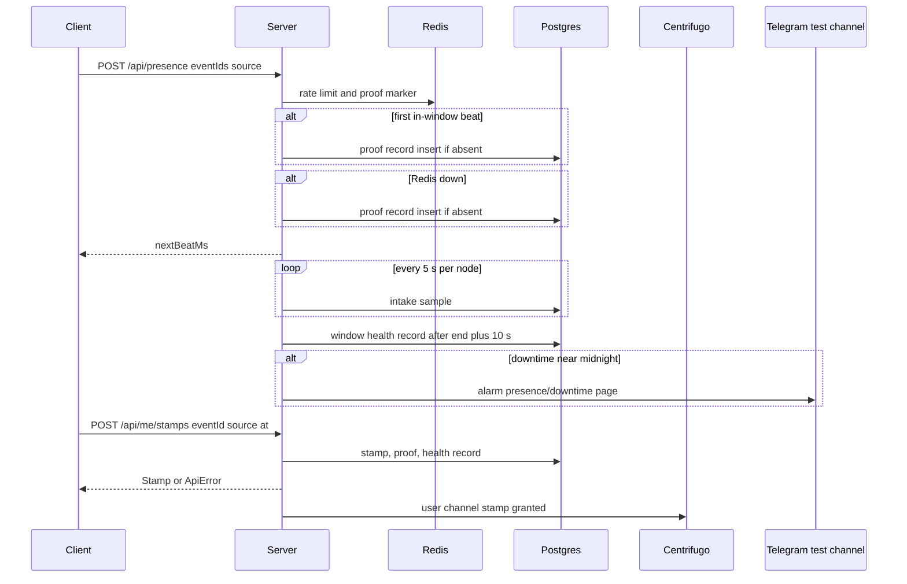
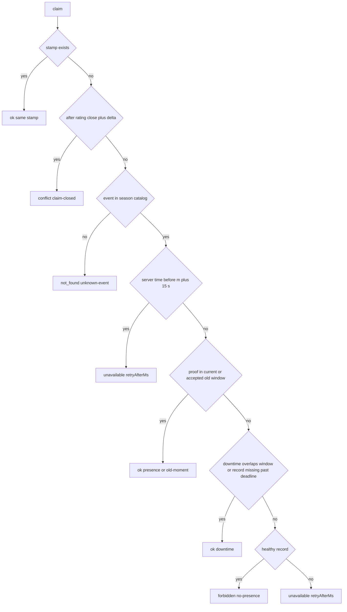

# Spec: Паспорт і присутність — пульси в Redis і доказ присутності поза ним, журнал справності прийому пульсів, видача штампа з чесними кодами, прийом при простої й за старим моментом, досягнення й серії, злиття штампів гостя, шлях і картка автора, обробник «дані суб'єкта»
Spec ID: SPEC-14
Status: approved
Supersedes: none

## Джерела

- Хвиля: `D:/Work/Pets/Time2Fest/specs/002-backend/waves.md:301-311` (картка SPEC-14), передачі SPEC-11 `:237-244`, SPEC-12 `:262-265`, SPEC-13b `:299`, вимоги до поточних хвиль від SPEC-24 `:990-1001`, ризик Р8 `:779`, К3 `:1063`, ШВ-08 `:715`.
- Вимоги (14 + 1 малим масштабом + 1 платформна): FR-STAMP-01…12, 14, 15 (`specs/002-backend/spec.md:754-768`); FR-STAMP-13 — лише малий масштаб 1–2 тис. клієнтів (30 тис. — SPEC-23); FR-PLAT-13 (`:497`) для штампів, пульсів і досягнень; дотичні FR-PLAT-14 (`:498`), NFR-03 (`:869`), NFR-14 (`:884-891`), FR-ID-12 (`:641`), A-3 (`:1145`), SC-003 (`:1011`), SC-017 (`:1025`), модель даних (`:993-995`).
- Конституція `D:/Work/Pets/Time2Fest/.specify/memory/constitution.md`: I (штамп — присутність, не перегляд), II (час лише сервера, межі свята), III (працює без бекенду: штамп лишається на пристрої), VI (приватність), IX (простота), XI (шов і контракти), XIII (дверцята лише в тесті).
- Шов клієнта: `lib/api/contracts/passport.ts:12-92` (`PassportClaimReason` `:12-16`, `PresenceBeat` `:18-24`, `StampClaim` `:27-32`, `PassportService` `:57-86`); `Stamp` `lib/data/types.ts:228-235`; `chat.authorPath` `lib/api/contracts/chat.ts:48-52,89`; `PathPoint` `lib/chat/authorPath.ts:7-30`; збірник штампа `lib/engine/stamp.ts:21-22`; заявник `lib/passport/stampClaims.ts:17-38,137`; sim `lib/api/sim/passport.ts:41-123`; правило серій `lib/api/sim/NotificationsGenerator.tsx:25-46,68-73`.
- Правила часу: `packages/rules/src/time/presence.ts:34-106` (`isPresentByPulses` `:100-106`, `stampGrantedAt` `:73`, `stampAcceptUntil` `:78`), `constants.ts:7,26-28,41` (`STAMP_DELAY`, `CELEBRATION_TAIL`, `SERVER_CLOCK_TOLERANCE_MS`), `bounds.ts:13` (`ratingCloseAt`), спільні тести меж `packages/rules/test/boundaries.shared.test.ts:44-58,170-193,240-300`.
- Сервер: реєстри `server/src/registries/{routes,moments,authLinks,subjectData,ops,rateLimits,adminSlots}.ts`, `test-doors/registry.ts:150-175` (32 дверцят), `endpoints/deps.ts:69-155` (`rightsOf`), `domain/rights/settings.ts:10` (`showPath` типово `true`), `rights/links.ts:66-111` (`passesLink`), `registries/ops.ts:560-572` (зарезервований домен `presence`), `adapters/redis.ts:34-119` (порт `FastStore`), `docker-compose.yml:27-42` (dev Redis без збереження).
- Нотатки досліджень (2026-11-26, тека сесії `spec-14/`): `research-code.md` («нотатки коду»), `research-docs.md` («нотатки документів»).

## Рішення власника

- **В1.** Тостів цього сезону немає; єдиний платний продукт — Новорічний пас $7 (`docs/decision.md:29-36`, 2026-11-26). Хвиля нічого не проєктує для тостів; правило «штамп ніколи не за тост, пас чи відео» (FR-STAMP-07) лишається. → AC-34, Non-goals
- **В2.** Штамп іде країні, яку дивились: подія, показана на сторінці (`decision.md:711`, 2026-11-16). → AC-31, AC-36
- **В3.** При простої підтвердження приймаються без перевірки присутності (відповідь 5(а), `decision.md:621,668-671`). → AC-29
- **В4.** Штамп показується одразу, підтвердження повторюється у фоні, тихий рядок через 1 хв (`decision.md:844`, 2026-11-14). → AC-60
- **В5.** Штампи гостя зливаються в акаунт (A-11, `decision.md:736`); при злитті штампа лишається ранніший (A-3). → AC-44…AC-47
- **В6.** Пакет видимих станів 26.11 затверджено; ШВ-08 (паспорт) — не видимий стан (`decision.md:9-14,61-74`; `waves.md:715`). → AC-62
- **В7.** Регіони й сторінки поясів (SPEC-24): штамп — за подію (місто), ілюстрація — за одиницею «країна + пояс [+ регіон]», не за країною; не вважати, що сторінка = країна (`decision.md:97-103`; `waves.md:996`). → AC-31, AC-36
- **В8.** Політика YouTube: штамп — присутність на сторінці події опівночі за сервером, не перегляд; сервер не отримує стан плеєра (конституція I). → AC-1, AC-34

## Питання власнику (перший прохід, не блокують)

- **[Q1]** Шлях у картці автора для інших (коли в автора пас і `showPath`) містить і **заплановані** точки з «Мого графіка» автора (північ ще попереду), як сайт показує зараз (`lib/chat/authorPath.ts:57-90`, sim `lib/api/sim/chat.ts:160-165`) — **власник підтвердив 2026-11-26**: так, лише заплановані події поточного сезону, північ яких після часу сервера. Альтернатива — лише зустрінуті (штампи). → AC-51

## Рішення сесії

Кожне — рішення сесії `[А]`, ведучий хвилі може змінити; кожне перевіряється в AC або NFR.

- **[А1] Доказ присутності — поза Redis.** Перший пульс суб'єкта в межах вікна події одразу записується в основну базу як запис доказу (суб'єкт, сезон, подія, момент, вікно якого він потрапив, час першого отримання, джерело); наступні пульси того ж суб'єкта й події лише оновлюють лічильники в Redis (позначка «вже записано» в Redis знімає повторні записи в базу). Якщо Redis недоступний — запис іде прямо в базу без дублікатів. Доказ переживає перезапуск і очищення Redis. Час останнього отримання записується при підсумку вікна, якщо Redis доступний (діагностика, на рішення не впливає). → AC-3, AC-6, AC-12
- **[А2] Пульси.** Інтервал біля півночі I = 20 с — одна спільна стала модуля правил (додається в `@time2fest/rules` з рядками тестів експорту й меж); розклад `nextBeatMs`: далі ніж за 5 хв до найближчої півночі подій пульсу — час до «північ − 5 хв», не більше 15 хв; від −5 до −2 хв — 60 с; від −2 хв до +15 с + Δ — I; після +15 с + Δ для всіх подій пульсу — `null`. До 8 подій у пульсі; поля стану плеєра не приймаються. Ліміт `presence-beat` — 12 на хвилину на суб'єкта (до 4 вкладок з I = 20 с), запасний ліміт у пам'яті вузла при падінні Redis. → AC-1, AC-2, AC-5, AC-8, AC-13
- **[А3] Пульс при падінні Redis відповідає `ok`, якщо доказ записано в базу**, а вікно все одно стає простоєм за журналом. Це відступ від буквального тексту NFR-14 (`spec.md:885`: «Redis down → пульси `unavailable`») на користь людини: доказ не губиться, а клієнт не повторює зайве. `unavailable` — лише коли не вдалося записати доказ ні туди, ні туди. → AC-6, AC-7
- **[А4] Журнал справності.** Кожен вузол щоп'ять секунд за годинником сервера пише в основну базу зразок прийому: досяжність Redis, ідентифікатор запуску Redis і час його роботи (виявлення перезапуску), кількість прийнятих і невдалих пульсів з попереднього зразка — без даних суб'єктів. Підсумок вікна кожної події — рядок реєстру моментів (`registries/moments.ts`, вид `event-stamp`, правило запізнення `always`, ідемпотентно за `consequenceId`) плюс доведення на такті зразка: після кінця вікна (північ + 15 с + Δ) + 10 с запас запис стану «справно» чи «простій» з переліком ознак. Відсутній запис після кінця вікна + 2 хв = простій. → AC-14…AC-18, AC-22
- **[А5] Ознаки простою:** `fast-store-unavailable` (зразок з недосяжним Redis), `fast-store-restart` (змінився ідентифікатор запуску чи час роботи Redis менший за вік вікна), `sample-gap` (у вузла, живого у вікні, розрив між зразками >10 с, або зразків немає), `beat-errors` (невдалих пульсів >1% від усіх у вікні), `beat-rate-drop` (суб'єктів з пульсом у вікні менше половини суб'єктів, що слали пульс цій події в [північ − 5 хв; початок вікна), коли тих ≥20; лічильники недоступні — теж простій), `edge-region` (звіт про збій краю, що перетинає вікно), `manual` (власник). Збій краю в будь-якому регіоні робить простоєм вікна всіх подій, що його перетинають (глядач події може бути де завгодно). → AC-16, AC-17, AC-21
- **[А6] Ручний простій** — зріз адмінки власника `37-presence` (за зразком `35-bans`): перелік записів сезону, додати простій (подія або проміжок часу, причина ≤200 символів) з журналом. Записи лише додаються: ні автоматичний, ні ручний не прибираються (зайвий простій лише видає штампи). → AC-19
- **[А7] Коди підтвердження** (таблиця рішення — «Module interactions»): спершу наявний штамп (`ok`, той самий), далі межа рейтингу (`conflict`/`claim-closed`), подія (`not_found`/`unknown-event`), відкриття (`unavailable` до північ + 15 с), доказ (`ok`, вид `presence`, одразу, не чекаючи підсумку), простій (`ok`, вид `downtime`), запис «справно» без доказу (`forbidden`/`no-presence`), інакше `unavailable` + `retryAfterMs`. Вікно — лише за серверним часом отримання через `isPresentByPulses`; поля `openedAt`, `at` від клієнта рішення не змінюють. → AC-23…AC-30
- **[А8] Подія без штампа** — подія поза каталогом сезону з поправками, подія не опівнічного слоту або схована (`hidden`) → `not_found`/`unknown-event`; клієнт штамп лишає й перестає повторювати. → AC-28
- **[А9] Старий момент (FR-STAMP-15).** Сервер знає кожен момент події в сезоні (базовий і кожну поправку). Пульс зараховується у вікно будь-якого моменту події, що ще приймається; доказ чи простій у вікні старого моменту дає штамп виду `old-moment` з `grantedAt` старого моменту — до кінця свята сезону (остання північ + `CELEBRATION_TAIL` + Δ), кожна видача — запис у журналі (суб'єкт, подія, старий і новий момент, час). Після кінця свята старі вікна не розглядаються. → AC-32, AC-33
- **[А10] Штамп на сервері** зберігає суб'єкта, сезон, подію, `grantedAt`, джерело присутності, вид видачі (`presence|downtime|old-moment`), час видачі; ілюстрацію й назву міста сервер складає при читанні з каталогу за подією (одиниця події: країна + пояс [+ регіон]) — SPEC-24 не потребує переробки. Склад збігається з клієнтським `buildStamp` (`lib/engine/stamp.ts:21-22`). → AC-36
- **[А11] Досягнення й серії** — одна чиста функція модуля правил (сервер викликає її; сайт — у SPEC-19), правило з клієнта: країни 3/5/10 (різні `countryIso`), пояси 3/5/10 (різні пояси подій), серія 3/5 — ряд сусідніх за порядком поясів каталогу, що закінчується поясом з найбільшим порядком серед штампів (`NotificationsGenerator.tsx:27,38-46`; `docs/site/notifications.md:50-52`). Зберігаються на сезон з часом досягнення, не відкликаються; стабільні ключі з сезоном `goal:<season>:countries:<N>`, `goal:<season>:zones:<N>`, `streak:<season>:<N>` (FR-NOTIF-02). Континенти й «усі пояси» сторінки паспорта лишаються клієнтськими. → AC-41…AC-43
- **[А12] Події.** На видачу: конверт `stamp` у персональний канал `user:#<subject>` (`granted` зі штампом; після злиття — `snapshot`) і внутрішня подія «Штамп видано» (суб'єкт, сезон, подія, вид видачі, нові ключі досягнень) для SPEC-19/21; сповіщення не створюються в цій хвилі. → AC-39, AC-40, AC-46
- **[А13] Злиття** — рядок `stamps` реєстру `authLinks` за зразком `passesLink`: штампи, докази й досягнення гостя переходять в акаунт; для однієї події лишається раніше виданий; досягнення перераховуються; внутрішня подія злиття несе лише досягнення, що з'явилися завдяки злиттю, не більше одного на вид (найвищий поріг). Окремий маршрут `mergeGuest` не обслуговується (сервер зливає сам при вході, `spec.md:1061`). → AC-44…AC-48
- **[А14] Шлях автора.** Маршрут `GET /api/chat/authors/:authorId/path` і схема відповіді належать SPEC-14; http-адаптер `chat` робить SPEC-15. `authorId` — непрозорий публічний ідентифікатор автора, стабільний для суб'єкта, не id суб'єкта й не виводиться з нього без сервера; SPEC-14 дає внутрішній інтерфейс «публічний id автора суб'єкта» для SPEC-15. Пас — лише через `rightsOf(deps)`, `showPath` — з `profiles.settings` (типово `true`); бан автора (`isBlocked`) ховає шлях. Гість з пасом на пристрої має пас за CAP-ID. → AC-49…AC-54
- **[А15] Пульс створює гостя** (маршрут з `subject: 'required'`, правило SPEC-10 «гість — при першому записі»): доказ прив'язаний до суб'єкта. Бани на пульси й штампи не впливають (FR-ID-16 — чат і оплати). → AC-1, AC-23
- **[А16] Строки зберігання.** Ключі Redis пульсів — TTL ≤48 год; записи доказів — видаляються ≤24 год після закриття рейтингу сезону; журнал справності даних суб'єктів не містить і зберігається з сезоном. → AC-56, AC-57, NFR-5
- **[А17] Нові дверцята (тестовий клас):** `presence-fault` (впорскнути збій Redis чи частку помилок у шлях пульсів цього процесу), `presence-downtime` (додати ручний простій або звіт про збій краю), `presence-tick` (зняти зразок і підсумувати вікна на поточний час годинника), `presence-health` (прочитати записи й зразки для події) — разом 36; справжня зупинка й перезапуск Redis — лише в ексклюзивних тестах з замком машини. → AC-63, AC-65

## Problem and user

Паспорт на сайті працює лише на пристрої (`lib/api/sim/passport.ts:41-51` видає штамп без перевірки), на сервері немає нічого з SPEC-14 (`registries/ops.ts:560-572` — лише зарезервований рядок). Людина, що зустріла північ у країні, не має підтвердження від сервера; штамп не переходить на інші пристрої й в акаунт; рейтинг (SPEC-19) не має кого спитати «чи був тут»; картка автора в чаті не має джерела шляху. Головний ризик ночі (Р8): перезапуск чи збій Redis опівночі не має позбавити присутніх штампа — сервер не сміє казати «присутності не було», коли сам не знає.

## Goals / Non-goals

**Goals:** пульси з розкладом від сервера й лімітами; доказ присутності, що переживає Redis; журнал справності кожного вікна з автоматичними ознаками, ручним простоєм і тривогою; підтвердження штампа з кодами FR-STAMP-04, прийом пізніше, при простої й за старим моментом; досягнення й серії; злиття штампів гостя; шлях і картка автора за правилами паса й `showPath`; обробник «дані суб'єкта»; домен `passport` на `http`; FR-STAMP-13 у малому масштабі.

**Non-goals:**
- Тости й усе пов'язане з ними (В1); штамп за пас, тост чи перегляд — ніколи (FR-STAMP-07).
- FR-STAMP-13 у масштабі 30 тис. клієнтів і 2 000 пульсів/с (NFR-03) — SPEC-23.
- Сповіщення `stamp`, `goal`, `streak` і інтерфейс «чи має суб'єкт штамп події» для рейтингу — SPEC-19 (тут — подія «Штамп видано» й дані).
- http-адаптер домену `chat` і проводка `authorPath` у картку — SPEC-15/16 (тут — маршрут і схема).
- Автоматичне надсилання звітів про збій краю з Worker — передача SPEC-22b/23 (тут — вхід звіту й дверцята, Open question 2).
- Континенти й «усі пояси» на сторінці паспорта — лишаються клієнтськими (`docs/site/passport.md:61,159`).
- Історія минулих сезонів через API (`?season=`) — пізніше, додаванням.
- Окремий маршрут `mergeGuest` (сервер зливає сам) [А13].
- Нові видимі стани й перезйомка дощок (В6).

## User stories

- **US-1** Як глядач на сторінці події, я шлю пульси лише біля півночі й не навантажую сервер решту часу. → AC-1…AC-9, AC-13
- **US-2** Як присутній опівночі, я отримую штамп, підтверджений сервером, навіть якщо Redis перезапустився чи частина пульсів упала. → AC-10…AC-12, AC-23, AC-24, AC-29, AC-30, AC-65
- **US-3** Як сервер і власник, я знаю для кожного вікна, чи прийом пульсів був справний, і отримую `page`, коли ні. → AC-14…AC-22, AC-64
- **US-4** Як людина з поганою мережею чи старою версією сайту, я отримую штамп пізніше або за старим моментом, а «присутності не було» чую лише коли це точно так. → AC-25…AC-28, AC-32, AC-33, AC-35
- **US-5** Як мандрівник ніччю, я маю окремий штамп за кожне місто, досягнення й серії, однакові на всіх пристроях і в межах сезону. → AC-31, AC-36…AC-43
- **US-6** Як гість, що входить в акаунт, я не втрачаю штампів і не отримую зайвих сповіщень про досягнення. → AC-44…AC-48
- **US-7** Як учасник чату, я бачу шлях автора лише коли він має пас і не сховав шлях; свій — завжди. → AC-49…AC-54
- **US-8** Як суб'єкт даних, я отримую й стираю свої штампи, докази й досягнення. → AC-55…AC-57
- **US-9** Як розробник і агент, я перевіряю все наборами контрактів, дверцятами й ексклюзивним тестом перезапуску Redis. → AC-58…AC-66

## Acceptance criteria (EARS)

**Пакети:** `server` (`server/`), `contracts` (`packages/contracts/`), `rules` (`packages/rules/`), `web` (`web/lib/api/*`, `lib/passport/*`, sim і http), `docs-patch` (документи поза репозиторієм).

Позначення: m — момент (північ) події за каталогом сезону з поправками; I = 20 с [А2]; Δ = `SERVER_CLOCK_TOLERANCE_MS`; вікно = [m − 2·I − Δ; m + 15 с + Δ].

### Пульси (FR-STAMP-01, FR-STAMP-07)

**AC-1 [server, contracts]** The server shall приймати `POST /api/presence` з тілом `{eventIds: string[] 1..8, source: 'country'|'air'|'room'|'tv', openedAt?: number}` лише від суб'єкта сесії (гість створюється при першому пульсі) і відкидати будь-яке інше поле, зокрема стан плеєра, як `validation`/`invalid-input`.
Verify: integration — body with `playerState` or a 9th eventId → `validation/invalid-input`; valid body without session → guest subject created, `ok`.

**AC-2 [server]** WHEN пульс прийнято, the server shall повернути `nextBeatMs` за розкладом [А2] відносно найближчого m серед відомих подій пульсу: до m − 5 хв — мс до m − 5 хв, не більше 900 000; [m − 5 хв; m − 2 хв) — 60 000; [m − 2 хв; m + 15 с + Δ] — 20 000; після m + 15 с + Δ для всіх подій — `null`.
Verify: integration (test clock) — beats at m − 1 h, m − 4 min, m − 30 s, m + 20 s → 900000, 60000, 20000, null.

**AC-3 [server]** WHEN сервер отримує пульс, час отримання якого лежить у вікні події, the server shall до відповіді `ok` мати в основній базі рівно один запис доказу для суб'єкта, події й моменту з часом першого отримання.
Verify: integration — 10 beats in the window from one subject → one proof record, its time equals the first receipt time.

**AC-4 [server]** IF час отримання пульсу поза вікном події, THEN the server shall не записувати доказ для цієї події, а лише врахувати пульс у лічильниках справності.
Verify: integration — beat at m − 3 min → no proof record; health counters increased.

**AC-5 [server]** IF суб'єкт надсилає 13-й пульс за 60 с, THEN the server shall відповісти `rate_limited` з `retryAfterMs` (рядок `presence-beat`, 12/хв на суб'єкта, при падінні Redis — ліміт у пам'яті вузла).
Verify: integration — 13 beats in one minute → 13th `rate_limited` with `retryAfterMs` > 0; same with Redis down (memory row).

**AC-6 [server]** IF Redis недоступний під час пульсу у вікні, THEN the server shall записати доказ прямо в основну базу без дублікатів, відповісти `ok` з `nextBeatMs` і писати журнал `presence/fast-store-down` не частіше разу на хвилину.
Verify: integration — in-process Redis-down fake, 3 beats → one proof record, `ok`, one log alarm row per minute.

**AC-7 [server]** IF доказ неможливо записати ні в Redis-позначку, ні в основну базу, THEN the server shall відповісти `unavailable` з `retryAfterMs` 5 000 і врахувати пульс як невдалий.
Verify: integration — Redis-down fake plus database-write fault → `unavailable`, `retryAfterMs` = 5000, failed counter +1.

**AC-8 [server]** IF пульс містить подію поза каталогом сезону, не опівнічного слоту чи сховану, THEN the server shall пропустити цю подію без доказу й обчислити `nextBeatMs` лише з решти подій (жодної — `null`).
Verify: integration — beat with one unknown and one known event → proof only for the known one; only unknown → `nextBeatMs: null`.

**AC-9 [server]** WHEN пульси одного суб'єкта для події приходять з кількох джерел, the server shall записати в доказ джерело з найвищим пріоритетом правил (`country` > `room` > `air` > `tv`, `presence.ts:51`).
Verify: unit + integration — beats `tv` then `country` in the window → proof source `country`.

### Доказ і вікно (FR-STAMP-02, FR-STAMP-03)

**AC-10 [server, rules]** The server shall вирішувати належність пульсу вікну лише функціями `@time2fest/rules` (`isPresentByPulses`, `stampGrantedAt`, `stampAcceptUntil`) з I зі спільної сталої й Δ = `SERVER_CLOCK_TOLERANCE_MS`, без власної копії правил.
Verify: unit — the server runs `boundaries.shared.test.ts` FR-STAMP-03 cases unchanged; lint rule `no-time-rule-copy` passes on `server/`.

**AC-11 [server]** IF пульс отримано поза вікном з `openedAt` усередині вікна, або підтвердження несе `at` усередині вікна, THEN the server shall не зарахувати присутність.
Verify: integration — beat received at m − 5 min with `openedAt` = m − 30 s and healthy window → claim `forbidden/no-presence`.

**AC-12 [server]** WHEN Redis перезапущено або очищено після пульсу у вікні, the server shall видати штамп виду `presence` за доказом з основної бази.
Verify: integration — beat in window, `FLUSHDB` of the tree's Redis, claim → `ok`, grant kind `presence`.

**AC-13 [rules]** The rules package shall експортувати сталу інтервалу пульсу I = 20 000 мс із рядками в тестах експорту й у карті викликів спільних тестів меж.
Verify: unit — `exports.test.ts` and `boundaries.shared.test.ts` call map list the new constant; value 20000.

### Журнал справності (FR-STAMP-12)

**AC-14 [server]** WHILE вузол сервера працює, the server shall кожні 5 с за годинником сервера записувати в основну базу зразок прийому: id вузла, досяжність Redis, id запуску й час роботи Redis, кількість прийнятих і невдалих пульсів з попереднього зразка — без id суб'єктів.
Verify: integration — 30 s of test clock with `presence-tick` → 6 samples with the listed fields and no subject column.

**AC-15 [server]** WHEN минув кінець вікна події + 10 с, the server shall протягом 30 с записати для вікна рівно один запис стану (`healthy` чи `downtime` з переліком ознак, хто записав `system`), зокрема після простою самого сервера — протягом 30 с після старту (рядок реєстру моментів, правило `always`).
Verify: integration (scheduler night-run) — record exists ≤ 30 s after window end + 10 s; restart the server after the window → record ≤ 30 s after boot; a second run leaves one record.

**AC-16 [server]** IF у вікні виявлено будь-яку ознаку [А5] (`fast-store-unavailable`, `fast-store-restart`, `sample-gap`, `beat-errors` >1%, `beat-rate-drop`, `edge-region`, `manual`), THEN the server shall записати стан `downtime` з цією ознакою.
Verify: integration — one test per sign via doors (`presence-fault` down/restart/errors 2%, no ticks for 15 s, rate drop, edge report, manual) → `downtime` with the matching sign; errors 0.5% → `healthy`.

**AC-17 [server]** IF у [m − 5 хв; початок вікна) пульс цій події слали ≥20 суб'єктів, а у вікні — менше половини з них, THEN the server shall записати ознаку `beat-rate-drop`.
Verify: integration — 40 subjects beat before the window, 15 inside → `downtime/beat-rate-drop`; 40 and 25 → `healthy`; 10 and 2 → `healthy`.

**AC-18 [server]** IF запису стану вікна немає після кінця вікна + 2 хв, THEN the server shall вважати вікно простоєм для підтверджень.
Verify: integration — finalisation disabled, claim at window end + 3 min without proof → `ok`, grant kind `downtime`.

**AC-19 [server]** WHERE власник у зрізі адмінки `37-presence`, the server shall давати переглянути записи сезону й додати ручний простій (подія або проміжок часу, причина ≤200 символів) з журналом аудиту, а прибрати чи змінити будь-який запис — ні.
Verify: integration — owner adds downtime → record `recordedBy: owner`, audit row; delete or edit attempt → `forbidden`; non-owner → `unauthorized`.

**AC-20 [server]** WHEN записано простій, що перетинає [m − 10 хв; m + 10 хв] будь-якої події, the server shall підняти тривогу `presence/downtime` рівня `page` і опублікувати внутрішню подію «Простій присутності зафіксовано» (події, проміжок, ознаки) рівно раз на запис.
Verify: integration — `expectAlarmInTestChannel({source:'presence', code:'presence/downtime'})` in the test Telegram channel; internal event count 1.

**AC-21 [server]** WHEN надходить звіт про збій краю `{region, from, to}` (внутрішній інтерфейс; у цій хвилі — дверцята), the server shall записати автоматичну ознаку `edge-region` для вікон усіх подій, що перетинають проміжок.
Verify: integration — `presence-downtime` edge report overlapping two windows → both `downtime/edge-region`, `recordedBy: system`.

**AC-22 [server]** IF запис зразка чи підсумку вікна не вдається, THEN the server shall підняти тривогу `presence/finalise-failed` рівня `log` і не записувати `healthy` за неповними даними.
Verify: integration — database-write fault on finalisation → alarm row; claim after deadline → `downtime` grant.

### Підтвердження штампа (FR-STAMP-04, 05, 06, 08, 15)

**AC-23 [server, contracts]** The server shall приймати `POST /api/me/stamps` з тілом `{eventId: string ≤64, source: PresenceSource, at: number}` лише для суб'єкта сесії і повертати `Stamp`; повтор для того ж суб'єкта й події повертає той самий штамп (поля `grantedAt`, `presenceSource` не змінюються).
Verify: integration — two claims → identical `Stamp`; one stamp row.

**AC-24 [server]** WHEN є доказ для події й час сервера ≥ m + 15 с, the server shall видати штамп виду `presence` з `grantedAt` = `stampGrantedAt(m)` одразу, не чекаючи запису стану вікна.
Verify: integration — beat in window, claim at m + 16 s → `ok` before the health record exists.

**AC-25 [server]** The server shall відповідати `forbidden`/`no-presence` лише коли для вікна (і для кожного ще прийнятого старого вікна) є запис `healthy`, простій їх не перетинає, а доказу немає.
Verify: integration — healthy record, no proof → `forbidden/no-presence`; same without record → not `no-presence`.

**AC-26 [server]** IF час сервера < m + 15 с, запис стану ще не прийшов, або основна база недоступна, THEN the server shall відповісти `unavailable` з `retryAfterMs`: до m + 15 с, до очікуваного підсумку (1 000…30 000) або 5 000 відповідно.
Verify: integration — claim at m − 10 s, at m + 16 s without proof and record, with database fault → `unavailable` with retryAfterMs in the stated ranges; never `no-presence`.

**AC-27 [server]** IF час сервера > `ratingCloseAt` сезону + Δ, а штампа ще немає, THEN the server shall відповісти `conflict`/`claim-closed`.
Verify: integration (test clock) — claim at close + Δ − 1 ms → evaluated; at close + Δ + 1 ms → `claim-closed`; existing stamp after close → `ok` same stamp.

**AC-28 [server]** IF подія підтвердження поза каталогом сезону з поправками, не опівнічного слоту чи схована, THEN the server shall відповісти `not_found`/`unknown-event`.
Verify: integration — unknown id, `startsAt` event, hidden event → `unknown-event`.

**AC-29 [server]** WHEN вікно події перетинає простій будь-якого виду, the server shall видати штамп виду `downtime` без перевірки присутності з джерелом з тіла підтвердження.
Verify: integration — one test per downtime kind of AC-16 and AC-18 → `ok`, grant kind `downtime`.

**AC-30 [server]** IF надходять паралельні підтвердження того ж суб'єкта й події, THEN the server shall створити рівно один штамп і повернути його кожному.
Verify: integration — 10 parallel claims → one row, 10 identical responses.

**AC-31 [server]** The server shall видавати окремий штамп за кожну подію (місто), незалежно від країни й сторінки, на якій її показано.
Verify: unit + integration — two events of one country → two stamps; claim for a country event from a `room` source → stamp of that event's country.

**AC-32 [server]** WHEN момент події змінено поправкою, а доказ чи простій є у вікні старого моменту, the server shall до кінця свята сезону + Δ видати штамп виду `old-moment` з `grantedAt` старого моменту й записати в журнал суб'єкта, подію, старий і новий момент.
Verify: integration — beat around m_old, correction to m_new, claim → `ok`, kind `old-moment`, journal row; old client beats around m_old after the correction → proof for the old window.

**AC-33 [server]** WHEN свято сезону скінчилось (остання північ + `CELEBRATION_TAIL` + Δ), the server shall оцінювати підтвердження лише за вікном поточного моменту.
Verify: integration (test clock) — proof only in the old window, claim after celebration end with healthy current window → `forbidden/no-presence`.

**AC-34 [server]** The server shall видавати штампи лише маршрутом підтвердження й злиттям, ніколи не з оплати, паса чи стану відео, і рішення не залежить від наявності паса.
Verify: integration — subject with a pass and no proof under a healthy window → `no-presence`; routes registry has no other stamp writer (security review).

**AC-35 [server]** IF суб'єкт надсилає 61-ше підтвердження за 60 с, THEN the server shall відповісти `rate_limited` з `retryAfterMs` (рядок `stamp-claim`, 60/хв на суб'єкта, запасний у пам'яті).
Verify: integration — 61 claims → 61st `rate_limited`.

**AC-36 [server]** The server shall складати `Stamp` (`illustrationId`, `cityName`, `countryIso`) при читанні з каталогу за подією, як `lib/engine/stamp.ts` — ілюстрацію через один пошук «ілюстрація одиниці події».
Verify: unit — for every catalog event the server stamp equals the client `buildStamp` output; integration — changing the country illustration changes stamps already granted.

### Паспорт, сезони, події (FR-STAMP-11, канал)

**AC-37 [server]** The server shall віддавати `GET /api/me/stamps` штампи суб'єкта поточного сезону, впорядковані за `grantedAt`, а без сесії — порожній список без створення гостя.
Verify: integration — 3 stamps → ordered list; no cookie → `[]`, no guest row.

**AC-38 [server]** WHEN ключ сезону каталогу змінився, the server shall віддавати порожній паспорт і зберігати штампи й досягнення попереднього сезону.
Verify: integration — seed season 2026-27 stamps, switch catalog to 2027-28 → `[]`; old rows remain.

**AC-39 [server, contracts]** WHEN штамп видано, the server shall опублікувати в `user:#<subject>` конверт `stamp` з `granted` і штампом протягом 3 с, а збій публікації не скасовує видачу.
Verify: integration (Centrifugo) — second tab receives `granted` ≤ 3 s; publish fault → claim still `ok`, log line.

**AC-40 [server]** WHEN штамп видано, the server shall опублікувати рівно одну внутрішню подію «Штамп видано» з суб'єктом, сезоном, подією, видом видачі й ключами нових досягнень.
Verify: integration — one internal event per stamp; idempotent repeat claim → no second event.

### Досягнення й серії (FR-STAMP-09)

**AC-41 [server, rules]** WHEN штамп видано, the server shall обчислити досягнення країн 3/5/10, поясів 3/5/10 і серії 3/5 за правилом [А11] і зберегти кожне нове досягнення раз із часом і ключем з сезоном.
Verify: unit — rule fixtures (3 countries, 5 zones, adjacent zone run of 5 ending at the highest order, gap breaks run); integration — the 3rd country stamp writes `goal:2026-27:countries:3`.

**AC-42 [rules]** The rules package shall мати одну функцію досягнень, що на тих самих штампах дає те саме, що `NotificationsGenerator.tsx:36-46,68-73`.
Verify: unit — parity test against the generator outputs on shared fixtures.

**AC-43 [server]** The server shall не відкликати збережене досягнення й рахувати досягнення окремо для кожного сезону.
Verify: integration — new season → achievements empty for the new season; old ones kept.

### Злиття штампів гостя (FR-STAMP-10)

**AC-44 [server]** WHEN гість входить в акаунт, the authLinks row `stamps` shall перенести штампи, докази й досягнення гостя в акаунт, лишивши для події раніше виданий штамп, а повтор для тієї ж пари — нічого не змінити.
Verify: integration — guest 4 stamps, account 2 (1 shared event) → 5 stamps, the shared one is the earlier issued; second run → no change.

**AC-45 [server]** WHEN злиття дало нові досягнення акаунта, the server shall опублікувати внутрішню подію злиття лише з ними, не більше одного на вид (найвищий поріг), а без нових — жодної.
Verify: integration — merge crossing countries 3 and 5 → one `countries` key (5); merge without new → no event.

**AC-46 [server]** WHEN злиття завершилось, the server shall опублікувати в `user:#<account>` конверт `stamp` з `snapshot` усіх штампів сезону.
Verify: integration (Centrifugo) — account tab receives `snapshot` with merged stamps.

**AC-47 [server]** IF обробник `stamps` падає, THEN the server shall записати рядок `auth_link_retries` і тривогу `auth/link-retry`, а вхід завершити.
Verify: integration — door `rights/link-fault {handler:'stamps'}` → retry row, alarm, session issued.

**AC-48 [web]** The http adapter `passport` shall не мати методу `mergeGuest`.
Verify: unit — `createHttpPassport(...).mergeGuest` is `undefined`.

### Шлях і картка автора (FR-STAMP-14)

**AC-49 [server, contracts]** The server shall обслуговувати `GET /api/chat/authors/:authorId/path` з відповіддю `{points: {eventId, planned}[], hidden: boolean}` за схемою пакета контрактів, що належить цій хвилі.
Verify: integration — response passes the wire schema; contract-surface check additive.

**AC-50 [server]** The server shall віддавати точки іншим лише коли `rightsOf(deps).passes` дає автору пас і `showPath` автора `true`; пас і `showPath: false` → `{points: [], hidden: true}`; без паса → `{points: [], hidden: false}`; глядачу-автору — свої точки завжди з `hidden: false`.
Verify: integration — four cases (pass+shown, pass+hidden, no pass, own without pass) → expected shapes.

**AC-51 [server]** The server shall складати точки з подій штампів поточного сезону (`planned: false`) і подій графіка автора, північ яких після часу сервера й без штампа (`planned: true`) [Q1].
Verify: integration (test clock) — 2 stamps + 3 scheduled (1 past) → 4 points, 2 planned.

**AC-52 [server]** IF `authorId` не відповідає жодному автору, THEN the server shall відповісти `not_found`, а `authorId` у відповідях і повідомленнях ніколи не дорівнює id суб'єкта.
Verify: integration — random id → `not_found`; `authorIdOf(subject)` ≠ subject id and stable across calls.

**AC-53 [server]** IF автор заблокований (`isBlocked`), THEN the server shall віддати `{points: [], hidden: true}`.
Verify: integration — door `rights/ban` on the author → hidden empty path.

**AC-54 [server]** IF пристрій надсилає 61-й запит шляху за 60 с, THEN the server shall відповісти `rate_limited` (рядок `author-path`, 60/хв на пристрій).
Verify: integration — 61 requests → 61st `rate_limited`.

### Дані суб'єкта (FR-PLAT-13)

**AC-55 [server]** WHEN викликано «віддати», «стерти» чи «знеособити», the subject-data handler `stamps` shall віддати штампи всіх сезонів, досягнення, докази й записи журналу старого моменту суб'єкта, а стирання й знеособлення — видалити їх.
Verify: integration — `runSubjectDataInScope` export lists the four groups; after erase none remain.

**AC-56 [server]** The subject-data registry shall мати декларативний рядок `presence-beats` (ключі Redis пульсів, строк ≤48 год), а ключі пульсів — TTL ≤48 год.
Verify: integration — registry row exists; TTL of every beat key ≤ 172800 s.

**AC-57 [server]** WHEN минуло 24 год після закриття рейтингу сезону, the server shall видалити записи доказів цього сезону.
Verify: integration (test clock) — close + 24 h + 1 min → no proof rows; stamps remain.

### Контракти, перемикання, клієнт, дверцята, перевірки

**AC-58 [contracts, web]** The contracts package shall лише додаванням мати причину `no-presence`, схеми тіл і відповідей пульсу, підтвердження, списку штампів і шляху автора, подію каналу `stamp` (`granted`, `snapshot`) з захисником без zod.
Verify: unit — contract-surface additive check, seam vocabulary test lists `no-presence`, guard tests.

**AC-59 [web]** The site shall мати `passport` у `HTTP_DOMAINS` і http-адаптер з `stamps`, `peek`, `subscribe`, `beat`, `claim`, `trackPresence`, де `trackPresence` шле пульси за `nextBeatMs` і далі живить реєстр поверхонь `lib/presence/surfaces.ts`.
Verify: unit — integration-build test lists `passport` as http; e2e — rewind to midnight on a country page → stamp confirmed by the server.

**AC-60 [web]** The claimer shall знімати локальний штамп лише на `forbidden`/`no-presence`, чекати не менше `retryAfterMs`, а на інших неповторюваних відповідях лишати штамп і більше не повторювати, зокрема після перезавантаження.
Verify: unit — `claim-closed`, `unknown-event`, `validation` → stamp kept, no further calls after resume; `retryAfterMs` 9000 → next attempt ≥ 9 s.

**AC-61 [web]** The sim adapter shall відповідати `forbidden/no-presence` без запису присутності на пристрої, `not_found/unknown-event` для невідомої події й `conflict/claim-closed` після закриття рейтингу, щоб набір `passport` ішов на `sim` і `http`.
Verify: e2e — `contract-run`: `passport` suite green in both columns.

**AC-62 [web]** The site shall не мати нових видимих станів: сторінки паспорта, країни, кімнати й TV виглядають як дошки.
Verify: e2e — layout-fidelity on passport and country boards with the http build; diff within the existing thresholds.

**AC-63 [server]** WHERE `T2F_ENV=test` і `T2F_TEST_DOORS=1`, the server shall мати дверцята `presence-fault`, `presence-downtime`, `presence-tick`, `presence-health`, а `reset` — очищувати штампи, докази, досягнення, журнал справності й ключі пульсів.
Verify: integration — door count 36 in all four assertions; each door 404 outside `test`; after `reset` the tables are empty.

**AC-64 [server]** The ops registry shall мати домен `presence` без `reserved` з тривогами `presence/downtime` (`page`), `presence/fast-store-down` (`log`), `presence/finalise-failed` (`log`) і метриками пульсів/с, частки помилок пульсів, підтверджень і вікон простою, а жодна метрика не лишається з позначкою SPEC-14.
Verify: integration — `expectAlarmInTestChannel` for each of the 3 codes into the test Telegram channel; registry tests green.

**AC-65 [server]** WHEN 1 500 віртуальних клієнтів шлють пульси навколо півночі тестового годинника, а Redis перезапускається рівно опівночі (ексклюзивний замок), the server shall не дати жодної відповіді `no-presence` і видати штамп кожному клієнту протягом 5 хв після m + 15 с.
Verify: integration (exclusive) — script reports 0 `no-presence`, 1500/1500 stamps, kinds `presence|downtime`; control run without restart: 100 non-beating subjects get `no-presence`.

**AC-66 [docs-patch]** The wave shall оновити `frontend-seam.md` (рядок `passport`, причина `no-presence`, маршрут шляху автора), `docs/site/passport.md` (розділи «Код» і «Відомі межі»), `alarms.md`, `night-runbook.md` (ручний простій) і `code-map.md`.
Verify: manual — the orchestrator reviews the patch draft; documents outside the repo are not read automatically.

## Edge cases

- **EC-1** Redis перезапустився о 23:58 чи рівно опівночі → докази в базі, вікно — простій, жодного `no-presence`. → AC-12, AC-16, AC-65
- **EC-2** Частина клієнтів отримує помилки на пульсах (2%) → `beat-errors`, простій. → AC-16, AC-29
- **EC-3** Сервер працює, але не пише пульси (зразків немає) → `sample-gap` або відсутній запис = простій. → AC-16, AC-18
- **EC-4** Сам сервер лежав опівночі → підсумок після старту знаходить розрив зразків → простій. → AC-15, AC-16
- **EC-5** Клієнт без мережі опівночі, з'явився за 3 хв → доказу немає, але й присутності не доведено; запис `healthy` → `no-presence` (клієнт справді не слав пульсів). Якщо пульси були до обриву у вікні — доказ є. → AC-24, AC-25
- **EC-6** Відкриття сторінки о m + 14 с → пульс у вікні → доказ. → AC-3, AC-10
- **EC-7** Скрипт шле пульс з `openedAt` = 23:50 о m − 5 хв → не зараховано. → AC-11
- **EC-8** Дві вкладки гостя на різних сторінках (країна й TV) → один штамп на подію з пріоритетним джерелом. → AC-9, AC-30
- **EC-9** Країна з кількома містами (US/AU/BR) і регіони SPEC-24 → окремий штамп за кожну подію. → AC-31, AC-36
- **EC-10** Поправка моменту після того, як людина була на старій півночі; стара версія сайту шле пульси за старим моментом → `old-moment`. → AC-32, AC-33
- **EC-11** Підтвердження через 11 год після останньої півночі → приймається; через 12 год + Δ + 1 мс → `claim-closed`, штамп лишається на пристрої. → AC-27, AC-60
- **EC-12** Подію сховано поправкою → `unknown-event`, штамп на пристрої лишається. → AC-28, AC-60
- **EC-13** Підтвердження до m + 15 с (годинник пристрою спішить) → `unavailable` до відкриття. → AC-26
- **EC-14** Гість з пасом на пристрої пише в чат → шлях видно іншим, якщо `showPath`. → AC-50
- **EC-15** Автор сховав шлях, а потім втратив пас → `hidden: false`, точок немає (без паса шлях не показується взагалі). → AC-50
- **EC-16** Злиття гостя з досягненням «3 країни», якого в акаунта не було → одна подія злиття з ключем; повтор злиття → нічого. → AC-44, AC-45
- **EC-17** Новий сезон починається, поки відкрито паспорт → `snapshot` порожній після перечитування; минулий сезон — у базі. → AC-38
- **EC-18** Збій краю в одному регіоні → простій для всіх подій, вікна яких перетинає проміжок. → AC-21
- **EC-19** Пульс під час недоступності і Redis, і бази → `unavailable`; вікно — простій через ознаки. → AC-7, AC-16
- **EC-20** Автоматичне надсилання звітів краю з Worker → поза хвилею. → Non-goal, Open question 2

## Non-functional requirements

**NFR-1 [server]** The server shall відповідати на пульс ≤50 мс p95 при 200 пульсах/с на локальному стеку.
Verify: integration — load script 200 beats/s for 60 s, p95 ≤ 50 ms.

**NFR-2 [server]** The server shall відповідати на підтвердження ≤100 мс p95 при 100 підтвердженнях/с на локальному стеку.
Verify: integration — load script, p95 ≤ 100 ms.

**NFR-3 [server, web]** The system shall давати ≥99,5% присутніх клієнтів з мережею штамп, підтверджений сервером, ≤60 с після півночі (SC-003) у прогоні AC-65 без перезапуску.
Verify: integration (exclusive) — share of confirmations ≤ m + 60 s ≥ 99.5%.

**NFR-4 [server]** The server shall приймати тіла пульсу й підтвердження ≤1 КБ.
Verify: integration — 1.1 KB body → 413.

**NFR-5 [server]** The server shall не писати в журнали й зразки IP, пошту, вміст пульсів чи id суб'єкта поза записами доказу й штампа.
Verify: integration — log capture during beats and claims contains no IP, email or subject id; sample rows have no subject column.

**NFR-6 [server]** The server shall працювати з Redis без збереження на диск (`--save '' --appendonly no`) без втрати жодного доказу.
Verify: integration (exclusive) — dev Redis restart after in-window beats → all proofs present.

**NFR-7 [server]** The server shall віддавати маршрути `/api/presence`, `/api/me/stamps` і шляху автора з `Cache-Control: private, no-store`.
Verify: integration — response headers.

**NFR-8 [server]** The server shall брати час рішень пульсів, підтверджень і підсумку лише з годинника сервера (`deps.clock`).
Verify: integration — all time-dependent tests run on the test clock; static check finds no `Date.now()` in the presence and stamp domain code.

## Module interactions

- **Клієнт → сервер:** `POST /api/presence`, `POST /api/me/stamps`, `GET /api/me/stamps`, `GET /api/chat/authors/:authorId/path`; помилки — `ApiError`; недоступність сервера → клієнт лишає штамп і повторює (AC-60, конституція III).
- **Сервер → Redis:** ліміти, позначки доказу, лічильники справності; недоступність → AC-6, AC-7, ознака `fast-store-unavailable`.
- **Сервер → Postgres:** докази, зразки, записи стану, штампи, досягнення, журнал старого моменту; недоступність → AC-7, AC-22, AC-26.
- **Планувальник (SPEC-07) → сервер:** рядок реєстру моментів `event-stamp`, правило `always`; запізнення → AC-15.
- **Сервер → Centrifugo:** `stamp` (`granted`, `snapshot`); збій публікації не скасовує видачу (AC-39).
- **Сервер → ops (SPEC-13b):** тривоги AC-20, AC-22, AC-6; доставка в тестовий канал.
- **Права (SPEC-11) → сервер:** `rightsOf(deps).passes`, `bans.isBlocked`, `profiles.settings.showPath`, `Ctx.subject`, `subjectKind`, реєстр `authLinks`.
- **Сервер → інші хвилі (proposed, внутрішні):** подія «Штамп видано», подія злиття, «публічний id автора суб'єкта» (SPEC-15), вхід звіту збою краю (SPEC-22b/23), «Простій присутності зафіксовано» (OPS).

**Контракт (proposed, лише додаванням):**
- `POST /api/presence` — тіло `{eventIds: string[1..8] (кожен ≤64), source: PresenceSource, openedAt?: number}` → `{nextBeatMs: number | null}`; помилки `validation/invalid-input`, `rate_limited` (`retryAfterMs`), `unavailable` (`retryAfterMs`).
- `POST /api/me/stamps` — тіло `{eventId: string ≤64, source: PresenceSource, at: number}` → `Stamp {eventId, grantedAt, presenceSource, illustrationId, cityName, countryIso}`; помилки `forbidden/no-presence`, `unavailable` (`retryAfterMs`), `conflict/claim-closed`, `not_found/unknown-event`, `rate_limited`, `validation/invalid-input`.
- `GET /api/me/stamps` → `Stamp[]` поточного сезону.
- `GET /api/chat/authors/:authorId/path` → `{points: {eventId: string, planned: boolean}[], hidden: boolean}`; помилки `not_found`, `rate_limited`. Сайт складає з точок `PathPoint` картки за своїм набором даних (`lib/chat/authorPath.ts:7-30`) — у SPEC-15/16.
- Канал `user:#<subject>`: конверт `{type: 'stamp', id, data: {kind: 'granted', stamp: Stamp} | {kind: 'snapshot', stamps: Stamp[]}}`.
- Причина `PassportClaimReason` доповнюється `no-presence`.

## Inputs and provenance

| Input | Source | Producer | Freshness | Trusted |
|---|---|---|---|---|
| `eventIds`, `source`, `openedAt` пульсу | тіло запиту | сайт відвідувача (підробний) | на пульс | ні |
| `eventId`, `source`, `at` підтвердження | тіло запиту | сайт відвідувача | на запит | ні |
| `authorId` | шлях запиту | сайт відвідувача | на запит | ні |
| Час отримання пульсу | годинник сервера | сервер (SPEC-07) | на пульс | так |
| Каталог сезону, моменти з поправками, ілюстрації | база каталогу, поправки | SPEC-04 | на імпорт/поправку | так |
| Пас, бан, `showPath`, графік | права й профіль | SPEC-11 | на запит | так |
| Стан Redis (досяжність, id запуску, час роботи) | Redis | Redis | на зразок | так |
| Звіт про збій краю | внутрішній інтерфейс / дверцята | край чи ops (пізніше) | на подію | так, лише з внутрішнього виклику |
| Ручний простій | зріз адмінки | власник | на дію | так, лише власник |

## Untrusted inputs

- `eventIds` і `eventId` → лише відомі події каталогу, ≤8 у пульсі, ≤64 символи (AC-1, AC-8, AC-28, NFR-4).
- `source` → перелік дозволених значень (AC-1, AC-23); на рішення присутності не впливає (AC-9).
- `openedAt`, `at` → лише підказка, вікно не розширюють (AC-11).
- Частота пульсів і підтверджень → ліміти (AC-5, AC-35); пульс можна підробити — прийнятий ризик (досягнення без грошової цінності, `frontend-seam.md:217,574`), обмежений вікном і лімітом.
- `authorId` → непрозорий, невідомий → `not_found`, ліміт (AC-52, AC-54); дані інших суб'єктів — лише за правилами паса й `showPath` (AC-50).
- Суб'єкт — лише з сесії, без id у тілі (AC-1, AC-23); зріз простою — лише власник (AC-19).

## Design review

- DR-1 Доказ лише в Redis губиться при перезапуску (`docker-compose.yml:27-42` без збереження; `infra/ops/node/compose.yml:24-48` без тому) — accepted [А1] → AC-3, AC-12, NFR-6.
- DR-2 Причини `no-presence` у коді немає; заявник знімає штамп на будь-якій неповторюваній відповіді (`stampClaims.ts:36-38,137`) — accepted → AC-58, AC-60.
- DR-3 Заявник ігнорує `retryAfterMs` (`stampClaims.ts:17`) — accepted → AC-60.
- DR-4 http `trackPresence` має далі живити реєстр поверхонь, інакше `moment:stamp` без присутніх подій (`engineScheduler.ts:170-181`, `surfaces.ts:34-46`) — accepted → AC-59.
- DR-5 Сталої I в модулі правил немає (`presence.ts:100-106` бере параметр) — accepted [А2] → AC-13.
- DR-6 Підтвердження до відкриття не має причини в шві; `no-presence` тут небезпечне — accepted як `unavailable` [А7] → AC-26.
- DR-7 NFR-14 каже «пульси `unavailable` при падінні Redis» — змінено на користь людини [А3] → AC-6, AC-7.
- DR-8 Ілюстрація штампа за країною (`types.ts:228-235`, `countries.ts:40`) не витримає SPEC-24 — accepted [А10] → AC-36.
- DR-9 Серія 10 є лише у FR-STAMP-09 загальним формулюванням, сайт рахує 3/5 — accepted як на сайті [А11] → AC-41, AC-42.
- DR-10 Рішення `decision.md:1215` «свій шлях видно всім без паса» застаріле проти FR-STAMP-14 і `docs/site/passport.md:41,61` — accepted FR-STAMP-14 → AC-50.
- DR-11 Заплановані точки в чужому шляху [Q1] — підтверджено власником 2026-11-26 → AC-51.
- DR-12 Метрики `presence.rooms`, `presence.realtimeConnections` позначені SPEC-14 (`ops.ts:569-570`) — accepted → AC-64.
- DR-13 Автоматичний звіт краю потребує зміни Worker — deferred → Open question 2, Non-goals.

## Traceability

| AC / NFR | From | Packages | Verify |
|---|---|---|---|
| AC-1 | US-1, FR-STAMP-01, FR-STAMP-07, В8, А15 | server, contracts | integration |
| AC-2 | US-1, FR-STAMP-01, А2 | server | integration |
| AC-3 | US-2, FR-STAMP-02, А1, DR-1, EC-6 | server | integration |
| AC-4 | US-1, FR-STAMP-03 | server | integration |
| AC-5 | US-1, FR-STAMP-07, FR-PLAT-14, А2 | server | integration |
| AC-6 | US-2, FR-STAMP-02, NFR-14, А3, DR-7 | server | integration |
| AC-7 | US-2, NFR-14, А3, EC-19 | server | integration |
| AC-8 | US-1, FR-STAMP-01, А8 | server | integration |
| AC-9 | US-2, EC-8 | server | unit, integration |
| AC-10 | US-2, FR-STAMP-03, FR-CLK-05 | server, rules | unit |
| AC-11 | US-2, FR-STAMP-03, EC-7 | server | integration |
| AC-12 | US-2, FR-STAMP-02, DR-1, EC-1 | server | integration |
| AC-13 | US-1, А2, DR-5 | rules | unit |
| AC-14 | US-3, FR-STAMP-12, А4 | server | integration |
| AC-15 | US-3, FR-STAMP-12, FR-CLK-12, А4, EC-4 | server | integration |
| AC-16 | US-3, FR-STAMP-12, FR-STAMP-06, А5, EC-1, EC-2, EC-3 | server | integration |
| AC-17 | US-3, FR-STAMP-12, А5 | server | integration |
| AC-18 | US-3, FR-STAMP-12, А4, EC-3 | server | integration |
| AC-19 | US-3, FR-STAMP-12, А6 | server | integration |
| AC-20 | US-3, FR-STAMP-12, SPEC-13b hand-off | server | integration |
| AC-21 | US-3, FR-STAMP-12, А5, EC-18 | server | integration |
| AC-22 | US-3, FR-STAMP-12 | server | integration |
| AC-23 | US-2, FR-STAMP-04, А15 | server, contracts | integration |
| AC-24 | US-2, FR-STAMP-03, А7, SC-003 | server | integration |
| AC-25 | US-4, FR-STAMP-04, EC-5 | server | integration |
| AC-26 | US-4, FR-STAMP-04, NFR-14, DR-6, EC-13 | server | integration |
| AC-27 | US-4, FR-STAMP-05, EC-11 | server | integration |
| AC-28 | US-4, FR-STAMP-04, А8, EC-12 | server | integration |
| AC-29 | US-2, FR-STAMP-06, В3 | server | integration |
| AC-30 | US-2, FR-STAMP-04, EC-8 | server | integration |
| AC-31 | US-5, FR-STAMP-08, В2, В7, EC-9 | server | unit, integration |
| AC-32 | US-4, FR-STAMP-15, А9, EC-10 | server | integration |
| AC-33 | US-4, FR-STAMP-15, А9 | server | integration |
| AC-34 | US-2, FR-STAMP-07, В1, В8 | server | integration |
| AC-35 | US-4, FR-PLAT-14 | server | integration |
| AC-36 | US-5, В2, В7, А10, DR-8, EC-9 | server | unit, integration |
| AC-37 | US-5, FR-STAMP-11 | server | integration |
| AC-38 | US-5, FR-STAMP-11, EC-17 | server | integration |
| AC-39 | US-5, А12 | server, contracts | integration |
| AC-40 | US-5, А12, SPEC-19 hand-off | server | integration |
| AC-41 | US-5, FR-STAMP-09, А11, DR-9 | server, rules | unit, integration |
| AC-42 | US-5, FR-STAMP-09, А11 | rules | unit |
| AC-43 | US-5, FR-STAMP-11, А11 | server | integration |
| AC-44 | US-6, FR-STAMP-10, В5, А13, EC-16 | server | integration |
| AC-45 | US-6, FR-STAMP-10, А13, EC-16 | server | integration |
| AC-46 | US-6, FR-ID-12, А12 | server | integration |
| AC-47 | US-6, FR-ID-12, SPEC-11 hand-off | server | integration |
| AC-48 | US-6, А13 | web | unit |
| AC-49 | US-7, FR-STAMP-14, А14 | server, contracts | integration |
| AC-50 | US-7, FR-STAMP-14, DR-10, EC-14, EC-15 | server | integration |
| AC-51 | US-7, FR-STAMP-14, Q1, DR-11 | server | integration |
| AC-52 | US-7, А14 | server | integration |
| AC-53 | US-7, А14, SPEC-11 hand-off | server | integration |
| AC-54 | US-7, FR-PLAT-14 | server | integration |
| AC-55 | US-8, FR-PLAT-13 | server | integration |
| AC-56 | US-8, FR-PLAT-13, FR-PRIV-01, А16 | server | integration |
| AC-57 | US-8, А16 | server | integration |
| AC-58 | US-9, FR-STAMP-04, DR-2 | contracts, web | unit |
| AC-59 | US-9, waves.md:305, DR-4 | web | unit, e2e |
| AC-60 | US-4, FR-STAMP-04, В4, DR-2, DR-3, EC-11, EC-12 | web | unit |
| AC-61 | US-9, FR-STAMP-04 | web | e2e |
| AC-62 | US-9, В6 | web | e2e |
| AC-63 | US-9, waves.md:306, А17 | server | integration |
| AC-64 | US-3, SPEC-13b hand-off, DR-12 | server | integration |
| AC-65 | US-2, FR-STAMP-13, SC-017, waves.md:307, EC-1 | server | integration |
| AC-66 | US-9 | docs-patch | manual |
| NFR-1 | US-1, NFR-03 | server | integration |
| NFR-2 | US-2 | server | integration |
| NFR-3 | US-2, SC-003 | server, web | integration |
| NFR-4 | US-1 | server | integration |
| NFR-5 | US-8, конституція VI | server | integration |
| NFR-6 | US-2, FR-STAMP-02, DR-1 | server | integration |
| NFR-7 | US-8 | server | integration |
| NFR-8 | US-2, FR-CLK-04 | server | integration |

## Зміни після планування

Ще немає.

## Open questions

Маркерів немає; питання нижче не блокують.

1. **Власнику ([Q1])** — заплановані точки в чужому шляху; підтверджено власником 2026-11-26 (так, як на сайті).
2. **SPEC-22b/23:** автоматичний звіт про збій краю з Worker у вхід AC-21 (як край визначає «регіон зі збоєм» і чим підписує виклик) — тут лише вхід і дверцята.
3. **Плану:** чи лишаються метрики `presence.rooms` і `presence.realtimeConnections` (`ops.ts:569-570`) з позначкою іншої хвилі (SPEC-15) чи прибираються — AC-64 вимагає лише, щоб жодна не лишилась із позначкою SPEC-14.
4. **Застарілі документи:** корінь `CLAUDE.md`, `docs/site/pass.md`, `passport.md:41` досі кажуть «тости $2/$5/$10, пас $5» (рішення 2026-11-26: тостів немає, пас $7) — поза SPEC-14, для оркестратора.
